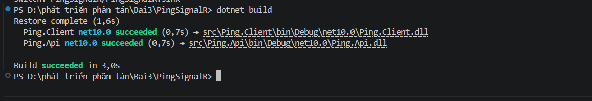
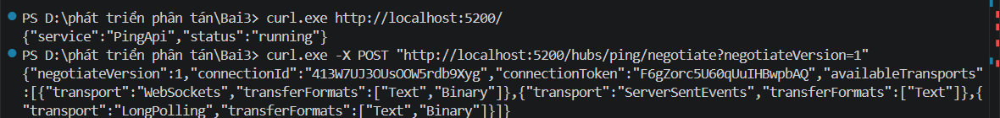
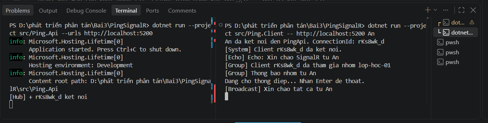
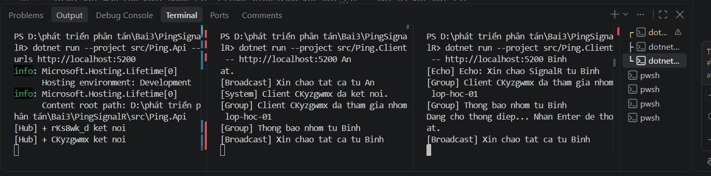
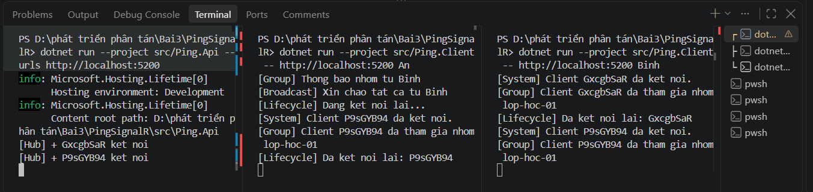
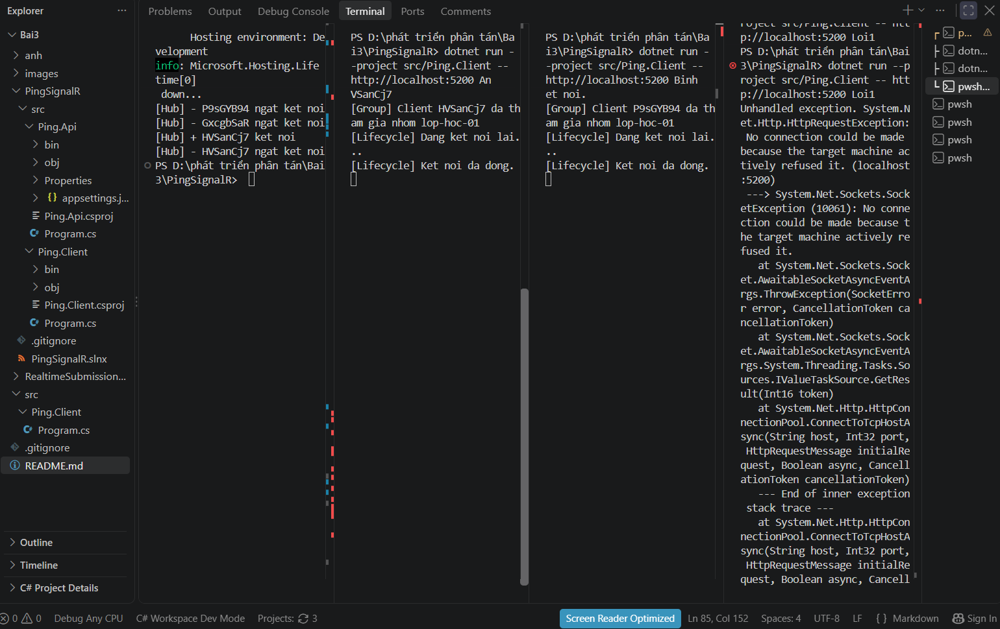
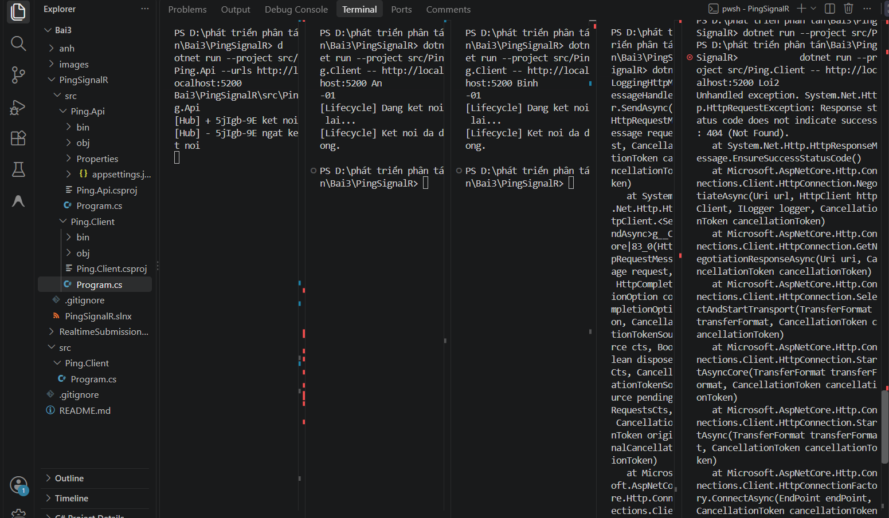
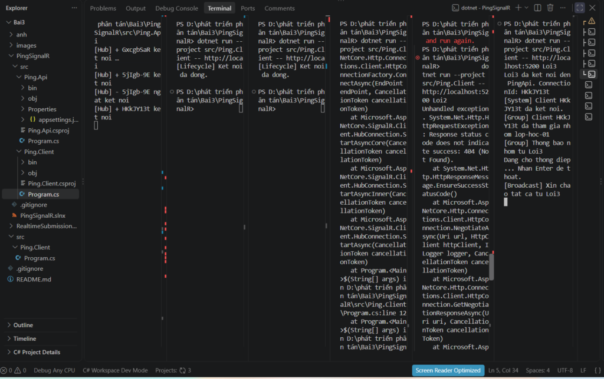
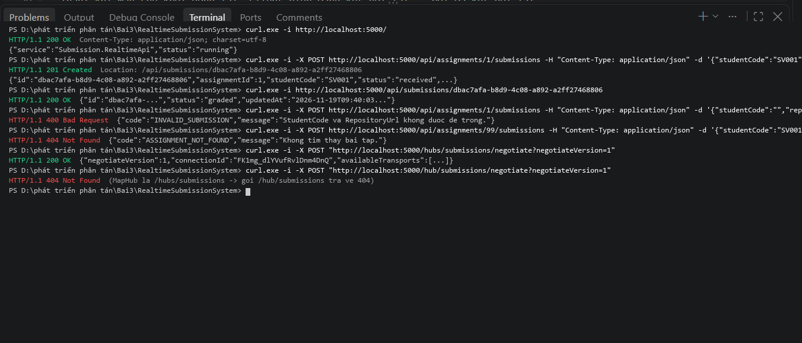
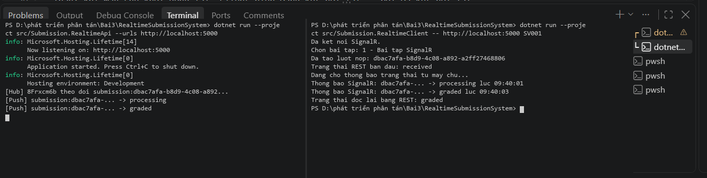

# Bài 3 — SignalR
Họ tên: Vũ Ngọc Anh Thuyên
MSSV: dtc245200428

Làm đến đâu, lưu ảnh vào anh/ và ghi phần tương ứng ở đây đến đó. Ảnh phải là kết quả chạy thật; các mục chưa có ảnh không được tính là hoàn tất.

## Bước 1: build

Thấy: build thành công, không có lỗi.
Giải thích: hai project Ping.Api và Ping.Client đã được restore và biên dịch.

## Bước 2: negotiate

Thấy: curl gọi negotiate và máy chủ trả connectionId.
Giải thích: negotiate bắt tay SignalR và liệt kê các transport máy khách có thể dùng. Ảnh được cắt từ ảnh chụp VS Code bạn gửi để giữ phần terminal có lệnh và kết quả.

## Bước 3–4: Echo

Thấy: máy khách kết nối và nhận dòng [Echo] Echo: Xin chao SignalR.
Giải thích: client gọi Echo trên Hub; Clients.Caller gửi EchoResponse riêng về kết nối đã gọi.

## Bước 5: Group và Broadcast

Thấy: hai máy khách nhận tin Group và Broadcast của nhau, nhưng không nhận Echo của máy khách kia.
Giải thích: Caller chỉ gửi người gọi, Group chỉ gửi thành viên nhóm, All gửi mọi kết nối.

## Bước 6: vòng đời và reconnect

Thấy: khi máy chủ khởi động lại, client hiện Dang ket noi lai... rồi Da ket noi lai.
Giải thích: kết nối mới có ConnectionId mới; client tham gia lại nhóm sau reconnect. Tin gửi lúc mất kết nối có thể bị lỡ.

## Bước 7: ba lỗi cố ý

Thấy: ghi kết quả thật của từng lỗi, kể cả trường hợp không hiện lỗi.
Giải thích: máy chủ tắt từ đầu gây Connection refused; sai hub path gây 404; sai tên event chiều xuống thường im lặng.

## EduSubmit realtime

Thấy: trạng thái đi received → processing → graded.
Giải thích: REST tạo và đọc trạng thái hiện tại; SignalR chỉ báo thay đổi và có thể bị lỡ khi mất kết nối.

## Trả lời ba câu hỏi tổng kết
1. Máy chủ có thể chủ động báo client không? Có, nếu máy khách mở sẵn một kết nối lâu dài (WebSocket qua SignalR). Máy chủ gửi bằng `Clients.Group(...).SendAsync`, dùng `IHubContext` khi ở ngoài hub.
2. REST và SignalR chia việc thế nào? REST tạo, đọc tài nguyên với mã trạng thái rõ ràng (201, 400, 404) và là nguồn sự thật. SignalR đẩy các thay đổi phát sinh sau yêu cầu ban đầu. SignalR không thay thế REST.
3. Nếu client mất kết nối lúc trạng thái chuyển graded? Tin đó bị mất do SignalR không lưu tin; `WithAutomaticReconnect` sẽ tự nối lại với `ConnectionId` mới. Máy khách gọi lại `WatchSubmission(id)` nếu cần, rồi gọi `GET /api/submissions/{id}` qua REST để lấy trạng thái cuối cùng.

## Nhật ký năm thí nghiệm EduSubmit
| Thí nghiệm | Dự đoán | Kết quả / giải thích |
|---|---|---|
| Hai client SV001 và SV002 cùng lúc | Mỗi máy khách chỉ nhận kết quả của mình | Đúng dự đoán. Mỗi máy khách chỉ thấy lượt nộp vừa tạo nhờ nhóm `submission:{id}` tách người nhận, đảm bảo riêng tư và tiết kiệm băng thông. |
| Client chạy khi máy chủ tắt | Báo lỗi không kết nối được | Báo lỗi `HttpRequestException: Connection refused (localhost:5000)`. Lần nối đầu tiên thất bại không được tự thử lại; `WithAutomaticReconnect` chỉ cứu kết nối đã mở. |
| Sai Hub path /hub/submissions | Bị lỗi 404 Not Found | Báo lỗi `HttpRequestException: ... 404 (Not Found)`. Lỗi xảy ra ở bước negotiate; đường dẫn `WithUrl` phải khớp chính xác với `MapHub`. |
| Sai tên event SubmissionStatusChange | Không nhận được thông báo trạng thái | Không có lỗi nào; 10 giây sau báo: `Qua thoi gian cho thong bao graded`. Sai tên chiều xuống = im lặng, không có lỗi ném ra. |
| Gọi Watch sau 4 giây | Bị lỡ thông báo push | Không nhận được tin nào qua SignalR vì máy chủ đã chấm xong; nhưng REST đọc lại vẫn trả `graded`. Vào nhóm muộn là lỡ tin; REST là nguồn sự thật ("Push để nhanh, REST để chắc"). |

## Cách chạy

PingSignalR, tại thư mục Bai3/PingSignalR:
    dotnet build
    dotnet run --project src/Ping.Api --urls http://localhost:5200

Mở terminal khác:
    dotnet run --project src/Ping.Client -- http://localhost:5200 An

EduSubmit, tại thư mục Bai3/RealtimeSubmissionSystem:
    dotnet build
    dotnet run --project src/Submission.RealtimeApi --urls http://localhost:5000

Terminal khác:
    dotnet run --project src/Submission.RealtimeClient -- http://localhost:5000 SV001

## Trước khi nộp
- Chụp ảnh thật cho từng mục còn thiếu và dán ảnh vào README.
- Chạy đủ 9 request trong RealtimeSubmissionSystem/requests.http.
- Ghi kết quả năm thí nghiệm EduSubmit.
- Không đưa bin/ và obj/ vào Git.
- Commit sau từng bước; tối thiểu 8 commit.
- Tiêu đề PR: Bai3 - dtc245200428 - Vũ Ngọc Anh Thuyên.

Task.Delay trong demo chỉ mô phỏng chấm bài; hệ thật cần queue/worker. Triển khai nhiều API instance cần backplane; WatchSubmission cần kiểm tra quyền.