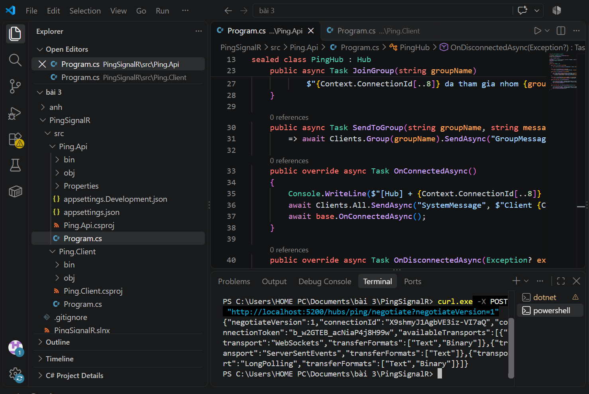
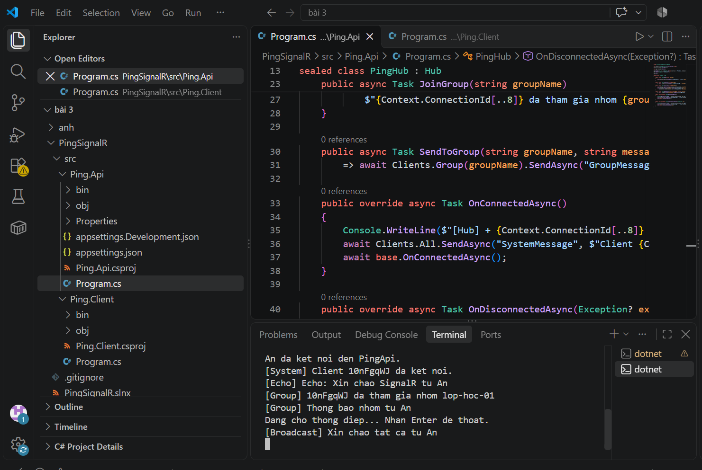
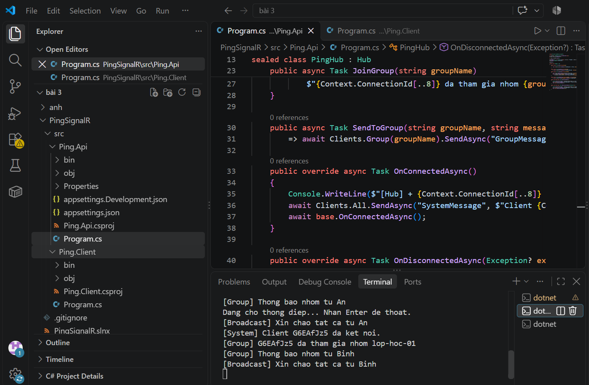
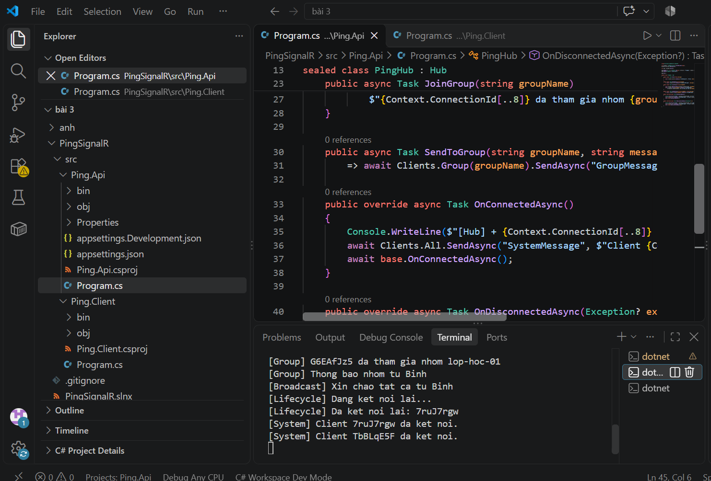
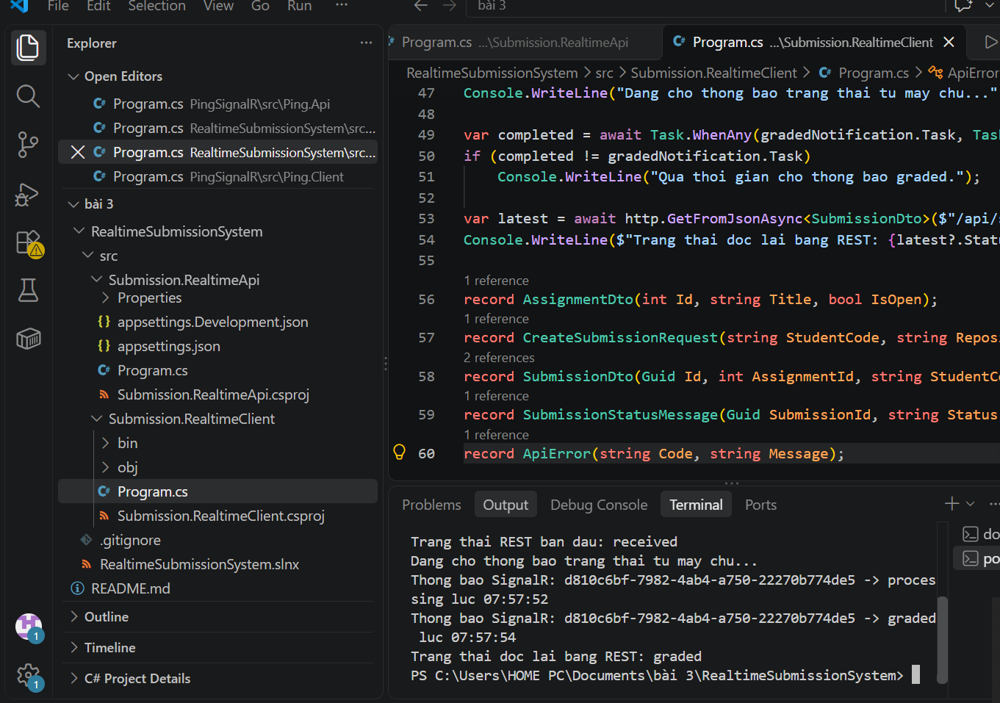

# Bài 3: Giao tiếp thời gian thực với SignalR

## 1. Trả lời 3 câu hỏi đầu giờ
1. **Máy chủ có thể chủ động báo cho máy khách mà không cần máy khách hỏi không?**
   Có, nếu máy khách mở sẵn một kết nối lâu dài (WebSocket qua SignalR)[cite: 65]. Máy chủ gửi tin qua `Clients.Group(...).SendAsync(...)` và dùng `IHubContext` khi gửi từ bên ngoài Hub[cite: 65].
2. **Đã có REST rồi, vì sao còn cần thêm SignalR? Hai thứ chia việc thế nào?**
   REST dùng để tạo và đọc tài nguyên (nguồn sự thật) với mã trạng thái HTTP rõ ràng[cite: 65]. SignalR dùng để đẩy các thay đổi phát sinh sau yêu cầu ban đầu[cite: 65]. SignalR bổ sung chứ không thay thế REST[cite: 65].
3. **Nếu đứt mạng đúng lúc máy chủ báo "đã chấm xong" thì sao?**
   Thông điệp đó bị mất vì SignalR không lưu tin chờ gửi lại[cite: 39, 65]. `WithAutomaticReconnect()` sẽ tự nối lại với một `ConnectionId` mới; máy khách cần gọi lại `WatchSubmission` và gọi `GET /api/submissions/{id}` qua REST để lấy trạng thái cuối cùng[cite: 65].

## 2. Kết quả thực hành
- **PingSignalR Build:** [cite: 23]
- **PingSignalR Negotiate:** [cite: 23]
- **PingSignalR Echo:** [cite: 23]
- **PingSignalR Group & Broadcast:** [cite: 23]
- **PingSignalR Reconnect:** [cite: 23]
- **EduSubmit Client:** [cite: 23]

## 3. Bảng 5 thí nghiệm phân tán (Bước 7 EduSubmit)
| STT | Thí nghiệm | Dự đoán | Kết quả thật | Giải thích |
|---|---|---|---|---|
| 1 | Chạy 2 máy khách SV001 và SV002 cùng lúc | Mỗi người chỉ thấy bài của mình | Mỗi máy khách chỉ nhận thông báo của lượt nộp vừa tạo[cite: 59] | Nhóm `submission:{id}` tách biệt người nhận[cite: 59] |
| 2 | Chạy máy khách khi máy chủ chưa chạy | Báo lỗi không kết nối được | `HttpRequestException: Connection refused (localhost:5000)`[cite: 59] | Lần nối đầu tiên không được tự thử lại[cite: 59] |
| 3 | Sửa `WithUrl` thành `/hub/submissions` | Báo lỗi 404 | `HttpRequestException: 404 (Not Found)`[cite: 59] | Lỗi ngay bước `negotiate` do không khớp `MapHub`[cite: 59] |
| 4 | Sửa `On("SubmissionStatusChanged")` thành `On("SubmissionStatusChange")` | Không nhận được thông báo | Không báo lỗi; sau 10s in `Qua thoi gian cho thong bao graded.`[cite: 59] | Sai tên sự kiện chiều xuống = im lặng[cite: 59] |
| 5 | Chờ 4 giây rồi mới gọi `WatchSubmission` | Bị lỡ thông báo từ server | Không nhận tin SignalR nào; REST đọc lại vẫn ra `graded`[cite: 59] | Vào nhóm muộn là lỡ tin; REST luôn là nguồn sự thật[cite: 59] |