# BÀI 2 – XÂY DỰNG RESTFUL API VÀ HTTP CLIENT (CATALOG API)

**Sinh viên:** Chu Thị Thảo  
**Mã sinh viên:** dtc245200040  
**Môn học:** Phát triển ứng dụng phân tán  

## 1. Giới thiệu bài tập

Bài tập xây dựng hệ thống quản lý danh mục sản phẩm (Catalog API) sử dụng ASP.NET Core Minimal API và C#.

Hệ thống cung cấp các chức năng:
- Kiểm tra trạng thái hoạt động của API.
- Lấy danh sách sản phẩm.
- Lấy thông tin chi tiết sản phẩm theo ID.
- Thêm sản phẩm mới.
- Kiểm tra dữ liệu đầu vào và trả về mã lỗi HTTP phù hợp.
- Xây dựng HTTP Client để gửi request và nhận response từ API.

## 2. Cấu trúc dự án

```text
Bai2/
├── README.md
└── CatalogAPI/
    ├── Catalog.Api/
    │   ├── Program.cs
    │   └── Catalog.Api.csproj
    ├── Catalog.Client/
    │   ├── Program.cs
    │   └── Catalog.Client.csproj
    ├── images/
    │   └── Các ảnh minh chứng
    └── requests.http
```

## 3. Các chức năng của Catalog API

API chạy tại địa chỉ:

`http://localhost:5100`

| Phương thức | Endpoint | Chức năng |
|---|---|---|
| GET | `/` | Kiểm tra trạng thái API |
| GET | `/api/products` | Lấy danh sách sản phẩm |
| GET | `/api/products/{id}` | Lấy sản phẩm theo ID |
| POST | `/api/products` | Tạo sản phẩm mới |

### 3.1. Dữ liệu sản phẩm

Mỗi sản phẩm gồm các thuộc tính:

- `Id`: Mã sản phẩm.
- `Name`: Tên sản phẩm.
- `Description`: Mô tả sản phẩm.
- `Price`: Giá sản phẩm.

API sử dụng các DTO để trao đổi dữ liệu:

- `ProductDto`: Dữ liệu sản phẩm trả về.
- `CreateProductRequest`: Dữ liệu yêu cầu tạo sản phẩm.
- `ApiError`: Cấu trúc thông tin lỗi trả về.

### 3.2. Kiểm tra dữ liệu đầu vào

Khi tạo sản phẩm, API kiểm tra:
- Tên sản phẩm không được để trống.
- Giá sản phẩm phải lớn hơn 0.

Nếu dữ liệu không hợp lệ, API trả về `400 Bad Request` cùng thông tin lỗi dạng JSON.

Nếu thiếu `Content-Type: application/json`, API trả về `415 Unsupported Media Type`.

## 4. Bảng kiểm thử API

Các trường hợp kiểm thử được thực hiện bằng file `requests.http`.

| STT | Phương thức | Endpoint / dữ liệu | Kết quả thực tế |
|---|---|---|---|
| 1 | GET | `/` | 200 OK |
| 2 | GET | `/api/products` | 200 OK |
| 3 | GET | `/api/products/1` | 200 OK |
| 4 | GET | `/api/products/999` | 404 Not Found |
| 5 | GET | `/api/products/abc` | 404 Not Found |
| 6 | POST | `/api/products` – dữ liệu hợp lệ | 201 Created |
| 7 | POST | `/api/products` – giá không hợp lệ | 400 Bad Request |
| 8 | POST | `/api/products` – thiếu Content-Type | 415 Unsupported Media Type |

### 4.1. Kết quả kiểm thử

- `200 OK`: Request được xử lý thành công.
- `201 Created`: Tạo sản phẩm mới thành công và trả về thông tin sản phẩm.
- `400 Bad Request`: Dữ liệu gửi lên không hợp lệ.
- `404 Not Found`: Không tìm thấy tài nguyên hoặc đường dẫn không phù hợp.
- `415 Unsupported Media Type`: Kiểu dữ liệu gửi lên không được hỗ trợ.

## 5. Chương trình Catalog Client

Catalog.Client sử dụng `HttpClient` để giao tiếp với Catalog.Api.

Các thao tác đã thực hiện:

1. Gửi GET để lấy danh sách sản phẩm.
2. Gửi POST với dữ liệu hợp lệ để tạo sản phẩm.
3. Gửi GET để đọc lại sản phẩm vừa tạo.
4. Gửi POST với dữ liệu không hợp lệ và xử lý lỗi HTTP 400.

Client cũng xử lý các tình huống không kết nối được với server thông qua các ngoại lệ như `HttpRequestException` và `TaskCanceledException`.

## 6. Trả lời câu hỏi lý thuyết

### Câu 1. Vì sao URI dùng danh từ, còn hành động do phương thức HTTP đảm nhận?

Trong RESTful API, URI đại diện cho tài nguyên nên thường sử dụng danh từ thay vì động từ. Các hành động trên tài nguyên được thể hiện bằng phương thức HTTP như GET, POST, PUT, PATCH và DELETE.

Ví dụ:

- `GET /api/products`: Lấy danh sách sản phẩm.
- `GET /api/products/1`: Lấy thông tin sản phẩm có ID là 1.
- `POST /api/products`: Tạo sản phẩm mới.

Cách thiết kế này giúp URI nhất quán, dễ hiểu, dễ mở rộng và tuân thủ nguyên tắc REST.

### Câu 2. Stateless thể hiện ở đâu trong code đã viết?

Stateless có nghĩa là server không lưu trạng thái phiên làm việc của client giữa các request. Mỗi request phải chứa đầy đủ thông tin cần thiết để server xử lý độc lập.

Trong Catalog API, các endpoint như:

- `GET /api/products`
- `GET /api/products/{id}`
- `POST /api/products`

được xử lý độc lập. Server không sử dụng session hoặc cookie để ghi nhớ trạng thái của client.

Ví dụ, khi client gửi POST để tạo sản phẩm, request phải cung cấp dữ liệu cần thiết như `Name`, `Description` và `Price`. Server không cần dựa vào trạng thái phiên trước đó của client.

Lưu ý: Danh sách `products` được lưu trong bộ nhớ server là dữ liệu tài nguyên, không phải session của client. Dữ liệu này sẽ được khởi tạo lại khi ứng dụng API khởi động lại. Việc lưu dữ liệu tài nguyên phía server không làm mất tính Stateless của REST.

### Câu 3. Vì sao client và server mỗi bên khai báo DTO riêng mà vẫn khớp nhau?

Client và server có thể khai báo DTO riêng vì hai bên giao tiếp thông qua HTTP và JSON, không phụ thuộc trực tiếp vào class trong bộ nhớ của nhau.

DTO của client và server vẫn tương thích khi:

- Tên các thuộc tính JSON tương ứng với nhau.
- Kiểu dữ liệu của các thuộc tính tương thích.
- Cấu trúc JSON gửi và nhận đúng theo hợp đồng API.
- Hai bên thống nhất định dạng dữ liệu trao đổi.

Ví dụ, server khai báo:

```csharp
record ProductDto(
    int Id,
    string Name,
    string Description,
    decimal Price
);
```

Client có thể khai báo một DTO riêng với các thuộc tính tương ứng như `Id`, `Name`, `Description` và `Price`.

Khi server trả về JSON, client sử dụng `HttpClient` và cơ chế deserialize để chuyển JSON thành DTO của client.

Như vậy, hai bên không cần dùng chung class DTO mà vẫn giao tiếp được nhờ thống nhất cấu trúc JSON và hợp đồng API.

## 7. Công nghệ sử dụng

- C#: Ngôn ngữ lập trình.
- .NET 10: Nền tảng phát triển ứng dụng.
- ASP.NET Core Minimal API: Xây dựng RESTful API.
- HttpClient: Giao tiếp HTTP từ client.
- JSON: Định dạng trao đổi dữ liệu.
- Visual Studio Code: Môi trường chỉnh sửa code.
- REST Client: Gửi và kiểm thử HTTP request trong file `requests.http`.

## 8. Ảnh minh chứng kết quả thực hiện

Các ảnh minh chứng được lưu trong thư mục `CatalogAPI/images/`.

### 8.1. Build dự án API và Client

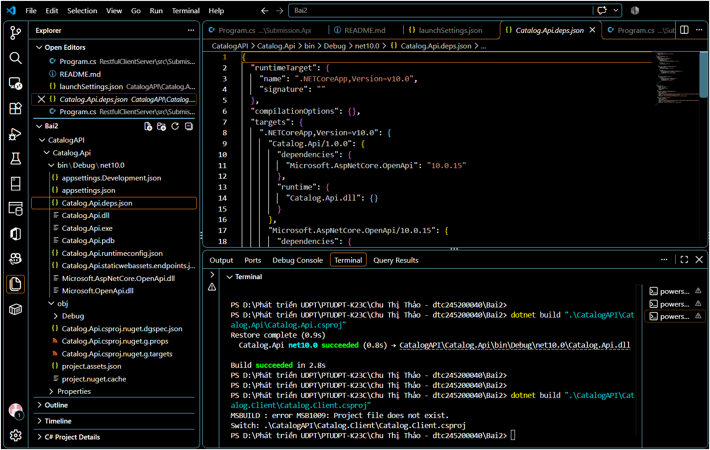

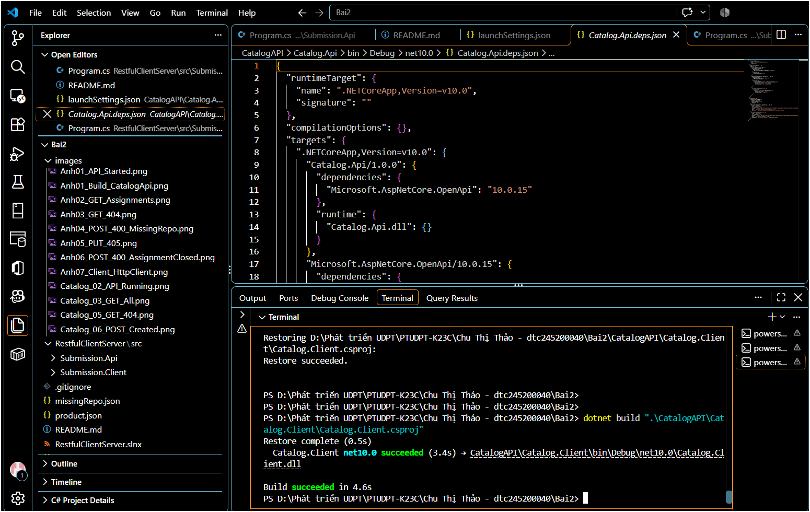

### 8.2. Chạy API và Client

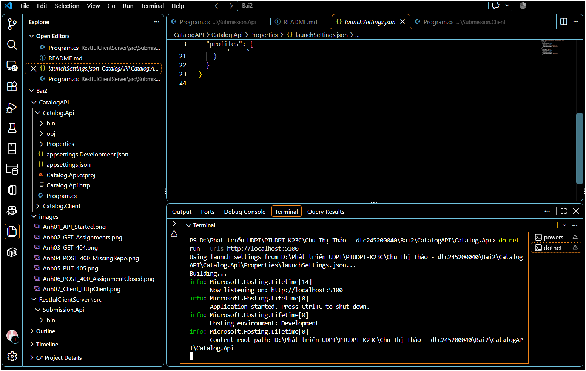

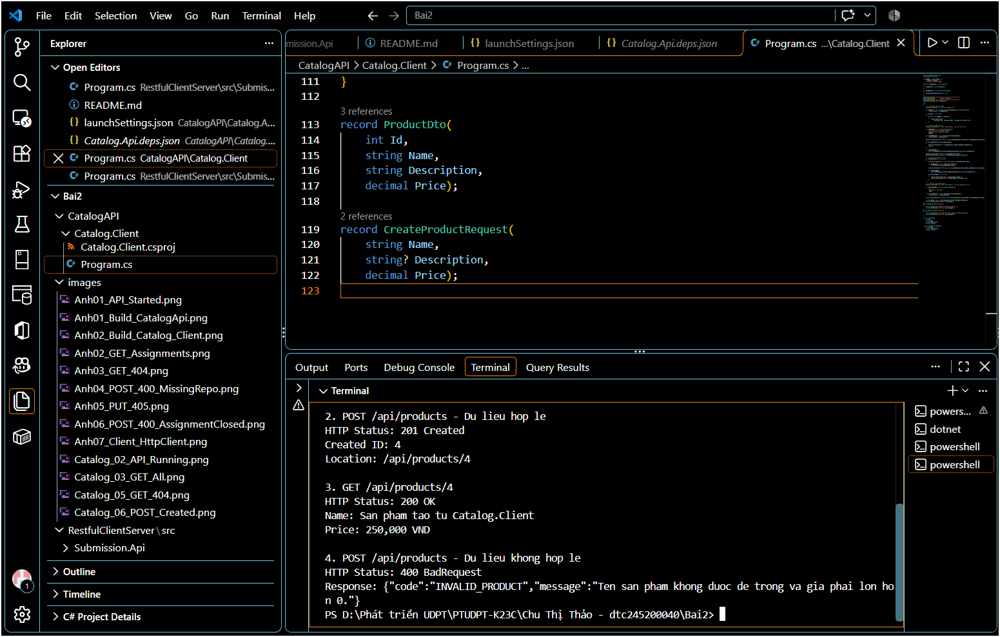

### 8.3. Kiểm thử các endpoint

**Kiểm tra trạng thái API – GET /**

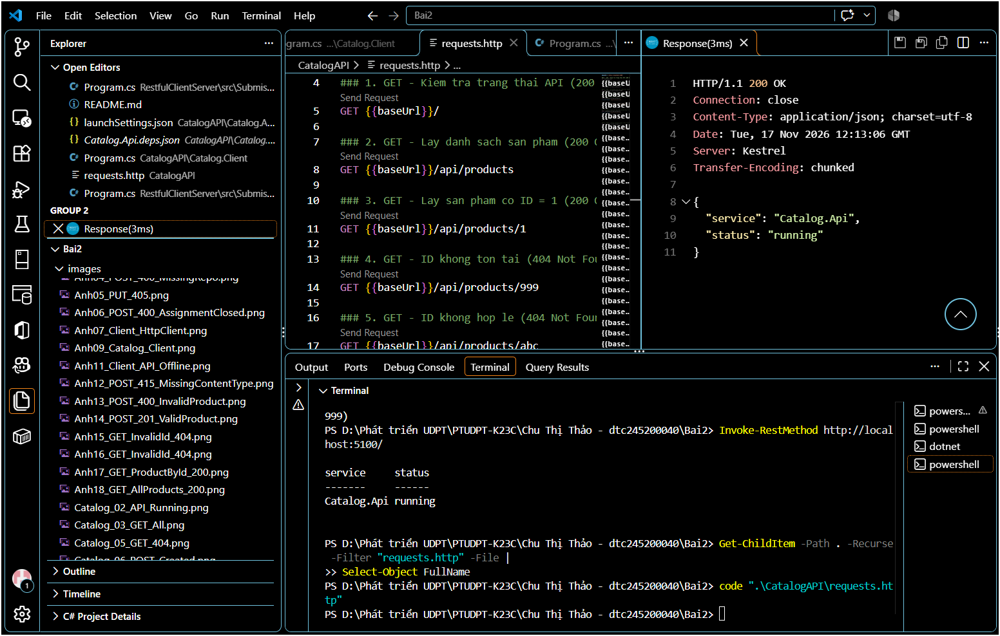

**Lấy danh sách sản phẩm – GET /api/products**

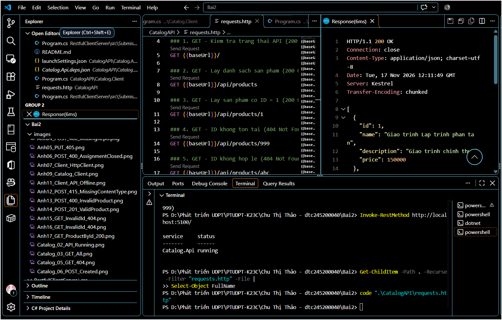

**Lấy sản phẩm theo ID – GET /api/products/1**

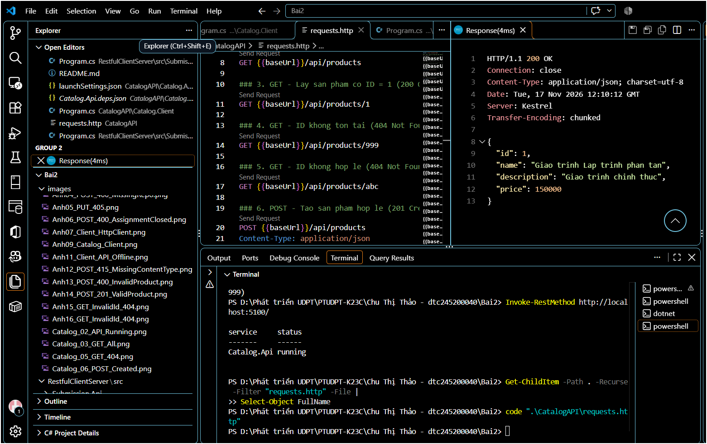

**Kiểm thử trường hợp GET trả về 404**

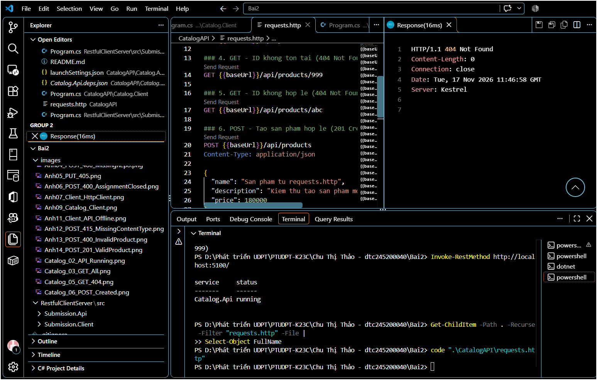

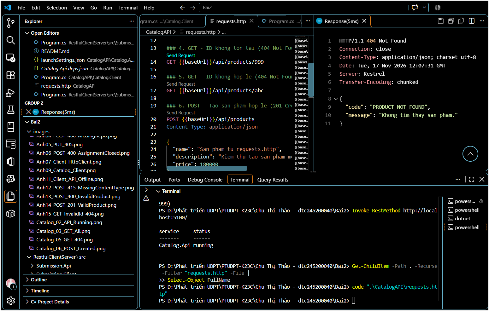

**POST thiếu Content-Type – 415 Unsupported Media Type**

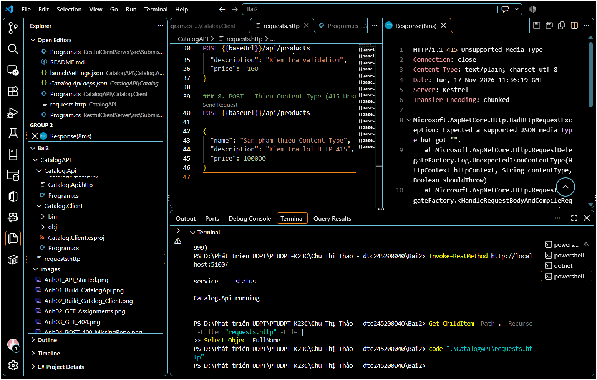

**POST dữ liệu không hợp lệ – 400 Bad Request**

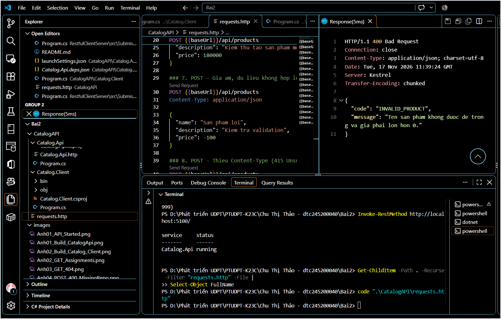

**POST dữ liệu hợp lệ – 201 Created**

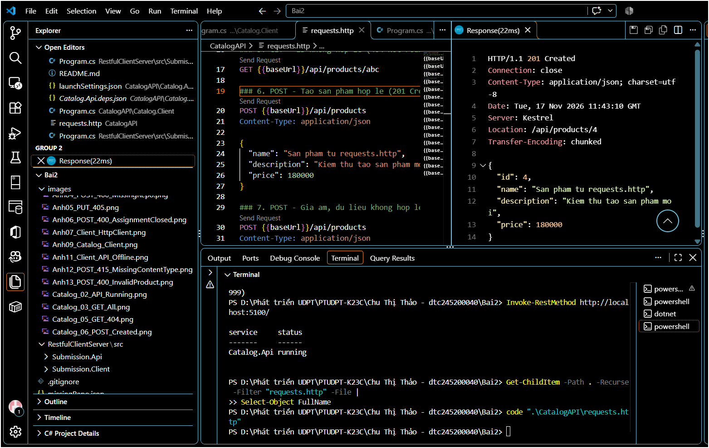

### 8.4. Kiểm thử xử lý lỗi kết nối Client – Server

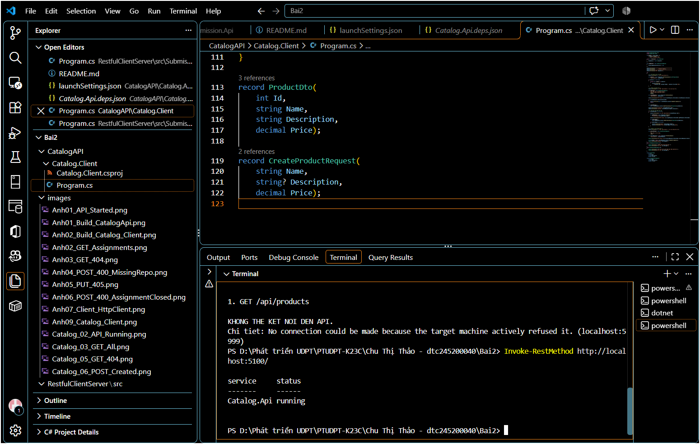

## 9. Hướng dẫn chạy chương trình

### 9.1. Yêu cầu môi trường

- .NET SDK 10.0 trở lên.
- Windows PowerShell.
- Visual Studio Code.
- Extension REST Client nếu muốn gửi request trực tiếp từ `requests.http`.

### 9.2. Chạy Catalog.Api

Mở Terminal PowerShell tại thư mục `Bai2`:

```powershell
dotnet run --project ".\CatalogAPI\Catalog.Api" --urls "http://localhost:5100"
```

Khi API khởi động thành công, có thể kiểm tra:

- `http://localhost:5100/`
- `http://localhost:5100/api/products`

Giữ Terminal này hoạt động trong khi kiểm thử.

### 9.3. Chạy Catalog.Client

Mở Terminal PowerShell thứ hai tại thư mục `Bai2`:

```powershell
dotnet run --project ".\CatalogAPI\Catalog.Client"
```

Client sẽ thực hiện các thao tác GET, POST và xử lý phản hồi từ API.

### 9.4. Kiểm thử bằng requests.http

Mở file:

`CatalogAPI/requests.http`

Sử dụng REST Client trong Visual Studio Code để gửi lần lượt 8 request và xem kết quả phản hồi HTTP.

## 10. Kết luận

Qua bài tập, em đã xây dựng được RESTful API quản lý sản phẩm bằng ASP.NET Core Minimal API, sử dụng các phương thức HTTP để thao tác với tài nguyên.

Đồng thời, em đã xây dựng HTTP Client bằng `HttpClient` để gửi request, nhận response, xử lý dữ liệu JSON và kiểm tra các trường hợp lỗi.

Bài tập giúp củng cố kiến thức về RESTful API, HTTP, DTO, Stateless, kiểm tra dữ liệu đầu vào và giao tiếp giữa Client và Server.