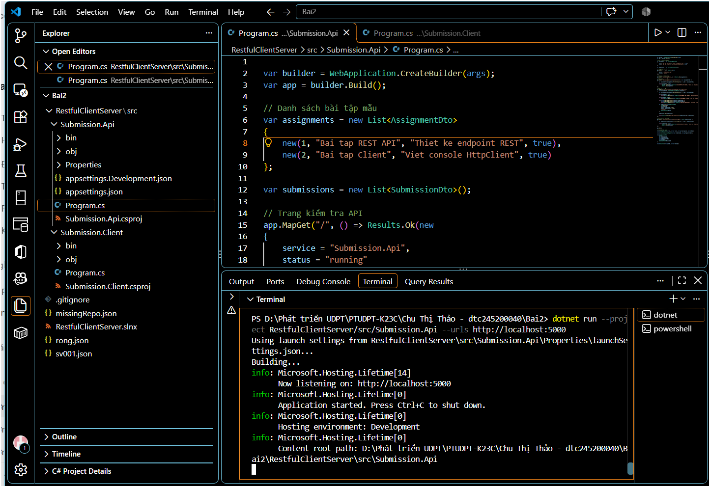
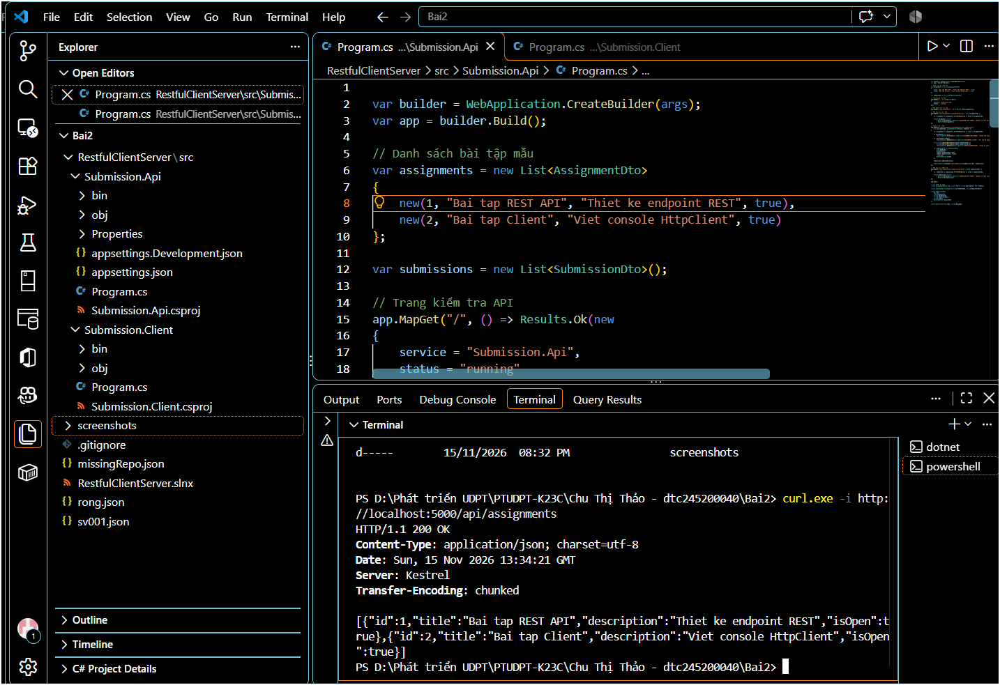
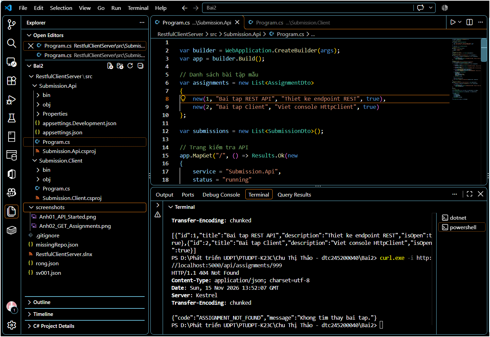
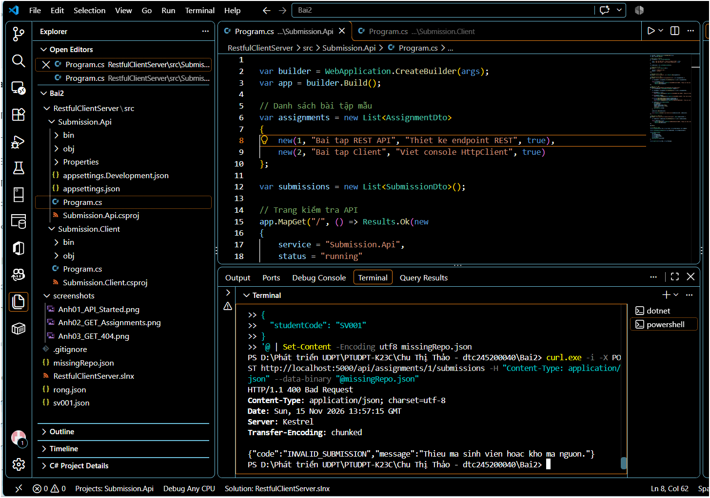
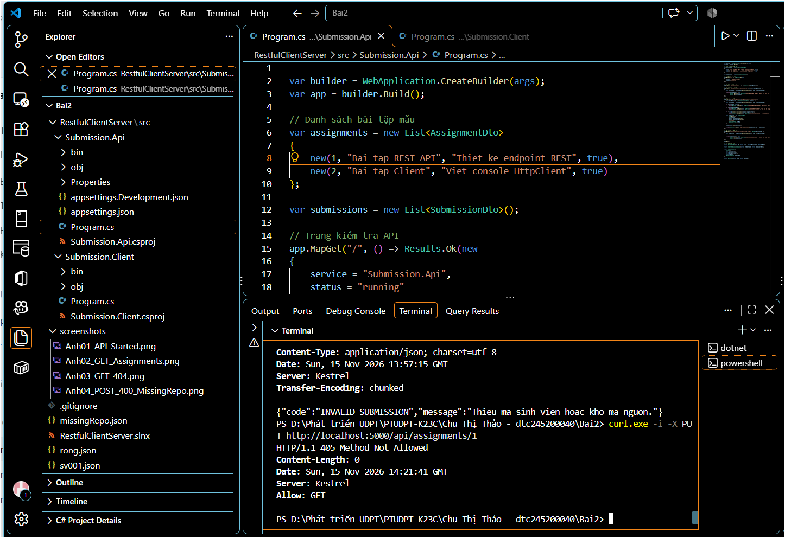
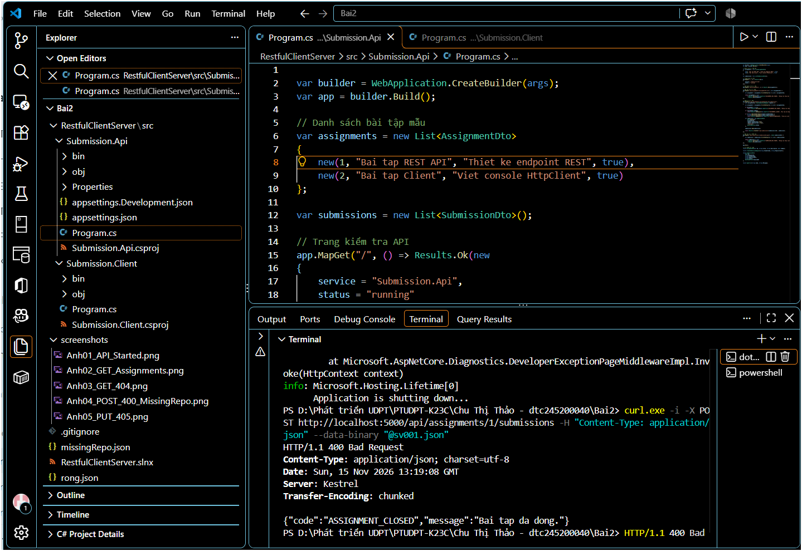
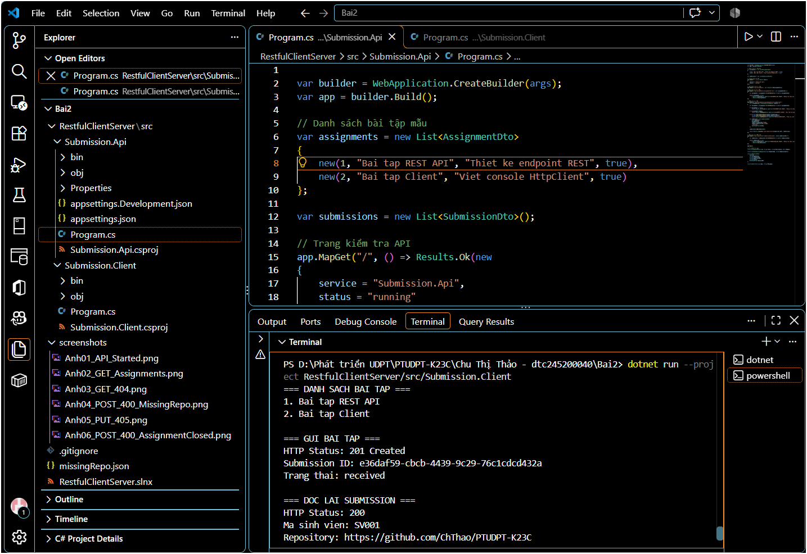

# BÀI 2 – RESTful API

**Sinh viên:** Chu Thị Thảo  
**Mã sinh viên:** dtc245200040  
**Môn học:** Phát triển ứng dụng phân tán  

## 1. Câu 1. Vì sao URI dùng danh từ, còn hành động do phương thức HTTP đảm nhận?

Trong RESTful API, URI được thiết kế để đại diện cho tài nguyên, vì vậy URI thường sử dụng danh từ thay vì động từ. Các hành động trên tài nguyên được thể hiện thông qua phương thức HTTP như GET, POST, PUT, PATCH và DELETE.

Ví dụ:

- `GET /api/assignments`: Lấy danh sách bài tập.
- `GET /api/assignments/1`: Lấy thông tin bài tập có ID là 1.
- `POST /api/assignments/1/submissions`: Gửi bài nộp cho bài tập có ID là 1.

Cách thiết kế này giúp URI nhất quán, dễ hiểu, dễ mở rộng và tuân thủ nguyên tắc REST.

## 2. Câu 2. Stateless thể hiện ở đâu trong code đã viết?

Stateless có nghĩa là server không lưu trạng thái phiên làm việc của client giữa các request. Mỗi request phải chứa đầy đủ thông tin cần thiết để server xử lý độc lập.

Trong code đã viết, tính Stateless thể hiện ở các endpoint như:

- `GET /api/assignments`
- `GET /api/assignments/{assignmentId}`
- `POST /api/assignments/{assignmentId}/submissions`

Server không sử dụng session hoặc cookie để ghi nhớ trạng thái client. Mỗi request được xử lý dựa trên dữ liệu request và tài nguyên hiện có trên server.

Ví dụ, khi client gửi POST để nộp bài, request phải cung cấp `StudentCode` và `RepositoryUrl` để server xử lý. Server không cần dựa vào trạng thái phiên trước đó của client.

Lưu ý: Danh sách `assignments` và `submissions` trong code là dữ liệu tài nguyên phía server, không phải session của client. Việc lưu dữ liệu này không làm mất tính Stateless của giao thức REST.

## 3. Câu 3. Vì sao client và server mỗi bên khai báo DTO riêng mà vẫn khớp nhau?

Client và server có thể khai báo DTO riêng vì hai bên giao tiếp với nhau thông qua HTTP và JSON, không phụ thuộc trực tiếp vào class trong bộ nhớ của nhau.

DTO của client và server vẫn tương thích khi:

- Tên các thuộc tính JSON tương ứng với nhau.
- Kiểu dữ liệu của các thuộc tính tương thích.
- Cấu trúc JSON gửi và nhận đúng theo hợp đồng API.
- Client và server thống nhất về định dạng dữ liệu trao đổi.

Ví dụ, server khai báo:

`record AssignmentDto(int Id, string Title, string Description, bool IsOpen);`

Client có thể khai báo một DTO tương ứng với các thuộc tính `Id`, `Title`, `Description`, `IsOpen`.

Khi server trả về JSON, client sử dụng `HttpClient` và cơ chế deserialize để chuyển JSON thành DTO của client.

Như vậy, hai bên không cần dùng chung class DTO mà vẫn giao tiếp được nhờ thống nhất cấu trúc JSON và hợp đồng API.


## 4. Bảng kiểm thử API

| STT | Phương thức | Endpoint | Kết quả mong đợi | Kết quả thực tế |
|---|---|---|---|---|
| 1 | GET | `/` | 200 OK | 200 OK |
| 2 | GET | `/api/assignments` | 200 OK | 200 OK |
| 3 | GET | `/api/assignments/999` | 404 Not Found | 404 Not Found |
| 4 | POST | `/api/assignments/1/submissions` (dữ liệu hợp lệ) | 201 Created | 201 Created |
| 5 | POST | `/api/assignments/1/submissions` (thiếu dữ liệu) | 400 Bad Request | 400 Bad Request |
| 6 | POST | `/api/assignments/999/submissions` | 404 Not Found | 404 Not Found |
| 7 | POST | `/api/assignments/1/submissions` (thiếu Content-Type) | 415 Unsupported Media Type | 415 Unsupported Media Type |
| 8 | PUT | `/api/assignments/1` | 405 Method Not Allowed | 405 Method Not Allowed |
| 9 | POST | `/api/assignments/1/submissions` (bài tập đóng) | 400 Bad Request | 400 Bad Request |

## 5. Công nghệ sử dụng

- C#: Ngôn ngữ lập trình.
- ASP.NET Core Minimal API: Xây dựng RESTful API.
- HttpClient: Giao tiếp HTTP từ client.
- JSON: Định dạng trao đổi dữ liệu.
- Visual Studio Code: Môi trường chỉnh sửa code.

## 6. Ảnh minh chứng kết quả chạy thực tế

### 6.1. Khởi động API



### 6.2. GET danh sách bài tập – 200 OK



### 6.3. GET bài tập không tồn tại – 404 Not Found



### 6.4. POST thiếu RepositoryUrl – 400 Bad Request



### 6.5. PUT không được hỗ trợ – 405 Method Not Allowed



### 6.6. POST bài tập đã đóng – 400 Bad Request



### 6.7. Client HttpClient gửi và nhận dữ liệu



## 7. Hướng dẫn chạy chương trình

### 7.1. Yêu cầu môi trường

- .NET SDK 10.0 trở lên.
- Windows PowerShell.
- Git.

### 7.2. Chạy Submission.Api

Mở Terminal tại thư mục gốc repository:

```powershell
dotnet run --project "Chu Thị Thảo - dtc245200040/Bai2/RestfulClientServer/src/Submission.Api" --urls http://localhost:5000
```

Khi API khởi động thành công, truy cập:

- `http://localhost:5000/`
- `http://localhost:5000/api/assignments`

### 7.3. Chạy Submission.Client

Mở Terminal PowerShell thứ hai tại thư mục gốc repository:

```powershell
dotnet run --project "Chu Thị Thảo - dtc245200040/Bai2/RestfulClientServer/src/Submission.Client"
```

Client sẽ thực hiện:
- Lấy danh sách bài tập.
- Gửi bài nộp thông qua HTTP POST.
- Đọc lại thông tin submission.
- Kiểm thử dữ liệu không hợp lệ.