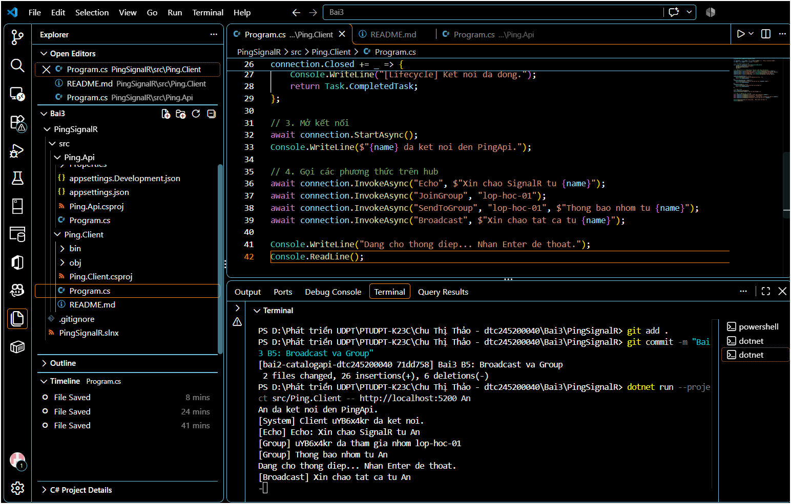
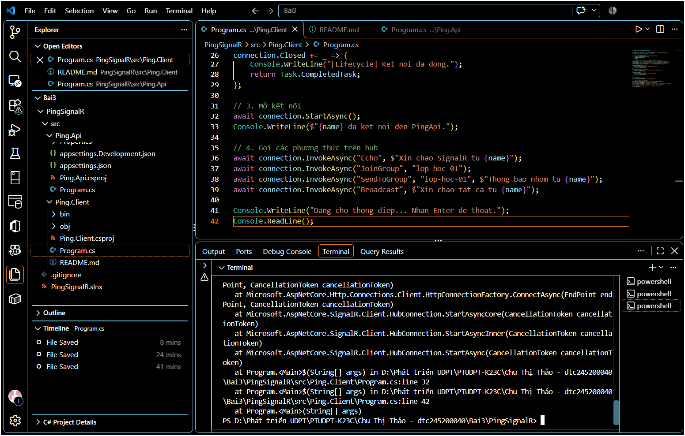
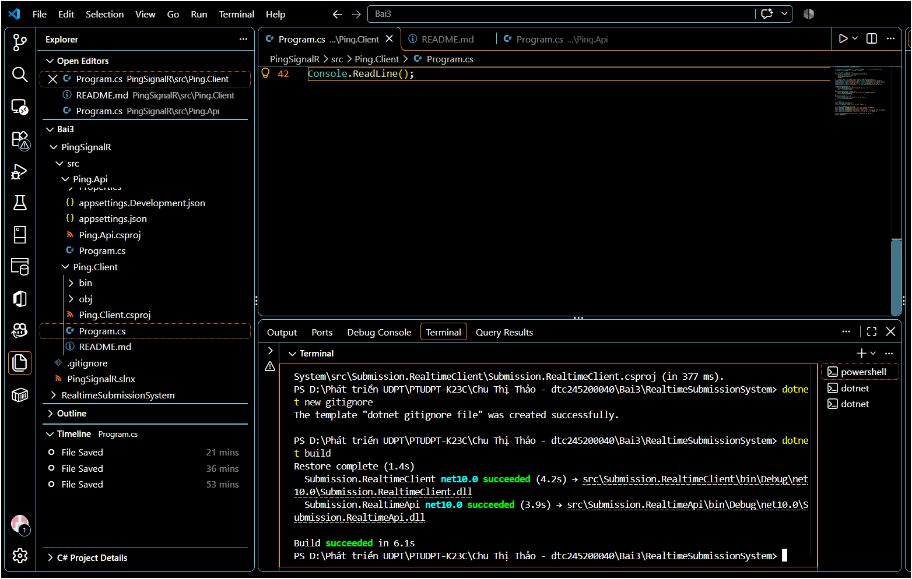
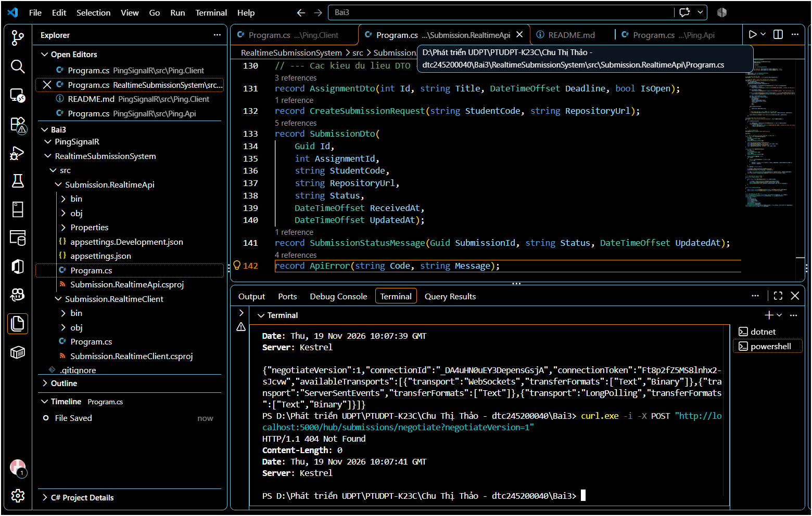
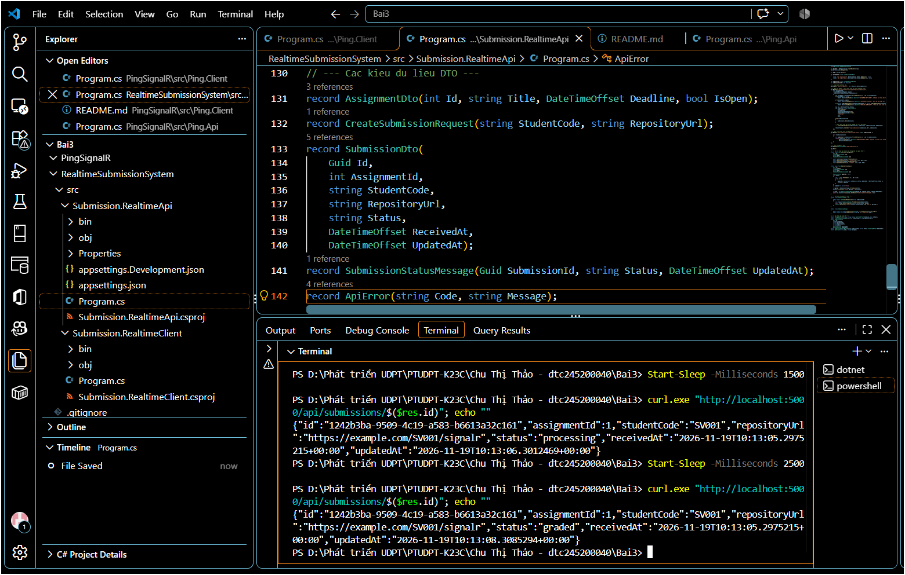
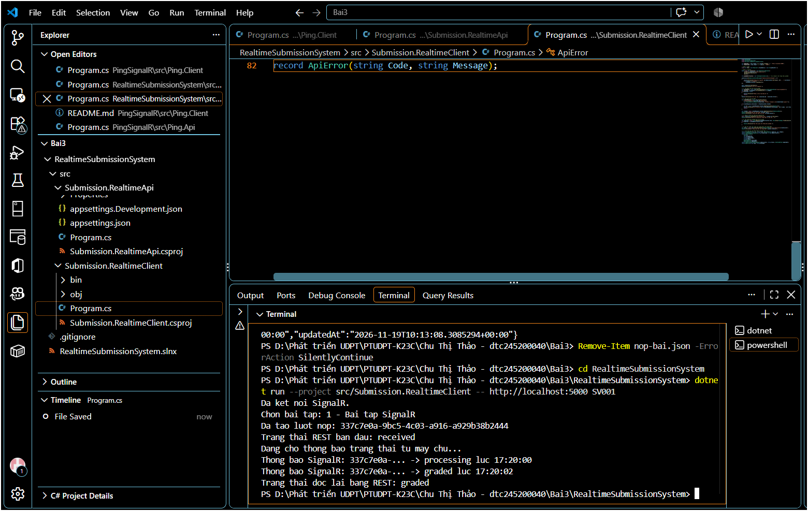
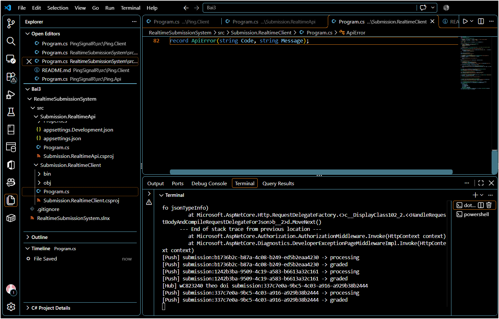

# Bài 3: Lập trình Thời gian thực với ASP.NET Core SignalR

- **Họ và tên:** Chu Thị Thảo
- **Mã sinh viên:** dtc245200040
- **Lớp:** PTUDPT-K23C

---

## Phần 2: Thực hành PingSignalR (Bước 1 – Bước 7)

### 1. Các phạm vi gửi thông điệp trong SignalR Hub
| Phạm vi gửi | Cú pháp trên Hub | Đối tượng nhận thông điệp |
| :--- | :--- | :--- |
| **Tất cả máy khách** | `Clients.All.SendAsync(...)` | Toàn bộ các kết nối đang mở tới Hub. |
| **Người gọi hiện tại** | `Clients.Caller.SendAsync(...)` | Chỉ duy nhất kết nối vừa gọi phương thức Hub. |
| **Theo nhóm** | `Clients.Group(groupName).SendAsync(...)` | Tất cả kết nối đã tham gia nhóm qua `Groups.AddToGroupAsync(...)`. |
| **Một kết nối cụ thể** | `Clients.Client(connectionId).SendAsync(...)` | Duy nhất kết nối có `ConnectionId` được chỉ định. |

### 2. Kiểm thử vòng đời kết nối & Tự động nối lại (Bước 6)
- Sử dụng `.WithAutomaticReconnect()` trên `HubConnectionBuilder`.
- Khi máy chủ tạm ngắt, máy khách kích hoạt sự kiện `Reconnecting`. Khi máy chủ bật lại, máy khách tự động kết nối lại và kích hoạt sự kiện `Reconnected` với `ConnectionId` mới.
- **Minh chứng tự động nối lại:**
  

### 3. Thí nghiệm xử lý lỗi thường gặp (Bước 7)
1. **Lỗi 1 — Máy chủ chưa chạy (`Connection refused`):**
   - Chạy máy khách khi máy chủ chưa khởi động gây ra ngoại lệ `HttpRequestException: No connection could be made because the target machine actively refused it`.
   - 
2. **Lỗi 2 — Sai đường dẫn Hub (`/hub/ping` thay vì `/hubs/ping`):**
   - Máy chủ trả về mã lỗi HTTP `404 Not Found` ngay tại bước thương lượng (`negotiate`).
   - 
3. **Lỗi 3 — Sai tên sự kiện lắng nghe (`EchoRespone` thay vì `EchoResponse`):**
   - Kết nối và gọi Hub vẫn thành công không báo lỗi ngoại lệ, nhưng hàm callback không bao giờ được kích hoạt nên không hiển thị dòng `[Echo]`.
   - 

---

## Phần 3: Tích hợp SignalR vào hệ thống nộp bài (`RealtimeSubmissionSystem`)

### 1. Kiến trúc kết hợp REST và SignalR
- **REST API (`HttpClient`):** Dùng cho các thao tác nghiệp vụ cần xác nhận chắc chắn và đọc trạng thái chuẩn (`GET /api/assignments`, `POST /api/assignments/{id}/submissions`, `GET /api/submissions/{id}`).
- **SignalR Hub (`/hubs/submissions`):** Hub mỏng chỉ làm nhiệm vụ đưa kết nối vào nhóm riêng theo từng lượt nộp (`WatchSubmission(submissionId)` -> nhóm `submission:{id}`), đảm bảo **riêng tư dữ liệu** cho từng sinh viên và **tiết kiệm băng thông** thay vì phát tán `Clients.All`[cite: 5].
- **Tác vụ nền (`IHubContext<SubmissionHub>`):** Khi nhận `POST`, máy chủ lưu trạng thái `received` (có dùng `lock` đồng bộ đa luồng), trả ngay `201 Created` và chạy nền `SimulateGradingAsync` để cập nhật dữ liệu trước rồi mới đẩy thông báo `SubmissionStatusChanged` tới đúng nhóm (`processing` -> `graded`)[cite: 6, 7].

### 2. Minh chứng thực thi Phần 3
- **Bước 1 — Khởi tạo solution & kiểm tra biên dịch (`Build succeeded, 0 Error(s)`)[cite: 2]:**
  

- **Bước 3 — Kiểm tra thương lượng kết nối Hub (`negotiate` trả `200 OK` vs `404 Not Found`)[cite: 4]:**
  

- **Bước 4 — Kiểm tra luồng đổi trạng thái qua REST (`received` -> `processing` -> `graded`)[cite: 8]:**
  

- **Bước 6 — Kết quả chạy thực tế Máy khách & Máy chủ đồng bộ REST + SignalR[cite: 11]:**
  - **Terminal Máy khách (`Submission.RealtimeClient`):** Nhận 2 thông báo đẩy `processing` và `graded` cách nhau ~2 giây qua SignalR và đọc chốt trạng thái cuối qua REST[cite: 11].
    
  - **Terminal Máy chủ (`Submission.RealtimeApi`):** Ghi nhận đăng ký nhóm `[Hub]` và đẩy thông báo `[Push]` theo đúng trình tự[cite: 11].
    

    ---

## 1. Trả lời 3 câu hỏi kiến trúc đầu giờ
1. **Dữ liệu tối thiểu cần đẩy qua SignalR là gì?**
   - Chỉ đẩy thông tin gọn nhẹ vừa đủ để thông báo thay đổi trạng thái (`SubmissionId`, `Status`, `UpdatedAt`), không nhồi toàn bộ dữ liệu lớn của bài nộp; khi cần chi tiết đầy đủ, máy khách đọc lại qua REST.
2. **Thứ tự lưu dữ liệu và đẩy thông báo như thế nào?**
   - **Lưu trước, đẩy sau:** Máy chủ phải cập nhật trạng thái vào bộ nhớ/CSDL (trong khối `lock`) trước rồi mới gọi `SendAsync(...)` đẩy thông báo ra Hub để đảm bảo khi máy khách nhận tin và gọi REST đọc lại sẽ luôn thấy dữ liệu mới nhất.
3. **Phạm vi người nhận thông báo được tổ chức ra sao?**
   - Chia nhóm riêng theo từng lượt nộp (`submission:{id}` qua `Groups.AddToGroupAsync`) thay vì `Clients.All`, giúp đảm bảo tính riêng tư (sinh viên chỉ nhận kết quả bài của mình) và tiết kiệm băng thông mạng.

---

## 2. Kết quả chạy thực tế Máy khách (`Submission.RealtimeClient` - 8 dòng)

```text
Da ket noi SignalR.
Chon bai tap: 1 - Bai tap SignalR
Da tao luot nop: 337c7e0a-9bc5-4c03-a916-a929b38b2444
Trang thai REST ban dau: received
Dang cho thong bao trang thai tu may chu...
Thong bao SignalR: 337c7e0a-... -> processing luc 17:20:00
Thong bao SignalR: 337c7e0a-... -> graded luc 17:20:02
Trang thai doc lai bang REST: graded