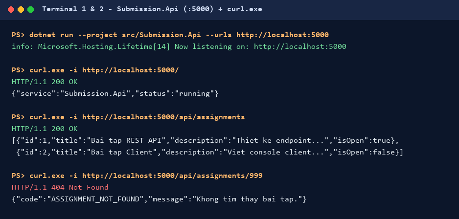
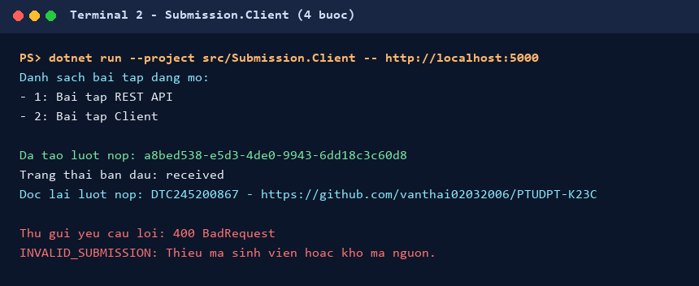
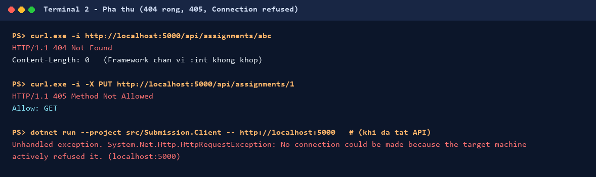

# BÁO CÁO THỰC HÀNH: XÂY DỰNG HỆ THỐNG RESTFUL CLIENT–SERVER (`RestfulClientServer`)

* **Sinh viên thực hiện:** Cấn Văn Thái
* **Mã sinh viên:** DTC245200867
* **Lớp:** CNTTK23C
* **Môn học:** Phát triển ứng dụng phân tán

---

## 1. Cấu trúc giải pháp (Solution)

```text
RestfulClientServer/
├── RestfulClientServer.slnx
├── .gitignore
├── requests.http
├── README.md
└── src/
    ├── Submission.Api/       (Máy chủ ASP.NET Core Minimal API - cổng 5000)
    └── Submission.Client/    (Máy khách Console dùng HttpClient)
```

---

## 2. Nhật ký lệnh khởi tạo và vận hành

### Bước 1: Khởi tạo Solution, hai Project con và `.gitignore`

```powershell
mkdir RestfulClientServer ; cd RestfulClientServer
dotnet new sln -n RestfulClientServer
dotnet new web -n Submission.Api -o src/Submission.Api
dotnet new console -n Submission.Client -o src/Submission.Client
dotnet sln add src/Submission.Api/Submission.Api.csproj
dotnet sln add src/Submission.Client/Submission.Client.csproj
dotnet new gitignore
dotnet build
```

### Bước 2: Chạy đồng thời hai tiến trình độc lập

* **Terminal 1 (Máy chủ API cố định cổng 5000):**
  ```powershell
  dotnet run --project src/Submission.Api --urls http://localhost:5000
  ```

* **Terminal 2 (Máy khách Console gọi chuỗi 4 bước):**
  ```powershell
  dotnet run --project src/Submission.Client -- http://localhost:5000
  ```

* **Kết quả đầu ra thực tế từ `Submission.Client`:**
  ```text
  Danh sach bai tap dang mo:
  - 1: Bai tap REST API
  - 2: Bai tap Client

  Da tao luot nop: 05223a23-5408-4c8a-8784-4ab8b4898998
  Trang thai ban dau: received
  Doc lai luot nop: DTC245200867 - [https://github.com/vanthai02032006/PTUDPT-K23C](https://github.com/vanthai02032006/PTUDPT-K23C)

  Thu gui yeu cau loi: 400 BadRequest
  INVALID_SUBMISSION: Thieu ma sinh vien hoac kho ma nguon.
  ```

## 3. Ảnh kết quả chạy thực tế

### 3.1. Khởi động máy chủ `Submission.Api` (:5000) và kiểm thử bằng `curl.exe`



### 3.2. Chạy máy khách `Submission.Client` (chuỗi 4 bước)



### 3.3. Phá thử (404 rỗng, 405 Method Not Allowed, tắt API)



---

## 4. Bảng tổng hợp các ca kiểm thử (`requests.http`) và Bảng phá thử

### Bảng các ca kiểm thử (`requests.http`)

| STT | Ca kiểm thử | Phương thức & Đường dẫn | Mã phản hồi | Bên trả về | Kết quả / Mã lỗi (`ApiError`) |
| :-: | :--- | :--- | :---: | :--- | :--- |
| 1 | Kiểm tra trạng thái máy chủ | `GET /` | `200 OK` | Handler | `{"service":"Submission.Api","status":"running"}` |
| 2 | Lấy danh sách bài tập | `GET /api/assignments` | `200 OK` | Handler | Danh sách 2 bài tập mẫu (`Id = 1, 2`) |
| 3 | Xem chi tiết bài tập tồn tại | `GET /api/assignments/1` | `200 OK` | Handler | Thông tin chi tiết bài tập 1 |
| 4 | Bài tập không tồn tại | `GET /api/assignments/999` | `404 Not Found` | Handler | `ASSIGNMENT_NOT_FOUND` |
| 5 | Tham số tuyến sai kiểu `int` | `GET /api/assignments/abc` | `404 Not Found` | Framework | Body rỗng (không khớp route constraint `:int`) |
| 6 | Nộp bài hợp lệ vào bài 1 | `POST /api/assignments/1/submissions` | `201 Created` | Handler | Kèm header `Location: /api/submissions/{id}` |
| 7 | Đọc lại lượt nộp vừa tạo | `GET /api/submissions/{id}` | `200 OK` | Handler | Trả về đúng `SubmissionDto` vừa nộp |
| 8 | Nộp thiếu mã SV / link repo | `POST /api/assignments/1/submissions` | `400 Bad Request` | Handler | `INVALID_SUBMISSION` |
| 9 | Nộp vào bài tập đã đóng (`IsOpen = false`) | `POST /api/assignments/2/submissions` | `400 Bad Request` | Handler | `ASSIGNMENT_CLOSED` |
| 10 | Gửi JSON thiếu header `Content-Type` | `POST /api/assignments/1/submissions` | `415 Unsupported Media Type` | Framework | Body rỗng |

### Bảng phá thử (theo slide Phần 3)

| STT | Ca thử | Mong đợi | Thực tế |
| :-: | :--- | :--- | :--- |
| 1 | `GET /api/assignments/999` (4b - Id không tồn tại) | `404 Not Found` kèm `ApiError` (`ASSIGNMENT_NOT_FOUND`) | Đúng `404 Not Found` + `{"code":"ASSIGNMENT_NOT_FOUND","message":"Khong tim thay bai tap."}` (Handler trả). |
| 2 | `GET /api/assignments/abc` (4c - sai kiểu `:int`) | `404 Not Found` body rỗng (`Content-Length: 0`) | Đúng `404 Not Found`, `Content-Length: 0` (Framework chặn trước khi vào handler). |
| 3 | `POST /api/assignments/1/submissions` thiếu dữ liệu (5b / 5f) | `400 Bad Request` kèm `ApiError` (`INVALID_SUBMISSION`) | Đúng `400 Bad Request` + `INVALID_SUBMISSION` (Handler trả). |
| 4 | `POST /api/assignments/999/submissions` (5c - bài tập cha không tồn tại) | `404 Not Found` kèm `ApiError` (`ASSIGNMENT_NOT_FOUND`) | Đúng `404 Not Found` + `ASSIGNMENT_NOT_FOUND` (Handler trả). |
| 5 | `POST /api/assignments/2/submissions` (5h - bài tập đã đóng `IsOpen = false`) | `400 Bad Request` kèm `ApiError` (`ASSIGNMENT_CLOSED`) | Đúng `400 Bad Request` + `ASSIGNMENT_CLOSED` (Handler trả). |
| 6 | `POST /api/assignments/1/submissions` thiếu `Content-Type` (5d) | `415 Unsupported Media Type` | Đúng `415 Unsupported Media Type`, body rỗng (Framework trả). |
| 7 | `PUT /api/assignments/1` (5g - sai phương thức HTTP) | `405 Method Not Allowed`, header `Allow: GET` | Đúng `405 Method Not Allowed`, `Allow: GET` (Framework trả). |
| 8 | Tắt `Submission.Api` rồi chạy `Submission.Client` (7a) | Lỗi mạng `Connection refused` (`localhost:5000`) | Đúng: `HttpRequestException: No connection could be made... (localhost:5000)`. |

---

## 5. Trả lời ba câu hỏi thảo luận

### 1. Vì sao URI dùng danh từ, còn hành động do phương thức HTTP đảm nhận?
Trong kiến trúc RESTful, URI đại diện cho **tài nguyên** (ví dụ `/api/assignments`, `/api/submissions`), do đó sử dụng danh từ số nhiều để định danh đối tượng thay vì động từ. Các hành động thao tác trên tài nguyên được chuẩn hóa bằng **phương thức HTTP** (`GET` để đọc, `POST` để tạo mới, `PUT` để cập nhật, `DELETE` để xóa), giúp giao diện API thống nhất, dễ đoán và tận dụng được ngữ nghĩa chuẩn (như tính an toàn, lũy đẳng và cơ chế cache) của giao thức HTTP.

### 2. Tính chất “Stateless” (phi trạng thái) thể hiện ở đâu trong code đã viết?
Máy chủ `Submission.Api` không lưu phiên làm việc (Session) hay ngữ cảnh riêng của từng Client giữa các lần gọi. Mỗi yêu cầu từ `Submission.Client` đều phải tự gửi kèm đầy đủ thông tin cần thiết để máy chủ xử lý độc lập:
* Khi gọi `POST /api/assignments/{assignmentId}/submissions`, Client tự truyền `assignmentId` trên URI cùng `StudentCode` và `RepositoryUrl` trong JSON body.
* Khi đọc lại kết quả bằng `GET /api/submissions/{submissionId}`, Client gửi trực tiếp `submissionId` lấy từ header `Location` mà không phụ thuộc vào trạng thái của các yêu cầu trước đó.

### 3. Vì sao Client và Server mỗi bên khai báo DTO riêng mà vẫn khớp nhau?
Hai tiến trình chạy độc lập và chỉ trao đổi dữ liệu qua mạng dưới dạng văn bản chuẩn **JSON** thay vì chia sẻ kiểu dữ liệu nội bộ của C#:
* Phía Server tuần tự hóa (serialize) `record` thành JSON với quy ước đặt tên thuộc tính mặc định là `camelCase` (ví dụ `StudentCode` -> `studentCode`, `IsOpen` -> `isOpen`).
* Phía Client sử dụng `System.Net.Http.Json` (`GetFromJsonAsync`, `ReadFromJsonAsync`) có cấu hình mặc định không phân biệt chữ hoa/thường (`PropertyNameCaseInsensitive = true`), nên chỉ cần hai bên tuân thủ đúng **hợp đồng JSON** (tên trường và kiểu dữ liệu tương thích) thì dữ liệu tự động ánh xạ khớp nhau.
