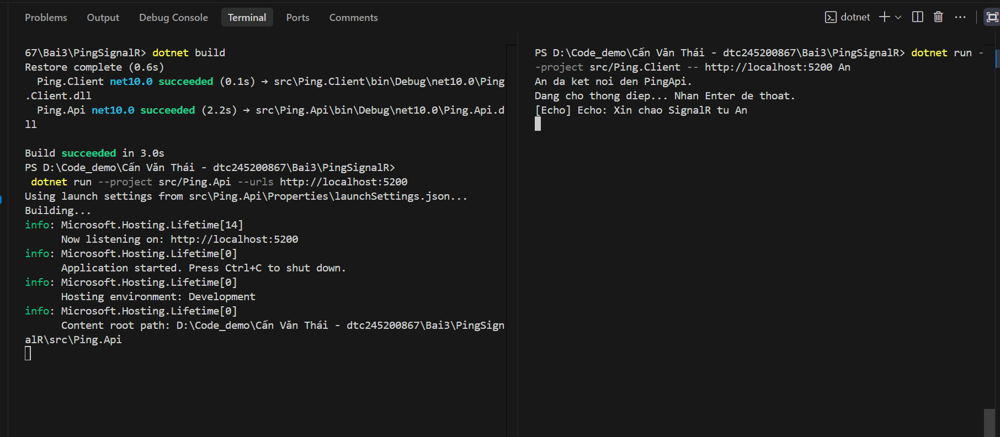
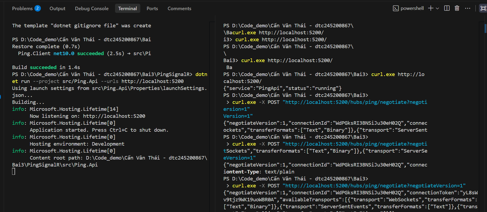
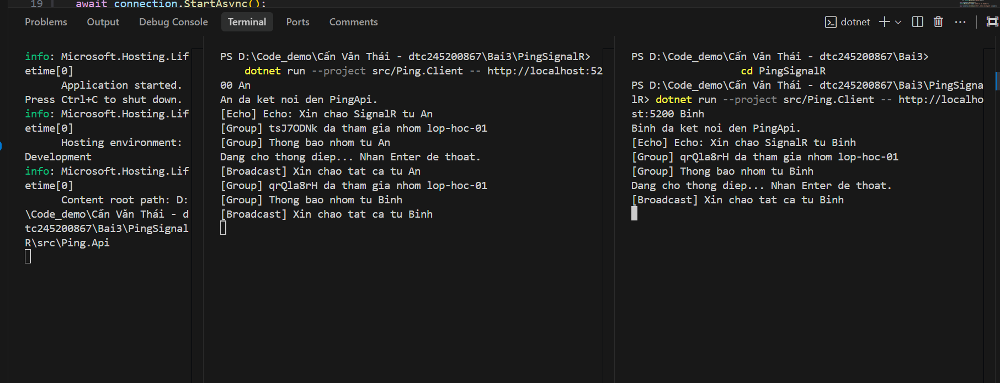
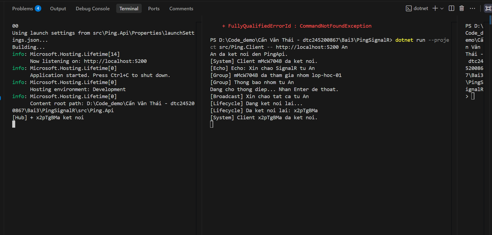
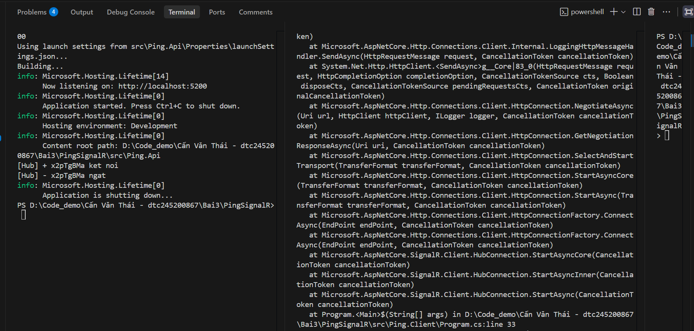
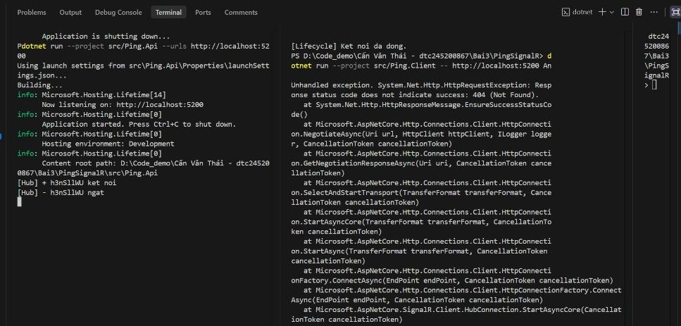
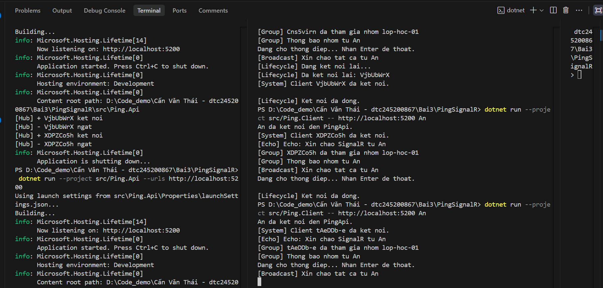

# PingSignalR

## Bước 1: build

Thấy: dotnet build báo Build succeeded, 0 Error(s).
Giải thích: tạo solution và thêm gói SignalR.Client cho máy khách thành công.

## Bước 2: negotiate

Thấy: curl trả về connectionId.
Giải thích: máy chủ báo các cách truyền tải hỗ trợ (WebSockets, ServerSentEvents, LongPolling).

## Bước 3-4: Echo

Thấy: máy chủ chạy, máy khách in `[Echo] Echo: Xin chao SignalR tu An`.
Giải thích: máy khách gọi Echo lên hub và Clients.Caller chỉ trả lời riêng người vừa gọi.

## Bước 5: Broadcast và nhóm

Thấy: An và Bình thấy tin `[Group]` và `[Broadcast]` của nhau, không thấy tin `[Echo]`.
Giải thích: Clients.Group gửi cho kết nối trong nhóm, Clients.All gửi cho tất cả kết nối.

## Bước 6: Tự động kết nối lại

Thấy: tắt bật lại máy chủ thì máy khách in `Dang ket noi lai...` rồi `Da ket noi lai: x2pTgBMa`.
Giải thích: WithAutomaticReconnect tự nối lại và được cấp ConnectionId mới.

## Bước 7: Ba lỗi cố ý

Thấy: máy chủ tắt thì máy khách báo lỗi ở bước NegotiateAsync.
Giải thích: máy chủ không chạy ở cổng 5200 nên không bắt tay được.

Thấy: báo lỗi `HttpRequestException: ... 404 (Not Found)`.
Giải thích: sai đường dẫn hub nên không khớp với MapHub trên máy chủ.

Thấy: sửa đúng lại thì máy khách nhận đủ thông điệp và đóng kết nối bình thường.
Giải thích: tên sự kiện và đường dẫn hai phía đã khớp nhau.
