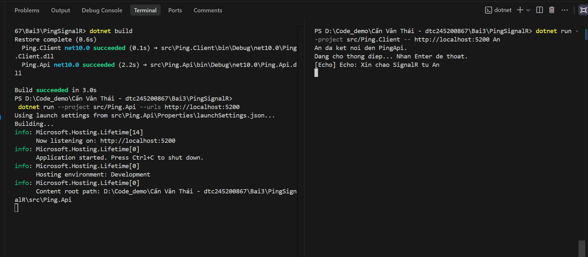
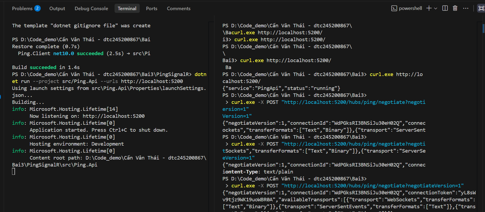
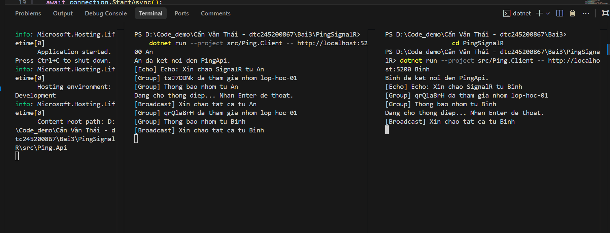
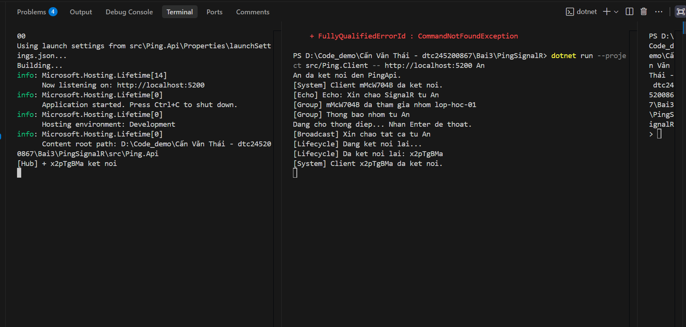
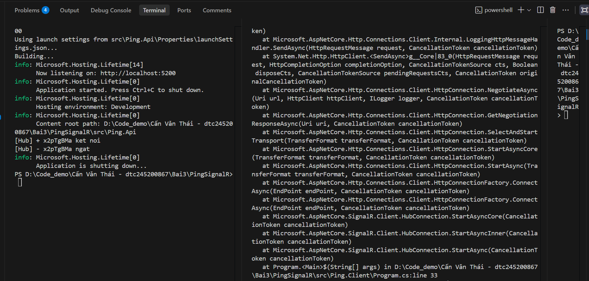
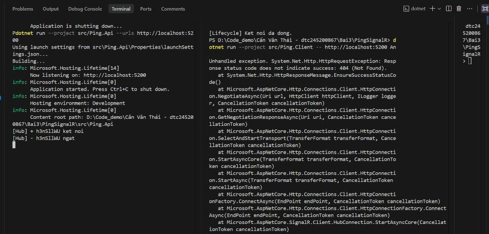
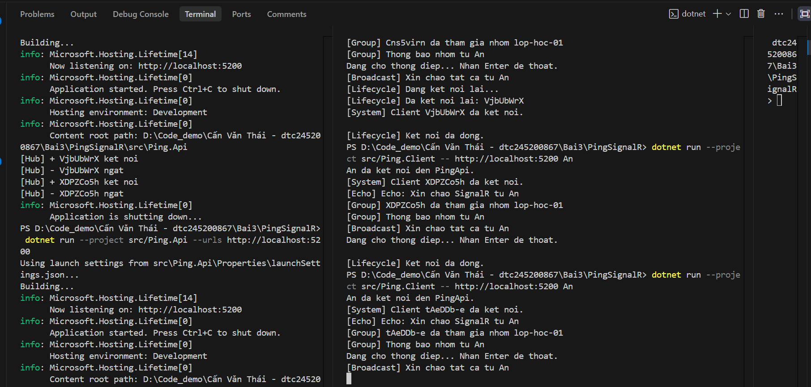
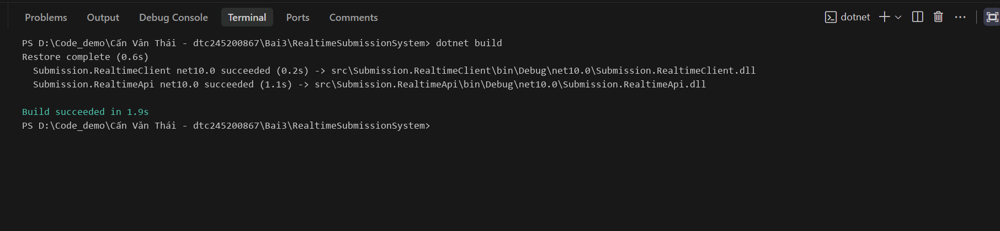
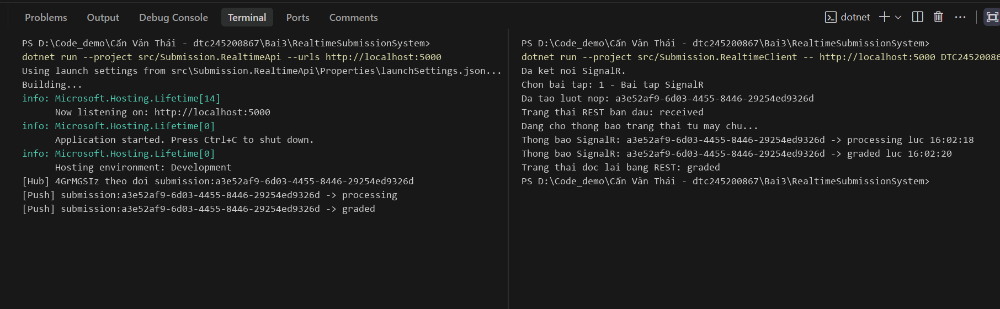
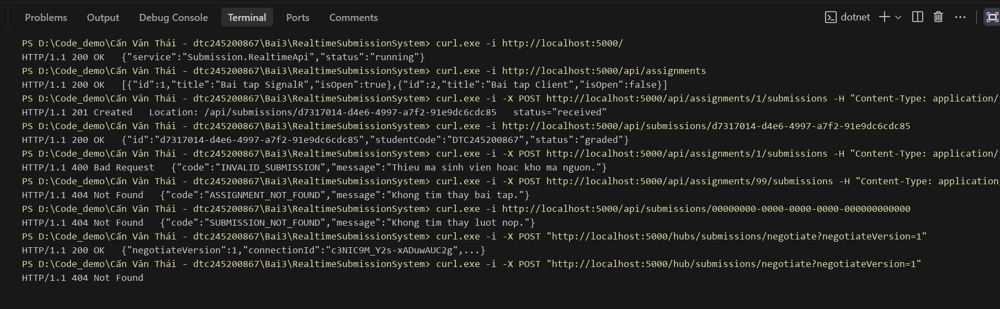

# Bài 3: SignalR

## Trả lời 3 câu hỏi đầu giờ
1. Hỏi lặp (polling) bằng GET liên tục gây tốn tài nguyên mạng/máy chủ khi hỏi dày, hoặc bị trễ thông báo khi hỏi thưa.
2. SignalR giữ kết nối sau bước negotiate để máy chủ chủ động đẩy thông báo ngay khi trạng thái lượt nộp thay đổi.
3. REST vẫn là nguồn sự thật để tạo lượt nộp (POST 201) và đọc lại trạng thái cuối (GET) nếu máy khách vào nhóm muộn hoặc lỡ tin SignalR.

## Phần 2: PingSignalR

### Bước 1: build

Thấy: dotnet build báo Build succeeded, 0 Error(s).
Giải thích: tạo solution và thêm gói SignalR.Client cho máy khách thành công.

### Bước 2: negotiate

Thấy: curl trả về connectionId.
Giải thích: máy chủ báo các cách truyền tải hỗ trợ (WebSockets, ServerSentEvents, LongPolling).

### Bước 3-4: Echo

Thấy: máy chủ chạy, máy khách in `[Echo] Echo: Xin chao SignalR tu An`.
Giải thích: máy khách gọi Echo lên hub và Clients.Caller chỉ trả lời riêng người vừa gọi.

### Bước 5: Broadcast và nhóm

Thấy: An và Bình thấy tin `[Group]` và `[Broadcast]` của nhau, không thấy tin `[Echo]`.
Giải thích: Clients.Group gửi cho kết nối trong nhóm, Clients.All gửi cho tất cả kết nối.

### Bước 6: Tự động kết nối lại

Thấy: tắt bật lại máy chủ thì máy khách in `Dang ket noi lai...` rồi `Da ket noi lai: x2pTgBMa`.
Giải thích: WithAutomaticReconnect tự nối lại và được cấp ConnectionId mới.

### Bước 7: Ba lỗi cố ý

Thấy: máy chủ tắt thì máy khách báo lỗi ở bước NegotiateAsync.
Giải thích: máy chủ không chạy ở cổng 5200 nên không bắt tay được.


Thấy: báo lỗi `HttpRequestException: ... 404 (Not Found)`.
Giải thích: sai đường dẫn hub nên không khớp với MapHub trên máy chủ.


Thấy: sửa đúng lại thì máy khách nhận đủ thông điệp và đóng kết nối bình thường.
Giải thích: tên sự kiện và đường dẫn hai phía đã khớp nhau.

## Phần 3: EduSubmit (RealtimeSubmissionSystem)

### Bước 1: build

Thấy: dotnet build báo Build succeeded.
Giải thích: tạo solution RealtimeSubmissionSystem với hai project máy chủ và máy khách.

### Bước 2-6: Kết quả chạy máy khách (8 dòng)

Thấy:
```text
Da ket noi SignalR.
Chon bai tap: 1 - Bai tap SignalR
Da tao luot nop: a3e52af9-6d03-4455-8446-29254ed9326d
Trang thai REST ban dau: received
Dang cho thong bao trang thai tu may chu...
Thong bao SignalR: a3e52af9-6d03-4455-8446-29254ed9326d -> processing luc 16:02:18
Thong bao SignalR: a3e52af9-6d03-4455-8446-29254ed9326d -> graded luc 16:02:20
Trang thai doc lai bang REST: graded
```
Giải thích: máy khách tạo lượt nộp qua REST, vào nhóm `submission:{id}` để nhận thông báo `processing`, `graded` từ `IHubContext`, rồi gọi lại GET REST để đọc trạng thái cuối.

### Bước 7: 5 thí nghiệm phân tán
| Thí nghiệm | Dự đoán | Kết quả thật | Bài học |
| --- | --- | --- | --- |
| 1. Hai máy khách cùng lúc | Cả hai cùng nhận thông báo | Mỗi máy khách chỉ thấy lượt nộp vừa tạo | Nhóm `submission:{id}` tách người nhận |
| 2. Máy chủ chưa chạy | Tự kết nối lại | `HttpRequestException: Connection refused (localhost:5000)` | Lần nối đầu không tự thử lại |
| 3. Sai `/hub/submissions` | Lỗi khi gọi hub | `HttpRequestException: ... 404 (Not Found)` | Lỗi ở negotiate, phải khớp MapHub |
| 4. Sai tên sự kiện | Báo lỗi tên sự kiện | Không lỗi, 10 giây sau in `Qua thoi gian cho thong bao graded.` | Sai tên chiều xuống là im lặng |
| 5. Watch muộn 4 giây | Vẫn nhận được tin cũ | Không nhận tin nào, REST đọc lại là `graded` | Vào nhóm muộn là lỡ tin, REST là nguồn sự thật |

### Bước 8: requests.http

Thấy: chạy 9 ca kiểm thử trong requests.http trả về đúng các mã 200, 201, 400, 404.
Giải thích: các endpoint REST và bước bắt tay negotiate hoạt động đúng trên cùng máy chủ.
