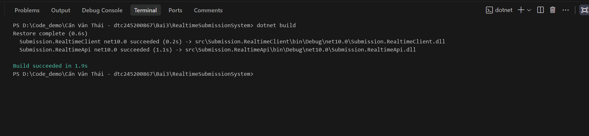
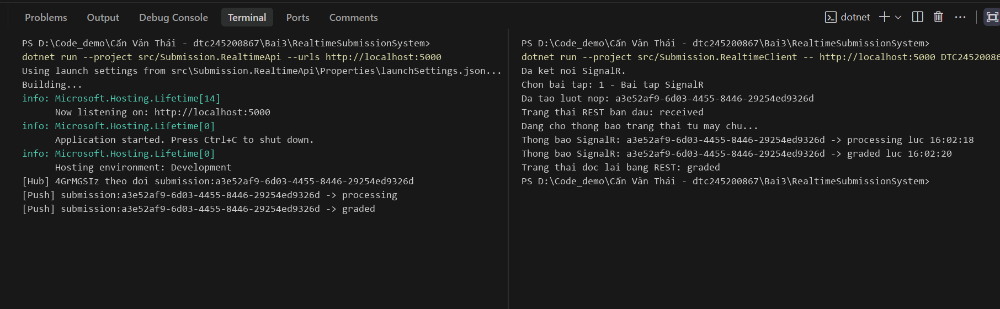
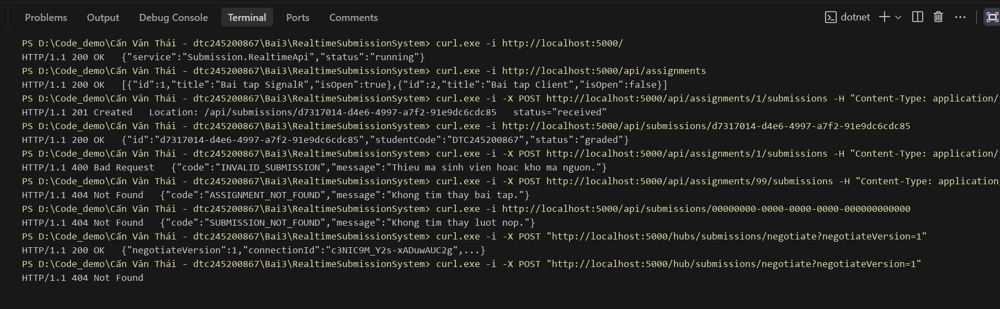

# RealtimeSubmissionSystem (EduSubmit)

## Bước 1: build

Thấy: dotnet build báo Build succeeded.
Giải thích: tạo solution RealtimeSubmissionSystem với hai project máy chủ và máy khách.

## Bước 2-6: Kết quả chạy máy khách (8 dòng)

Thấy:
```text
Da ket noi SignalR.
Chon bai tap: 1 - Bai tap SignalR
Da tao luot nop: a3e52af9-6d03-4455-8446-29254ed9326d
Trang thai REST ban dau: received
Dang cho thong bao trang thai tu may chu...
Thong bao SignalR: a3e52af9-6d03-4455-8446-29254ed9326d -> processing luc 16:02:18
Thong bao SignalR: a3e52af9-6d03-4455-8446-29254ed9326d -> graded luc 16:02:20
Trang thai doc lai bang REST: graded
```
Giải thích: máy khách tạo lượt nộp qua REST, vào nhóm `submission:{id}` để nhận thông báo `processing`, `graded` từ `IHubContext`, rồi gọi lại GET REST để đọc trạng thái cuối.

## Bước 7: 5 thí nghiệm phân tán
| Thí nghiệm | Dự đoán | Kết quả thật | Bài học |
| --- | --- | --- | --- |
| 1. Hai máy khách cùng lúc | Cả hai cùng nhận thông báo | Mỗi máy khách chỉ thấy lượt nộp vừa tạo | Nhóm `submission:{id}` tách người nhận |
| 2. Máy chủ chưa chạy | Tự kết nối lại | `HttpRequestException: Connection refused (localhost:5000)` | Lần nối đầu không tự thử lại |
| 3. Sai `/hub/submissions` | Lỗi khi gọi hub | `HttpRequestException: ... 404 (Not Found)` | Lỗi ở negotiate, phải khớp MapHub |
| 4. Sai tên sự kiện | Báo lỗi tên sự kiện | Không lỗi, 10 giây sau in `Qua thoi gian cho thong bao graded.` | Sai tên chiều xuống là im lặng |
| 5. Watch muộn 4 giây | Vẫn nhận được tin cũ | Không nhận tin nào, REST đọc lại là `graded` | Vào nhóm muộn là lỡ tin, REST là nguồn sự thật |

## Bước 8: requests.http

Thấy: chạy 9 ca kiểm thử trong requests.http trả về đúng các mã 200, 201, 400, 404.
Giải thích: các endpoint REST và bước bắt tay negotiate hoạt động đúng trên cùng máy chủ.

## Trả lời 3 câu hỏi đầu giờ
1. Hỏi lặp (polling) gây tốn tài nguyên khi hỏi quá dày hoặc nhận kết quả trễ khi hỏi quá thưa.
2. SignalR giữ kết nối hai chiều sau bước negotiate để máy chủ chủ động đẩy thông báo ngay khi đổi trạng thái.
3. REST vẫn cần giữ để tạo lượt nộp (POST 201) và làm nguồn sự thật (GET) khi máy khách vào nhóm muộn hoặc rớt mạng lỡ tin.
