# Bài 3 · Minh chứng thực hành SignalR

## Phần 2 · PingSignalR

### Bước 1 · Tạo solution và cài SignalR Client

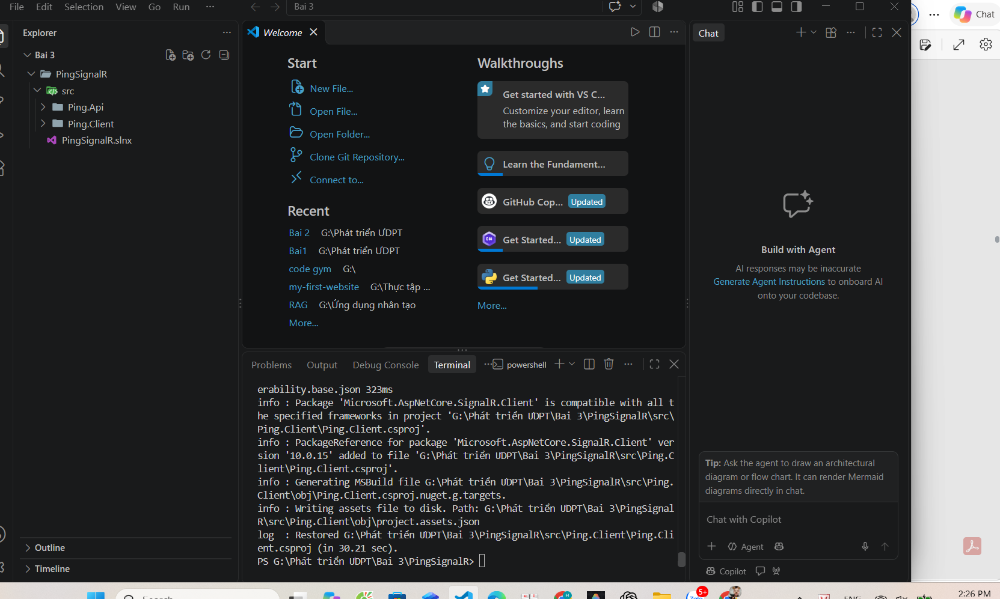

### Bước 2 · Tạo hub và kiểm tra bắt tay

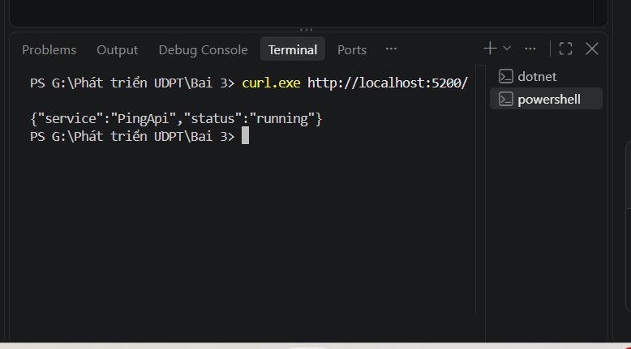
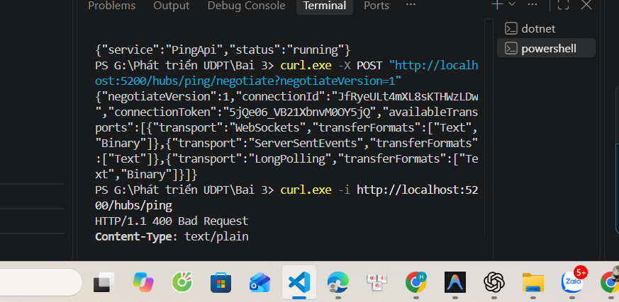
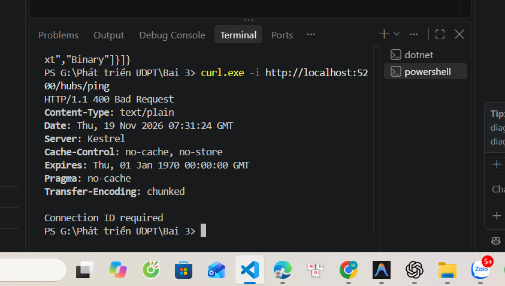

### Bước 3 · Thêm phương thức Echo

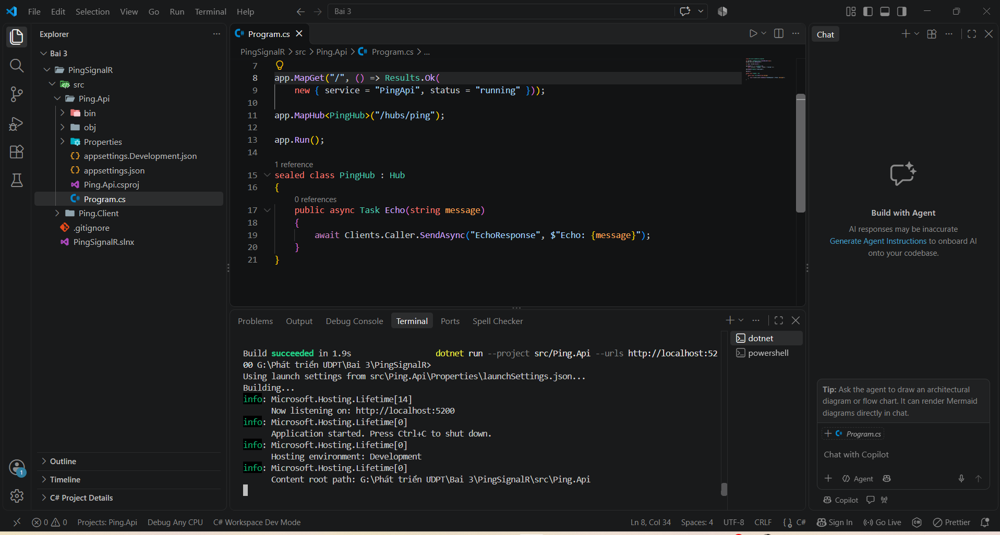

### Bước 4 · Máy khách gọi Echo

Dòng phản hồi Echo của An xuất hiện ở đầu [ảnh terminal An dùng chung với bước 5](images/phan-2-pingsignalr/pingsignalr-buoc-05-an.png).

### Bước 5 · Gửi theo nhóm và phát rộng

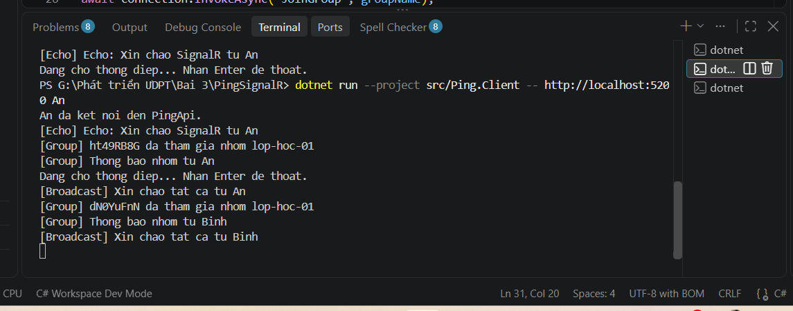
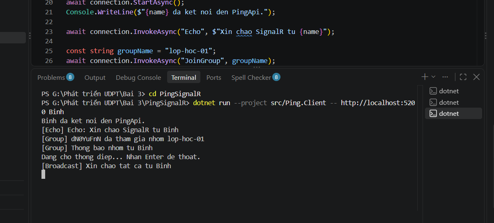

### Bước 6 · Tự kết nối lại

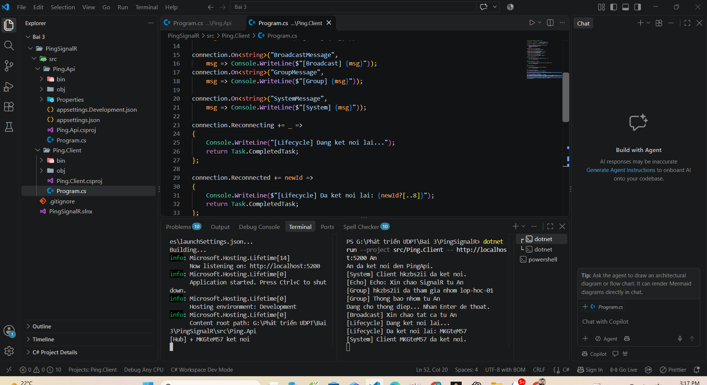

### Bước 7 · Ba thí nghiệm lỗi

1. Chạy máy khách khi máy chủ tắt. Kết nối bị từ chối vì cổng 5200 không có máy chủ lắng nghe.

   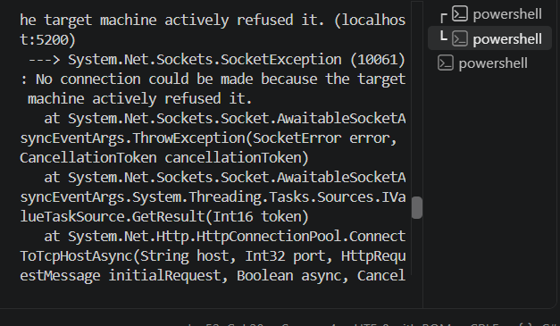

2. Tạm thay `/hubs/ping` bằng `/hub/ping`. Yêu cầu bắt tay trả về 404 vì đường dẫn không khớp. Ảnh dưới ghi phần cuối lỗi ở `StartAsync()`; dòng 404 nằm phía trên vùng chụp.

   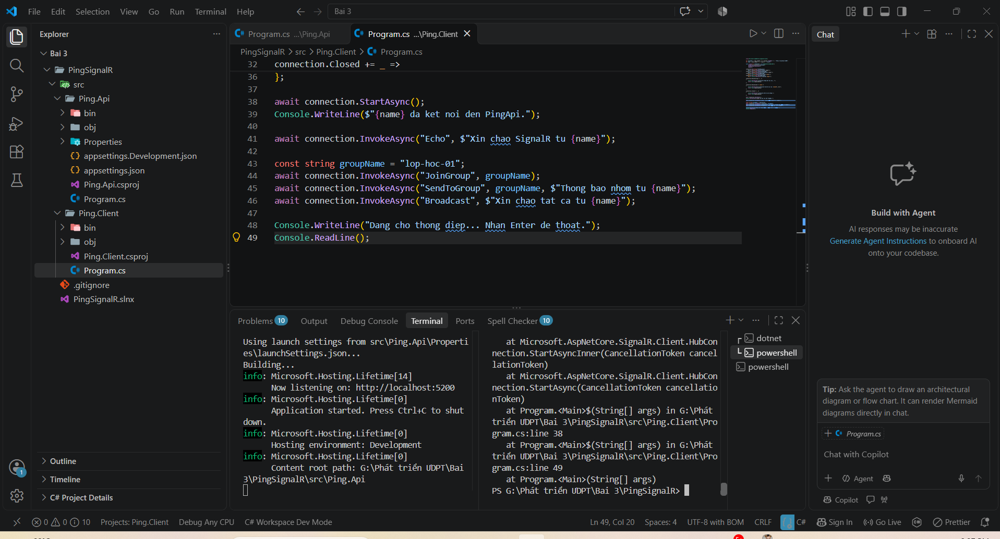

3. Tạm nghe `EchoRespone` trong khi máy chủ gửi `EchoResponse`. Máy khách vẫn nhận tin khác, nhưng không in Echo. Sau khi khôi phục tên đúng, Echo xuất hiện trở lại.

   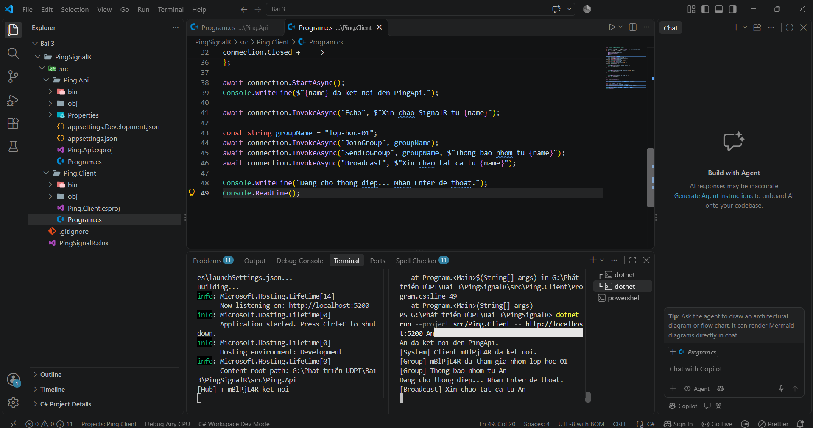
   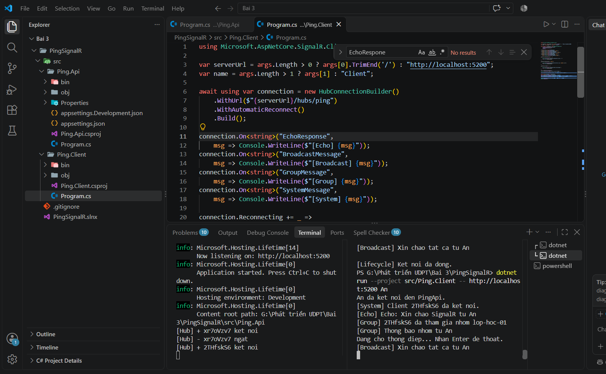

## Phần 3 · EduSubmit realtime

Minh chứng Phần 3 gồm GIF trình bày kết quả PowerShell và các ảnh tóm tắt log kiểm thử. Mình đã dùng Codex để đối chiếu bài với slide, chạy lại API và máy khách, và bổ sung kết quả kiểm thử vào README.

Theo slide 44–46, sự kiện cần báo là lúc trạng thái lượt nộp thay đổi. Chỉ các kết nối đã theo dõi nhóm `submission:{id}` nhận thông báo. Thông báo gồm ID lượt nộp, trạng thái mới và `updatedAt`. Nếu lỡ thông báo, máy khách gọi `GET /api/submissions/{id}` để đọc trạng thái hiện tại.

### Bước 1 · Tạo solution, thêm gói và build

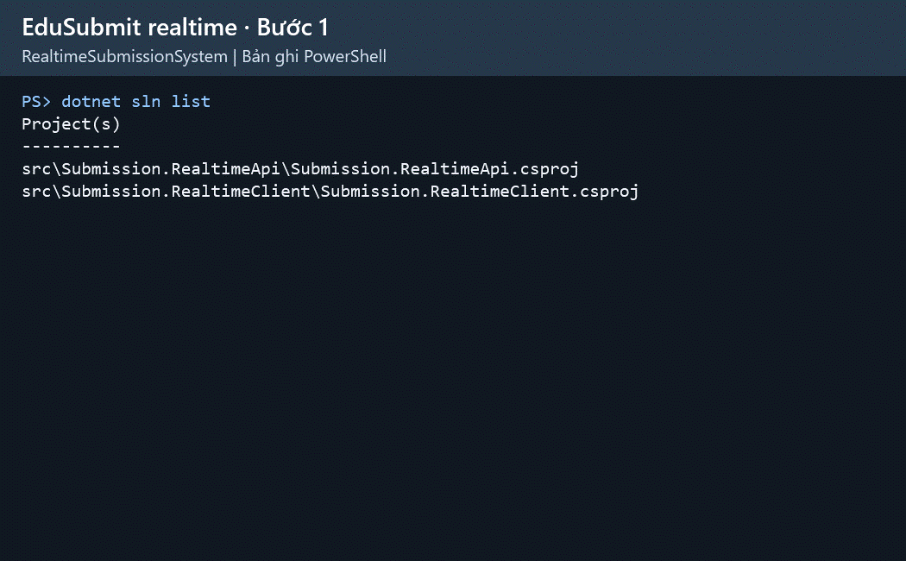

### Bước 2–5 · REST, hub, chấm nền và mở kết nối

- Bước 2. POST trả `201 Created`, có `Location`, trạng thái `received` và `updatedAt`.
- Bước 3. Bắt tay ở `/hubs/submissions` trả mã kết nối. Tuyến thiếu chữ s trả 404.
- Bước 4. Đọc cùng một lượt nộp qua REST thấy `received → processing → graded` và `updatedAt` tăng.
- Bước 5. Máy khách đăng ký nghe sự kiện trước khi mở kết nối SignalR.

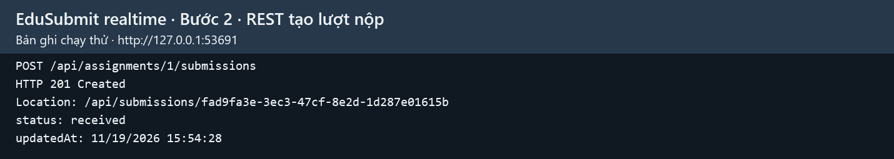

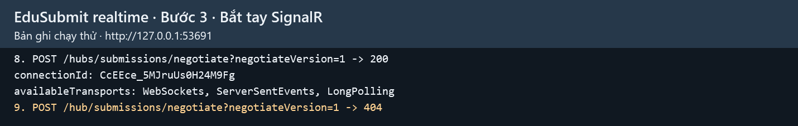

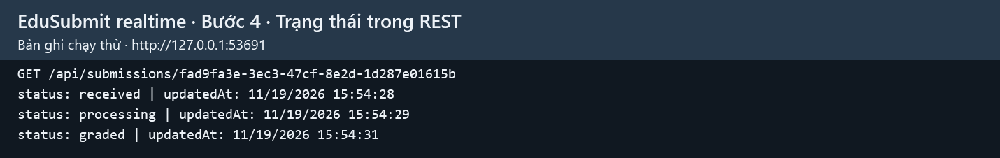

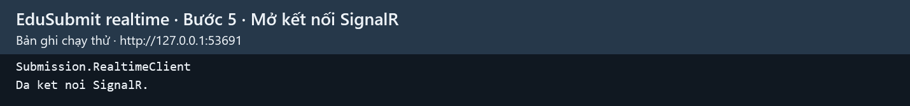

### Bước 6 · Chạy máy chủ và máy khách

Mở hai terminal tại thư mục `RealtimeSubmissionSystem`. Chạy máy chủ ở terminal 1 và đợi cổng 5000 sẵn sàng.

```powershell
dotnet run --project src/Submission.RealtimeApi --urls http://localhost:5000
```

Trong terminal 2, chạy máy khách.

```powershell
dotnet run --project src/Submission.RealtimeClient -- http://localhost:5000 SV001
```

Kết quả chạy thử gồm đủ tám dòng dưới đây. Các lần kiểm tra tự động dùng cổng loopback tạm để tránh xung đột với phiên VS Code.

```text
Da ket noi SignalR.
Chon bai tap: 1 - Bai tap SignalR
Da tao luot nop: dc4a9c97-61d1-4cb9-beb4-fdb15ff73e28
Trang thai REST ban dau: received
Dang cho thong bao trang thai tu may chu...
Thong bao SignalR: dc4a9c97-61d1-4cb9-beb4-fdb15ff73e28 -> processing luc 08:54:33.252 UTC
Thong bao SignalR: dc4a9c97-61d1-4cb9-beb4-fdb15ff73e28 -> graded luc 08:54:35.268 UTC
Trang thai doc lai bang REST: graded
```

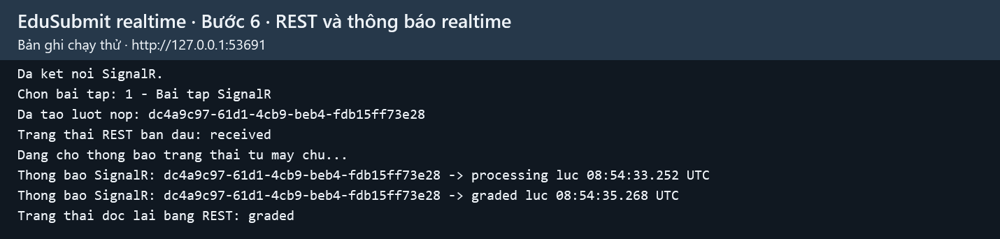

### Bước 7 · Năm thí nghiệm

| Thí nghiệm | Dự đoán | Kết quả thực tế | Giải thích |
|---|---|---|---|
| SV001 và SV002 chạy đồng thời | Mỗi máy nhận sự kiện cho ID của mình | Hai ID khác nhau. Mỗi máy nhận đúng hai sự kiện `processing` và `graded` cho ID của mình | Máy chủ phát tới nhóm riêng `submission:{id}`. |
| Máy chủ tắt | Lần kết nối đầu thất bại | Máy khách báo `HttpRequestException` và kết nối bị từ chối | Tự kết nối lại áp dụng sau khi đã có kết nối thành công. |
| Sai tuyến `/hub/submissions` | Bước bắt tay trả 404 | Máy khách báo `404 (Not Found)` | Tuyến của máy khách phải khớp `MapHub`. |
| Sai tên `SubmissionStatusChange` | Chờ hết 10 giây, REST vẫn trả `graded` | Không có thông báo SignalR. Máy khách báo hết thời gian chờ và GET trả `graded` | Tên đăng ký nghe phải khớp tên sự kiện máy chủ gửi. |
| Gọi Watch sau 4 giây | Bỏ lỡ cả hai thông báo, REST vẫn trả `graded` | Không có thông báo SignalR. Máy khách báo hết thời gian chờ và GET trả `graded` | Máy khách vào nhóm sau khi quá trình chấm đã xong. |

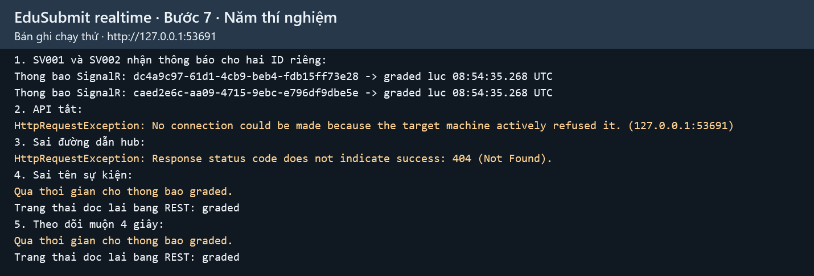

### Bước 8 · Kiểm tra HTTP và bài tập vận dụng

Mở `RealtimeSubmissionSystem/requests.http` trong VS Code và gửi từng yêu cầu khi máy chủ chạy ở cổng 5000. Gửi ca 3 trước ca 4 để REST Client lấy được ID từ phản hồi. Đã kiểm tra đủ chín ca. Mã theo thứ tự là `200, 200, 201, 200, 400, 404, 404, 200, 404`.

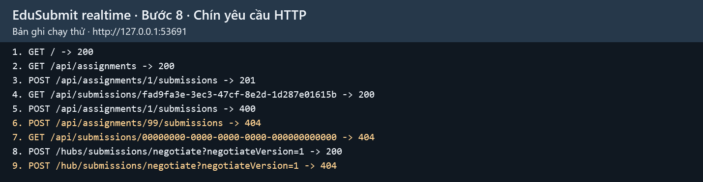

Để chạy bài tập theo dõi hai lượt nộp trên cùng kết nối và thử trạng thái `failed`:

```powershell
dotnet run --project src/Submission.RealtimeClient -- http://localhost:5000 SV001 --two
```

SV001 dùng URL HTTPS nên cả SignalR và REST ghi nhận `graded`. SV002 dùng URL HTTP nên máy khách in cảnh báo đỏ và cả hai kênh ghi nhận `failed`. Hai lượt nộp được ghép với hai tác vụ chờ theo ID. Bài tập chạy khi API tắt tương ứng thí nghiệm 2 ở trên.

Kết quả chạy lại với `--two` trên một kết nối SignalR:

```text
Thong bao SignalR: e6acb4dd-eb67-4e25-a0fa-a6f24262023d -> processing luc 09:01:09.726 UTC
Thong bao SignalR: b58e3b20-01a0-4981-be9c-a5f63f54a411 -> processing luc 09:01:09.800 UTC
Thong bao SignalR: e6acb4dd-eb67-4e25-a0fa-a6f24262023d -> graded luc 09:01:11.735 UTC
Thong bao SignalR: b58e3b20-01a0-4981-be9c-a5f63f54a411 -> failed luc 09:01:11.804 UTC
CANH BAO: luot nop b58e3b20-01a0-4981-be9c-a5f63f54a411 cham loi (failed).
SV001 (e6acb4dd-eb67-4e25-a0fa-a6f24262023d): SignalR = graded, REST = graded
SV002 (b58e3b20-01a0-4981-be9c-a5f63f54a411): SignalR = failed, REST = failed
```

### Trả lời ba câu hỏi đầu giờ

1. Máy chủ có thể chủ động đẩy trạng thái qua SignalR ngay khi tiến trình chấm cập nhật dữ liệu. Thông báo gửi đến nhóm của đúng lượt nộp và chứa ID, trạng thái mới, thời điểm cập nhật.
2. REST dùng để lấy danh sách, nộp bài và đọc trạng thái đã lưu. SignalR báo thay đổi ngay cho máy khách đang theo dõi, giúp giảm số lần phải gửi GET liên tục.
3. Nếu mất kết nối lúc chấm xong, máy khách có thể bỏ lỡ thông báo. Sau khi khôi phục kết nối, gọi GET để biết trạng thái mới nhất và đăng ký lại lượt nộp cần tiếp tục theo dõi.
