# Bài 3 - SignalR

## Bước 1: Tạo solution và build project

Đã tạo solution PingSignalR gồm hai project:

- Ping.Api: ASP.NET Core Web.
- Ping.Client: Console Client sử dụng SignalR.

Đã cài thư viện Microsoft.AspNetCore.SignalR.Client phiên bản 10.0.15.

Kết quả build:

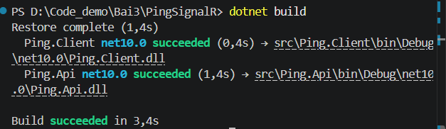

Build succeeded, không có lỗi.

## Bước 2: Xây dựng SignalR Hub

Đã tạo PingHub kế thừa lớp Hub của SignalR. Hub hỗ trợ phương thức Echo để nhận tin nhắn và gửi phản hồi về client gọi.

Đã cấu hình AddSignalR() và MapHub<PingHub>("/hubs/ping").

Kết quả chạy server:

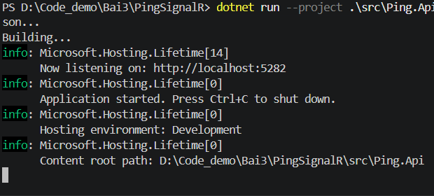

Server chạy thành công tại http://localhost:5282.

## Bước 3: Kết nối Client với SignalR Server

Đã cấu hình Ping.Client kết nối đến SignalR Hub thông qua địa chỉ http://localhost:5282/hubs/ping.

Client gọi phương thức Echo với nội dung "Xin chao SignalR" và nhận phản hồi từ Server.

Kết quả chạy thử:

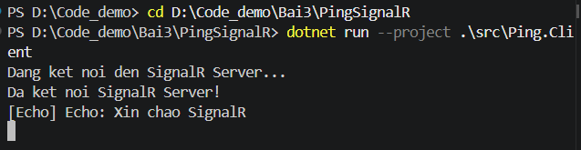

Client kết nối và nhận phản hồi thành công.

## Bước 4: Kiểm tra tự động kết nối lại

Đã cấu hình WithAutomaticReconnect() và bổ sung các sự kiện Reconnecting, Reconnected, Closed để theo dõi trạng thái kết nối.

Tiến hành tắt Server rồi khởi động lại. Client tự động phát hiện mất kết nối và kết nối lại thành công.

Kết quả kiểm thử:

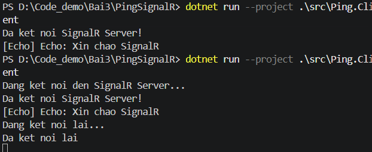

Client hiển thị thông báo "Dang ket noi lai..." và "Da ket noi lai".

## Bước 5: Kiểm tra Negotiate

Sử dụng lệnh curl để gửi yêu cầu đến endpoint negotiate của SignalR Hub.

Kết quả kiểm tra:

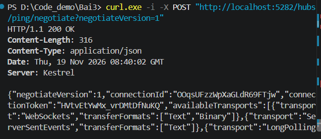

**Kết quả:** Server trả về HTTP 200 OK, kèm connectionId, connectionToken và danh sách phương thức truyền tải.

**Giải thích:** Negotiate giúp Client và Server trao đổi thông tin trước khi thiết lập kết nối SignalR.

## Bước 6: Kiểm tra Broadcast và Group

Chạy hai Client An và Binh để kiểm tra gửi tin nhắn.

Kết quả kiểm tra:

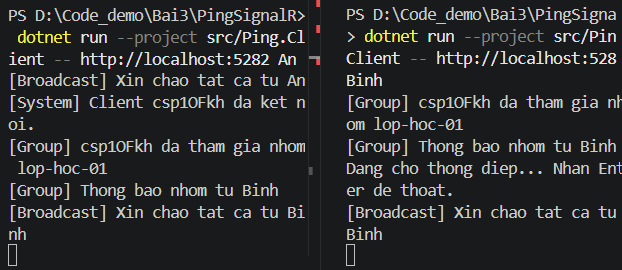

**Kết quả:** Cả hai Client kết nối thành công, nhận được tin nhắn Broadcast và tin nhắn trong nhóm.

**Giải thích:** Broadcast gửi tin nhắn đến tất cả Client, còn Group chỉ gửi tin nhắn đến các Client thuộc cùng một nhóm.

## Bước 7: Kiểm tra tự động kết nối lại

Dừng Server và khởi động lại để kiểm tra khả năng tự động kết nối lại của Client.

Kết quả kiểm tra:

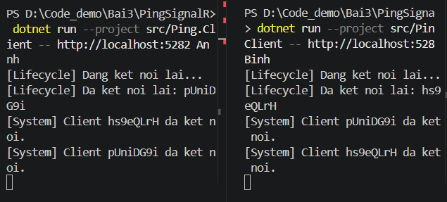

**Kết quả:** Client tự động kết nối lại thành công sau khi Server hoạt động trở lại.

**Giải thích:** WithAutomaticReconnect() hỗ trợ Client tự động thử kết nối lại khi mất kết nối với Server.

## Bước 8: Thí nghiệm các lỗi cố ý

### 8.1. Máy chủ chưa chạy

Tắt Server rồi chạy Client để kiểm tra lỗi kết nối.

Kết quả kiểm tra:

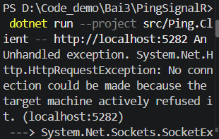

**Kết quả:** Client báo lỗi Connection refused (SocketException 10061).

**Giải thích:** StartAsync() không thể kết nối khi Server chưa chạy. WithAutomaticReconnect() chỉ hỗ trợ kết nối lại sau khi kết nối ban đầu thành công.

### 8.2. Sai đường dẫn Hub

Sửa đường dẫn Hub trong Client từ `/hubs/ping` thành `/hub/ping` rồi chạy lại Client.

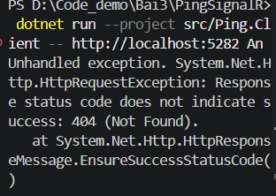

**Kết quả:** Client báo lỗi HTTP 404 (Not Found).

**Giải thích:** Đường dẫn kết nối của Client phải trùng với đường dẫn được cấu hình trong MapHub() ở Server.

### 8.3. Sai tên phương thức và sự kiện

**Trường hợp 1: Sai tên phương thức**

Client gọi `Ech0` thay vì `Echo`.

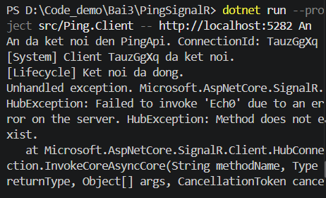

**Kết quả:** Server trả về lỗi HubException: Method does not exist.

**Trường hợp 2: Sai tên sự kiện nhận**

Client lắng nghe `EchoRespone` thay vì `EchoResponse`.

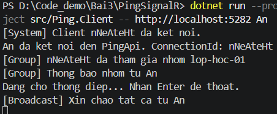

**Kết quả:** Client vẫn kết nối bình thường nhưng không nhận được phản hồi Echo.

**Giải thích:** Tên phương thức và tên sự kiện giữa Client và Server phải khớp nhau.
