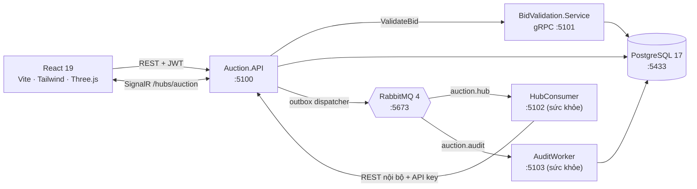

# Aurelia — Nền tảng đấu giá trực tuyến

Hệ thống đấu giá trực tuyến dạng sản xuất với giao diện React cao cấp và backend phân tán .NET 10. Mỗi lệnh đặt giá thực sự đi theo toàn bộ đường ống:

**REST API → gRPC kiểm tra giá → PostgreSQL (khóa dòng) → transactional outbox → RabbitMQ → Hub Consumer → SignalR → trình duyệt**, đồng thời luồng sự kiện RabbitMQ này cung cấp dữ liệu cho **Audit Worker** (dịch vụ kiểm toán độc lập).

Không có mock, không có nút bấm giả, không dùng polling.

---

## Mục lục

- [Tính năng](#tính-năng)
- [Kiến trúc](#kiến-trúc)
- [Cấu trúc kho chứa](#cấu-trúc-kho-chứa)
- [Khởi đầu nhanh với Docker Compose](#khởi-đầu-nhanh-với-docker-compose)
- [Thiết lập phát triển cục bộ](#thiết-lập-phát-triển-cục-bộ)
- [Tài khoản mẫu](#tài-khoản-mẫu)
- [Cấu hình](#cấu-hình)
- [API và realtime](#api-and-realtime)
- [Kiểm tra](#kiểm-tra)
- [Tài liệu](#tài-liệu)
- [Khắc phục sự cố](#khắc-phục-sự-cơ)
- [Lưu ý an ninh](#lưu-y-an-ninh)
- [License](#license)

---

## Tính năng

### Trải nghiệm người đấu giá

- Trang chủ tuyển tập với thống kê trực tiếp, lô đồ nổi bật và cảnh 3D chuyển động.
- Thư mục với tìm kiếm, lọc theo danh mục và trạng thái, sắp xếp và phân trang.
- Trang chi tiết đấu giá với đồng hồ đếm ngược, biểu đồ lịch sử giá, tham gia người đấu giá, trình bày 3D/ảnh, đồng hồ giờ theo thời gian máy chủ và biểu mẫu đặt giá đã xác thực.
- Tín hiệu giá và luồng đấu giá trực tiếp qua SignalR, cùng panel kết thúc phiên đấu giá.
- Đăng ký với kiểm tra độ mạnh mật khẩu và xác nhận, đăng nhập với tài khoản mẫu.
- Hồ sơ với thống kê đặt giá, lịch sử đặt giá, phòng và thắng.
- Hiển thị kết quả phiên đấu giá đã kết thúc.

### Bảng điều khiển quản trị

- Bảng điểm KPI, xu hướng 14 ngày, phân bố trạng thái phiên, phiên đấu giá top và hoạt động gần đây.
- Quản trị sản phẩm (CRUD) với modal kiểm tra.
- Tạo và đóng tức thì phiên đấu giá với người thắng xác định.
- Tìm kiếm người dùng, thay đổi quyền và kích hoạt/tắt tài khoản (với tự bảo vệ).
- Nhật ký kiểm toán chỉ được cung cấp bởi Audit Worker.

### Kỹ thuật backend

- Dịch vụ xác thực giá độc lập với hợp đồng decimal-safe.
- Giao dịch tuần tự sử dụng `SELECT ... FOR UPDATE`.
- Rào cản duy nhất với `(auction_id, sequence)` và ràng buộc `event_id` như phòng thủ sâu.
- Giao dịch outbox với publisher xác nhận và giao hàng ít nhất một lần.
- Người tiêu thụ idempotent, ACK thủ công, retry ngay tại chỗ và hàng đệm DLQ.
- Hub Consumer riêng biệt nối RabbitMQ với SignalR thông qua endpoint nội bộ được bảo vệ bằng khóa API.
- JWT auth với vai trò `Admin`/`Bidder`, băm BCrypt, danh sách cho phép CORS, Swagger.
- Kích hoạt và đóng phiên đấu giá tự động, tự chọn người thắng và phát sự kiện `AuctionEnded`.
- Bài kiểm tra tích hợp PostgreSQL thực tế, bao gồm cuộc đua cùng giá song song.

---

## Kiến trúc



| Dịch vụ | Dự án | Cổng |
| --- | --- | --- |
| REST API + SignalR + Swagger | `Auction.API` | 5100 |
| Kiểm tra giá | `BidValidation.Service` | 5101 |
| Cầu nối thời gian thực | `Auction.HubConsumer` | 5102 (sức khỏe) |
| Người tiêu thụ kiểm toán | `Auction.AuditWorker` | 5103 (sức khỏe) |
| PostgreSQL | container / cục bộ | 5433 |
| RabbitMQ AMQP / quản trị | container / cục bộ | 5673 / 15673 |
| Giao diện người dùng | Vite / nginx | 5173 |

Đọc bản thiết kế đầy đủ tại [`docs/architecture.md`](docs/architecture.md).

---

## Khởi đầu nhanh với Docker Compose

**Điều kiện tiên quyết:** Docker Desktop/Engine với Compose v2. Chỉ cần vậy.

```bash
cp .env.example .env        # tùy chọn; xem lại giá trị mặc định cho phát triển
docker compose up --build
```

| URL | Mục đích |
| --- | --- |
| http://localhost:5173 | Giao diện người dùng |
| http://localhost:5100/swagger | Tham chiếu API REST |
| http://localhost:5100/health | Sức khỏe API |
| http://localhost:15673 | Quản trị RabbitMQ (`auction` / giá trị từ `.env`) |
| localhost:5433 | PostgreSQL (`auction`, database `auctiondb`) |

API tự động chạy migration và tạo dữ liệu mẫu trên lần chạy đầu. Thời khởi động có thể mất ~30s khi hình ảnh được tạo và PostgreSQL trở nên khỏe.

Dừng với `docker compose down`; xóa dữ liệu với `docker compose down -v`.

**Lưu ý cho máy chủ:** Docker Desktop cần phần cứng ảo hóa. Nếu không thể khởi động (ví dụ `HCS_E_SERVICE_NOT_AVAILABLE` trên VM với ảo hóa lồng ghép bị tắt), hãy dùng con đường cục bộ. Dự án đã được xác thực thực sự bằng PostgreSQL, RabbitMQ và SignalR cục bộ.

---

## Thiết lập phát triển cục bộ

### Điều kiện tiên quyết

| Công cụ | Phiên bản |
| --- | --- |
| .NET SDK | 10.0+ |
| Node.js | 20+ (đã kiểm tra trên 24) |
| PostgreSQL | 16+ (kiểm tra trên 17.6) |
| RabbitMQ | 4.x + Erlang 27 |
| EF Core CLI (tùy chọn) | `dotnet tool install --global dotnet-ef` |

### 1. PostgreSQL

Tạo vai trò và database:

```sql
CREATE ROLE auction LOGIN PASSWORD 'auction_dev_password';
CREATE DATABASE auctiondb OWNER auction;
```

Giữ nó ở cổng `5433` để khớp với cài đặt phát triển cam kết, hoặc ghi đè `ConnectionStrings__Default`.

### 2. RabbitMQ

Kích hoạt plugin quản trị và tạo user/vhost mà các service dùng:

```bash
rabbitmq-plugins enable rabbitmq_management
rabbitmqctl add_user auction auction_dev_password
rabbitmqctl set_permissions -p / auction ".*" ".*" ".*"
```

Chạy AMQP trên `5672` mặc định; các file appsettings dùng `5673`. Hãy bắt đầu RabbitMQ ở 5633 hoặc đặt `RabbitMq__Port=5672`.

### 3. Dịch vụ backend

Mở bốn terminal từ gốc repository:

```bash
# API (migration + seed tự động xảy ra)
dotnet run --project backend/Auction.API --urls http://localhost:5100

# gRPC validator
dotnet run --project backend/BidValidation.Service

# RabbitMQ → SignalR bridge
dotnet run --project backend/Auction.HubConsumer

# RabbitMQ → audit log
dotnet run --project backend/AuditWorker
```

### 4. Giao diện người dùng

```bash
cd frontend
npm install
npm run dev
```

Mở http://localhost:5173. Để trỏ vào API khác:

```bash
# frontend/.env.local
VITE_API_URL=http://localhost:5100
VITE_HUB_URL=http://localhost:5100/hubs/auction
```

### 5. Xây dựng giao diện người dùng cho sản xuất

```bash
cd frontend
npm ci
npm run build
npm run preview
```

---

## Tài khoản mẫu

| Vai trò | Email | Mật khẩu |
| --- | --- | --- |
| Quản trị viên | `admin@auction.local` | `Admin@123` |
| Người đấu giá | `alice@auction.local` | `Bidder@123` |
| Người đấu giá | `bob@auction.local` | `Bidder@123` |
| Người đấu giá | `chloe@auction.local` | `Bidder@123` |

Dữ liệu mẫu bao gồm 10 sản phẩm, 6 phiên đấu giá (đang diễn ra, lên lịch, kết thúc) và lịch sử đặt giá.

---

## Cấu hình

Tất cả các thiết lập có thể ghi đè bằng biến môi trường (cặp gạch dưới gấp hai cho lồng ghép):

| Biến | Giá trị mặc định (phát triển) | Mục đích |
| --- | --- | --- |
| `ConnectionStrings__Default` | `Host=localhost;Port=5433;Database=auctiondb;Username=auction;Password=auction_dev_password` | PostgreSQL |
| `Jwt__Key` | khóa 52 ký tự dành cho phát triển | Khóa ký HS256 (≥ 32 ký tự) |
| `Jwt__Issuer` / `Jwt__Audience` | `OnlineAuction` / `OnlineAuction.Client` | Xác thực token |
| `InternalApi__Key` | `dev-internal-key-change-me` | Hub Consumer → API |
| `RabbitMq__HostName` / `__Port` | `localhost` / `5673` | Broker |
| `RabbitMq__UserName` / `__Password` | `auction` / `auction_dev_password` | Thông tin xác thực |
| `RabbitMq__QueuePrefix` | rỗng | Phạm vi queues theo môi trường |
| `BidValidation__Address` | `http://localhost:5101` | Endpoint gRPC |
| `BidValidation__TimeoutSeconds` | `5` | Hạn chót gRPC |
| `Cors__Origins__0` | `http://localhost:5173` | Nguồn browser được phép |
| `Database__AutoMigrate` | `true` | Migrate + seed trên startup |
| `Swagger__Enabled` | `true` | Swagger UI |
| `VITE_API_URL` (thời gian xây dựng) | `http://localhost:5100` | Base API cho trình duyệt |
| `VITE_HUB_URL` (thời gian xây dựng) | `${VITE_API_URL}/hubs/auction` | Endpoint SignalR |

File `.env.example` là template Compose. Không bao giờ tái sử dụng bí mật phát triển trong sản xuất. Ghi đè `Jwt__Key`, database, RabbitMQ và khóa nội bộ khi triển khai, và giữ `.env` ngoài git.

---

## API và realtime

- Tham chiếu đầy đủ: [`docs/api-documentation.md`](docs/api-documentation.md)
- Swagger: http://localhost:5100/swagger

### Đặt giá

```bash
TOKEN=$(curl -s -X POST http://localhost:5100/api/auth/login \
  -H 'Content-Type: application/json' \
  -d '{"email":"alice@auction.local","password":"Bidder@123"}' | jq -r .token)

AUCTION=$(curl -s http://localhost:5100/api/auctions | jq -r '.items[0].id')

curl -s -X POST "http://localhost:5100/api/auctions/$AUCTION/bids" \
  -H "Authorization: Bearer $TOKEN" -H 'Content-Type: application/json' \
  -d '{"amount":16000}'
```

### SignalR

```ts
import { HubConnectionBuilder } from '@microsoft/signalr'

const connection = new HubConnectionBuilder()
  .withUrl('http://localhost:5100/hubs/auction', { accessTokenFactory: () => token })
  .withAutomaticReconnect()
  .build()

connection.on('BidAccepted', (e) => console.log('live bid', e))
await connection.start()
await connection.invoke('JoinAuction', auctionId)
```

Sự kiện: `Connected`, `JoinedAuction`, `BidAccepted`, `AuctionEnded`. Hub chỉ đọc; khách hàng không thể đăng giá hoặc publish sự kiện.

---

## Kiểm tra

```bash
# Bài kiểm tra đơn vị + kiểm tra tích hợp PostgreSQL (trên 5433)
dotnet test backend/Auction.Tests/Auction.Tests.csproj

# Với server kiểm tra tùy chỉnh
export AUCTION_TEST_PG_ADMIN="Host=localhost;Port=5433;Username=postgres;Password=...;Database=postgres"
export AUCTION_TEST_PG="Host=localhost;Port=5433;Username=auction;Password=...;Database=auctiondb_test"
dotnet test backend/Auction.Tests/Auction.Tests.csproj

# Xây dựng nghiêm ngặt frontend + lint
cd frontend
npm run build
npm run lint
```

Cơ sở kiểm tra tạo `auctiondb_test`, áp dụng các migration EF thực tế và báo lỗi rõ ràng nếu PostgreSQL không khả dụng. Xem [`docs/test-plan.md`](docs/test-plan.md) và bằng chứng đã ghi lại tại [`docs/test-results.md`](docs/test-results.md).

---

## Tài liệu

| Tài liệu | Nội dung |
| --- | --- |
| [`docs/requirements.md`](docs/requirements.md) | Actors, yêu cầu chức năng/phi chức năng, tiêu chí chấp nhận |
| [`docs/use-cases.md`](docs/use-cases.md) | Sử dụng quá trình đấu giá, chuỗi đặt giá, các phương án |
| [`docs/architecture.md`](docs/architecture.md) | Thành phần, topology, giao dịch/không gian конкур, outbox, an ninh, các quyết định |
| [`docs/database.md`](docs/database.md) | Biểu đồ ER, bảng, chỉ mục, ràng buộc, migration, seed |
| [`docs/api-documentation.md`](docs/api-documentation.md) | Mỗi endpoint, payloads, lỗi, hợp đồng SignalR |
| [`docs/grpc-design.md`](docs/grpc-design.md) | Kontract proto, quy tắc, xác thực đôi, hoạt động |
| [`docs/rabbitmq-design.md`](docs/rabbitmq-design.md) | Topology, sự kiện, outbox, retry, DLQ, idempotency |
| [`docs/test-plan.md`](docs/test-plan.md) | Chế độ, ca kiểm tra, môi trường, vân tay liên quan |
| [`docs/test-results.md`](docs/test-results.md) | Kết quả thực tế và bằng chứng |

---

## Khắc phục sự cố

| Triệu chứng | Sửa |
| --- | --- |
| API thoát với `Jwt:Key must be at least 32 characters` | Đặt khóa dài hơn `Jwt__Key`. |
| `Failed to connect to localhost:5433` | Bắt đầu PostgreSQL hoặc ghi đè `ConnectionStrings__Default`. |
| Bids trả `503 VALIDATION_UNAVAILABLE` | Bắt đầu `BidValidation.Service` ở 5101. |
| Bids được chấp nhận nhưng UI live không cập nhật | Kiểm tra RabbitMQ, sau đó kiểm tra log `Auction.HubConsumer` và sức khỏe cổng 5102. |
| Trang kiểm toán trống | Kiểm tra log `Auction.AuditWorker` và `audit_logs`; kiểm tra queue `auction.audit`. |
| Các hàng outbox không được publish | RabbitMQ không khả dụng hoặc thông tin xác sai; kiểm tra `last_error`. |
| `PendingModelChangesWarning` trong bài kiểm tra | Bài kiểm tra `DbContext` phải gọi `UseSnakeCaseNamingConvention()`. |
| CSS trông chưa được phong cách | Chạy Tailwind qua Vite pipeline (`npm run dev` / `npm run build`). |
| Docker Desktop gặp `HCS_E_SERVICE_NOT_AVAILABLE` | Kích hoạt phần cứng ảo hóa hoặc dùng con đường cục bộ. |

Các endpoint sức khỏe:

```bash
curl http://localhost:5100/health
curl http://localhost:5102/health
curl http://localhost:5103/health
```

---

## Lưu ý an ninh

- JWT không có trạng thái; logout là xử lý dispose token tại client.
- Mật khẩu sử dụng BCrypt với muối riêng biệt cho mỗi mật khẩu; mật khẩu không tồn tại hoặc được ghi log dưới dạng rõ ràng.
- Chỉ người đấu giá có thể đặt giá; quản trị viên và người tạo phiên đều bị từ chối bởi quy tắc domain.
- Hub không thể thay đổi trạng thái. Chỉ có thể broadcast qua các sự kiện RabbitMQ thông qua endpoint nội bộ được bảo vệ bằng khóa.
- Tất cả SQL đều được tham số hóa; câu lệnh SQL thô duy nhất là câu khóa dòng với id đã được ràng buộc.
- CORS là danh sách cho phép nguồn rõ ràng.
- Bí mật phát triển trong `appsettings*.json` và `.env.example` **không phải** là bí mật sản xuất. Ghi đè `Jwt__Key`, database, RabbitMQ và khóa nội bộ khi triển khai, và giữ `.env` ngoài git.

---

## License

MIT — tạo như một bản tham khảo cho bài tập đấu giá trực tuyến.