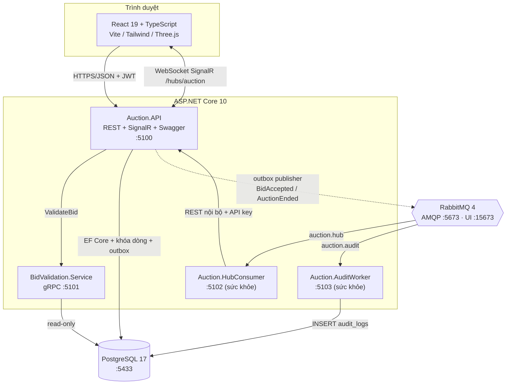

# Kiến trúc hệ thống

## 1. Tổng quan

Aurelia được chia thành một client trình duyệt và bốn dịch vụ .NET được hỗ trợ bởi PostgreSQL và RabbitMQ. API là backend công khai duy nhất. Dịch vụ gRPC là cơ quan xác thực độc lập. Nhắn tin tách việc phân phối thời gian thực và kiểm toán khỏi đường ghi.

## 2. Dịch vụ và dự án

| Dự án | Loại | Trách nhiệm |
| --- | --- | --- |
| `Auction.API` | ASP.NET Core Web API | Endpoint REST, xác thực JWT, SignalR hub, Swagger, migration/seed, outbox dispatcher, bộ lập lịch phiên đấu giá |
| `Auction.Application` | Thư viện lớp | Trường hợp sử dụng: xác thực, sản phẩm, phiên đấu giá, lượt giá, người dùng, quản trị, vòng đời |
| `Auction.Domain` | Thư viện lớp | Thực thể, enum và `BidRules` (nguồn sự thật duy nhất) |
| `Auction.Infrastructure` | Thư viện lớp | EF Core/Npgsql, JWT/BCrypt, client gRPC, outbox publisher, DI |
| `Auction.Messaging` | Thư viện lớp | Kết nối RabbitMQ, topology, publisher, lớp consumer dùng chung |
| `Auction.Contracts` | Thư viện lớp | Bản ghi sự kiện, hằng số routing, tuần tự hóa JSON |
| `BidValidation.Contracts` | Thư viện lớp | Hợp đồng Protobuf và kiểu gRPC đã sinh |
| `BidValidation.Service` | ASP.NET Core gRPC | Xác thực giá độc lập, chỉ đọc PostgreSQL |
| `Auction.HubConsumer` | Worker (minimal web host) | Consumer `auction.hub` → broadcast qua API nội bộ |
| `Auction.AuditWorker` | Worker (minimal web host) | Consumer `auction.audit` → `audit_logs` |
| `Auction.Tests` | Dự án kiểm tra xUnit | Kiểm tra quy tắc, hợp đồng sự kiện, tích hợp với PostgreSQL thực tế |

Hướng phụ thuộc: `API/Workers → Application → Domain`; `Infrastructure → Application`; `API → Infrastructure`.
Lớp Application không bao giờ tham chiếu trực tiếp `DbContext` của EF Core — nó dùng `IAppDbContext`.

## 3. Topology khi chạy (cục bộ)

| Thành phần | URL / cổng |
| --- | --- |
| Frontend (Vite dev) | `http://localhost:5173` |
| REST API / Swagger | `http://localhost:5100` · `/swagger` |
| SignalR hub | `http://localhost:5100/hubs/auction` |
| gRPC Bid Validation | `http://localhost:5101` (HTTP/2) |
| Sức khỏe Hub Consumer | `http://localhost:5102/health` |
| Sức khỏe Audit Worker | `http://localhost:5103/health` |
| PostgreSQL | `localhost:5433` (`auctiondb`, user `auction`) |
| RabbitMQ AMQP / quản trị | `localhost:5673` / `http://localhost:15673` |

Docker Compose ánh xạ cùng các cổng máy chủ. Bên trong mạng Compose, các dịch vụ dùng
`postgres:5432`, `rabbitmq:5672`, `api:8080`, `grpc:5101`.

## 4. Đường ghi của lượt giá (đường quan trọng)

1. **Kiểm tra REST** — kiểm tra vai trò JWT, xác thực model, số tiền dương, làm tròn hai chữ số thập phân.
2. **Tiền xác thực gRPC** — dịch vụ độc lập đọc phiên + người đặt giá và áp dụng `BidRules`;
   trả về mã lỗi, giá hiện tại quyết định và giá hợp lệ kế tiếp.
3. **Giao dịch ghi** — giao dịch read-committed; `SELECT 1 FROM auctions WHERE id = @id FOR UPDATE`
   chặn các writer cạnh tranh chỉ cho phiên đó.
4. **Kiểm tra lại** — vì giá có thể thay đổi giữa bước 2 và 3, `BidRules` chạy lại
   trên trạng thái đã khóa. Đây là kiểm tra quyết định.
5. **Lưu trữ nguyên tử** — chèn `bids` (duy nhất `auction_id + sequence`, duy nhất `event_id`),
   cập nhật `auctions.current_price/version`, upsert `auction_participants`, chèn `outbox_messages`.
6. **Commit** — cả năm hiệu ứng cùng commit hoặc không commit gì cả.
7. **Fan-out bất đồng bộ** — outbox dispatcher publish sau khi commit; consumer idempotent.

Tại sao vừa gRPC vừa kiểm tra lại? Dịch vụ gRPC đáp ứng ranh giới xác thực phân tán bắt buộc
và cho API một ý kiến độc lập. Việc kiểm tra lại trong giao dịch đảm bảo đúng đắn: khoảng cách
giữa xác thực và commit là cửa sổ race mà chỉ khóa dòng mới đóng được.

### Mô hình đồng thời

- Khóa dòng PostgreSQL trên phiên tuần tự hóa writer theo từng phiên; các phiên khác chạy song song.
- `UNIQUE (auction_id, sequence)` là tuyến phòng thủ thứ hai chống số thứ tự trùng.
- `UNIQUE (event_id)` trên bids và audit_logs thi hành idempotency ở mức sự kiện.
- Không cần vòng lặp thử lại optimistic-concurrency cho đường đặt giá; `auctions.version` vẫn
  được tăng để quan sát và cho client trong tương lai.
- `EnableRetryOnFailure` cố tình **không** được kết hợp với giao dịch người dùng rõ ràng: phát lại
  một commit mơ hồ có thể nhân đôi lượt giá. Độ bền được đảm bảo bởi outbox.

### Transactional outbox

`outbox_messages` được ghi trong cùng giao dịch với lượt giá. `OutboxPublisherService` thăm dò
các dòng chưa publish (có tín hiệu trong tiến trình để đánh thức ngay), publish với xác nhận
từ publisher và đánh dấu `published_at_utc`. Lỗi tăng `attempts`, ghi `last_error` và được thử lại.
Giao hàng là **ít nhất một lần**; consumer tự loại trùng.

## 5. Kiến trúc thời gian thực

- `AuctionHub` nằm trong API tại `/hubs/auction`.
- JWT được chấp nhận từ tham số query `access_token` cho handshake WebSocket.
- Client gọi `JoinAuction(auctionId)` / `LeaveAuction(auctionId)`; hub quản lý các nhóm SignalR.
- API không bao giờ publish tới SignalR từ giao dịch đặt giá. Nó chờ vòng tròn RabbitMQ:
  `outbox → RabbitMQ → HubConsumer → POST /internal/hub/bid-accepted → IHubContext → nhóm`.
- Điều này chứng minh toàn bộ đường ống bắt buộc và giữ phản hồi HTTP độc lập với client đã kết nối.
- Giao diện cũng tải lại ảnh chụp sau khi kết nối lại, nên thông điệp bị trễ không để lại trạng thái cũ.

## 6. Kiến trúc sự kiện và kiểm toán

Hai queue bền vững gắn với topic exchange `auction.events` cho cả hai routing key:

| Queue | Mục đích | Đường lỗi |
| --- | --- | --- |
| `auction.hub` | Broadcast thời gian thực | thử lại tại chỗ 3× → `auction.hub.dlq` |
| `auction.audit` | Lưu kiểm toán | thử lại tại chỗ 3× → `auction.audit.dlq` |

Audit Worker chèn `audit_logs` với `event_id` duy nhất; một lần giao trùng được ACK mà không tạo
dòng thứ hai. Hub Consumer chuyển tiếp nội dung sự kiện tới API với `X-Internal-Api-Key`; endpoint
này bị loại khỏi Swagger và không tiếp xúc với trình duyệt.

## 7. An ninh

- **Xác thực:** JWT HS256, kiểm tra issuer/audience/lifetime/signature, cho phép lệch đồng hồ 30 giây.
- **Ủy quyền:** `[Authorize(Roles = "Bidder")]` cho đặt giá, `[Authorize(Roles = "Admin")]` cho endpoint quản trị.
- **Mật khẩu:** BCrypt với muối riêng; lỗi đăng nhập không tiết lộ email có tồn tại hay không.
- **Đầu vào:** DataAnnotations cộng quy tắc domain rõ ràng; EF Core tham số hóa SQL; chuỗi SQL thô
  duy nhất là câu lệnh `FOR UPDATE` hằng với tham số được nội suy.
- **Kênh nội bộ:** `X-Internal-Api-Key` chia sẻ, so sánh thời gian không đổi, endpoint ẩn khỏi Swagger.
- **CORS:** danh sách cho phép nguồn rõ ràng kèm credentials cho SignalR.
- **Bí mật:** giá trị mặc định phát triển được đánh dấu rõ chỉ để dev. Compose dùng `.env`; sản xuất phải
  cung cấp `JWT_KEY`, thông tin database và RabbitMQ từ bên ngoài.

## 8. Dữ liệu và nhất quán

- PostgreSQL là nguồn lưu trữ quyết định.
- Tiền là `decimal(18,2)`; hợp đồng gRPC vận chuyển số tiền dưới dạng chuỗi để tránh mất dấu phẩy động.
- Mọi mốc thời gian đều UTC (`timestamptz`); API trả `serverTimeUtc` để đồng hồ đếm ngược an toàn trước lệch đồng hồ.
- Thay đổi vòng đời phiên và đóng phiên đều dùng giao dịch tuần tự và phát sự kiện outbox.
- Xử lý của consumer idempotent theo event id; broadcast của hub tự nhiên idempotent với giao diện.

## 9. Triển khai

### Docker Compose

`docker-compose.yml` tạo bốn ảnh .NET từ một Dockerfile đa giai đoạn dùng chung và một ảnh frontend
do nginx phục vụ. PostgreSQL và RabbitMQ dùng named volume và health check. Biến môi trường
ghi đè mọi connection string và bí mật.

### Cục bộ (đã dùng để xác minh trên máy này)

PostgreSQL 17, RabbitMQ 4 + Erlang 27 và bốn dịch vụ chạy dưới dạng tiến trình cục bộ. Đường này
được ghi trong README vì Docker Desktop cần ảo hóa phần cứng, không có trên máy xác minh.
Tất cả bằng chứng chức năng trong `test-results.md` được tạo cục bộ với PostgreSQL, RabbitMQ và SignalR thực tế.

## 10. Quyết định chính và đánh đổi

| Quyết định | Lý do | Đánh đổi |
| --- | --- | --- |
| Khóa dòng thay vì retry optimistic | Đảm bảo một người thắng duy nhất khi cạnh tranh; dễ suy luận | Writer cùng một phiên phải tuần tự |
| gRPC + kiểm tra lại trong giao dịch | Đáp ứng yêu cầu xác thực phân tán mà không tin vào kiểm tra cũ | Thêm một lần gọi mạng cho mỗi lượt giá |
| Transactional outbox | Không bao giờ mất sự kiện đã chấp nhận khi broker downtime | Thêm bảng và dispatcher; ngữ nghĩa ít nhất một lần |
| Hub Consumer riêng | Chứng minh đường ống RabbitMQ → SignalR, giữ API không trạng thái | Thêm một tiến trình |
| Dùng chung `BidRules` | gRPC và API không thể khác nhau | Dự án domain phải không phụ thuộc |
| Schema snake-case | Đúng cách PostgreSQL và SQL dễ đọc | Cần gói naming convention và fixture kiểm tra khớp |
| Cầu nối REST nội bộ | Consumer không cần client SignalR hay nội bộ API | Phải quản lý khóa chia sẻ |
