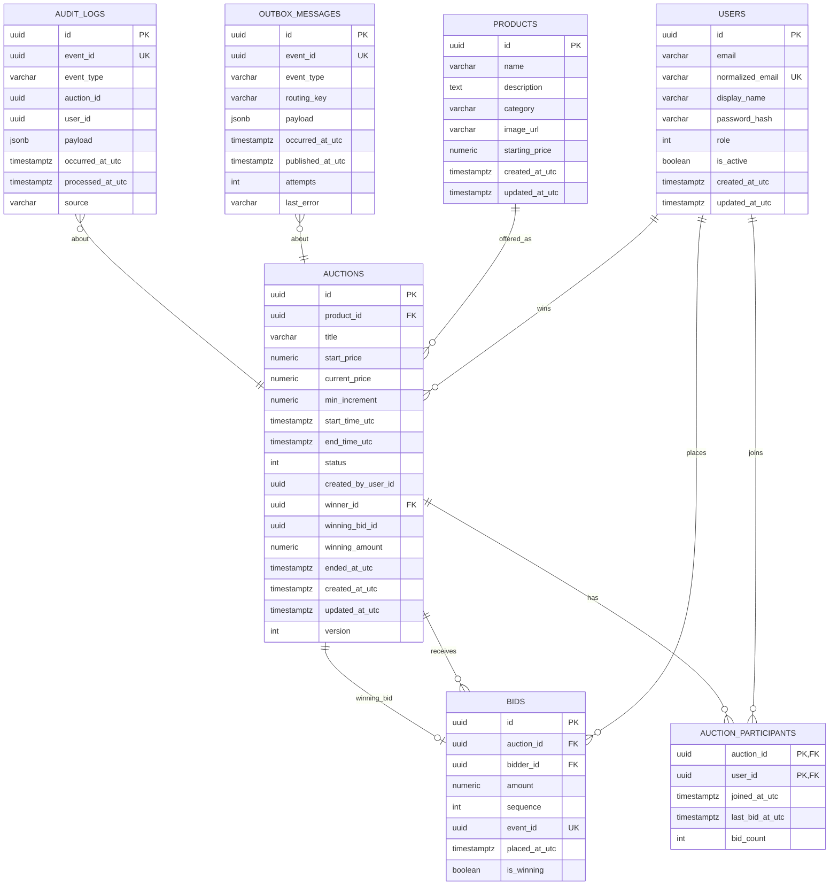

# Thiết kế cơ sở dữ liệu

## 1. Công nghệ

- PostgreSQL 17
- EF Core 10 + Npgsql 10
- `EFCore.NamingConventions` ánh xạ thuộc tính CLR PascalCase sang bảng/cột snake_case
- Migration nằm trong `backend/Auction.Infrastructure/Persistence/Migrations`
- API áp dụng migration và dữ liệu mẫu khi khởi động (`Database:AutoMigrate=true`)

## 2. Biểu đồ thực thể-quan hệ



## 3. Các bảng

### 3.1 `users`

| Cột | Kiểu | Ràng buộc |
| --- | --- | --- |
| `id` | `uuid` | PK, do ứng dụng tạo mặc định |
| `email` | `varchar(256)` | NOT NULL |
| `normalized_email` | `varchar(256)` | NOT NULL, **UNIQUE** |
| `display_name` | `varchar(80)` | NOT NULL |
| `password_hash` | `varchar(200)` | NOT NULL, BCrypt |
| `role` | `integer` | NOT NULL; `0=Bidder`, `1=Admin` |
| `is_active` | `boolean` | NOT NULL |
| `created_at_utc` | `timestamptz` | NOT NULL, lập chỉ mục |
| `updated_at_utc` | `timestamptz` | NOT NULL |

Chỉ mục: `ux_users_normalized_email` (duy nhất), `ix_users_created_at_utc`.

### 3.2 `products`

| Cột | Kiểu | Ràng buộc |
| --- | --- | --- |
| `id` | `uuid` | PK |
| `name` | `varchar(160)` | NOT NULL, lập chỉ mục |
| `description` | `varchar(4000)` / text | NOT NULL |
| `category` | `varchar(60)` | NOT NULL, lập chỉ mục |
| `image_url` | `varchar(1024)` | NULL |
| `starting_price` | `numeric(18,2)` | NOT NULL |
| `created_at_utc`, `updated_at_utc` | `timestamptz` | NOT NULL |

Chỉ mục: `ix_products_category`, `ix_products_name`.

### 3.3 `auctions`

| Cột | Kiểu | Ràng buộc |
| --- | --- | --- |
| `id` | `uuid` | PK |
| `product_id` | `uuid` | FK → `products.id`, `RESTRICT`, lập chỉ mục |
| `title` | `varchar(180)` | NOT NULL |
| `start_price` | `numeric(18,2)` | NOT NULL |
| `current_price` | `numeric(18,2)` | NOT NULL |
| `min_increment` | `numeric(18,2)` | NOT NULL |
| `start_time_utc`, `end_time_utc` | `timestamptz` | NOT NULL |
| `status` | `integer` | NOT NULL; `0=Scheduled`, `1=Active`, `2=Ended`, `3=Cancelled` |
| `created_by_user_id` | `uuid` | NOT NULL |
| `winner_id` | `uuid` | NULL, FK → `users.id`, `RESTRICT`, lập chỉ mục |
| `winning_bid_id` | `uuid` | NULL |
| `winning_amount` | `numeric(18,2)` | NULL |
| `ended_at_utc` | `timestamptz` | NULL |
| `created_at_utc`, `updated_at_utc` | `timestamptz` | NOT NULL |
| `version` | `integer` | NOT NULL, tăng trên mỗi lượt giá được chấp nhận |

Chỉ mục: `ix_auctions_status_end_time_utc`, `ix_auctions_product_id`, `ix_auctions_winner_id`.

### 3.4 `bids`

| Cột | Kiểu | Ràng buộc |
| --- | --- | --- |
| `id` | `uuid` | PK |
| `auction_id` | `uuid` | FK → `auctions.id`, `CASCADE` |
| `bidder_id` | `uuid` | FK → `users.id`, `RESTRICT` |
| `amount` | `numeric(18,2)` | NOT NULL |
| `sequence` | `integer` | NOT NULL, bắt đầu từ 1 trong mỗi phiên |
| `event_id` | `uuid` | NOT NULL, **UNIQUE** |
| `placed_at_utc` | `timestamptz` | NOT NULL, lập chỉ mục |
| `is_winning` | `boolean` | NOT NULL |

Chỉ mục:

- `ux_bids_auction_id_sequence` **UNIQUE** — ngăn số thứ tự trùng.
- `ux_bids_event_id` **UNIQUE** — idempotency và khả năng truy vết sự kiện.
- `ix_bids_auction_id_amount` (số tiền giảm dần) — tra cứu lượt giá cao nhất nhanh.
- `ix_bids_placed_at_utc`.

### 3.5 `auction_participants`

PK tổng hợp `(auction_id, user_id)`. Cả hai FK đều CASCADE khi xóa. Các cột:
`joined_at_utc`, `last_bid_at_utc`, `bid_count` (aggregate phi chuẩn hóa được duy trì trong giao dịch đặt giá).
Chỉ mục: `ix_auction_participants_user_id`.

### 3.6 `outbox_messages`

| Cột | Kiểu | Ghi chú |
| --- | --- | --- |
| `id` | `uuid` | PK |
| `event_id` | `uuid` | Duy nhất theo hợp đồng sự kiện, lập chỉ mục |
| `event_type` | `varchar(60)` | `BidAccepted`, `AuctionEnded` |
| `routing_key` | `varchar(120)` | `bid.accepted`, `auction.ended` |
| `payload` | `jsonb` | Sự kiện đã tuần tự hóa |
| `occurred_at_utc` | `timestamptz` | Mốc thời gian domain |
| `published_at_utc` | `timestamptz` | NULL cho đến khi broker xác nhận |
| `attempts` | `integer` | Số lần publish |
| `last_error` | `varchar(2000)` | Lỗi publish gần nhất |

Chỉ mục: `ix_outbox_messages_published_at_utc` hỗ trợ truy vấn của dispatcher.

### 3.7 `audit_logs`

| Cột | Kiểu | Ghi chú |
| --- | --- | --- |
| `id` | `uuid` | PK |
| `event_id` | `uuid` | **UNIQUE** — loại trùng các lần giao lại |
| `event_type` | `varchar(60)` | Lập chỉ mục |
| `auction_id` | `uuid` | Có thể NULL, lập chỉ mục |
| `user_id` | `uuid` | Có thể NULL |
| `payload` | `jsonb` | JSON sự kiện đầy đủ |
| `occurred_at_utc` | `timestamptz` | Lập chỉ mục giảm dần |
| `processed_at_utc` | `timestamptz` | Đồng hồ của worker |
| `source` | `varchar(40)` | `rabbitmq` |

## 4. Đồng thời và đúng đắn

Giao dịch đặt giá thực hiện:

```sql
BEGIN;                                   -- READ COMMITTED
SELECT 1 FROM auctions WHERE id = $1 FOR UPDATE;
-- đọc lại phiên, lượt giá cao nhất; kiểm tra lại BidRules
INSERT INTO bids (... sequence = max + 1, event_id = ...);
UPDATE auctions SET current_price = $2, version = version + 1 ...;
INSERT INTO auction_participants ... ON CONFLICT ...;
INSERT INTO outbox_messages (...);
COMMIT;
```

- `FOR UPDATE` tuần tự hóa các lượt giá đồng thời cho một phiên.
- Chỉ mục duy nhất `(auction_id, sequence)` làm cho số thứ tự trùng là không thể, ngay cả khi mã
  trong tương lai quên khóa.
- Chỉ mục duy nhất `event_id` giúp việc tạo sự kiện đặt giá truy vết được và bảo vệ việc loại trùng kiểm toán.
- Hai lượt giá đồng thời cùng mức giá: lượt thứ nhất commit, lượt thứ hai đọc lại giá mới và bị
  `BidRules` từ chối với `BID_TOO_LOW` (hoặc `BID_STEP_TOO_SMALL`).
- Việc đóng phiên dùng cùng khóa và phát `AuctionEnded` trong cùng giao dịch.

## 5. Migration

```bash
# từ backend/
dotnet ef migrations add <Name> \
  --project Auction.Infrastructure --startup-project Auction.API --context AuctionDbContext

dotnet ef database update \
  --project Auction.Infrastructure --startup-project Auction.API --context AuctionDbContext
```

Bản baseline đã cam kết là `20261119072840_InitialCreate`. Fixture kiểm tra áp dụng cùng các migration
tới `auctiondb_test`, nên bài kiểm tra tích hợp dùng đúng schema thực tế.

## 6. Dữ liệu mẫu

`DbSeeder` idempotent (kiểm tra xem người dùng đã tồn tại chưa). Nó tạo:

- 1 quản trị viên: `admin@auction.local` / `Admin@123` (Nguyễn Hoàng Nam)
- 3 người đấu giá: `alice@auction.local`, `bob@auction.local`, `chloe@auction.local` / `Bidder@123` (Nguyễn Minh Anh, Trần Quốc Bảo, Lê Thu Hà)
- 10 sản phẩm với ảnh SVG cục bộ trong `/media/*.svg`
- 6 phiên bao phủ các trạng thái đang diễn ra, sắp diễn ra và đã kết thúc
- 11 lượt giá lịch sử và aggregate người tham gia

Dữ liệu mẫu dùng offset tương đối theo `UtcNow`, nên đồng hồ đếm ngược demo luôn có ý nghĩa sau mỗi lần khởi động mới.

## 7. Ghi chú vận hành

- Mọi mốc thời gian đều UTC. Giao diện dùng `serverTimeUtc` để tính offset.
- Số tiền là `numeric(18,2)`; không bao giờ dùng dấu phẩy động cho tiền.
- `audit_logs` chỉ thêm từ góc nhìn ứng dụng; không có endpoint update/delete.
- Có thể kiểm tra outbox bằng:
  ```sql
  SELECT event_type, published_at_utc, attempts, last_error
  FROM outbox_messages ORDER BY occurred_at_utc DESC LIMIT 20;
  ```
- RabbitMQ downtime: các dòng outbox chờ publish; API vẫn chấp nhận lượt giá; dispatcher thử lại.
