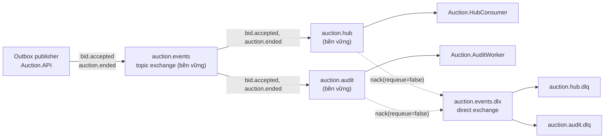

# Thiết kế RabbitMQ

## 1. Mục tiêu

- Không bao giờ mất sự kiện tương ứng với lượt giá đã commit hoặc phiên đã kết thúc.
- Giao mỗi sự kiện tới hai consumer độc lập: fan-out thời gian thực và kiểm toán.
- Chịu được downtime của broker mà không làm lỗi yêu cầu HTTP.
- Làm cho việc giao lại không gây hại (consumer idempotent).
- Tránh vòng lặp thông điệp độc hại.

## 2. Topology



Hằng số: `backend/Auction.Contracts/AuctionEvents.cs`  
Thiết lập/publisher/consumer: `backend/Auction.Messaging/RabbitMqMessaging.cs`

| Đối tượng | Loại | Bền vững | Mục đích |
| --- | --- | --- | --- |
| `auction.events` | topic exchange | có | Publish sự kiện domain |
| `auction.events.dlx` | direct exchange | có | Routing dead-letter |
| `auction.hub` | queue | có | Cầu nối SignalR |
| `auction.audit` | queue | có | Lưu kiểm toán |
| `auction.hub.dlq` | queue | có | Sự kiện hub thất bại |
| `auction.audit.dlq` | queue | có | Sự kiện kiểm toán thất bại |

Cả hai queue gắn với cả hai routing key, nên mỗi consumer thấy toàn bộ luồng sự kiện.
Queue khai báo `x-dead-letter-exchange=auction.events.dlx`; DLQ gắn cùng routing key trên DLX.

Tiền tố theo môi trường tùy chọn: `RabbitMq:QueuePrefix` được áp qua `ResolveQueue()` để tránh
xung đột khi nhiều môi trường dùng chung một broker.

## 3. Sự kiện

### 3.1 `BidAccepted` (`bid.accepted`)

```json
{
  "eventId": "…",
  "auctionId": "…",
  "bidId": "…",
  "bidderId": "…",
  "bidderDisplayName": "Nguyễn Minh Anh",
  "amount": 16000.00,
  "previousPrice": 15500.00,
  "currentPrice": 16000.00,
  "minimumNextBid": 16500.00,
  "auctionTitle": "Chronograph Sapphire Đêm — Số 07",
  "occurredAtUtc": "2026-11-19T08:21:39Z",
  "sequence": 5
}
```

### 3.2 `AuctionEnded` (`auction.ended`)

```json
{
  "eventId": "…",
  "auctionId": "…",
  "auctionTitle": "Nhẫn Ngọc Lục Bảo Hoàng Gia — 4.8ct",
  "winnerId": "…",
  "winnerDisplayName": "Nguyễn Minh Anh",
  "winningBidId": "…",
  "winningAmount": 10200.00,
  "totalBids": 6,
  "endedAtUtc": "2026-11-19T06:00:00Z"
}
```

Tuần tự hóa: `System.Text.Json`, camelCase, UTC ISO-8601 (`EventSerialization`).

## 4. Publish: transactional outbox

API không bao giờ publish trong giao dịch đặt giá. Thay vào đó:

1. Giao dịch đặt giá chèn một dòng `outbox_messages` (`event_id`, loại, routing key, JSON, thời điểm phát sinh).
2. Commit thành công → trả HTTP `201`.
3. `OutboxPublisherService` đọc các dòng chưa publish theo thời điểm phát sinh.
4. Nó publish bền vững với:
   - `delivery_mode=2`
   - `message_id=event_id`
   - `type=event_type`
   - header `x-event-id`, `x-event-type`
   - bật publisher confirmations
5. Khi có xác nhận, đặt `published_at_utc`, `attempts`, xóa `last_error`.
6. Khi lỗi, ghi `attempts` và `last_error` rồi thử lại với backoff.
7. `IOutboxSignal` đánh thức dispatcher ngay sau commit; bộ đếm định kỳ là phương án dự phòng.

Điều này cho giao hàng **ít nhất một lần**: crash sau publish nhưng trước khi cập nhật DB gây publish lại, và consumer tự loại trùng.

## 5. Tiêu thụ

`QueueConsumerService` là consumer ACK thủ công dùng chung:

- `prefetch = 20`, channel riêng cho mỗi consumer.
- Tạo kết nối/topology lúc khởi động và kết nối lại với backoff lũy thừa (tối đa 15 s).
- Với mỗi thông điệp:
  1. Giải tuần tự envelope (`routingKey`, `eventType`, `eventId`, JSON).
  2. Gọi handler của lớp con.
  3. ACK khi thành công.
  4. Khi có exception, thử lại tại chỗ tối đa 3 lần với độ trễ ngắn.
  5. Sau khi cạn ngân sách, `basic.nack(requeue=false)` → DLX → DLQ.

### Hub Consumer

`auction.hub` → `Auction.HubConsumer` → `POST /internal/hub/bid-accepted` hoặc
`/internal/hub/auction-ended` với `X-Internal-Api-Key`. API broadcast tới nhóm SignalR.
Chỉ sau khi API trả `202` thì thông điệp mới được ACK.

### Audit Worker

`auction.audit` → `Auction.AuditWorker` → `INSERT INTO audit_logs`.
Chỉ mục duy nhất `event_id` đảm bảo idempotency: lần insert trùng được bắt và coi là
thành công (ACK), không bao giờ tạo dòng trùng.

## 6. Idempotency và thứ tự

- `bids.event_id` được tạo một lần cho mỗi lượt giá và tái dùng làm `event_id` của outbox và `message_id` của AMQP.
- `audit_logs.event_id` là duy nhất.
- RabbitMQ không đảm bảo thứ tự toàn cục giữa các queue; thứ tự theo phiên được giữ trong thực tế vì một queue và consumer giới hạn prefetch xử lý thông điệp theo thứ tự. Giao diện cũng chống được cập nhật sai thứ tự (giữ giá cao nhất và tải lại khi kết nối lại).
- Consumer an toàn khi chạy nhiều instance; queue phân phối thông điệp.

## 7. Kịch bản lỗi

| Kịch bản | Hành vi |
| --- | --- |
| Broker downtime lúc lượt giá commit | Lượt giá vẫn commit; dòng outbox chờ; dispatcher thử lại đến khi broker trở lại |
| Broker downtime lúc tiêu thụ | Consumer kết nối lại với backoff; thông điệp chưa ACK được giao lại |
| Hub Consumer downtime | Thông điệp tích trong `auction.hub`; kiểm toán vẫn chạy độc lập |
| Audit Worker downtime | Thông điệp tích trong `auction.audit`; realtime vẫn chạy độc lập |
| Endpoint nội bộ của API downtime | Hub Consumer thử 3× rồi đưa vào dead-letter; kiểm toán không ảnh hưởng |
| Sự kiện độc hại | 3 lần thất bại → DLQ với payload gốc |
| Giao trùng | Loại trùng theo `event_id` ở kiểm toán; cập nhật UI idempotent |
| Publisher crash sau confirm | Dòng có thể publish lại; consumer tự loại trùng |

## 8. Vận hành

UI quản trị: `http://localhost:15673` (user `auction`, mật khẩu từ cấu hình).  
AMQP: `localhost:5673`.

Các lệnh hữu ích:

```bash
rabbitmqctl list_queues name messages_ready messages_unacknowledged
rabbitmqctl list_bindings
rabbitmqctl list_exchanges
```

Kiểm tra không tiêu thụ:

```bash
rabbitmqadmin get queue=auction.audit count=5
```

Chạy lại DLQ (thủ công, sau khi sửa nguyên nhân):

```bash
rabbitmqadmin publish exchange=auction.events routing_key=bid.accepted \
  payload="$(rabbitmqadmin get queue=auction.audit.dlq count=1 --format=raw_json | ...)"
```

## 9. Cấu hình

```json
"RabbitMq": {
  "HostName": "localhost",
  "Port": 5673,
  "UserName": "auction",
  "Password": "auction_dev_password",
  "VirtualHost": "/",
  "Enabled": true,
  "QueuePrefix": ""
}
```

`Enabled=false` cho phép nhà phát triển chạy API không có broker khi làm việc với UI; consumer ghi cảnh báo và outbox giữ sự kiện. Đây là tiện ích phát triển, không được dùng trong xác minh.
