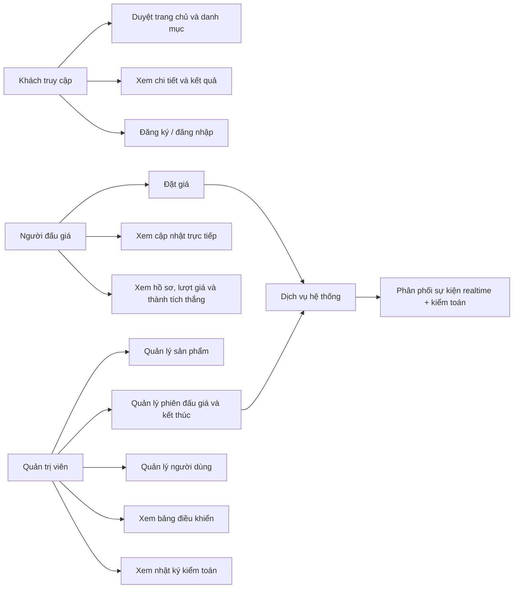

# Trường hợp sử dụng

## 1. Tác nhân

- **Khách truy cập** — người dùng trình duyệt chưa xác thực.
- **Người đấu giá** — người dùng đã xác thực với vai trò `Bidder`.
- **Quản trị viên** — người dùng đã xác thực với vai trò `Admin`.
- **RabbitMQ** — message broker (tác nhân hệ thống).
- **Hub Consumer** — dịch vụ nền nối RabbitMQ với SignalR.
- **Audit Worker** — dịch vụ nền lưu trữ bản ghi kiểm toán.
- **Auction Scheduler** — worker nền bên trong API kích hoạt và đóng các phiên đấu giá.

## 2. Tổng quan trường hợp sử dụng



| ID | Tên | Tác nhân chính |
| --- | --- | --- |
| UC-01 | Đăng ký tài khoản | Khách truy cập |
| UC-02 | Đăng nhập / đăng xuất | Khách truy cập, Người đấu giá, Quản trị viên |
| UC-03 | Duyệt và tìm kiếm phiên đấu giá | Khách truy cập |
| UC-04 | Xem chi tiết và kết quả phiên | Khách truy cập |
| UC-05 | Đặt giá | Người đấu giá |
| UC-06 | Xem cập nhật trực tiếp | Khách truy cập, Người đấu giá |
| UC-07 | Xem hồ sơ và lịch sử cá nhân | Người đấu giá |
| UC-08 | Quản lý sản phẩm | Quản trị viên |
| UC-09 | Tạo / kết thúc phiên đấu giá | Quản trị viên |
| UC-10 | Quản lý người dùng | Quản trị viên |
| UC-11 | Xem bảng điều khiển | Quản trị viên |
| UC-12 | Xem nhật ký kiểm toán | Quản trị viên |
| UC-13 | Vòng đời tự động và phân phối sự kiện | Hệ thống |

---

## UC-01 Đăng ký tài khoản

**Tác nhân:** Khách truy cập  
**Điều kiện tiên quyết:** Email hợp lệ chưa được đăng ký.  
**Kích hoạt:** Khách truy cập gửi biểu mẫu đăng ký.

**Luồng chính**

1. Khách truy cập nhập tên hiển thị, email, mật khẩu và xác nhận mật khẩu.
2. Trình duyệt kiểm tra các trường bắt buộc, định dạng email, độ dài mật khẩu và mật khẩu xác nhận khớp nhau.
3. `POST /api/auth/register` chuẩn hóa email và kiểm tra tính duy nhất.
4. API băm mật khẩu bằng BCrypt và tạo một `Bidder`.
5. API trả `201` kèm JWT và hồ sơ công khai của người dùng.
6. Frontend lưu token và chuyển hướng tới trang đã yêu cầu.

**Phương án / ngoại lệ**

- Email trùng → `409 EMAIL_IN_USE`.
- Payload không hợp lệ → `400 VALIDATION_ERROR` kèm lỗi từng trường.
- Mạng/API không khả dụng → lỗi hiển thị ngay; không tạo tài khoản một phần.

---

## UC-02 Đăng nhập / đăng xuất

**Tác nhân:** Khách truy cập, Người đấu giá, Quản trị viên  
**Luồng chính**

1. Người dùng gửi email và mật khẩu.
2. `POST /api/auth/login` xác minh băm BCrypt và kiểm tra tài khoản còn hoạt động.
3. API trả JWT (8 giờ), thời gian hết hạn và hồ sơ công khai.
4. Client lưu token và đính kèm `Authorization: Bearer <token>` vào các lời gọi API.
5. SignalR kết nối với `access_token` trong query string.

**Ngoại lệ**

- Sai thông tin → `401 INVALID_CREDENTIALS` (thông điệp chung; không liệt kê tài khoản).
- Tài khoản bị khóa → `401 ACCOUNT_DISABLED`.
- Đăng xuất không trạng thái: client hủy token và ngắt kết nối hub.

---

## UC-03 Duyệt và tìm kiếm phiên đấu giá

**Tác nhân:** Khách truy cập  
**Luồng chính**

1. Trang chủ yêu cầu `/api/auctions/stats` và các phiên nổi bật.
2. Trang danh mục yêu cầu `/api/auctions?status=&category=&q=&sort=&page=&pageSize=`.
3. API lọc, sắp xếp, phân trang và trả thời gian máy chủ cho đồng hồ đếm ngược.
4. Giao diện hiển thị các thẻ đáp ứng với trạng thái trực tiếp/đã kết thúc/sắp diễn ra, giá hiện tại và thời gian còn lại.

**Phương án**

- Không có kết quả → trạng thái trống với thao tác xóa bộ lọc.
- API không đến được → trạng thái lỗi kèm nút thử lại.

---

## UC-04 Xem chi tiết và kết quả phiên đấu giá

**Tác nhân:** Khách truy cập  
**Luồng chính**

1. Client yêu cầu `/api/auctions/{id}`.
2. API trả dữ liệu sản phẩm, giá, giá hợp lệ kế tiếp, trạng thái, số lượt giá, người tham gia, lượt giá gần đây, người thắng và thời gian máy chủ.
3. Giao diện hiển thị khu vực chính (3D hoặc ảnh), đồng hồ đếm ngược, bảng đặt giá, biểu đồ giá, luồng lượt giá và người tham gia.
4. Với phiên đã kết thúc, panel kết quả hiển thị người thắng, số tiền thắng và thời gian kết thúc.

**Ngoại lệ**

- Id không tồn tại → `404 AUCTION_NOT_FOUND`; giao diện hiển thị trạng thái không tìm thấy.

---

## UC-05 Đặt giá (trường hợp sử dụng cốt lõi)

**Tác nhân:** Người đấu giá  
**Điều kiện tiên quyết:** Người đấu giá đã xác thực; phiên còn hoạt động và trong khung giờ mở.  
**Kích hoạt:** Người đấu giá gửi số tiền.

**Luồng chính**

1. Giao diện kiểm tra số tiền cục bộ theo giá hợp lệ kế tiếp.
2. `POST /api/auctions/{id}/bids` với `{ "amount": 16000 }`.
3. API gọi dịch vụ **gRPC Bid Validation** với mã phiên, mã người đặt giá và số tiền.
4. Dịch vụ gRPC tải phiên và người đặt giá từ PostgreSQL, áp dụng `BidRules`.
5. Khi hợp lệ, API mở giao dịch read-committed và thực hiện `SELECT 1 FROM auctions WHERE id = ... FOR UPDATE`.
6. API tải lại phiên và lượt giá cao nhất, tính lại giá quyết định và áp dụng lại `BidRules`.
7. API chèn lượt giá (số thứ tự kế tiếp, event id duy nhất), cập nhật giá/phiên bản phiên, upsert bản aggregate người tham gia và chèn một dòng outbox `BidAccepted`.
8. Giao dịch commit nguyên tử.
9. API trả `201` kèm mã lượt giá, giá hiện tại và giá hợp lệ kế tiếp.
10. Bộ phân phối outbox publish `BidAccepted` tới topic exchange `auction.events`.
11. **Hub Consumer** nhận sự kiện và gọi endpoint broadcast nội bộ của API.
12. API gửi `BidAccepted` tới nhóm SignalR của phiên; các trình duyệt đã kết nối cập nhật ngay lập tức.
13. **Audit Worker** nhận cùng sự kiện và chèn một dòng `audit_logs`.

**Trình tự**

```mermaid
sequenceDiagram
  autonumber
  participant UI as Trình duyệt
  participant API as Auction.API
  participant GRPC as BidValidation.Service
  participant DB as PostgreSQL
  participant OUT as Outbox publisher
  participant MQ as RabbitMQ
  participant HUB as Hub Consumer
  participant AUD as Audit Worker

  UI->>API: POST /api/auctions/{id}/bids
  API->>GRPC: ValidateBid(auction, bidder, amount)
  GRPC->>DB: đọc phiên + người đặt giá
  GRPC-->>API: hợp lệ / mã lỗi
  API->>DB: BEGIN; SELECT ... FOR UPDATE
  API->>DB: kiểm tra lại, INSERT lượt giá, UPDATE phiên,
  API->>DB: UPSERT người tham gia, INSERT outbox
  API->>DB: COMMIT
  API-->>UI: 201 Created
  OUT->>DB: đọc outbox chưa publish
  OUT->>MQ: publish BidAccepted
  MQ->>HUB: auction.hub
  HUB->>API: POST /internal/hub/bid-accepted
  API-->>UI: SignalR BidAccepted
  MQ->>AUD: auction.audit
  AUD->>DB: INSERT audit_logs
```

**Phương án / ngoại lệ**

| Điều kiện | Kết quả |
| --- | --- |
| JWT không hợp lệ | `401` |
| Quản trị viên hoặc không phải người đấu giá | `403 FORBIDDEN` |
| Phiên không tồn tại | `404 AUCTION_NOT_FOUND` |
| Người đặt giá không tồn tại/bị khóa | `404` / `403 BIDDER_INACTIVE` |
| Phiên chưa bắt đầu | `409 AUCTION_NOT_STARTED` |
| Phiên đã kết thúc/hết hạn | `409 AUCTION_ENDED` |
| Số tiền ≤ giá hiện tại | `409 BID_TOO_LOW` |
| Bước giá quá nhỏ | `409 BID_STEP_TOO_SMALL` |
| Số tiền/thập phân không hợp lệ | `400 INVALID_AMOUNT` |
| Tự đặt giá phiên của mình | `403 SELF_BID_NOT_ALLOWED` |
| Cùng giá đồng thời | đúng một `201`; lượt kia nhận `409 BID_TOO_LOW` |
| gRPC không khả dụng | `503 VALIDATION_UNAVAILABLE`; không ghi dữ liệu |
| RabbitMQ không khả dụng | vẫn trả `201`; outbox publish sau |

**Điều kiện sau:** Lượt giá đã bền vững; `auction.current_price`, `auctions.version`, `bids`, `auction_participants` và `outbox_messages` nhất quán. Sự kiện cuối cùng được giao ít nhất một lần và được consumer loại trùng.

---

## UC-06 Xem cập nhật trực tiếp

**Tác nhân:** Khách truy cập, Người đấu giá  
**Luồng chính**

1. Trang chi tiết mở kết nối SignalR tới `/hubs/auction` và tham gia `auction:{id}`.
2. Khi có `BidAccepted`, giao diện cập nhật giá, giá hợp lệ kế tiếp, người trả giá cao nhất, luồng lượt giá và biểu đồ.
3. Khi có `AuctionEnded`, giao diện chuyển sang panel kết quả và dừng đồng hồ đếm ngược.

**Ngoại lệ**

- Mất kết nối → tự động kết nối lại với backoff; hiển thị chỉ báo trạng thái.
- Kết nối lại thành công → client tham gia lại nhóm và tải lại ảnh chụp chi tiết để lấp khoảng trống.

---

## UC-07 Xem hồ sơ và lịch sử cá nhân

**Tác nhân:** Người đấu giá  
**Luồng chính**

1. `GET /api/users/me` trả hồ sơ và các số liệu tổng hợp.
2. Các tab yêu cầu `/api/users/me/bids`, `/api/users/me/auctions` và `/api/users/me/wins`.
3. Giao diện hiển thị thống kê, lịch sử đặt giá và liên kết tới từng phiên.

---

## UC-08 Quản lý sản phẩm

**Tác nhân:** Quản trị viên  
**Luồng chính**

1. Quản trị viên mở **Sản phẩm** và tìm kiếm/phân trang danh mục.
2. Tạo/cập nhật mở modal đã kiểm tra và gọi `POST/PUT /api/products`.
3. Xóa yêu cầu xác nhận và gọi `DELETE /api/products/{id}`.

**Ngoại lệ**

- Sản phẩm đã gắn với phiên → `409 PRODUCT_IN_USE`.
- Lỗi kiểm tra được hiển thị theo từng trường.

---

## UC-09 Tạo và kết thúc phiên đấu giá

**Tác nhân:** Quản trị viên  
**Luồng chính**

1. Quản trị viên chọn sản phẩm, tiêu đề, giá khởi điểm, bước giá tối thiểu, thời gian mở và kết thúc.
2. `POST /api/auctions` kiểm tra khung giờ và lưu phiên `Scheduled` hoặc `Active`.
3. Bộ lập lịch kích hoạt/kết thúc phiên khi đến khung giờ.
4. Quản trị viên có thể kết thúc ngay bằng `POST /api/auctions/{id}/end`.

**Điều kiện sau:** Người thắng là lượt giá cao nhất; `AuctionEnded` được phát ra qua outbox.

---

## UC-10 Quản lý người dùng

**Tác nhân:** Quản trị viên  
**Luồng chính**

1. Quản trị viên tìm người dùng.
2. Quản trị viên đổi vai trò (`PUT /api/admin/users/{id}/role`) hoặc trạng thái hoạt động (`PUT /api/admin/users/{id}/status`).
3. API ngăn việc tự giáng quyền và tự khóa tài khoản.

---

## UC-11 Xem bảng điều khiển

**Tác nhân:** Quản trị viên  
**Luồng chính**

1. `GET /api/admin/dashboard` trả tổng số, chuỗi lượt giá 14 ngày, phân bố trạng thái, phiên top và lượt giá gần đây.
2. Giao diện hiển thị thẻ KPI, biểu đồ xu hướng SVG và bảng hoạt động.

---

## UC-12 Xem nhật ký kiểm toán

**Tác nhân:** Quản trị viên  
**Luồng chính**

1. `GET /api/admin/audit-logs?eventType=&page=&pageSize=` trả nhật ký kiểm toán.
2. Giao diện hiển thị loại sự kiện, phiên, người dùng, thời điểm phát sinh/xử lý và payload JSON có thể mở rộng.

**Lưu ý:** Bản ghi được ghi bởi Audit Worker từ RabbitMQ, không phải từ đường đi của yêu cầu API.

---

## UC-13 Vòng đời tự động và phân phối sự kiện

**Tác nhân:** Scheduler, Outbox publisher, RabbitMQ, Hub Consumer, Audit Worker

1. Mỗi giây, bộ lập lịch kích hoạt các phiên đến hạn và đóng các phiên đã hết hạn trong giao dịch tuần tự.
2. Mỗi lần đóng chọn lượt giá thắng, cập nhật phiên và chèn một dòng outbox `AuctionEnded`.
3. Outbox publisher gửi các dòng chưa publish tới RabbitMQ với xác nhận từ publisher.
4. Cả hai queue nhận mỗi sự kiện; consumer ACK khi thành công, thử lại 3 lần và đưa lỗi vào dead-letter.
5. Broadcast của Hub và các dòng kiểm toán đều idempotent theo `event_id`.
