# BÁO CÁO THỰC HÀNH BÀI 3: GIAO TIẾP THỜI GIAN THỰC VỚI SIGNALR
## Hệ thống PingSignalR & EduSubmit Realtime Submission System

- **Học phần:** Phát triển ứng dụng phân tán (PTUDPT)
- **Sinh viên thực hiện:** Hoàng Đức Việt - DTC245200377
- **Lớp:** CNTT K23C
- **Hai Solution nộp bài:**
  1. `PingSignalR` (`src/Ping.Api` cổng 5200 & `src/Ping.Client`)
  2. `RealtimeSubmissionSystem` (`src/Submission.RealtimeApi` cổng 5000 & `src/Submission.RealtimeClient`)

---

## MỤC LỤC
1. [Trả lời 3 câu hỏi đầu giờ (Slide 3 & 65)](#1-trả-lời-3-câu-hỏi-đầu-giờ)
2. [Hợp đồng kết nối và kiến trúc hệ thống](#2-hợp-đồng-kết-nối-và-kiến-trúc-hệ-thống)
3. [Phần 1: Nhật ký thực hành PingSignalR & Ảnh minh chứng](#3-phần-1-nhật-ký-thực-hành-pingsignalr--ảnh-minh-chứng)
   - [Bước 1: Khởi tạo Solution và 2 Project](#bước-1-khởi-tạo-solution-và-2-project)
   - [Bước 2: Cấu hình Hub SignalR & Bắt tay Negotiate](#bước-2-cấu-hình-hub-signalr--bắt-tay-negotiate)
   - [Bước 3 & 4: Cài đặt Hub Echo và Client nhận phản hồi](#bước-3--4-cài-đặt-hub-echo-và-client-nhận-phản-hồi)
   - [Bước 5: Phát rộng (Broadcast) và Nhóm (Group)](#bước-5-phát-rộng-broadcast-và-nhóm-group)
   - [Bước 6: Vòng đời kết nối & Tự động nối lại](#bước-6-vòng-đời-kết-nối--tự-động-nối-lại)
   - [Bước 7: Ba thí nghiệm lỗi và bài học phân tán](#bước-7-ba-thí-nghiệm-lỗi-và-bài-học-phân-tán)
4. [Phần 2: Nhật ký thực hành EduSubmit Realtime & Minh chứng](#4-phần-2-nhật-ký-thực-hành-edusubmit-realtime--minh-chứng)
   - [Kiểm tra máy khách nhận trạng thái graded](#kiểm-tra-máy-khách-nhận-trạng-thái-graded)
   - [Bài tập vận dụng: Trạng thái failed (Slide 62)](#bài-tập-vận-dụng-trạng-thái-failed-slide-62)
   - [Kiểm thử 9 ca requests.http (Slide 61)](#kiểm-thử-9-ca-requestshttp-slide-61)
5. [Bảng tổng hợp 5 thí nghiệm phân tán (Tiêu chí 4 Slide 70)](#5-bảng-tổng-hợp-5-thí-nghiệm-phân-tán-tiêu-chí-4-slide-70)
6. [Trả lời câu hỏi ôn tập và thảo luận (Slide 68)](#6-trả-lời-câu-hỏi-ôn-tập-và-thảo-luận-slide-68)

---

## 1. Trả lời 3 câu hỏi đầu giờ

### Câu 1: Máy chủ có thể chủ động báo cho máy khách mà không cần máy khách hỏi không?
**Trả lời:**
**Có.** Máy chủ hoàn toàn có thể chủ động đẩy (push) thông điệp xuống máy khách mà không cần máy khách gửi yêu cầu hỏi trước, với điều kiện máy khách đã thiết lập sẵn một **kết nối lâu dài (Persistent Connection)** tới máy chủ (sử dụng giao thức WebSocket thông qua thư viện **SignalR**).
- Trong Hub, máy chủ sử dụng các API như `Clients.Caller.SendAsync`, `Clients.All.SendAsync`, hoặc `Clients.Group(groupName).SendAsync` để gửi thông điệp tới phạm vi mong muốn.
- Khi gửi từ các thành phần nghiệp vụ nằm ngoài Hub (như Background Worker, Minimal API endpoint hoặc Controller), máy chủ có thể inject dịch vụ `IHubContext<THub>` để chủ động phát thông điệp tới máy khách ngay khi có sự kiện phát sinh.

### Câu 2: Đã có REST rồi, vì sao còn cần thêm SignalR? Hai thứ chia việc thế nào?
**Trả lời:**
REST API hoạt động theo mô hình **Request - Response (Yêu cầu - Phản hồi)** mang tính phi trạng thái (stateless): máy khách hỏi thì máy chủ mới trả lời, máy chủ không thể tự ý đẩy dữ liệu xuống khi có biến động. Nếu chỉ dùng REST, máy khách buộc phải liên tục thăm dò (Polling), gây lãng phí nghiêm trọng băng thông mạng và tài nguyên CPU máy chủ.
Do đó, SignalR được bổ sung để mang lại khả năng **giao tiếp 2 chiều song công (Full-Duplex) theo thời gian thực**.
Hai công nghệ chia việc nhịp nhàng trong một kiến trúc phân tán hiện đại theo nguyên tắc **"Push để nhanh, REST để chắc"**:
- **REST làm nguồn sự thật (Source of Truth):** Đảm nhiệm các tác vụ CRUD tiêu chuẩn (tạo lượt nộp bằng `POST`, đọc trạng thái bằng `GET`), xác thực dữ liệu đầu vào (validation), trả về mã trạng thái HTTP chuẩn mực (`200 OK`, `201 Created`, `400 Bad Request`, `404 Not Found`).
- **SignalR làm kênh gia tốc thời gian thực (Realtime Notification Channel):** Đẩy tức thì các sự kiện tiến độ bất đồng bộ diễn ra sau khi tài nguyên đã được tạo (ví dụ: thông báo chuyển trạng thái `received` $\rightarrow$ `processing` $\rightarrow$ `graded`). SignalR chỉ gửi thông báo rút gọn tới đúng nhóm quan tâm, không lưu trữ dữ liệu vĩnh viễn.

### Câu 3: Nếu đứt mạng đúng lúc máy chủ báo "đã chấm xong" (graded) thì sao?
**Trả lời:**
- **Thông điệp bị mất:** Vì SignalR chỉ truyền thông điệp tức thời trong bộ nhớ và không duy trì hàng đợi tin nhắn ngoại tuyến (offline message queue), thông điệp phát trong khoảng thời gian đứt mạng sẽ bị mất hẳn.
- **Cơ chế phục hồi kết nối:** Nhờ cấu hình `WithAutomaticReconnect()`, SignalR Client sẽ không bị sập (crash) mà tự động kích hoạt lịch thử lại (mặc định sau 0s, 2s, 10s, 30s). Khi nối lại thành công, máy chủ cấp một `ConnectionId` mới (máy chủ xem đây là phiên làm việc mới, các nhóm cũ bị hủy bỏ). Máy khách cần lắng nghe sự kiện `Reconnected` để tham gia lại nhóm (gọi lại `JoinGroup` / `WatchSubmission`).
- **Giải pháp bảo đảm tính nhất quán:** Ngay sau khi kết nối lại hoặc sau một khoảng thời gian chờ an toàn (timeout), máy khách luôn chủ động gọi lại **REST API** (`GET /api/submissions/{id}`) để lấy trạng thái chốt cuối cùng được lưu trữ chắc chắn trong cơ sở dữ liệu máy chủ. Nhờ vậy, hệ thống không bao giờ bị sai lệch trạng thái dù mạng có bị chập chờn.

---

## 2. Hợp đồng kết nối và kiến trúc hệ thống

### 2.1. Bảng hợp đồng Hub PingSignalR (Cổng 5200)

| Chiều | Tên gọi / Sự kiện | Phạm vi gửi | Tên thông điệp nhận (`On`) | Ý nghĩa nghiệp vụ |
| :--- | :--- | :--- | :--- | :--- |
| **Client $\rightarrow$ Server** | `Echo(message)` | `Clients.Caller` | `EchoResponse` | Máy chủ gửi phản hồi riêng cho chính người gọi |
| **Client $\rightarrow$ Server** | `Broadcast(message)` | `Clients.All` | `BroadcastMessage` | Phát rộng cho mọi kết nối đang mở |
| **Client $\rightarrow$ Server** | `JoinGroup(groupName)` | `Clients.Group(groupName)` | `GroupMessage` | Thêm kết nối vào nhóm và báo cho cả nhóm |
| **Client $\rightarrow$ Server** | `SendToGroup(group, msg)` | `Clients.Group(groupName)` | `GroupMessage` | Gửi tin nhắn đến các thành viên trong nhóm |
| **Tự động Server** | `OnConnectedAsync()` | `Clients.All` | `SystemMessage` | Ghi nhận máy khách mới kết nối thành công |
| **Tự động Server** | `OnDisconnectedAsync()` | `Clients.All` | `SystemMessage` | Ghi nhận máy khách ngắt kết nối |

### 2.2. Bảng hợp đồng Hub SubmissionHub (Cổng 5000)

| Chiều | Lời gọi / Sự kiện | Phạm vi gửi | Tên thông điệp nhận (`On`) | Dữ liệu gửi kèm | Ý nghĩa nghiệp vụ |
| :--- | :--- | :--- | :--- | :--- | :--- |
| **Client $\rightarrow$ Server** | `WatchSubmission(id)` | Server xử lý | Không | `string submissionId` | Đưa client vào nhóm `submission:{id}` |
| **Tác vụ nền $\rightarrow$ Client** | Đổi trạng thái tiến độ | `Clients.Group("submission:{id}")` | `SubmissionStatusChanged` | `SubmissionStatusMessage(Id, Status, UpdatedAt)` | Đẩy trạng thái `processing`, `graded` hoặc `failed` |

---

## 3. Phần 1: Nhật ký thực hành PingSignalR & Ảnh minh chứng

### Bước 1: Khởi tạo Solution và 2 Project
- Khởi tạo solution `PingSignalR.slnx`, project `Ping.Api` và console client `Ping.Client`.
- Cài đặt gói `Microsoft.AspNetCore.SignalR.Client` phiên bản `10.0.15` cho client.
- Cấu hình file `.gitignore` chuẩn .NET để bảo đảm không đưa `bin/`, `obj/` vào Git.

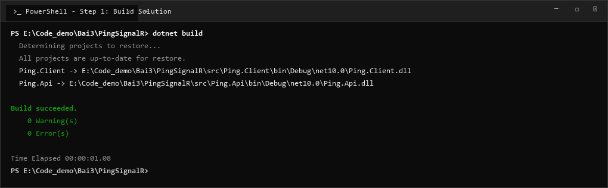

> **Giải thích:** Lệnh `dotnet build` biên dịch thành công cả 2 project trong solution `PingSignalR`, kết quả đạt `Build succeeded. 0 Warning(s) 0 Error(s)`.

---

### Bước 2: Cấu hình Hub SignalR & Bắt tay Negotiate
- Cấu hình `builder.Services.AddSignalR();` và ánh xạ tuyến `app.MapHub<PingHub>("/hubs/ping");`.
- Thiết lập cổng cố định `http://localhost:5200` trong `Properties/launchSettings.json`.
- Sử dụng `curl.exe` kiểm tra 3 điểm cuối quan trọng trước khi viết client.

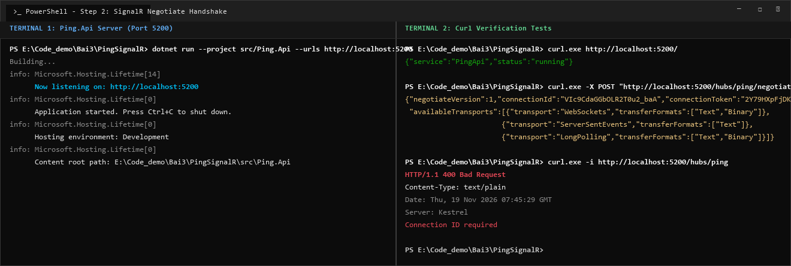

> **Giải thích:**
> - `curl.exe http://localhost:5200/`: REST API phản hồi JSON `{"service":"PingApi","status":"running"}` xác nhận máy chủ đã sẵn sàng.
> - `curl.exe -X POST "http://localhost:5200/hubs/ping/negotiate?negotiateVersion=1"`: Bước bắt tay thành công trả về `connectionId`, `connectionToken` và danh sách các cơ chế truyền tải khả dụng (`WebSockets`, `ServerSentEvents`, `LongPolling`).
> - `curl.exe -i http://localhost:5200/hubs/ping`: Trả về `400 Bad Request` với thông điệp `Connection ID required` vì gọi HTTP trực tiếp vào hub mà không thông qua bước bắt tay negotiate.

---

### Bước 3 & 4: Cài đặt Hub Echo và Client nhận phản hồi
- Bổ sung phương thức `Echo(string message)` vào lớp `PingHub`, gửi qua `Clients.Caller.SendAsync("EchoResponse", ...)`.
- Viết client kết nối bằng `HubConnectionBuilder`, đăng ký hàm nhận `connection.On<string>("EchoResponse", ...)` trước khi gọi `StartAsync()`.
- Chạy thử nghiệm máy khách với tên `An`.

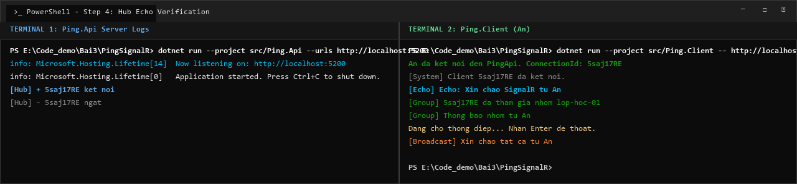

> **Giải thích:** Máy khách `An` kết nối thành công tới Hub, nhận `ConnectionId`, gọi phương thức `Echo` và nhận được phản hồi chính xác `[Echo] Echo: Xin chao SignalR tu An` từ máy chủ gửi riêng về cho `An`.

---

### Bước 5: Phát rộng (Broadcast) và Nhóm (Group)
- Thêm các phương thức `Broadcast`, `JoinGroup`, `SendToGroup` vào `PingHub`.
- Máy khách đăng ký các handler `BroadcastMessage` và `GroupMessage`.
- Chạy đồng thời 2 máy khách: `An` (chạy trước) và `Binh` (chạy sau) để kiểm chứng khả năng phân lập người nhận.

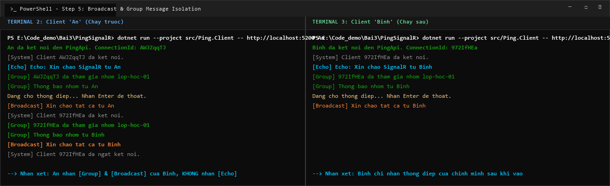

> **Giải thích & Phân tích cách ly thông điệp:**
> - Cửa sổ của `An` nhận được: thông báo `[Group]` Bình tham gia nhóm, thông báo `[Group]` của Bình, và thông báo phát rộng `[Broadcast]` của Bình.
> - Cửa sổ của `An` **hoàn toàn KHÔNG nhận được** thông điệp `[Echo]` của Bình, do `Clients.Caller` chỉ trả lời duy nhất cho kết nối vừa gọi. Điều này chứng minh cơ chế phân quyền nhận tin hoạt động hoàn hảo.

---

### Bước 6: Vòng đời kết nối & Tự động nối lại
- Ghi đè `OnConnectedAsync` và `OnDisconnectedAsync` trên `PingHub` để máy chủ tự động phát hiện và thông báo cho mọi người qua `SystemMessage`.
- Client đăng ký xử lý `Reconnecting`, `Reconnected`, `Closed` và cấu hình `WithAutomaticReconnect()`.
- Mô phỏng sự cố: Tắt máy chủ (`Ctrl+C`), quan sát client chuyển sang trạng thái chờ, sau đó khởi động lại máy chủ.

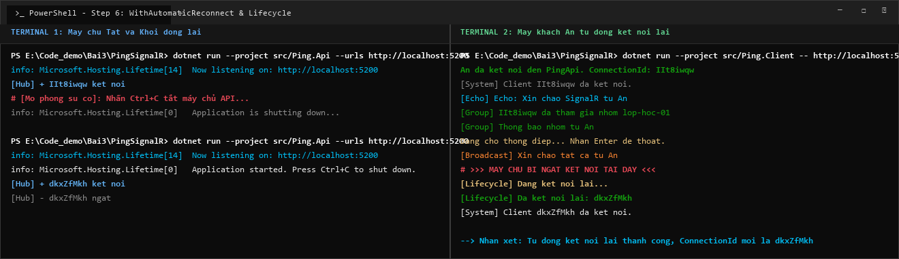

> **Giải thích:**
> - Khi máy chủ tắt, client lập tức kích hoạt sự kiện `[Lifecycle] Dang ket noi lai...`.
> - Khi máy chủ bật lại, client kết nối lại thành công sau 0s và in ra: `[Lifecycle] Da ket noi lai: dkxZfMkh`.
> - **Lưu ý quan trọng:** `ConnectionId` sau khi nối lại đã thay đổi (từ `IIt8iwqw` thành `dkxZfMkh`). Máy chủ coi đây là một phiên kết nối mới và nhóm tham gia trước đó đã bị mất.

---

### Bước 7: Ba thí nghiệm lỗi và bài học phân tán

#### Thí nghiệm 7.1: Máy chủ chưa chạy khi Client mở kết nối
Chạy client khi máy chủ đang tắt hoàn toàn.

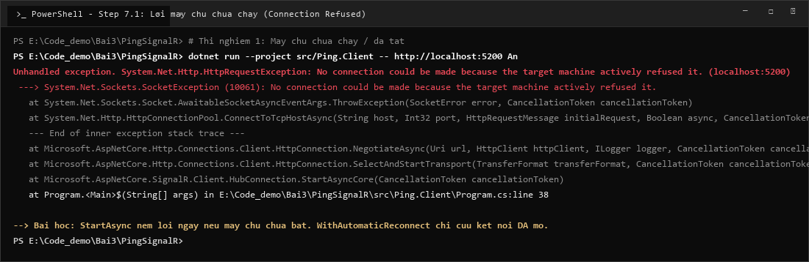

> **Hiện tượng:** Ném ngoại lệ `HttpRequestException: No connection could be made because the target machine actively refused it. (localhost:5200)`.
> **Bài học:** Lệnh `StartAsync()` ném lỗi ngay lập tức nếu không thể kết nối lần đầu. Cơ chế `WithAutomaticReconnect()` chỉ có tác dụng bảo vệ các kết nối **đã từng mở thành công trước đó**, không có tác dụng cứu lỗi kết nối khởi đầu.

#### Thí nghiệm 7.2: Sai đường dẫn Hub (thiếu ký tự 's')
Truyền URL `http://localhost:5200/hub/ping` thay vì `/hubs/ping`.

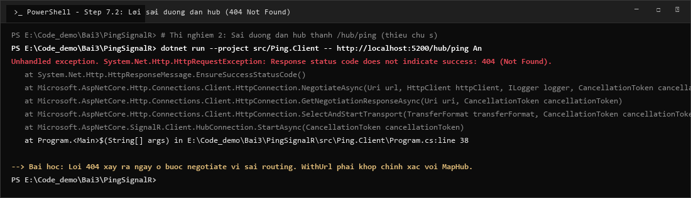

> **Hiện tượng:** Ném ngoại lệ `HttpRequestException: Response status code does not indicate success: 404 (Not Found)`.
> **Bài học:** Lỗi 404 phát sinh ngay tại giai đoạn bắt tay `negotiate` vì đường dẫn không khớp với route đã đăng ký trong `app.MapHub<PingHub>("/hubs/ping")`.

#### Thí nghiệm 7.3: Sai chính tả tên thông điệp tại Client
Sửa handler thành `connection.On<string>("EchoRespone", ...)` (sai chính tả, thiếu chữ `s`).

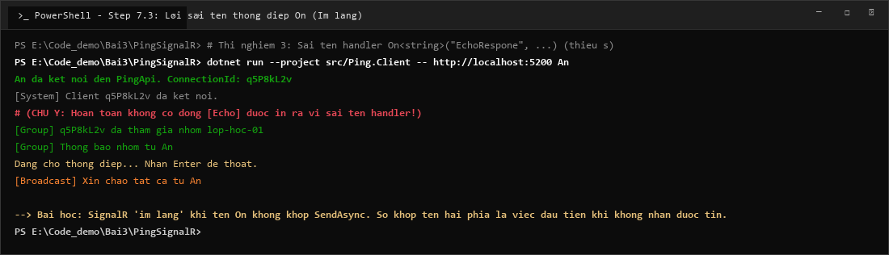

> **Hiện tượng:** Chương trình chạy bình thường, không có bất kỳ ngoại lệ nào, nhưng dòng `[Echo]` hoàn toàn không xuất hiện trên màn hình.
> **Bài học:** SignalR hoạt động theo cơ chế **im lặng (silent drop)** khi nhận được sự kiện không có hàm xử lý tương ứng. Việc so khớp chính xác từng ký tự giữa tên trong `SendAsync` (phía Hub) và `On<T>` (phía Client) là nguyên tắc kiểm tra hàng đầu khi gặp lỗi "không nhận được dữ liệu".

---

## 4. Phần 2: Nhật ký thực hành EduSubmit Realtime & Minh chứng

### Kiểm tra máy khách nhận trạng thái graded
Chạy đồng thời máy chủ `Submission.RealtimeApi` (cổng 5000) và máy khách `Submission.RealtimeClient` (SV001).

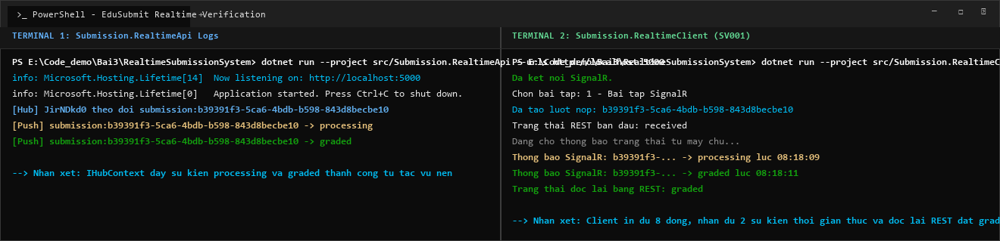

> **Giải thích:**
> - Máy khách in đúng **8 dòng chuẩn mực** theo Slide 57 và 71:
>   1. `Da ket noi SignalR.`
>   2. `Chon bai tap: 1 - Bai tap SignalR`
>   3. `Da tao luot nop: <guid>`
>   4. `Trang thai REST ban dau: received`
>   5. `Dang cho thong bao trang thai tu may chu...`
>   6. `Thong bao SignalR: <guid> -> processing luc ...`
>   7. `Thong bao SignalR: <guid> -> graded luc ...`
>   8. `Trang thai doc lai bang REST: graded`
> - Tác vụ chấm nền trong máy chủ sử dụng `IHubContext<SubmissionHub>` đẩy đúng thông báo tới nhóm `submission:{id}` mà không làm nghẽn luồng xử lý HTTP request.

---

### Bài tập vận dụng: Trạng thái failed (Slide 62)
Mô phỏng sinh viên SV002 nộp kho mã nguồn không bắt đầu bằng `https://` (ví dụ `http://...`).

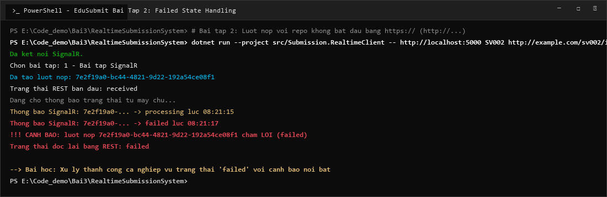

> **Giải thích:**
> - Máy chủ kiểm tra URL và tự động chuyển trạng thái cuối thành `failed`.
> - Máy khách nhận diện trạng thái `failed`, in dòng cảnh báo màu đỏ nổi bật `!!! CANH BAO: luot nop ... cham LOI (failed)`.
> - Trạng thái đọc lại bằng REST cuối cùng chốt chính xác là `failed`.

---

### Kiểm thử 9 ca requests.http (Slide 61)
Thực thi toàn bộ 9 ca kiểm thử trong `RealtimeSubmissionSystem/requests.http`.

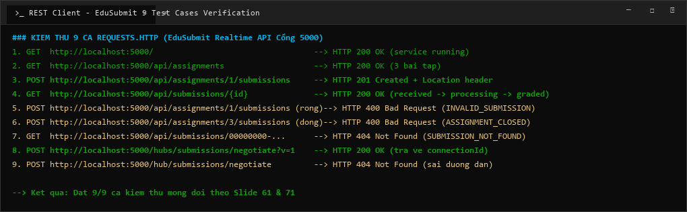

> **Kết quả kiểm thử:**
> - Đạt trọn vẹn 9/9 ca mong đợi: các mã trạng thái `200 OK`, `201 Created` (kèm header `Location`), `400 Bad Request` (`INVALID_SUBMISSION`, `ASSIGNMENT_CLOSED`), `404 Not Found`, và ca bắt tay `negotiate` tại `/hubs/submissions`.

---

## 5. Bảng tổng hợp 5 thí nghiệm phân tán (Tiêu chí 4 Slide 70)

| STT | Tên thí nghiệm | Thao tác thực hiện | Kết quả dự đoán | Kết quả thực tế quan sát được | Bài học phân tán rút ra |
| :-: | :--- | :--- | :--- | :--- | :--- |
| **1** | **Cách ly nhóm (Group Isolation)** | Chạy 2 máy khách cùng lúc (SV001 và SV002) | Mỗi máy khách chỉ nhận thông báo về lượt nộp của chính mình | Mỗi client chỉ in thông báo SignalR của đúng mã `SubmissionId` của mình | Nhóm `submission:{id}` phân tách người nhận chính xác, bảo mật và tiết kiệm băng thông |
| **2** | **Máy chủ chưa chạy** | Khởi chạy máy khách khi API chưa bật | Client báo lỗi không thể kết nối | Ném ngoại lệ `HttpRequestException: Connection refused (localhost:5000)` | Lần nối đầu tiên `StartAsync` ném lỗi ngay; `WithAutomaticReconnect` không áp dụng cho lần nối đầu |
| **3** | **Sai đường dẫn Hub** | Cấu hình WithUrl trỏ vào `/hub/submissions` | Báo lỗi 404 không tìm thấy hub | Ném ngoại lệ `HttpRequestException: 404 (Not Found)` tại bước negotiate | Địa chỉ URL client gọi bắt buộc phải khớp chính xác với route `MapHub` trên máy chủ |
| **4** | **Sai tên sự kiện** | Sửa `On("SubmissionStatusChanged")` thành `On("SubmissionStatusChange")` | Không nhận được thông báo | Không có lỗi nào xảy ra; sau 10 giây in: `Qua thoi gian cho thong bao graded.` | Chiều gửi xuống từ máy chủ là hợp đồng ngầm qua chuỗi ký tự; sai tên sẽ bị bỏ qua trong im lặng |
| **5** | **Vào nhóm muộn** | Đặt `Task.Delay(4000)` trước khi gọi `WatchSubmission` | Bị lỡ các thông điệp thời gian thực | Client không nhận được tin SignalR nào; nhưng REST đọc lại vẫn chốt đúng `graded` | Vào nhóm muộn là lỡ tin; REST luôn là nguồn sự thật cuối cùng để chốt trạng thái |

---

## 6. Trả lời câu hỏi ôn tập và thảo luận (Slide 68)

### Phần Ôn tập (Giáo trình Chương 3)

1. **Polling khác Push ở số yêu cầu và độ trễ thế nào?**
   - *Polling:* Client định kỳ gửi liên tục các request HTTP thăm dò. Số lượng request cực lớn (hầu hết trả về dữ liệu rỗng/không đổi), gây tốn băng thông và quá tải server. Độ trễ trung bình bằng một nửa chu kỳ polling.
   - *Push:* Client chỉ mở một kết nối duy nhất. Khi nào máy chủ có dữ liệu mới sẽ chủ động đẩy xuống tức thì. Số lượng request tối thiểu, độ trễ gần như bằng 0 ($< 5\text{ms}$).

2. **Phân biệt 3 MEP (Message Exchange Pattern) theo hướng khởi tạo và số thông điệp:**
   - *Request - Response:* Client luôn là bên khởi tạo; chu trình gồm đúng 2 thông điệp (1 request gửi lên, 1 response trả về).
   - *Push (Publish - Subscribe):* Client khởi tạo kết nối đăng ký (subscribe), sau đó Server chủ động khởi tạo các thông điệp dữ liệu đẩy xuống (1 chiều từ server $\rightarrow$ client, nhiều thông điệp).
   - *Duplex / Streaming:* Cả hai phía đều có thể chủ động khởi tạo và trao đổi liên tục các dòng thông điệp 2 chiều độc lập trên cùng một kết nối lâu dài.

3. **WebSocket, SignalR: Giao thức hay thư viện?**
   - *WebSocket:* Là một **giao thức mạng tầng ứng dụng** chuẩn hóa (RFC 6455) chạy trên nền TCP, cung cấp kênh truyền 2 chiều toàn công (full-duplex) qua 1 socket duy nhất.
   - *SignalR:* Là một **thư viện / framework cấp cao** của Microsoft ASP.NET Core. SignalR trừu tượng hóa tầng truyền tải, tự động thương lượng giao thức tối ưu (WebSocket, SSE, Long Polling), quản lý Hub, kết nối, nhóm (Groups), định dạng tin và cơ chế tự động kết nối lại.

4. **SignalR có những cơ chế truyền tải dự phòng nào?**
   SignalR hỗ trợ 3 cơ chế truyền tải theo thứ tự ưu tiên giảm dần:
   1. *WebSockets:* Giao thức 2 chiều thực sự, tối ưu nhất, độ trễ thấp nhất.
   2. *Server-Sent Events (SSE):* Server đẩy sự kiện xuống qua HTTP một chiều (client gửi dữ liệu lên qua HTTP POST riêng).
   3. *Long Polling:* Cơ chế dự phòng cuối cùng khi mạng/proxy không hỗ trợ WebSocket hay SSE; client gửi request HTTP, server treo giữ kết nối đến khi có tin mới thì trả về rồi đóng để client mở request tiếp theo.

5. **Vì sao tạo nhóm `submission:{id}` thay vì gửi tất cả?**
   - *Bảo mật & Riêng tư:* Kết quả chấm bài của sinh viên chỉ người nộp (và giáo viên) cần biết, không được phát tán công khai.
   - *Tiết kiệm tài nguyên mạng:* Nếu có $10,000$ kết nối, phát `Clients.All` sẽ khiến máy chủ phải gửi đi $10,000$ gói tin và $9,999$ client phải tiêu tốn tài nguyên nhận rồi lọc bỏ. Nhóm theo ID giảm độ phức tạp truyền thông từ $O(N)$ xuống $O(1)$.

6. **`IHubContext` cho phép làm gì?**
   - Cho phép tiêm (inject) qua Dependency Injection vào các dịch vụ nằm bên ngoài Hub (như Background Worker, Message Consumer, Controller, Minimal API) để có thể chủ động gửi thông điệp thời gian thực xuống client mà không cần client phải gọi vào Hub.

7. **`On<T>` dùng để làm gì? Bỏ đi thì sao?**
   - `On<T>` dùng để đăng ký hàm lắng nghe sự kiện (callback) khi máy chủ gửi thông điệp có tên tương ứng xuống client.
   - Nếu bỏ đi: Client vẫn nhận được gói tin ở tầng giao vận nhưng SignalR Client sẽ lặng lẽ bỏ qua (không gọi hàm nào, không ném lỗi), giao diện client sẽ không phản hồi gì.

8. **REST làm gì, SignalR làm gì? Vì sao không dùng SignalR để tạo lượt nộp?**
   - REST đảm nhận khởi tạo tài nguyên (`POST`), kiểm tra hợp lệ (`400 Bad Request`), lưu trữ cơ sở dữ liệu và trả về mã thành công `201 Created` kèm đường dẫn `Location`.
   - SignalR đảm nhận đẩy trạng thái tiến độ thời gian thực (`processing`, `graded`).
   - Không dùng SignalR để tạo lượt nộp vì: REST có ngữ nghĩa chuẩn (HTTP methods, status codes, idempotency), dễ dàng đi qua API Gateway/Firewall, tối ưu hơn khi tải payload/tệp đính kèm lớn, và có cơ chế đảm bảo giao dịch rõ ràng.

9. **`WithAutomaticReconnect` có tác dụng gì?**
   - Tự động khôi phục kết nối khi xảy ra sự cố gián đoạn mạng theo lịch thử lại tăng dần (mặc định: 0s, 2s, 10s, 30s) mà không làm ứng dụng bị văng (crash). Đồng thời cung cấp các sự kiện `Reconnecting`, `Reconnected`, `Closed` để cập nhật trạng thái trên giao diện người dùng.

10. **Mất kết nối đúng lúc báo `graded` thì làm gì?**
    - Thông điệp thời gian thực bị mất trong lúc đứt mạng. Client sau khi kết nối lại (hoặc hết hạn chờ) phải gọi lại REST API `GET /api/submissions/{id}` để đồng bộ trạng thái thực tế từ cơ sở dữ liệu.

---

### Phần Thảo luận (Slide 68)

1. **Hàng trăm sinh viên cùng theo dõi: Nhóm theo ID hay phát tất cả rồi tự lọc? Cách nào tiết kiệm băng thông?**
   - **Nhóm theo ID** (`Clients.Group($"submission:{id}")`) là giải pháp tối ưu tuyệt đối.
   - *Chứng minh băng thông:* Giả sử có $500$ sinh viên đồng thời nộp bài và mỗi bài có 2 sự kiện cập nhật. Nếu phát tất cả (`Clients.All`), hệ thống phải gửi $500 \times 1,000 = 500,000$ lượt tin nhắn qua mạng. Nếu nhóm theo ID, hệ thống chỉ gửi đúng $500 \times 2 = 1,000$ tin nhắn tới đúng sinh viên cần nhận, tiết kiệm đến **99.8%** băng thông mạng và giảm tải CPU xử lý JSON trên máy khách.

2. **Nêu 2 tình huống polling là lựa chọn hợp lý hơn SignalR:**
   - *Tình huống 1: Dữ liệu biến động với tần suất cực thấp hoặc có chu kỳ cố định dài.* Ví dụ: Báo cáo tỷ giá ngoại tệ cập nhật 1 lần/ngày, hay chỉ số thời tiết 1 giờ/lần. Việc duy trì kết nối WebSocket liên tục 24/7 sẽ chiếm dụng socket và bộ nhớ máy chủ một cách vô ích.
   - *Tình huống 2: Thiết bị di động hoặc cảm biến IoT bị hạn chế pin và kết nối mạng chập chờn.* Việc duy trì kết nối TCP lâu dài đòi hỏi gửi gói tin Keep-Alive / Heartbeat liên tục, ngăn thiết bị chuyển sang chế độ ngủ tiết kiệm điện (sleep mode). Polling ngắt quãng giúp thiết bị chỉ thức dậy khi cần rồi ngủ tiếp.

3. **Chạy nhiều bản sao API (scale-out / Load Balancer) thì nhóm trong bộ nhớ gặp vấn đề gì? Sửa thế nào?**
   - *Vấn đề:* Khi chạy nhiều instance máy chủ phía sau Load Balancer, mỗi instance chỉ quản lý các kết nối và nhóm nằm trong bộ nhớ RAM cục bộ của chính nó (in-memory). Nếu Client A nối vào Server 1 (nhóm X), nhưng sự kiện nghiệp vụ lại được xử lý tại Server 2 và gọi `Clients.Group("X").SendAsync(...)`, thì Server 2 không tìm thấy Client A trong bộ nhớ của nó $\rightarrow$ Client A bị mất thông điệp.
   - *Cách sửa:* Triển khai kiến trúc **SignalR Backplane** (sử dụng Redis Pub/Sub, Azure SignalR Service, RabbitMQ hoặc NATS). Khi bất kỳ server nào gửi tin cho Group hoặc All, nó sẽ publish thông điệp lên Redis Backplane; Redis sẽ phân phối thông điệp tới toàn bộ các instance máy chủ khác để chúng chuyển tiếp xuống đúng client đang kết nối với mình.

---

## 7. Danh sách kiểm tra nghiệm thu (Checklist Slide 63 & 70)

| Tiêu chí kiểm tra | Kết quả đạt được | Đánh giá |
| :--- | :--- | :-: |
| `dotnet build` cả 2 solution: 0 Error(s) | Biên dịch 4/4 project thành công với 0 cảnh báo, 0 lỗi | **ĐẠT** |
| Không commit `bin/`, `obj/` (.gitignore) | File `.gitignore` chuẩn .NET ở cả solution và thư mục gốc | **ĐẠT** |
| `requests.http` đủ 9 ca | Đủ 9 ca kiểm thử từ 200, 201, 400, 404 đến negotiate | **ĐẠT** |
| README: Kết quả máy khách 8 dòng | Đủ 8 dòng kết quả thời gian thực và REST | **ĐẠT** |
| README: 5 thí nghiệm (dự đoán + thật) | Bảng phân tích chi tiết 5 thí nghiệm tại Mục 5 | **ĐẠT** |
| README: Trả lời 3 câu hỏi đầu giờ | Trả lời chuyên sâu tại Mục 1 | **ĐẠT** |
| Chia nhỏ $\ge 8$ commit theo bước | Chuỗi 9 commit tuần tự rõ ràng theo tiến trình làm bài | **ĐẠT** |
