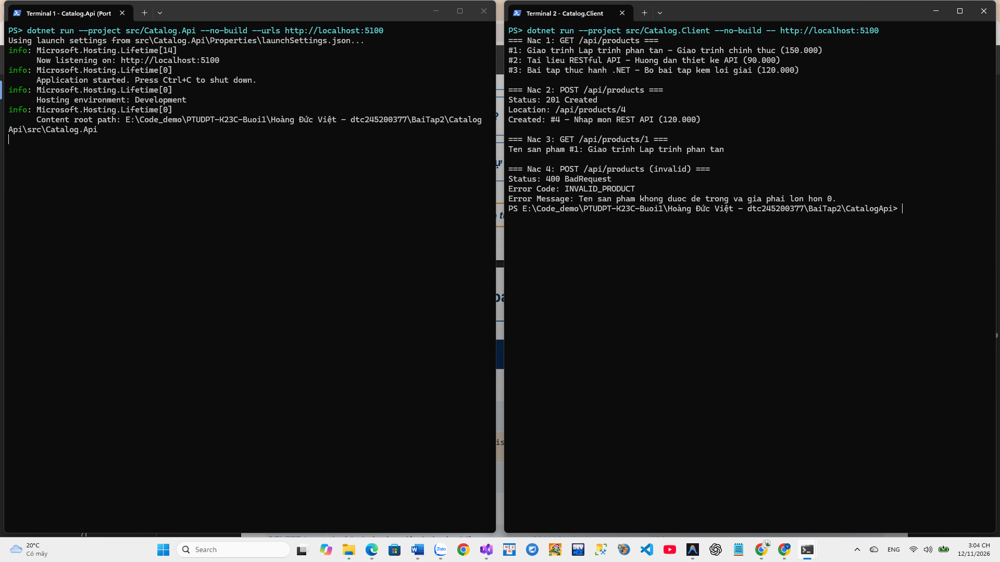

# Bài Tập 2 - Bài 1: CatalogApi (.NET 10)

## Thông Tin Sinh Viên
- **Họ và tên:** Hoàng Đức Việt
- **Mã sinh viên:** `dtc245200377`
- **Lớp:** `CNTTK23C`

## Nội Dung Dự Án
Dự án mẫu `CatalogApi` (gồm `Catalog.Api` và `Catalog.Client`) chạy trên cổng `5100`:
- `GET /`: trả về `200 OK` trạng thái dịch vụ.
- `GET /api/products`: trả về danh sách sản phẩm trong bộ nhớ.
- `GET /api/products/{id:int}`: trả về chi tiết sản phẩm hoặc `404 Not Found` kèm `ApiError("PRODUCT_NOT_FOUND", ...)`.
- `POST /api/products`: kiểm tra hợp lệ dữ liệu (`400 Bad Request` kèm `ApiError("INVALID_PRODUCT", ...)` nếu lỗi), trả về `201 Created` kèm header `Location`.

## Cách Chạy Trên 2 Terminal
Tại thư mục `Baitap2/bai1/CatalogApi`:

- **Terminal 1 (Server cổng 5100):**
  ```powershell
  dotnet run --project src/Catalog.Api --urls http://localhost:5100
  ```
- **Terminal 2 (Console Client):**
  ```powershell
  dotnet run --project src/Catalog.Client -- http://localhost:5100
  ```

## Ảnh Minh Chứng Chạy Thực Tế

