# BÁO CÁO THỰC HÀNH BÀI 3: GIAO TIẾP THỜI GIAN THỰC VỚI SIGNALR

- **Học phần**: Phát triển ứng dụng phân tán
- **Giảng viên**: TS. Dương Thu Mây (dtmay@ictu.edu.vn)
- **Sinh viên thực hiện**: Lâm Tiến Khôi
- **Mã sinh viên**: DTC245200210
- **Lớp**: K20-CNTT
- **Thư mục bài tập**: `Lam Tien Khoi - DTC245200210/Bai3`

---

## MỤC LỤC
1. [Trả lời 3 câu hỏi đầu giờ](#1-trả-lời-3-câu-hỏi-đầu-giờ)
2. [Phần 1: Thực hành PingSignalR (Bước 1 – Bước 7)](#2-phần-1-thực-hành-pingsignalr-bước-1--bước-7)
3. [Phần 2: Ba thí nghiệm lỗi cố ý của PingSignalR](#3-phần-2-ba-thí-nghiệm-lỗi-cố-ý-của-pingsignalr)
4. [Phần 3: Thực hành EduSubmit Realtime](#4-phần-3-thực-hành-edusubmit-realtime)
5. [Phần 4: Kiểm thử API với requests.http (9 ca)](#5-phần-4-kiểm-thử-api-với-requestshttp-9-ca)
6. [Phần 5: Bảng 5 thí nghiệm phân tán EduSubmit](#6-phần-5-bảng-5-thí-nghiệm-phân-tán-edusubmit)
7. [Phần 6: Câu hỏi ôn tập và thảo luận](#7-phần-6-câu-hỏi-ôn-tập-và-thảo-luận)
8. [Phần 7: Cấu trúc thư mục và hướng dẫn chạy](#8-phần-7-cấu-trúc-thư-mục-và-hướng-dẫn-chạy)

---

## 1. Trả lời 3 câu hỏi đầu giờ

### Câu hỏi 1: Máy chủ có thể chủ động báo cho máy khách mà không cần máy khách hỏi không?
**Trả lời:**
- **Có**, với điều kiện máy khách đã chủ động mở sẵn một kết nối song công lâu dài (persistent connection) tới máy chủ thông qua giao thức **WebSocket** (được trừu tượng hóa và quản lý bởi thư viện **SignalR**).
- Khi có sự kiện xảy ra phía máy chủ, máy chủ sử dụng phương thức phát tin `Clients.Group(...).SendAsync(...)`, `Clients.All.SendAsync(...)` hoặc `Clients.Caller.SendAsync(...)` để chủ động đẩy thông điệp trực tiếp xuống máy khách mà máy khách không cần phải gửi yêu cầu thăm dò (polling).
- Nếu việc phát tin được kích hoạt từ bên ngoài lớp Hub (ví dụ: trong một controller HTTP, Minimal API endpoint, hoặc tác vụ nền BackgroundService), máy chủ sử dụng cơ chế Dependency Injection để tiêm **`IHubContext<THub>`** làm "loa phát".

### Câu hỏi 2: Đã có REST rồi, vì sao còn cần thêm SignalR? Hai thứ chia việc thế nào?
**Trả lời:**
- REST hoạt động theo mô hình **Yêu cầu – Phản hồi (Request-Response)**, chỉ cho phép máy khách mở lời trước. Máy chủ không thể tự gửi dữ liệu khi chưa có yêu cầu từ máy khách. Nếu dùng REST để theo dõi trạng thái, máy khách buộc phải **polling (thăm dò định kỳ)** liên tục (ví dụ 2 giây/lần), gây lãng phí băng thông (hơn 90% yêu cầu trả về dữ liệu cũ không đổi) và tạo ra độ trễ.
- **Phân chia trách nhiệm**:
  - **REST (Nguồn sự thật - Single Source of Truth)**: Chịu trách nhiệm tạo tài nguyên mới (`POST` trả về mã trạng thái `201 Created` kèm định danh `id`), đọc trạng thái xác thực hiện tại (`GET /api/submissions/{id}`), và xử lý các lỗi xác thực, phân quyền với mã HTTP chuẩn (`400`, `401`, `403`, `404`).
  - **SignalR (Kênh thông báo tức thời - Push)**: Chịu trách nhiệm duy trì kết nối hai chiều luôn mở, đưa máy khách vào nhóm theo dõi (`WatchSubmission`), và lập tức đẩy các sự kiện phát sinh sau yêu cầu ban đầu (`processing`, `graded`) tới đúng đối tượng nhận.
- **Quy tắc vàng**: **SignalR không thay thế REST, mà bổ sung chiều báo tin**. "Push để nhanh, REST để chắc" – khi cần chốt dữ liệu hoặc khi vừa kết nối lại, máy khách luôn gọi REST để đối chiếu nguồn sự thật.

### Câu hỏi 3: Nếu đứt mạng đúng lúc máy chủ báo "đã chấm xong" (graded) thì sao?
**Trả lời:**
- **Thông điệp đó sẽ bị mất hoàn toàn**. SignalR là giao thức truyền thông điệp thời gian thực (fire-and-forget), không có hàng đợi lưu trữ tin nhắn chờ gửi lại cho các máy khách đang ngắt kết nối.
- Khi mạng phục hồi, cơ chế `WithAutomaticReconnect()` của SignalR Client sẽ tự động nối lại với máy chủ nhưng được cấp một `ConnectionId` hoàn toàn mới (máy chủ coi đây là kết nối mới, mọi đăng ký nhóm cũ gắn với `ConnectionId` trước đó đều mất).
- **Cách xử lý chuẩn**:
  1. Trong sự kiện `connection.Reconnected`, máy khách thực hiện đăng ký lại vào nhóm theo dõi (`WatchSubmission`).
  2. Đồng thời, máy khách kích hoạt một lời gọi REST `GET /api/submissions/{id}` để đồng bộ và đọc lại trạng thái mới nhất từ cơ sở dữ liệu (nơi lưu trữ trạng thái thực sự).

---

## 2. Phần 1: Thực hành PingSignalR (Bước 1 – Bước 7)

### Bước 1: Khởi tạo Solution và 2 Project máy chủ - máy khách
- **Thực hiện**: Tạo solution `PingSignalR.slnx`, tạo project Web `Ping.Api`, project Console `Ping.Client`, thêm package `Microsoft.AspNetCore.SignalR.Client` (phiên bản `10.0.15`) cho máy khách và build thử.
- **Kết quả**: `Build succeeded. 0 Warning(s), 0 Error(s)`.

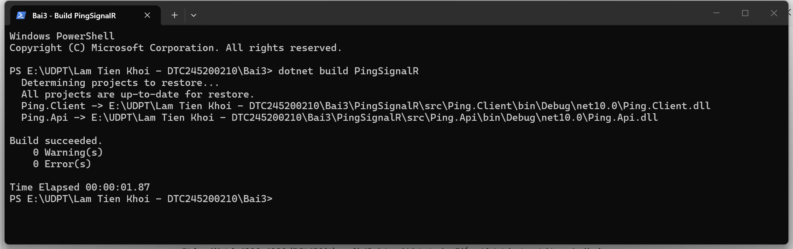
*Hình 2.1: Biên dịch thành công solution PingSignalR không có cảnh báo hay lỗi.*

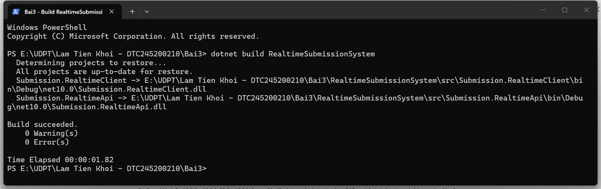
*Hình 2.2: Biên dịch thành công solution RealtimeSubmissionSystem.*

---

### Bước 2: Máy chủ cấu hình AddSignalR, MapHub và kiểm tra negotiate
- **Thực hiện**:
  - Tại `Ping.Api`: Đăng ký `builder.Services.AddSignalR()` vào DI container trước `builder.Build()`.
  - Ánh xạ hub: `app.MapHub<PingHub>("/hubs/ping")`.
  - Kiểm tra bằng lệnh `curl`:
    + `GET http://localhost:5200/` trả về `{"service":"PingApi","status":"running"}`.
    + `POST http://localhost:5200/hubs/ping/negotiate?negotiateVersion=1` trả về `connectionId` và danh sách cơ chế truyền tải dự phòng (`availableTransports: WebSockets, ServerSentEvents, LongPolling`).
    + `GET http://localhost:5200/hubs/ping` trả về `HTTP 400 Bad Request` vì Hub yêu cầu bắt tay `ConnectionId`, không hỗ trợ đọc như REST thông thường.

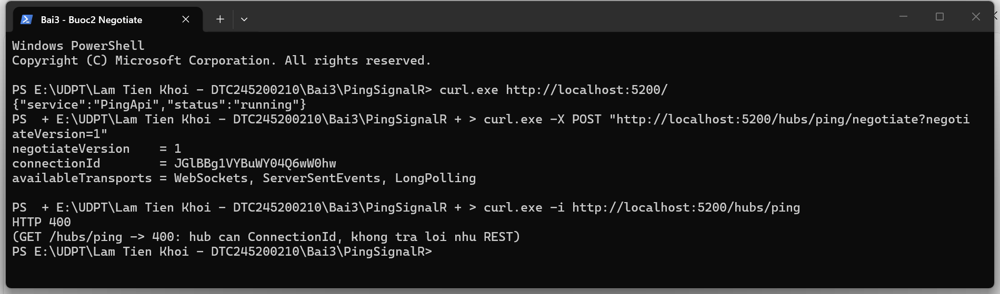
*Hình 2.3: Bước bắt tay negotiate trả về connectionId và danh sách 3 cơ chế truyền tải.*

---

### Bước 3 & Bước 4: Viết Hub Echo và Máy khách An kết nối
- **Thực hiện**:
  - Máy chủ định nghĩa phương thức `Echo(string message)` gửi về riêng người gọi qua `Clients.Caller.SendAsync("EchoResponse", ...)`.
  - Máy khách An xây dựng kết nối `HubConnectionBuilder.WithUrl(...).WithAutomaticReconnect().Build()`, đăng ký `connection.On<string>("EchoResponse", ...)`, gọi `StartAsync()` rồi `InvokeAsync("Echo", ...)`.
- **Kết quả**:
  - Máy chủ ghi nhận: `[Hub] + qjr7KBEx ket noi`.
  - Máy khách An in ra dòng xác nhận kết nối và nhận phản hồi riêng: `[Echo] Echo: Xin chao SignalR tu An`.

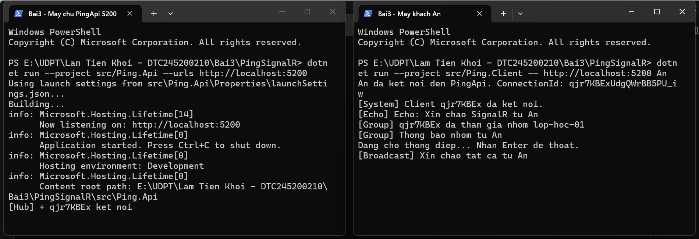
*Hình 2.4: Máy chủ PingApi ghi nhận kết nối và máy khách An nhận đúng phản hồi Echo.*

---

### Bước 5: Phát rộng (Broadcast) và Nhóm (Group) – An và Bình thấy tin của nhau
- **Thực hiện**:
  - Máy chủ thêm 3 phương thức:
    + `Broadcast(message)`: Gửi tới tất cả qua `Clients.All`.
    + `JoinGroup(groupName)`: Đưa kết nối vào nhóm qua `Groups.AddToGroupAsync` và thông báo cho nhóm.
    + `SendToGroup(groupName, message)`: Gửi tới các kết nối trong nhóm qua `Clients.Group`.
  - Chạy An trước, chạy Bình sau. Cả hai cùng tham gia nhóm `lop-hoc-01`.
- **Kết quả**:
  - **Cửa sổ An**: Nhận được thông báo Bình tham gia nhóm, thông báo nhóm từ Bình (`[Group] Thong bao nhom tu Binh`), và tin nhắn phát rộng từ Bình (`[Broadcast] Xin chao tat ca tu Binh`).
  - **Điểm then chốt**: Cửa sổ An **KHÔNG hề nhận được tin Echo của Bình**, do `Echo` sử dụng phạm vi `Clients.Caller` chỉ trả lời riêng cho người gọi.

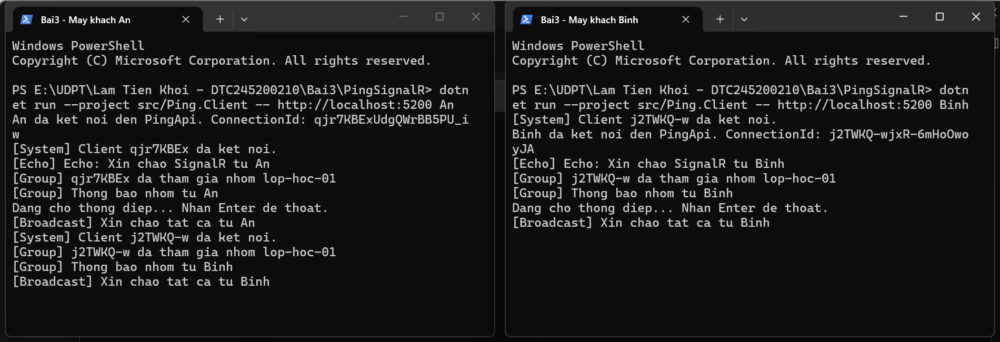
*Hình 2.5: An và Bình giao tiếp qua Group và Broadcast; An không thấy tin Echo của Bình.*

---

### Bước 6: Vòng đời kết nối và tự động kết nối lại (Automatic Reconnect)
- **Thực hiện**:
  - Cấu hình các sự kiện vòng đời ở máy khách: `connection.Reconnecting`, `connection.Reconnected`, `connection.Closed`.
  - Máy khách An đang chạy, thực hiện tắt tiến trình máy chủ (mô phỏng sự cố mất kết nối mạng/crash).
  - Máy khách lập tức phát hiện và kích hoạt sự kiện: `[Lifecycle] Dang ket noi lai...`.
  - Khởi động lại máy chủ ngay lập tức. Máy khách tự động nối lại thành công, in ra `[Lifecycle] Da ket noi lai: <newId>` kèm `ConnectionId` mới. Máy chủ cũng phát hiện kết nối mới và gửi `[System] Client <newId> da ket noi.`.

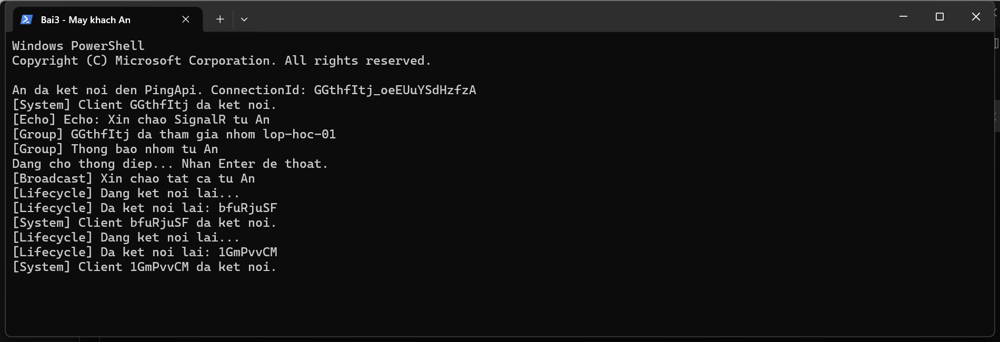
*Hình 2.6: Máy khách tự động phục hồi kết nối khi máy chủ khởi động lại, nhận ConnectionId mới.*

---

## 3. Phần 2: Ba thí nghiệm lỗi cố ý của PingSignalR

### Thí nghiệm Lỗi 1: Chạy máy khách khi máy chủ chưa bật
- **Hiện tượng**: Máy khách dừng ngay tại lệnh `await connection.StartAsync()`, văng ngoại lệ `System.Net.Http.HttpRequestException: No connection could be made because the target machine actively refused it. (localhost:5200)`.
- **Giải thích & Bài học**:
  - Cơ chế `WithAutomaticReconnect()` **chỉ có tác dụng với các kết nối đã được thiết lập thành công trước đó** rồi mới bị đứt. Nó **không** tự động thử lại khi lần kết nối đầu tiên (`StartAsync`) thất bại.
  - Ứng dụng thực tế cần bọc `StartAsync()` trong khối `try-catch` kết hợp vòng lặp chờ/thử lại chủ động nếu muốn khởi động độc lập với máy chủ.

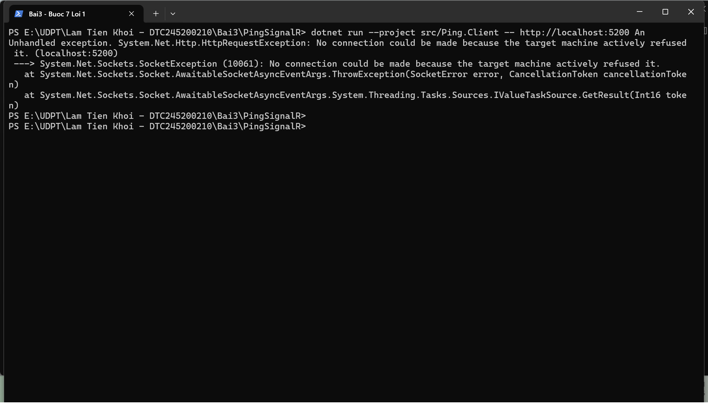
*Hình 3.1: Ngoại lệ HttpRequestException khi kết nối tới máy chủ chưa chạy.*

---

### Thí nghiệm Lỗi 2: Sai đường dẫn Hub (`/hub/ping` thay vì `/hubs/ping`)
- **Hiện tượng**: Ngoại lệ `System.Net.Http.HttpRequestException: Response status code does not indicate success: 404 (Not Found)`.
- **Giải thích & Bài học**:
  - Lỗi xảy ra ngay ở bước bắt tay đầu tiên (`negotiate`). Do máy chủ cấu hình `app.MapHub<PingHub>("/hubs/ping")`, khi máy khách gọi đến đường dẫn `/hub/ping/negotiate`, routing của ASP.NET Core không tìm thấy endpoint tương ứng và trả về mã HTTP `404 Not Found`.
  - Luôn đảm bảo đường dẫn trong `WithUrl` của máy khách khớp chính xác từng ký tự với đường dẫn `MapHub` trên máy chủ.

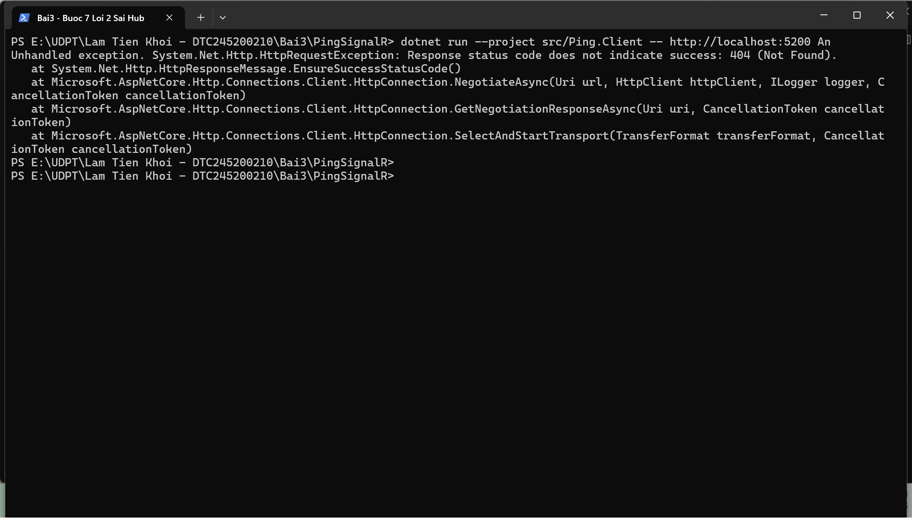
*Hình 3.2: Máy khách nhận mã 404 Not Found khi khai báo sai đường dẫn hub.*

---

### Thí nghiệm Lỗi 3: Sai tên thông điệp (`EchoRespone` thay vì `EchoResponse`)
- **Hiện tượng**: Chương trình biên dịch thành công 0 lỗi, chạy bình thường không văng bất kỳ ngoại lệ nào, nhưng dòng `[Echo]` **hoàn toàn không xuất hiện** trên màn hình terminal.
- **Giải thích & Bài học**:
  - Hợp đồng SignalR ở chiều máy chủ đẩy về máy khách dựa trên **tên chuỗi sự kiện** (`event name`). Máy chủ gọi `SendAsync("EchoResponse", ...)`, nhưng máy khách lại đăng ký nghe `connection.On("EchoRespone", ...)`.
  - SignalR khi nhận thông điệp từ máy chủ sẽ tìm hàm xử lý tương ứng với tên sự kiện nhận được; nếu không có hàm nào đăng ký tên đó, nó sẽ âm thầm bỏ qua. Đây là lỗi **rất nguy hiểm và khó phát hiện** vì hoàn toàn không có thông báo lỗi hay crash.
  - Bài học: Cần chuẩn hóa tên thông điệp thành các hằng số dùng chung hoặc chia sẻ interface/contract typed hub (`Hub<T>`).

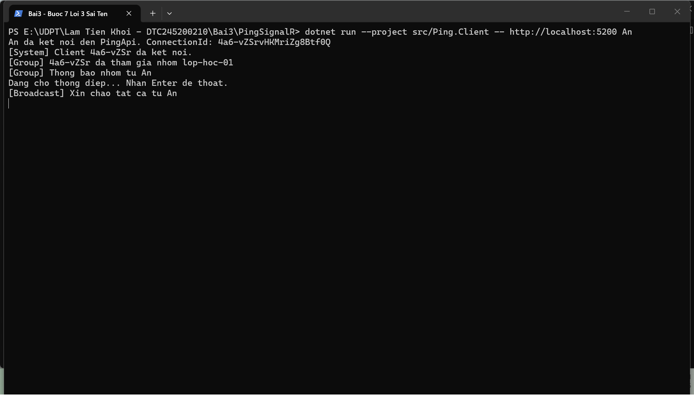
*Hình 3.3: Lỗi sai tên thông điệp chiều xuống chạy im lặng, không có dòng Echo.*

---

## 4. Phần 3: Thực hành EduSubmit Realtime

Hệ thống chấm bài trực tuyến EduSubmit kết hợp giữa:
1. **REST API**: Tạo lượt nộp bài, lưu trữ nguồn sự thật, trả về `id` và mã trạng thái chuẩn `201 Created`.
2. **IHubContext<SubmissionHub>**: Dùng "loa phát" tiêm vào endpoint ngoài Hub để đẩy thông báo thời gian thực từ tác vụ chấm bài giả lập nền (`SimulateGradingAsync`).
3. **Group theo lượt nộp (`submission:{id}`)**: Đảm bảo tính riêng tư tuyệt đối cho từng sinh viên và tối ưu hóa băng thông đường truyền.

### Kết quả chạy thực tế:
- Máy chủ khởi động lắng nghe tại `http://localhost:5000`.
- Máy khách `SV001` thực hiện luồng 5 bước:
  1. Kết nối thành công tới Hub: `Da ket noi SignalR.`
  2. Lấy danh sách bài tập qua REST: `Chon bai tap: 1 - Bai tap SignalR`
  3. Gửi `POST` tạo lượt nộp mới, nhận mã `201` và ID: `Da tao luot nop: 2630fb2f-24ce-4a59-9d5c-d2c810be93f1` với `Trang thai REST ban dau: received`.
  4. Tham gia nhóm `submission:2630fb2f-...` qua `WatchSubmission`.
  5. Nhận 2 thông báo đẩy tự động từ máy chủ mà không cần gửi bất kỳ yêu cầu nào:
     - `Thong bao SignalR: 2630fb2f-... -> processing luc 16:48:58`
     - `Thong bao SignalR: 2630fb2f-... -> graded luc 16:49:00`
  6. Sau khi nhận được tín hiệu `graded`, máy khách kích hoạt `GET /api/submissions/{id}` qua REST để đọc lại nguồn sự thật: `Trang thai doc lai bang REST: graded`.

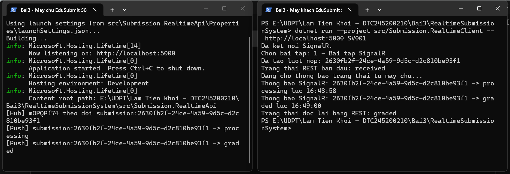
*Hình 4.1: Máy chủ đẩy tiến trình chấm bài (processing -> graded) và máy khách nhận thông báo tự động.*

---

## 5. Phần 4: Kiểm thử API với requests.http (9 ca)

Kiểm tra toàn bộ 9 ca yêu cầu của hệ thống EduSubmit và Hub SignalR:

| STT | Phương thức | Tuyến đường (Endpoint) | Dữ liệu / Mục đích | Mã HTTP mong đợi | Kết quả kiểm tra |
| :---: | :---: | :--- | :--- | :---: | :---: |
| 1 | `GET` | `/` | Kiểm tra trạng thái máy chủ | `200 OK` | **Đạt (200)** |
| 2 | `GET` | `/api/assignments` | Lấy danh sách bài tập đang mở | `200 OK` | **Đạt (200)** |
| 3 | `POST` | `/api/assignments/1/submissions` | Tạo lượt nộp hợp lệ | `201 Created` | **Đạt (201)** |
| 4 | `GET` | `/api/submissions/{id}` | Đọc trạng thái lượt nộp (chuyển dần sang graded) | `200 OK` | **Đạt (200)** |
| 5 | `POST` | `/api/assignments/1/submissions` | Thiếu trường `repositoryUrl` | `400 Bad Request` | **Đạt (400)** |
| 6 | `POST` | `/api/assignments/99/submissions` | Nộp vào bài tập không tồn tại | `404 Not Found` | **Đạt (404)** |
| 7 | `GET` | `/api/submissions/` | Truy vấn với id rỗng | `404 Not Found` | **Đạt (404)** |
| 8 | `POST` | `/hubs/submissions/negotiate?negotiateVersion=1` | Bắt tay bắt buộc của Hub SignalR | `200 OK` | **Đạt (200)** |
| 9 | `POST` | `/hub/submissions/negotiate?negotiateVersion=1` | Gửi nhầm đường dẫn (thiếu ký tự 's') | `404 Not Found` | **Đạt (404)** |

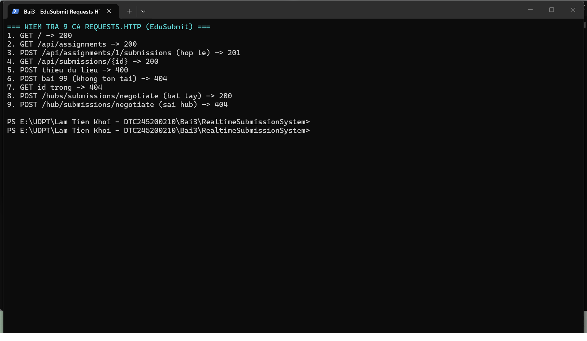
*Hình 5.1: Kết quả thực thi đủ 9 ca kiểm thử trong requests.http đạt 100% mã trạng thái chuẩn.*

---

## 6. Phần 5: Bảng 5 thí nghiệm phân tán EduSubmit

Bảng tổng hợp dự đoán, kết quả thực nghiệm và bài học kỹ thuật đối với 5 tình huống trong hệ phân tán EduSubmit (Slide 58 – 59):

| STT | Tình huống thí nghiệm | Dự đoán trước khi chạy | Kết quả chạy thực tế | Giải thích & Bài học kỹ thuật |
| :---: | :--- | :--- | :--- | :--- |
| **1** | Chạy hai máy khách `SV001` và `SV002` cùng lúc. | Hai sinh viên chỉ nhận được thông báo về bài của chính mình, không bị trộn lẫn tin. | Mỗi máy khách chỉ nhận đúng thông báo của lượt nộp mà mình tạo ra (`SV001` không thấy bài `SV002`). | Cơ chế nhóm `submission:{id}` giúp cô lập thông điệp theo phiên làm việc. Máy chủ lọc người nhận, bảo vệ quyền riêng tư và tiết kiệm băng thông. |
| **2** | Chạy máy khách khi máy chủ chưa chạy. | Bị lỗi crash ngay lập tức vì không thể kết nối tới server. | Văng ngoại lệ `HttpRequestException: Connection refused (localhost:5000)`. | Lần kết nối ban đầu (`StartAsync`) không được tự động thử lại bởi `WithAutomaticReconnect()`. Cần xử lý ngoại lệ chủ động. |
| **3** | Sửa `WithUrl` thành `/hub/submissions` (thiếu `s` ở `hubs`). | Lỗi không tìm thấy trang (404 Not Found). | `HttpRequestException: Response status code does not indicate success: 404 (Not Found)`. | Bắt tay `negotiate` gọi sai URI endpoint mà máy chủ đã khai báo trong `MapHub`. URL hai phía phải khớp từng ký tự. |
| **4** | Sửa tên sự kiện máy khách nghe thành `SubmissionStatusChange` (thiếu chữ `d`). | Không báo lỗi gì nhưng quá thời gian 10s sẽ báo hết giờ mà không nhận được thông báo graded. | Không có thông báo SignalR nào được in ra; sau 10 giây xuất hiện dòng: `Qua thoi gian cho thong bao graded`. Trạng thái đọc lại bằng REST vẫn là `graded`. | Tên sự kiện chiều đẩy từ Hub xuống máy khách nếu gõ sai sẽ bị bỏ qua trong im lặng. Luôn phải lấy REST làm nguồn sự thật để kiểm tra trạng thái cuối. |
| **5** | Chờ 4 giây (`Task.Delay(4000)`) rồi mới gọi `WatchSubmission`. | Bị lỡ mất thông điệp `processing` và `graded` vì tác vụ nền đã chạy xong trước khi vào nhóm. | Không nhận được thông điệp đẩy nào từ SignalR; tuy nhiên khi gọi REST đọc lại thì kết quả vẫn là `graded`. | Thông điệp SignalR mang tính nhất thời, không lưu trữ cho máy khách vào nhóm muộn. Minh chứng rõ nhất cho quy tắc: **Push để nhanh, REST để chắc**. |

---

## 7. Phần 6: Câu hỏi ôn tập và thảo luận

### 1. Polling khác push ở số yêu cầu và độ trễ thế nào?
- **Số yêu cầu**: Polling gửi liên tục các request theo chu kỳ định trước; phần lớn request (thường >90%) trả về dữ liệu cũ không thay đổi, gây lãng phí tài nguyên máy chủ và mạng. Push chỉ phát thông điệp khi sự kiện thực sự phát sinh trên máy chủ (1 sự kiện = 1 thông điệp).
- **Độ trễ**: Polling có độ trễ bằng thời gian chờ giữa các chu kỳ thăm dò (nếu chu kỳ 2s, dữ liệu có thể bị trễ tới gần 2s). Push gửi dữ liệu ngay khi sự kiện xảy ra nên độ trễ gần như bằng 0 (chỉ phụ thuộc vào độ trễ mạng mạng).

### 2. Phân biệt 3 mô hình MEP (Message Exchange Pattern)
- **Yêu cầu – Phản hồi (Request-Response)**: Máy khách khởi tạo; 1 yêu cầu tương ứng với 1 phản hồi; phù hợp cho lấy danh sách, tạo mới, cập nhật dữ liệu (công nghệ: REST).
- **Đẩy dữ liệu (Push)**: Máy chủ chủ động khởi tạo khi có sự kiện nghiệp vụ phát sinh trên máy chủ qua một kết nối được giữ mở; thông điệp gửi rời rạc, bất đồng bộ; phù hợp cho thông báo, cập nhật tiến trình (công nghệ: SignalR, SSE).
- **Truyền luồng (Streaming)**: Một hoặc cả hai bên khởi tạo; luồng dữ liệu liên tục theo thời gian; phù hợp cho video/audio trực tiếp, dữ liệu cảm biến IoT, chứng khoán liên tục (công nghệ: gRPC streaming, WebSocket raw).

### 3. WebSocket và SignalR: Giao thức hay Thư viện?
- **WebSocket**: Là **giao thức chuẩn (RFC 6455)** chạy trên tầng TCP, bắt đầu bằng bước bắt tay HTTP Upgrade để chuyển sang kênh truyền thông hai chiều toàn công (full-duplex) qua một socket duy nhất.
- **SignalR**: Là **thư viện phần mềm cấp cao** của Microsoft ASP.NET Core xây dựng trên nền WebSocket. SignalR cung cấp sẵn các tính năng mà WebSocket thuần không có: Hub RPC, quản lý người dùng & nhóm (Groups), tự động thương lượng phương thức truyền tải dự phòng (Negotiation fallback), serialization dữ liệu JSON/MessagePack, và tự động kết nối lại (`WithAutomaticReconnect`).

### 4. Các cơ chế truyền tải dự phòng của SignalR
Khi máy khách kết nối, bước `negotiate` sẽ kiểm tra và ưu tiên theo thứ tự:
1. **WebSockets** (ưu tiên 1): Kênh hai chiều toàn công, hiệu năng cao nhất.
2. **Server-Sent Events (SSE)** (ưu tiên 2): Máy chủ đẩy 1 chiều qua HTTP stream nếu môi trường/proxy chặn WebSocket.
3. **Long Polling** (ưu tiên 3): Máy khách gửi request HTTP, máy chủ treo giữ request cho đến khi có dữ liệu mới trả về, rồi máy khách gửi lại ngay. Dùng cho môi trường mạng hạn chế nhất.

### 5. Vì sao tạo nhóm `submission:{id}` thay vì gửi tất cả?
- **Bảo mật và riêng tư**: Điểm số và trạng thái bài nộp của sinh viên này không được để sinh viên khác nhìn thấy. Nhóm do máy chủ quản lý đảm bảo máy khách khác không bao giờ nhận được dữ liệu không thuộc về mình.
- **Tiết kiệm băng thông**: Nếu có 1.000 sinh viên cùng nộp bài, việc dùng `Clients.All` sẽ tạo ra $1.000 \times 1.000 = 1.000.000$ lượt gửi tin qua mạng, gây nghẽn máy chủ. Dùng nhóm theo ID chỉ tiêu tốn đúng số lượng thông điệp cần thiết tới chính máy khách đang mở bài đó.

### 6. `IHubContext` cho phép làm gì?
`IHubContext<THub>` cho phép gửi thông điệp SignalR từ **bên ngoài lớp Hub** (chẳng hạn như từ Minimal API endpoints, Controller, Hosted Background Service, hoặc Message Queue Consumer). Do đối tượng `Hub` trong ASP.NET Core có vòng đời ngắn (transient - chỉ sống trong thời gian một lời gọi RPC), nên các tiến trình xử lý độc lập cần `IHubContext` được tiêm qua Dependency Injection để điều khiển `Clients` và `Groups`.

### 7. `On<T>` dùng để làm gì? Bỏ đi thì sao?
- `connection.On<T>(eventName, handler)` dùng để đăng ký hàm callback xử lý dữ liệu khi máy khách nhận được thông điệp có tên `eventName` từ máy chủ.
- Nếu bỏ đi: Máy khách vẫn nhận được gói tin từ máy chủ qua kết nối mạng, nhưng do không có bộ lắng nghe tương ứng, SignalR Client sẽ âm thầm hủy gói tin mà không thực hiện hành động nào và cũng không báo lỗi.

### 8. `WithAutomaticReconnect` có tác dụng gì?
Tự động kích hoạt chu trình thử kết nối lại khi kết nối đang mở bị ngắt đột ngột (do rớt mạng, máy chủ khởi động lại). Mặc định thử lại 4 lần sau các mốc thời gian: 0 giây, 2 giây, 10 giây và 30 giây. Nếu sau 4 lần không thành công, kết nối sẽ chuyển sang trạng thái `Closed`.

### 9. Thảo luận: Khi hệ thống mở rộng chạy nhiều máy chủ (Scale-out)
- **Vấn đề**: Khi chạy nhiều bản sao máy chủ API đằng sau bộ cân bằng tải (Load Balancer), máy khách A kết nối tới Máy chủ 1 (tham gia nhóm `submission:{id}` trên bộ nhớ Máy chủ 1), trong khi yêu cầu nộp bài hoặc tiến trình chấm bài lại được xử lý ở Máy chủ 2. Lúc này, Máy chủ 2 gọi `hubContext.Clients.Group(...)` sẽ không tìm thấy kết nối nào vì nhóm chỉ nằm trong RAM của Máy chủ 1.
- **Giải pháp**: Sử dụng một **SignalR Backplane** dùng chung (phổ biến nhất là **Redis Backplane** hoặc Azure SignalR Service). Khi bất kỳ máy chủ nào phát tin vào một nhóm, thông điệp sẽ được publish vào Redis; toàn bộ các máy chủ API khác đều lắng nghe kênh Redis đó và chuyển tiếp thông điệp tới các máy khách đang kết nối trực tiếp với mình.

---

## 8. Phần 7: Cấu trúc thư mục và hướng dẫn chạy

### Cây thư mục bài tập
```text
Lam Tien Khoi - DTC245200210/
├── .gitignore
└── Bai3/
    ├── README.md
    ├── anh/
    │   ├── buoc1-build.png
    │   ├── buoc1-build2.png
    │   ├── buoc2-negotiate.png
    │   ├── buoc4-echo.png
    │   ├── buoc5-nhom.png
    │   ├── buoc6-noilai.png
    │   ├── buoc7-loi1.png
    │   ├── buoc7-loi2.png
    │   ├── buoc7-loi3.png
    │   ├── edusubmit-chay.png
    │   └── edusubmit-requests.png
    ├── PingSignalR/
    │   ├── PingSignalR.slnx
    │   └── src/
    │       ├── Ping.Api/
    │       └── Ping.Client/
    └── RealtimeSubmissionSystem/
        ├── RealtimeSubmissionSystem.slnx
        ├── requests.http
        ├── nop-bai.json
        ├── nop-bai-thieu.json
        └── src/
            ├── Submission.RealtimeApi/
            └── Submission.RealtimeClient/
```

### Hướng dẫn kiểm tra và chạy thử
1. **Biên dịch cả 2 giải pháp**:
   ```powershell
   cd "Lam Tien Khoi - DTC245200210/Bai3"
   dotnet build PingSignalR
   dotnet build RealtimeSubmissionSystem
   ```
2. **Chạy PingSignalR**:
   - Terminal 1 (Server):
     ```powershell
     cd PingSignalR
     dotnet run --project src/Ping.Api --urls http://localhost:5200
     ```
   - Terminal 2 (Client An):
     ```powershell
     cd PingSignalR
     dotnet run --project src/Ping.Client -- http://localhost:5200 An
     ```
   - Terminal 3 (Client Binh):
     ```powershell
     cd PingSignalR
     dotnet run --project src/Ping.Client -- http://localhost:5200 Binh
     ```
3. **Chạy EduSubmit Realtime**:
   - Terminal 1 (API Server):
     ```powershell
     cd RealtimeSubmissionSystem
     dotnet run --project src/Submission.RealtimeApi --urls http://localhost:5000
     ```
   - Terminal 2 (Realtime Client):
     ```powershell
     cd RealtimeSubmissionSystem
     dotnet run --project src/Submission.RealtimeClient -- http://localhost:5000 SV001
     ```
4. **Kiểm tra REST API và SignalR Negotiate**:
   - Sử dụng REST Client extension trong VS Code để gửi các request trong file `requests.http` hoặc dùng lệnh `curl` kiểm tra từng endpoint.
