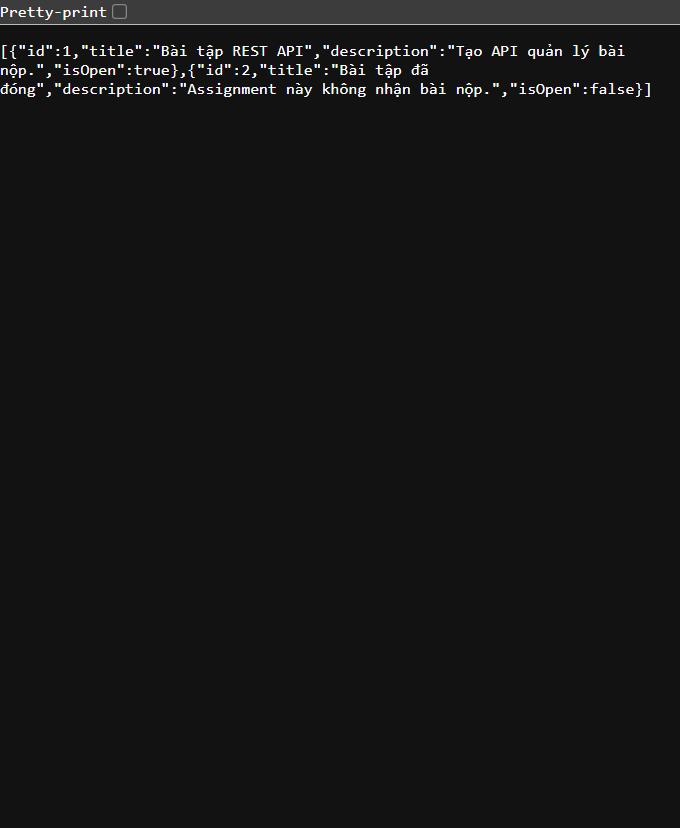
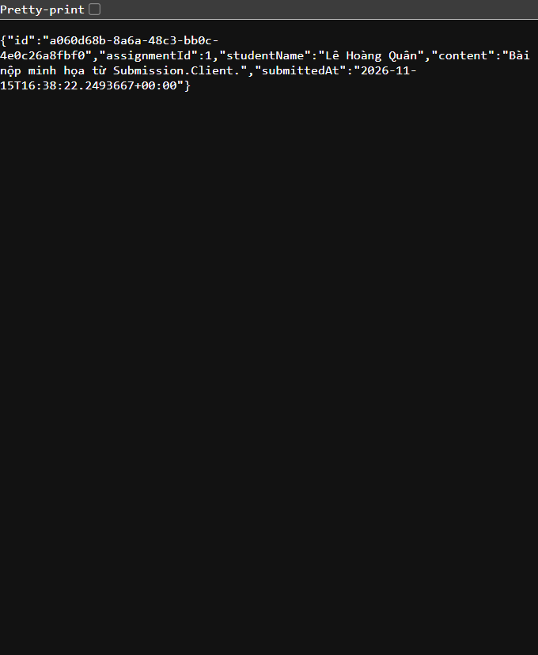

# Bài 2 - RESTful API Client/Server

**Sinh viên:** Lê Hoàng Quân (`dtc245200572`)

Bài tập xây dựng API quản lý assignments và submissions bằng ASP.NET Core Minimal API, đồng thời viết console client gọi API, tạo bài nộp và xử lý phản hồi HTTP.

## Chạy chương trình

Yêu cầu .NET 10 SDK. Mở terminal tại thư mục `Bai2`.

Build toàn bộ solution (gồm các project Catalog mẫu đã có và các project Submission):

```powershell
dotnet build .\CatalogApi.slnx
```

Chạy API Server trong terminal thứ nhất:

```powershell
dotnet run --project .\src\Submission.Api\Submission.Api.csproj
```

Server lắng nghe tại `http://localhost:5140`. Trong terminal thứ hai, chạy Client:

```powershell
dotnet run --project .\src\Submission.Client\Submission.Client.csproj -- http://localhost:5140
```

Client liệt kê assignment đang mở, gửi submission, chỉ đọc body sau khi xác nhận HTTP 201, đọc lại submission theo `Location`, rồi gửi payload sai và in mã lỗi HTTP 400. Server lưu dữ liệu trong bộ nhớ; submissions được tạo lại từ đầu khi Server khởi động lại.

## API và kiểm thử

Các request bên dưới đều có trong [`requests.http`](./requests.http). Chạy Server trước, sau đó dùng **Send Request** trong VS Code (cần REST Client extension).

| Thao tác | Dữ liệu | Kết quả mong đợi |
|---|---|---|
| GET `/api/assignments` | Danh sách assignments | 200 |
| GET `/api/assignments/1` | Assignment tồn tại | 200 |
| GET `/api/assignments/999` | Assignment không tồn tại | 404, `ASSIGNMENT_NOT_FOUND` |
| POST `/api/assignments/1/submissions` | `studentName` và `content` hợp lệ | 201, có `Location`, ID do Server sinh |
| GET `/api/submissions/{id}` | ID vừa nhận từ POST | 200 |
| GET `/api/submissions/00000000-0000-0000-0000-000000000000` | Submission không tồn tại | 404, `SUBMISSION_NOT_FOUND` |
| POST `/api/assignments/1/submissions` | `studentName` rỗng hoặc `content` rỗng | 400, `INVALID_SUBMISSION` |

Submission không thể tạo cho assignment đã đóng (ID `2`): Server trả 400 với code `ASSIGNMENT_CLOSED`. Khi POST, Server kiểm tra theo thứ tự assignment tồn tại, assignment còn mở, rồi mới xác thực dữ liệu. Mọi lỗi nghiệp vụ dùng cấu trúc `ApiError { code, message }`.

## Kết quả chạy

Ảnh chụp trực tiếp phản hồi JSON từ API đang chạy:





## Câu hỏi

### 1. Vì sao URI nên dùng danh từ thay vì động từ?

URI biểu diễn tài nguyên, còn HTTP method biểu diễn hành động. Dùng danh từ giúp đường dẫn ổn định, nhất quán và tận dụng đúng ngữ nghĩa HTTP (GET đọc, POST tạo). Ví dụ API này dùng:

```http
GET  /api/assignments/1
POST /api/assignments/1/submissions
GET  /api/submissions/550e8400-e29b-41d4-a716-446655440000
```

`assignments` và `submissions` là tài nguyên; không cần các đường dẫn kiểu `/getAssignment/1` hay `/createSubmission`.

### 2. Stateless trong HTTP có nghĩa là gì?

Mỗi request chứa đủ thông tin để Server xử lý; Server không dựa vào trạng thái phiên của request trước đó. Client có thể gửi các request độc lập, và Server không cần nhớ “đang ở bước nào” của Client. Trong bài này, request POST mang assignment ID và dữ liệu submission trong URL/body; request GET sau đó mang submission ID trong URL. Dữ liệu submission được lưu như tài nguyên phía Server, không phải trạng thái hội thoại của Client.

```http
POST /api/assignments/1/submissions
Content-Type: application/json

{"studentName":"Lê Hoàng Quân","content":"Bài nộp"}
```

```http
GET /api/submissions/550e8400-e29b-41d4-a716-446655440000
```

Request GET thứ hai tự xác định submission cần đọc bằng ID; Server không cần dựa vào nội dung request POST trước đó.

### 3. Vì sao API Server và Client nên sử dụng DTO riêng biệt?

DTO định nghĩa rõ dữ liệu trên wire và tách hợp đồng API khỏi cấu trúc nội bộ. Server có thể trả về ID, assignment ID và thời điểm tạo, trong khi Client chỉ gửi tên sinh viên và nội dung. Nhờ đó Client không thể tự đặt ID hoặc trạng thái; thay đổi mô hình nội bộ cũng không tự ý làm đổi JSON API.

Request DTO phía Client chỉ chứa dữ liệu người dùng được phép gửi:

```csharp
sealed record CreateSubmissionRequest(string StudentName, string Content);
```

Response DTO phía Server có thêm các giá trị do Server quản lý:

```csharp
public sealed record SubmissionResponse(
    Guid Id,
    int AssignmentId,
    string StudentName,
    string Content,
    DateTimeOffset SubmittedAt);
```

Server tự sinh `Id` bằng `Guid.NewGuid()` và tự ghi `SubmittedAt`; các trường này không thuộc request DTO. Client và Server có DTO cùng mục đích giao tiếp nhưng được khai báo độc lập trong từng project.
