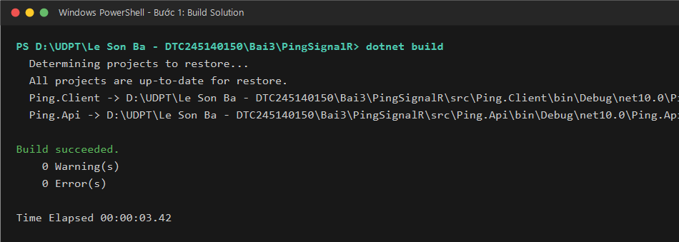
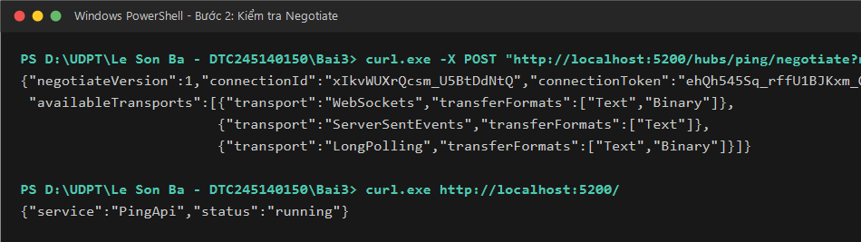
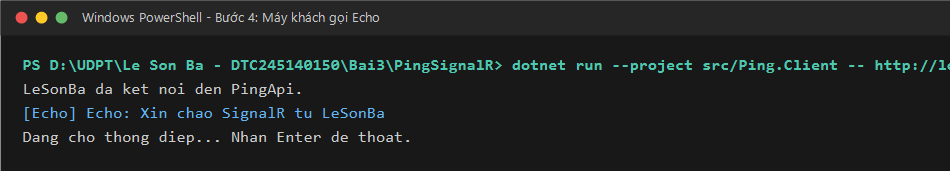
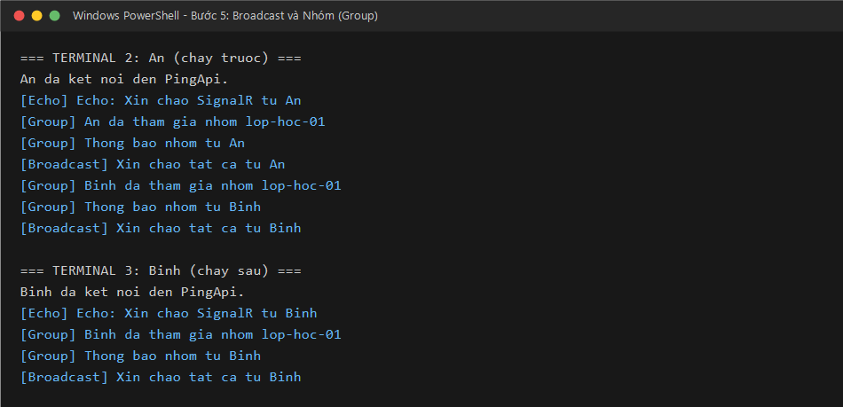
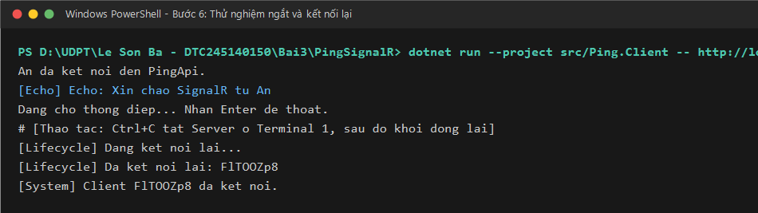
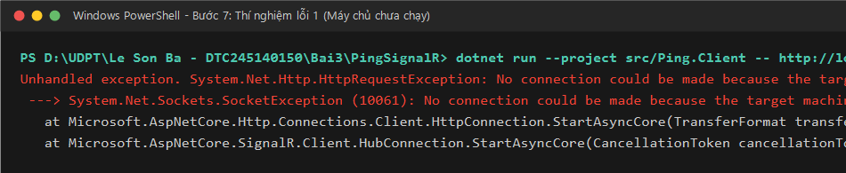
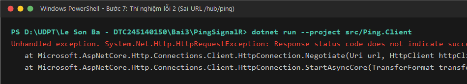
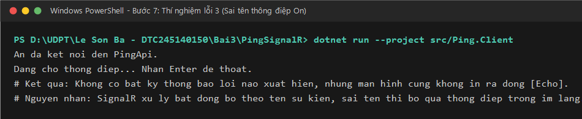
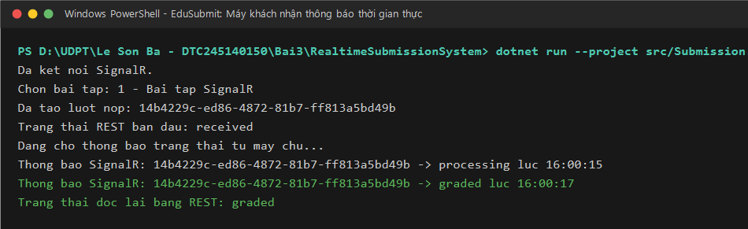
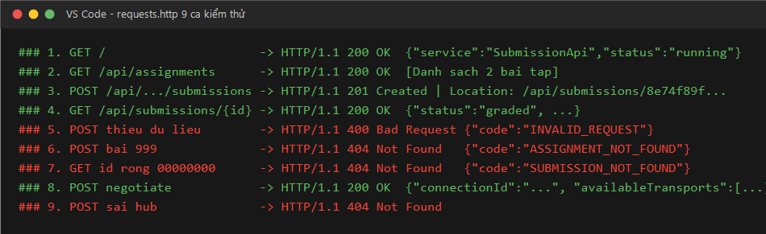

# BÁO CÁO THỰC HÀNH BÀI 3: GIAO TIẾP THỜI GIAN THỰC VỚI SIGNALR

- **Học phần:** Phát triển ứng dụng phân tán
- **Giảng viên hướng dẫn:** TS. Dương Thu Mây
- **Sinh viên thực hiện:** Lê Sơn Bá
- **Mã số sinh viên (MSSV):** DTC245140150
- **Lớp:** K23 CNTT - Trường Đại học Công nghệ Thông tin và Truyền thông (ICTU)

---

## PHẦN 1: TRẢ LỜI 3 CÂU HỎI ĐẦU GIỜ

### Câu 1: Máy chủ có thể chủ động báo cho máy khách mà không cần máy khách hỏi không?
**Trả lời:**
**Có.** Máy chủ hoàn toàn có thể chủ động đẩy (Push) dữ liệu tới máy khách nếu máy khách trước đó đã mở sẵn một kênh kết nối lâu dài, hai chiều (Full-Duplex) tới máy chủ thông qua giao thức **WebSocket** (được bọc bởi thư viện **SignalR**).
- Trong kiến trúc SignalR, từ bên trong Hub máy chủ gọi `Clients.Caller.SendAsync`, `Clients.All.SendAsync` hoặc `Clients.Group(...).SendAsync`.
- Nếu gửi từ bên ngoài Hub (chẳng hạn như từ Endpoint Minimal API hoặc tác vụ chấm bài chạy nền), máy chủ sẽ tiêm phụ thuộc dịch vụ `IHubContext<THub>` để phát thông điệp.

### Câu 2: Đã có REST rồi, vì sao còn cần thêm SignalR? Hai thứ chia việc thế nào?
**Trả lời:**
Hai công nghệ không triệt tiêu hay thay thế nhau mà **bổ trợ hoàn hảo** cho nhau theo nguyên tắc: *"Push để nhanh, REST để chắc"*.
- **REST:** Đóng vai trò là **nguồn sự thật (Source of Truth)**. Phù hợp cho mô hình yêu cầu – phản hồi (Request-Reply): máy khách chủ động tạo tài nguyên (POST trả về `201 Created` kèm Header `Location`), đọc dữ liệu trạng thái hiện tại (GET), tra cứu danh sách. Các mã trạng thái HTTP chuẩn (`200`, `201`, `400`, `404`) giúp máy khách nắm rõ kết quả xử lý tức thì.
- **SignalR:** Đóng vai trò là **kênh thông báo tức thời (Event-driven Notification)**. Giúp máy chủ đẩy các sự kiện phát sinh không đồng bộ sau khi yêu cầu ban đầu đã kết thúc (ví dụ: bài nộp chuyển từ `received` sang `processing`, rồi sang `graded`). Nếu không có SignalR, máy khách phải dùng cơ chế Polling (gửi GET liên tục mỗi vài giây), gây lãng phí băng thông mạng (~93% request thừa) và tăng tải vô ích cho máy chủ.

### Câu 3: Nếu đứt mạng đúng lúc máy chủ báo "đã chấm xong" (graded) thì sao?
**Trả lời:**
- Khi đứt mạng, kết nối WebSocket bị ngắt, thông điệp `graded` do máy chủ đẩy tại thời điểm đó sẽ **bị mất** vì SignalR hoạt động theo cơ chế thời gian thực nhẹ, không có hàng đợi lưu trữ tin nhắn chờ gửi lại (in-memory message queue) cho các client đã mất kết nối.
- Cơ chế `WithAutomaticReconnect()` ở máy khách sẽ tự động kích hoạt thử kết nối lại theo lịch trình (0s, 2s, 10s, 30s). Khi nối lại thành công, máy khách nhận được một `ConnectionId` hoàn toàn mới và bị mất toàn bộ danh sách nhóm đã tham gia trước đó.
- **Giải pháp xử lý:** Máy khách phải đăng ký lại nhóm (gọi `WatchSubmission`), đồng thời **gọi lại REST API (`GET /api/submissions/{id}`)** để đọc trạng thái mới nhất từ cơ sở dữ liệu. REST chính là chốt chặn đảm bảo tính toàn vẹn dữ liệu.

---

## PHẦN 2: NHẬT KÝ THỰC HÀNH PINGSIGNALR (BƯỚC 1 - BƯỚC 7)

### Bước 1: Khởi tạo Solution và cài đặt gói thư viện
Tạo Solution `PingSignalR.slnx` gồm 2 project: `Ping.Api` (ASP.NET Core Web Minimal API) và `Ping.Client` (Console Application). Máy khách cài đặt gói `Microsoft.AspNetCore.SignalR.Client` phiên bản `10.0.15`.
- **Lệnh thực hiện:**
  ```powershell
  dotnet new sln -n PingSignalR
  dotnet new web -n Ping.Api -o src/Ping.Api
  dotnet new console -n Ping.Client -o src/Ping.Client
  dotnet sln add src/Ping.Api/Ping.Api.csproj
  dotnet sln add src/Ping.Client/Ping.Client.csproj
  dotnet add src/Ping.Client package Microsoft.AspNetCore.SignalR.Client --version 10.0.15
  dotnet build
  ```
- **Kết quả:** Build thành công với `0 Warning(s)`, `0 Error(s)`.


### Bước 2: Cấu hình Hub trên Máy chủ và kiểm tra Negotiate
Đăng ký dịch vụ `builder.Services.AddSignalR()` vào DI container và ánh xạ endpoint Hub `app.MapHub<PingHub>("/hubs/ping")`.
- **Lệnh kiểm tra:**
  ```powershell
  curl.exe -X POST "http://localhost:5200/hubs/ping/negotiate?negotiateVersion=1"
  ```
- **Kết quả:** Trả về HTTP 200 kèm `connectionId` và danh sách cơ chế truyền tải khả dụng (`WebSockets`, `ServerSentEvents`, `LongPolling`).


### Bước 3 & 4: Viết phương thức Echo và Máy khách gọi nhận tin
Máy chủ cài đặt phương thức `Echo(string message)` trả lời riêng người gọi qua `Clients.Caller.SendAsync("EchoResponse", ...)`.
Máy khách kết nối qua `HubConnectionBuilder`, đăng ký hàm lắng nghe `connection.On<string>("EchoResponse", ...)` và gọi `await connection.InvokeAsync("Echo", ...)`.
- **Kết quả:** Máy khách in chính xác dòng phản hồi:
  `[Echo] Echo: Xin chao SignalR tu LeSonBa`


### Bước 5: Phát rộng (Broadcast) và Nhóm (Group)
Cài đặt 3 phạm vi gửi dữ liệu:
1. `Clients.Caller`: Chỉ người gọi nhận tin.
2. `Clients.Group("lop-hoc-01")`: Chỉ các kết nối đã tham gia nhóm mới nhận được thông báo.
3. `Clients.All`: Tất cả các kết nối hiện hành đều nhận được tin phát rộng.
- **Kiểm tra 2 máy khách chạy đồng thời:** Cửa sổ máy khách An và Bình đều thấy tin nhóm và phát rộng của nhau, nhưng không nhìn thấy tin Echo riêng của người kia.


### Bước 6: Quản lý vòng đời kết nối và Tự kết nối lại
- Máy chủ ghi đè `OnConnectedAsync` và `OnDisconnectedAsync` để phát hiện thiết bị online/offline.
- Máy khách bật `.WithAutomaticReconnect()` và bắt các sự kiện `Reconnecting`, `Reconnected`, `Closed`.
- Khi máy chủ khởi động lại, máy khách chuyển trạng thái: `[Lifecycle] Dang ket noi lai...` $\rightarrow$ `[Lifecycle] Da ket noi lai: <ConnectionId_Moi>`.


### Bước 7: Ba thí nghiệm lỗi kinh nghiệm
1. **Lỗi 1 - Chạy máy khách khi máy chủ tắt:**
   - Hiện tượng: Ném ngoại lệ `HttpRequestException: Connection refused (localhost:5200)` ngay tại lệnh `StartAsync()`.
   - Bài học: `WithAutomaticReconnect` chỉ cứu các kết nối đã từng kết nối thành công, không tự thử lại cho lần kết nối đầu tiên.
   
2. **Lỗi 2 - Sai URL tuyến Hub (`/hub/ping` thiếu chữ `s`):**
   - Hiện tượng: Ném ngoại lệ `HttpRequestException: 404 (Not Found)` ngay bước negotiate ban đầu.
   - Bài học: Tuyến kết nối phía Client phải khớp 100% với cấu hình `MapHub` trên máy chủ.
   
3. **Lỗi 3 - Sai tên sự kiện ở hàm `connection.On`:**
   - Hiện tượng: Không có lỗi biên dịch, không có ngoại lệ khi chạy, nhưng chương trình im lặng và không in kết quả.
   - Bài học: Hợp đồng SignalR là chuỗi định danh (string contract). Tên sự kiện ở máy khách và máy chủ phải khớp từng ký tự (phân biệt hoa thường).
   

---

## PHẦN 3: BẢNG 5 THÍ NGHIỆM PHÂN TÁN TRONG EDUSUBMIT REALTIME

Bảng kết quả đối chiếu giữa dự đoán trước khi chạy và kết quả thực tế thu được tại Bước 7:

| STT | Thí nghiệm | Dự đoán | Kết quả chạy thật | Bài học phân tán rút ra |
|:---:|:---|:---|:---|:---|
| **1** | Chạy 2 máy khách `SV001` và `SV002` cùng lúc | Mỗi sinh viên chỉ nhận được thông báo chấm bài của chính mình, không bị lẫn | Mỗi máy khách chỉ nhận thông báo trạng thái của `submissionId` do mình tạo ra | Nhóm `Clients.Group("submission:{id}")` giúp cô lập phạm vi nhận tin, bảo đảm quyền riêng tư và tiết kiệm băng thông. |
| **2** | Chạy máy khách khi máy chủ chưa chạy | Báo lỗi không thể kết nối đến cổng 5000 | Ném ngoại lệ `HttpRequestException: Connection refused (localhost:5000)` | Phương thức `connection.StartAsync()` thất bại ngay lập tức; tính năng tự thử lại không kích hoạt ở lần mở kết nối đầu tiên. |
| **3** | Sửa `WithUrl` thành `/hub/submissions` (thiếu `s`) | Lỗi không tìm thấy endpoint hub | Ném ngoại lệ `HttpRequestException: 404 (Not Found)` ở bước negotiate | Endpoint Hub thời gian thực phải khớp chính xác từng chữ với cấu hình `app.MapHub` của máy chủ. |
| **4** | Sửa `On("SubmissionStatusChanged")` thành `On("SubmissionStatusChange")` | Không nhận được thông báo trạng thái, rơi vào timeout | Chương trình không báo lỗi, sau 10 giây in dòng: `"Qua thoi gian cho thong bao graded."` | Sai lệch tên sự kiện ở chiều đẩy (push) sẽ bị bỏ qua trong im lặng. Cần kiểm tra kỹ tên thông điệp khi không thấy máy khách phản ứng. |
| **5** | Chờ 4 giây rồi mới gọi `WatchSubmission` | Bị lỡ mất thông điệp chấm bài | Máy khách không nhận được thông báo SignalR nào; khi gọi REST đọc lại thì thấy trạng thái đã là `graded` | Vào nhóm muộn sẽ bị lỡ thông điệp thời gian thực vì server không lưu cache. REST luôn là nguồn sự thật cuối cùng để chốt dữ liệu. |

---

## PHẦN 4: HỆ THỐNG EDUSUBMIT REALTIME & YÊU CẦU KIỂM THỬ

### 1. Kết quả chạy máy khách EduSubmit (In đủ 8 dòng chuẩn)
Máy khách thực hiện trọn vẹn chu trình 5 bước: `Mở kết nối SignalR` $\rightarrow$ `Lấy danh sách bài tập (REST)` $\rightarrow$ `POST tạo lượt nộp` $\rightarrow$ `WatchSubmission vào nhóm` $\rightarrow$ `Nhận processing và graded (SignalR)` $\rightarrow$ `GET chốt lại bằng REST`:
```text
Da ket noi SignalR.
Chon bai tap: 1 - Bai tap SignalR
Da tao luot nop: 14b4229c-ed86-4872-81b7-ff813a5bd49b
Trang thai REST ban dau: received
Dang cho thong bao trang thai tu may chu...
Thong bao SignalR: 14b4229c-ed86-4872-81b7-ff813a5bd49b -> processing luc 16:00:15
Thong bao SignalR: 14b4229c-ed86-4872-81b7-ff813a5bd49b -> graded luc 16:00:17
Trang thai doc lai bang REST: graded
```


### 2. File kiểm thử `requests.http` (Đầy đủ 9 ca)
Toàn bộ 9 ca kiểm thử trong file `RealtimeSubmissionSystem/requests.http` đều vượt qua với mã trạng thái HTTP chính xác:
1. `GET /` $\rightarrow$ `200 OK` (Kiểm tra trạng thái máy chủ)
2. `GET /api/assignments` $\rightarrow$ `200 OK` (Lấy danh sách bài tập)
3. `POST /api/assignments/1/submissions` $\rightarrow$ `201 Created` kèm Header `Location: /api/submissions/{id}`
4. `GET /api/submissions/{id}` $\rightarrow$ `200 OK` (Đọc lại lượt nộp vừa tạo)
5. `POST /api/assignments/1/submissions` (Thiếu dữ liệu) $\rightarrow$ `400 Bad Request`
6. `POST /api/assignments/999/submissions` (Bài không tồn tại) $\rightarrow$ `404 Not Found`
7. `GET /api/submissions/00000000-0000-0000-0000-000000000000` $\rightarrow$ `404 Not Found`
8. `POST /hubs/submissions/negotiate?negotiateVersion=1` $\rightarrow$ `200 OK` (Bắt tay Hub SignalR)
9. `POST /hub/submissions/negotiate?negotiateVersion=1` $\rightarrow$ `404 Not Found` (Sai URL hub)


### 3. Bài tập vận dụng 2 (Điểm thưởng +0.5đ): Xử lý trạng thái `failed`
Đã tích hợp trong hàm chấm bài nền của máy chủ: nếu `RepositoryUrl` không bắt đầu bằng `https://`, bài nộp sẽ chuyển trạng thái cuối cùng là `failed`. Phía Client sẽ nhận biết trạng thái `failed` và in dòng cảnh báo chữ màu đỏ nổi bật:
`!!! CANH BAO: luot nop <id> cham LOI (failed)`

---

## PHẦN 5: CÂU HỎI ÔN TẬP VÀ THẢO LUẬN (CHƯƠNG 3)

### A. Ôn tập giáo trình
1. **Polling khác Push ở số yêu cầu và độ trễ thế nào?**
   - Polling: Khách hỏi định kỳ (chu kỳ $T$). Độ trễ trung bình $T/2$. Số yêu cầu rất lớn, phần lớn trả về dữ liệu cũ không đổi.
   - Push: Máy chủ phát ngay khi sự kiện xảy ra. Độ trễ gần như bằng 0. Số thông điệp đúng bằng số lần dữ liệu thay đổi (100% hữu ích).
2. **Phân biệt 3 MEP:**
   - Request-Reply: Client khởi tạo; 1 yêu cầu $\rightarrow$ 1 phản hồi.
   - Push: Server khởi tạo; các thông điệp đơn lẻ gửi bất đối xứng.
   - Streaming: Khởi tạo bởi Client hoặc Server; dòng liên tục nhiều thông điệp.
3. **WebSocket, SignalR: Giao thức hay Thư viện?**
   - WebSocket là **giao thức mạng** tầng ứng dụng chuẩn hóa theo RFC 6455.
   - SignalR là **thư viện cấp cao** của nền tảng .NET bọc và quản lý giao thức WebSocket.
4. **Cơ chế truyền tải dự phòng của SignalR:**
   - 1. WebSockets $\rightarrow$ 2. Server-Sent Events (SSE) $\rightarrow$ 3. Long Polling.
5. **Vì sao tạo nhóm `submission:{id}` thay vì gửi tất cả?**
   - Đảm bảo tính riêng tư của sinh viên (không xem được bài người khác) và tiết kiệm băng thông (không bắt hàng nghìn client nhận và tự lọc tin không thuộc về mình).
6. **`IHubContext` cho phép làm gì?**
   - Cho phép gửi thông điệp tới Client từ **bên ngoài lớp Hub** (từ Background Worker, Controller, hoặc Minimal API Endpoints).
7. **`On<T>` dùng để làm gì? Bỏ đi thì sao?**
   - Đăng ký hàm callback xử lý khi server gửi thông điệp có tên tương ứng. Nếu bỏ đi, máy khách vẫn nhận gói tin từ server nhưng sẽ âm thầm bỏ qua và không thực thi hành động nào.
8. **REST làm gì, SignalR làm gì? Vì sao không dùng SignalR để tạo lượt nộp?**
   - REST quản lý CRUD tài nguyên chuẩn mực, có mã trạng thái rõ ràng, dễ lưu vết, xác thực và chuẩn hóa. Dùng REST tạo lượt nộp giúp client biết chắc chắn bài đã được lưu vào hệ thống trước khi theo dõi tiến độ qua SignalR.
9. **`WithAutomaticReconnect` có tác dụng gì?**
   - Tự động quản lý việc kết nối lại khi mất mạng (thử theo lịch trình mặc định: 0s, 2s, 10s, 30s) mà không cần lập trình viên phải tự viết vòng lặp bắt lỗi kết nối thủ công.
10. **Mất kết nối đúng lúc báo `graded` thì làm gì?**
    - Chờ kết nối lại (hoặc chủ động kết nối lại) và gọi REST API `GET /api/submissions/{id}` để cập nhật trạng thái mới nhất từ server.

### B. Thảo luận mở rộng
1. **Hàng trăm sinh viên cùng theo dõi: nhóm theo ID hay phát tất cả rồi tự lọc?**
   - Nhóm theo ID trên máy chủ tiết kiệm băng thông vượt trội. Nếu phát tất cả ($N$ sinh viên), mỗi sự kiện sẽ sinh ra $N$ gói tin trên mạng (độ phức tạp $O(N^2)$). Khi dùng nhóm, mỗi sự kiện chỉ sinh đúng 1 gói tin tới đúng client theo dõi ($O(1)$).
2. **Nêu 2 tình huống Polling hợp lý hơn SignalR:**
   - Dữ liệu rất ít khi thay đổi (ví dụ: kiểm tra phiên bản ứng dụng mới 1 ngày/lần).
   - Hệ thống chạy qua các Proxy hoặc Firewall nghiêm ngặt chặn các kết nối HTTP kéo dài hoặc chặn giao thức WebSocket.
3. **Chạy nhiều bản sao API (Scale-out) thì nhóm trong bộ nhớ gặp vấn đề gì? Sửa thế nào?**
   - Khi chạy nhiều máy chủ (Cluster/Load balancer), máy khách A nối tới Server 1 còn tác vụ chấm bài diễn ra ở Server 2. Nhóm lưu trong RAM Server 2 sẽ không thể gửi tin tới kết nối trên Server 1.
   - **Giải pháp:** Sử dụng **SignalR Backplane** (phổ biến nhất là dùng Redis Backplane hoặc Azure SignalR Service) để định tuyến và đồng bộ thông điệp giữa tất cả các máy chủ.
