# Bài 3: SignalR – Ma Thị Thanh Tú

- **Mã sinh viên:** `dtc245200587`
- **Lớp:** CNTT K23C

*Minh chứng Bài 3: PingSignalR và RealtimeSubmissionSystem.*

---

## Phần 1: PingSignalR

Gồm 2 project:
- `Ping.Api`: server ASP.NET Core có hub `/hubs/ping`, chạy ở `http://localhost:5200`
- `Ping.Client`: console client kết nối tới hub bằng `HubConnectionBuilder`

```powershell
dotnet run --project src/Ping.Api --urls http://localhost:5200
dotnet run --project src/Ping.Client -- http://localhost:5200 An
```

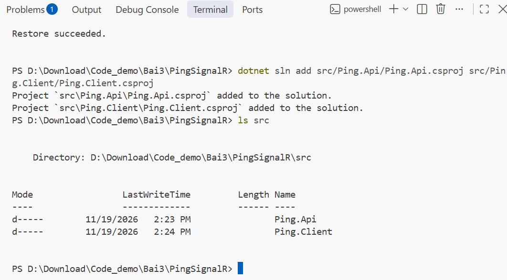
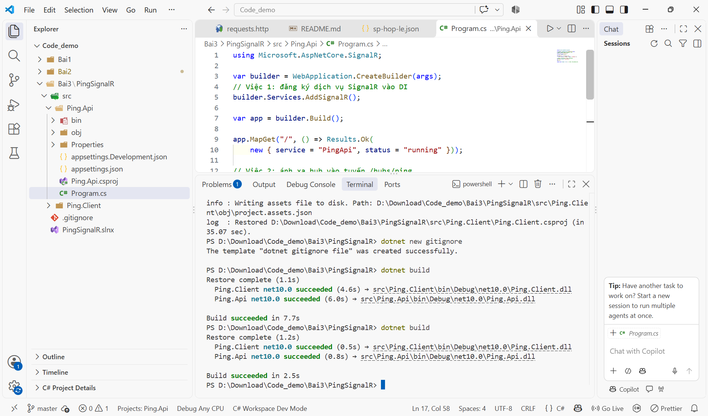
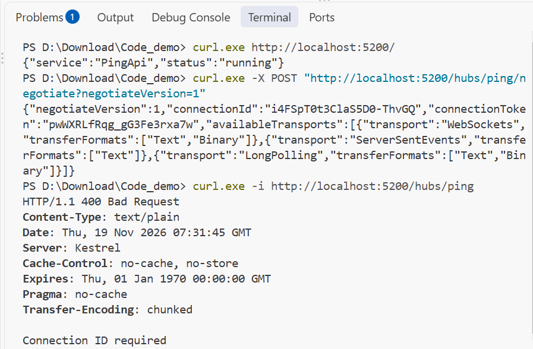
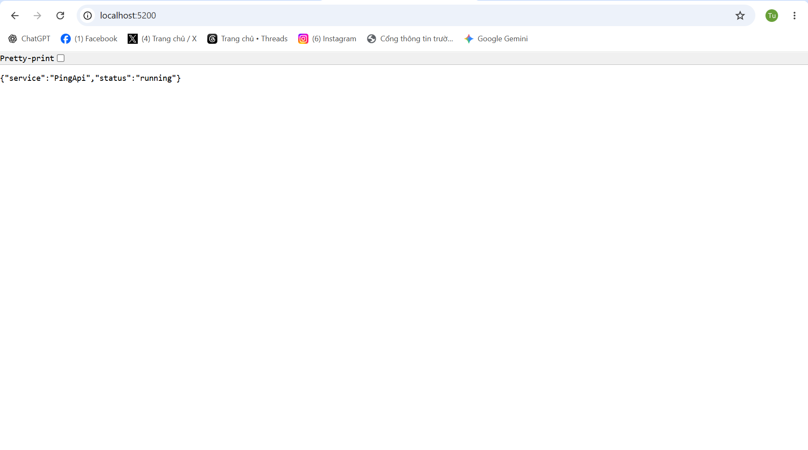
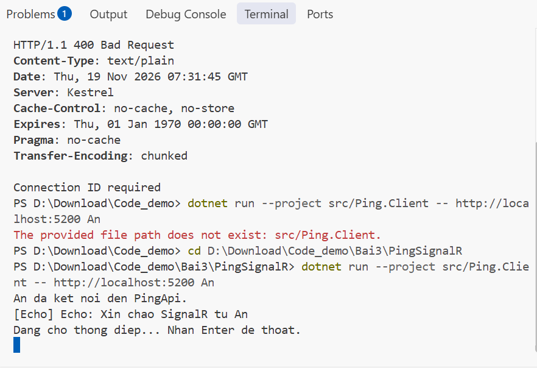
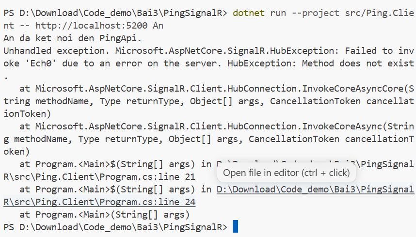
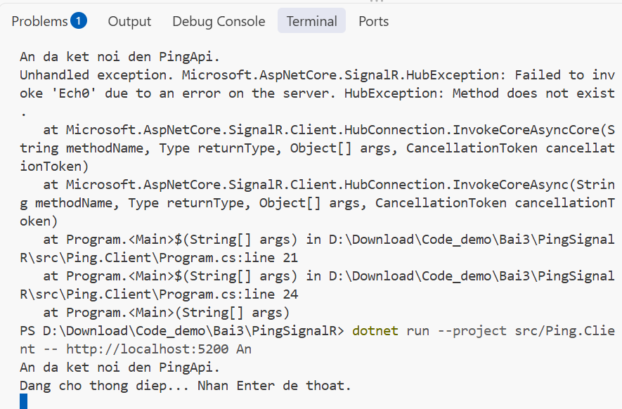
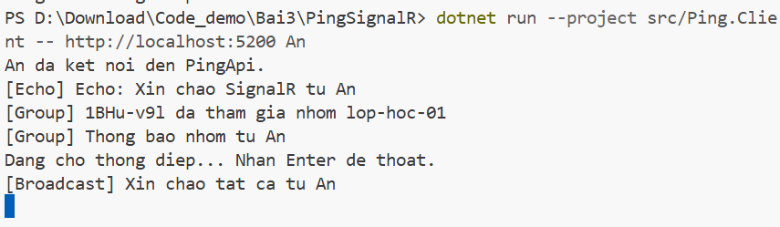
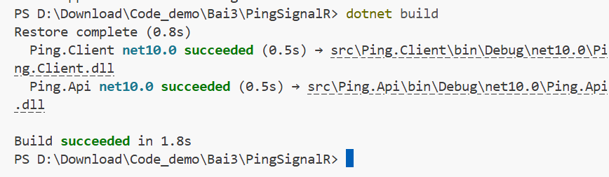
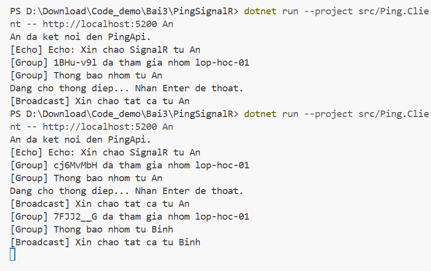
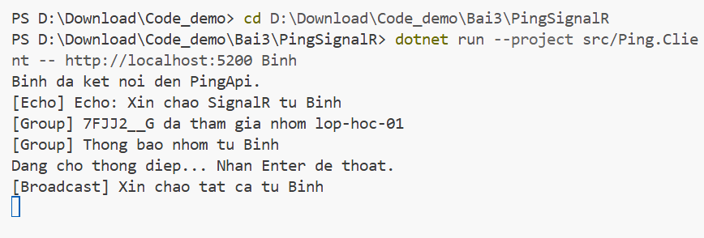
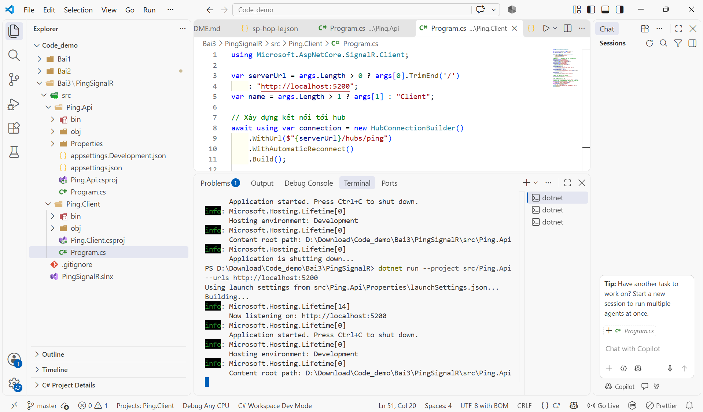

---

## Phần 2: RealtimeSubmissionSystem

Hệ thống nộp bài realtime, có hub `/hubs/submissions` chạy ở `http://localhost:5000`.

```powershell
curl.exe -X POST "http://localhost:5000/hubs/submissions/negotiate?negotiateVersion=1"
```

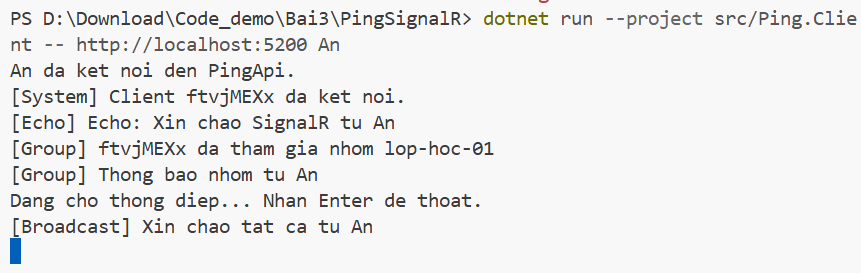
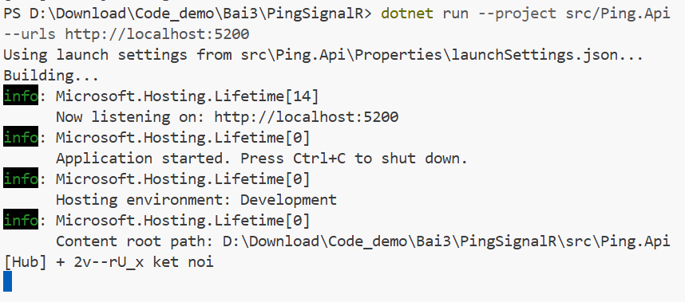
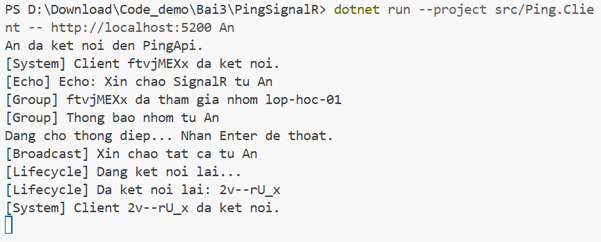
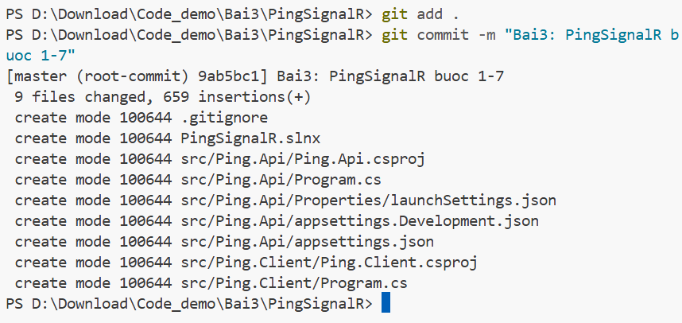
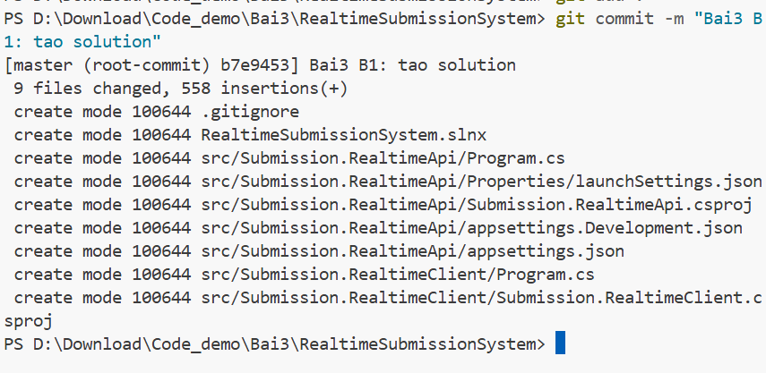
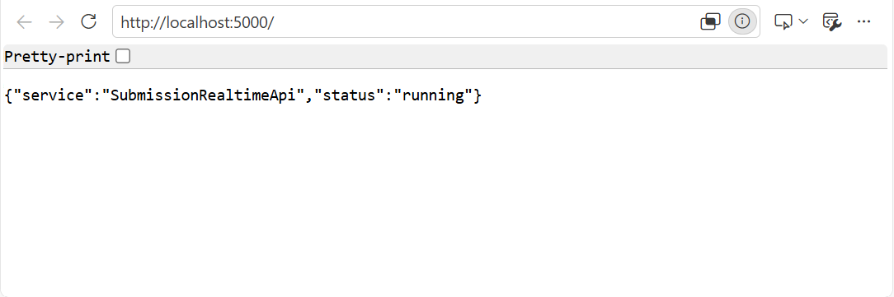
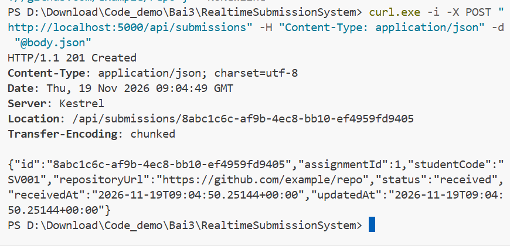
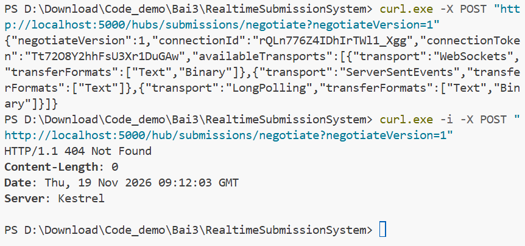
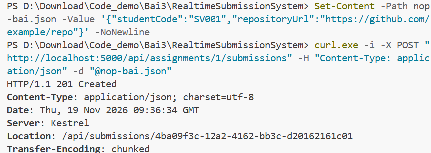
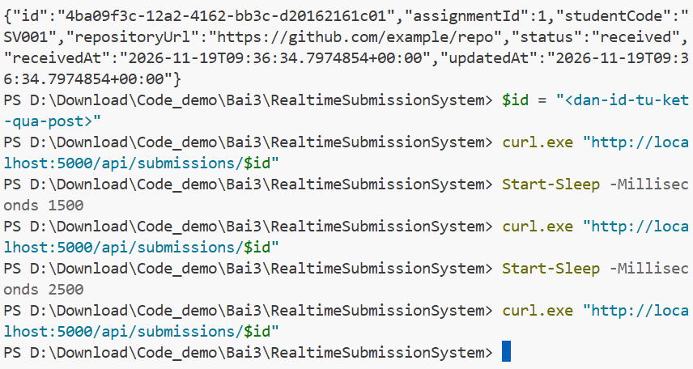
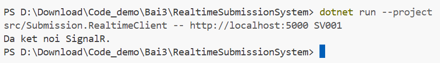
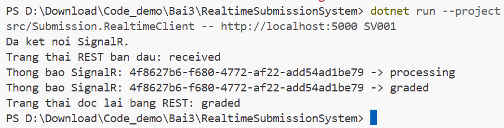
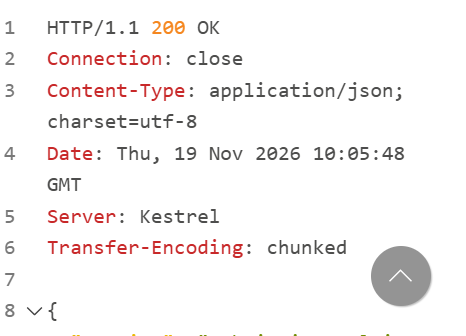
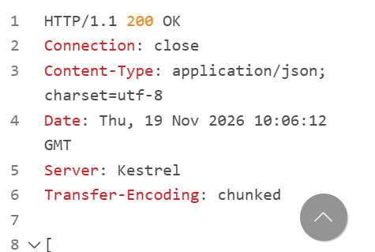
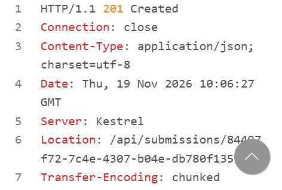
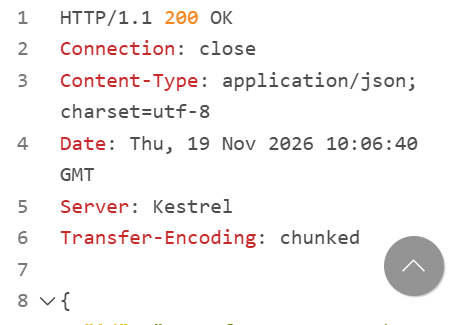
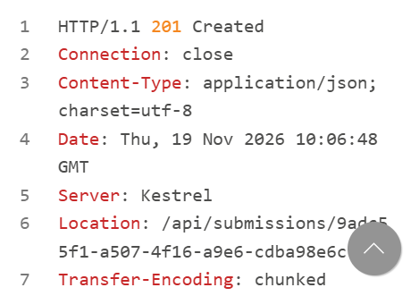
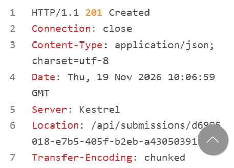
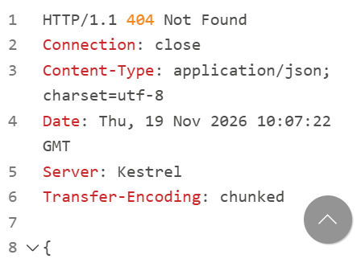
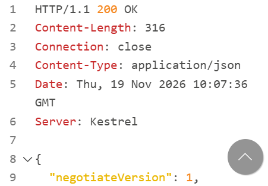
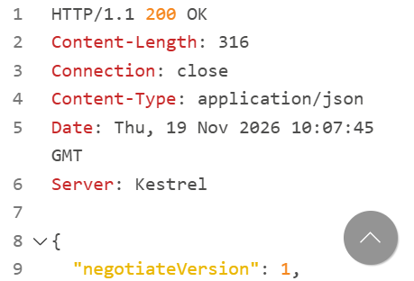
