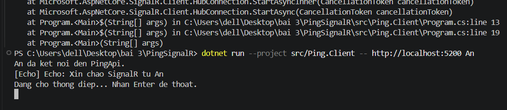
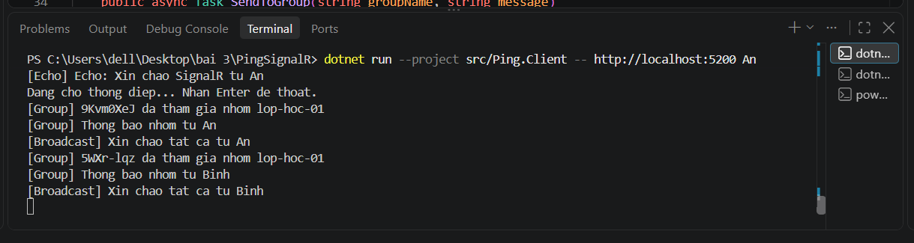
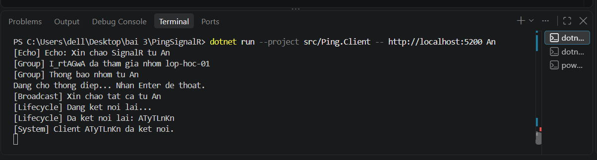
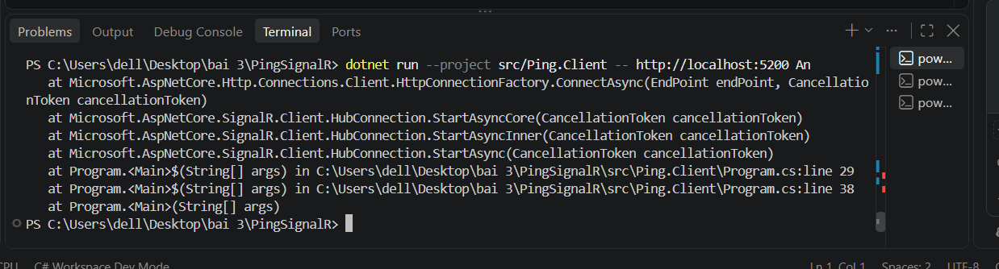
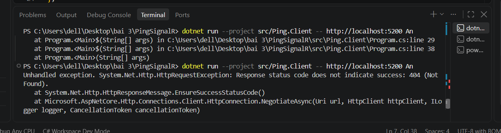
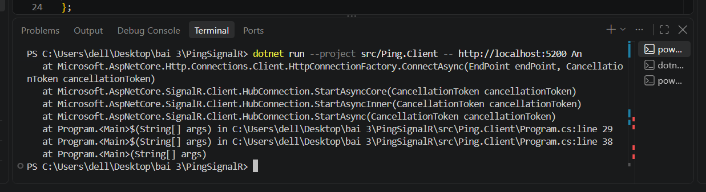

# Báo cáo Thực hành Bài 3: Giao tiếp thời gian thực với SignalR

## I. Trả lời 3 câu hỏi đầu giờ
1. **Máy chủ có thể chủ động báo cho máy khách mà không cần máy khách hỏi không?**
   - Có, khi máy khách mở sẵn một kết nối hai chiều lâu dài thông qua SignalR (WebSocket). Máy chủ đẩy thông điệp qua Clients.Group(...).SendAsync(...) hoặc thông qua IHubContext khi gửi từ tác vụ nền bên ngoài Hub.
2. **Đã có REST rồi, vì sao còn cần thêm SignalR? Hai thứ chia việc thế nào?**
   - REST dùng để tạo và đọc tài nguyên với mã trạng thái HTTP rõ ràng (201, 400, 404) và đóng vai trò nguồn sự thật. SignalR bổ sung chiều đẩy thông báo thay đổi trạng thái phát sinh sau yêu cầu ban đầu (
eceived -> processing -> graded), không thay thế REST.
3. **Nếu đứt mạng đúng lúc máy chủ báo "đã chấm xong" thì sao?**
   - Thông điệp đẩy lúc mất mạng sẽ bị lỡ vì SignalR không lưu hàng đợi tin nhắn. WithAutomaticReconnect() sẽ tự động kết nối lại với ConnectionId mới; sau đó máy khách đăng ký WatchSubmission lại và gọi GET /api/submissions/{id} qua REST để lấy trạng thái cuối cùng chính xác.

---

## II. Phần 1: PingSignalR (Cổng 5200)
- **Bước 4 (Echo):** 
- **Bước 5 (Nhóm & Broadcast):** 
- **Bước 6 (Tự động nối lại):** 
- **Bước 7 - Lỗi 1 (Connection Refused):** 
- **Bước 7 - Lỗi 2 (404 Not Found):** 
- **Bước 7 - Lỗi 3 (Sai tên sự kiện):** 

---

## III. Phần 2: EduSubmit Realtime (RealtimeSubmissionSystem - Cổng 5000)
- **Kết quả chạy luồng REST + SignalR:**

### Bảng 5 thí nghiệm phân tán (Bước 7)
| STT | Thí nghiệm | Dự đoán | Kết quả thật | Giải thích |
| :--- | :--- | :--- | :--- | :--- |
| 1 | Chạy 2 máy khách SV001 và SV002 cùng lúc | Mỗi máy khách chỉ nhận tin của mình | Mỗi máy khách chỉ thấy thông báo lượt nộp vừa tạo | Nhóm submission:{id} phân tách đúng người nhận |
| 2 | Chạy máy khách khi máy chủ chưa chạy | Báo lỗi không kết nối được | Ném HttpRequestException: Connection refused (localhost:5000) | WithAutomaticReconnect() chỉ thử lại với kết nối đã mở thành công |
| 3 | Sửa WithUrl thành /hub/submissions (thiếu s) | Lỗi 404 không tìm thấy hub | Ném HttpRequestException: 404 (Not Found) | Lỗi ngay ở bước bắt tay 
egotiate do không khớp MapHub |
| 4 | Sửa On("SubmissionStatusChanged") thành On("SubmissionStatusChange") | Không nhận được thông báo đẩy | Không lỗi; sau 10s báo quá thời gian chờ, REST đọc lại ra graded | Sai tên thông điệp chiều xuống thì SignalR bỏ qua im lặng |
| 5 | Chờ 4 giây sau POST mới gọi WatchSubmission | Bỏ lỡ thông báo do vào nhóm muộn | Không nhận tin đẩy nào; REST đọc lại vẫn ra graded | Tác vụ chấm nền đã chạy xong trước khi vào nhóm; REST là nguồn sự thật |