# BÁO CÁO TỔNG HỢP TOÀN DIỆN KẾT QUẢ THỰC HÀNH BÀI 2
## RESTful API CHO TƯƠNG TÁC CLIENT – SERVER (.NET 10)

> **Môn học:** Lập trình phân tán / Kiến trúc Dịch vụ RESTful  
> **Sinh viên thực hiện:** Nguyễn Thanh Sơn  
> **Môi trường thực thi:** macOS (Apple Silicon) | .NET 10.0 SDK | Kestrel Web Server  
> **Thư mục lưu trữ mã nguồn:**  
> - Bài 1: `/Users/nguyenthanhson/Desktop/CatalogApi`  
> - Bài 2: `/Users/nguyenthanhson/Desktop/RestfulClientServer`  
> **Thư mục ảnh chụp minh chứng:** `/Users/nguyenthanhson/Desktop/screenshots_bai2/`  

---

## MỤC LỤC
1. [PHẦN 1: BÀI 1 — CATALOG API (`CatalogApi`)](#phan-1-bai-1--catalog-api-catalogapi)
   - [Bước 1: Khởi tạo Solution và Kiểm tra Biên dịch](#b1-b1)
   - [Bước 2: Endpoint Kiểm tra Máy chủ `GET /`](#b1-b2)
   - [Bước 3: Lấy Danh sách Toàn bộ Sản phẩm `GET /api/products`](#b1-b3)
   - [Bước 4: Tra cứu Chi tiết Sản phẩm `GET /api/products/{id}`](#b1-b4)
   - [Bước 5: Thêm Sản phẩm Mới `POST /api/products`](#b1-b5)
   - [Bước 6: Tập Kịch bản Kiểm thử Tự động `requests.http`](#b1-b6)
   - [Bước 7: Ứng dụng Console Client Kiểm thử 4 Nấc An toàn](#b1-b7)
   - [Bước 8: Lịch sử Git Commit Từng Bước](#b1-b8)
   - [Bảng Phá thử (Chaos Testing) Bài 1](#b1-chaos)
2. [PHẦN 2: BÀI 2 — EDUSUBMIT (`RestfulClientServer`)](#phan-2-bai-2--edusubmit-restfulclientserver)
   - [Bước 1: Khởi tạo Solution và Kiểm tra Biên dịch](#b2-b1)
   - [Bước 2: Endpoint Kiểm tra Máy chủ `GET /`](#b2-b2)
   - [Bước 3: Lấy Danh sách Bài tập `GET /api/assignments`](#b2-b3)
   - [Bước 4: Tra cứu Chi tiết Bài tập `GET /api/assignments/{id}`](#b2-b4)
   - [Bước 5: Nộp Bài 3 Cổng Kiểm soát `POST /api/assignments/{id}/submissions`](#b2-b5)
   - [Bước 6: Tra cứu Lượt Nộp theo GUID `GET /api/submissions/{guid}`](#b2-b6)
   - [Bước 7: Tập Kịch bản Kiểm thử Tự động `requests.http`](#b2-b7)
   - [Bước 8: Ứng dụng Console Client Nộp Bài Chuỗi 4 Nấc An toàn](#b2-b8)
   - [Bước 8b: Lịch sử Git Commit Từng Bước](#b2-git)
   - [Bảng Phá thử (Chaos Testing) Bài 2](#b2-chaos)
3. [PHẦN 3: GIẢI THÍCH 3 CÂU HỎI LÝ THUYẾT TRỌNG TÂM](#phan-3-giai-thich-3-cau-hoi-ly-thuyet-trong-tam)

---

<a id="phan-1-bai-1--catalog-api-catalogapi"></a>
# PHẦN 1: BÀI 1 — CATALOG API (`CatalogApi`)

Dự án Web API quản lý danh mục sản phẩm (sách giáo trình, tài liệu) phục vụ sinh viên, bao gồm dịch vụ `Catalog.Api` chạy tại cổng `http://localhost:5100` và ứng dụng điều khiển `Catalog.Client`.

---

<a id="b1-b1"></a>
### Bước 1: Khởi tạo Solution và Kiểm tra Biên dịch

- **Mục tiêu:** Tạo cấu trúc Solution chuẩn .NET gồm 2 dự án `src/Catalog.Api` (ASP.NET Core Minimal API) và `src/Catalog.Client` (Console Application), cấu hình `.gitignore`, kiểm tra biên dịch không có cảnh báo/lỗi.
- **Lệnh thực thi:**
  ```bash
  cd /Users/nguyenthanhson/Desktop/CatalogApi
  dotnet build CatalogApi.slnx
  ```
- **Kết quả thực tế:** Biên dịch thành công 100% (`0 Warning(s)`, `0 Error(s)`).

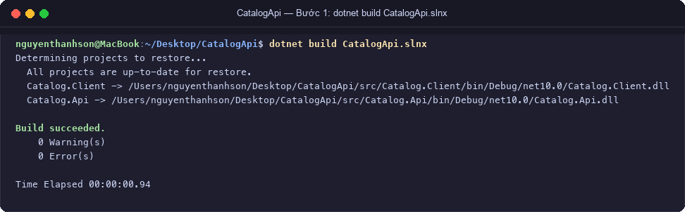

---

<a id="b1-b2"></a>
### Bước 2: Endpoint Kiểm tra Máy chủ (`GET /`)

- **Mục tiêu:** Kiểm tra máy chủ API đã sẵn sàng phục vụ và tiếp nhận kết nối HTTP. Trả về mã trạng thái `200 OK` cùng thông tin dịch vụ dưới dạng JSON.
- **Lệnh thực thi:**
  ```bash
  curl -i http://localhost:5100/
  ```
- **Phản hồi HTTP thực tế:**
  ```http
  HTTP/1.1 200 OK
  Content-Type: application/json; charset=utf-8
  Server: Kestrel

  {"service":"Catalog.Api","status":"running"}
  ```

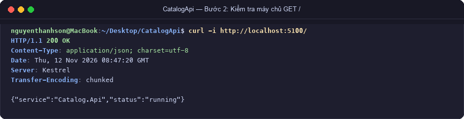

---

<a id="b1-b3"></a>
### Bước 3: Lấy Danh sách Toàn bộ Sản phẩm (`GET /api/products`)

- **Mục tiêu:** Truy vấn danh sách tài nguyên danh mục sản phẩm. Dữ liệu được trả về theo danh sách các `ProductDto` với định dạng JSON chuẩn mực.
- **Lệnh thực thi:**
  ```bash
  curl -i http://localhost:5100/api/products
  ```
- **Phản hồi HTTP thực tế:** Mã `200 OK`, mảng 3 sản phẩm mẫu (Giáo trình Lập trình phân tán, Tài liệu RESTful API, Bài tập thực hành .NET).

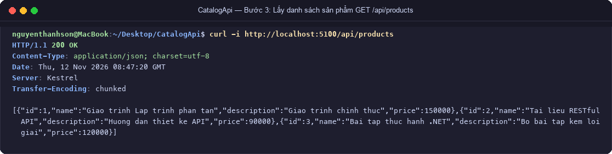

---

<a id="b1-b4"></a>
### Bước 4: Tra cứu Chi tiết Sản phẩm (`GET /api/products/{id}`)

#### Ca 1: Sản phẩm tồn tại (Id = 1) -> Kỳ vọng 200 OK
- **Lệnh thực thi:**
  ```bash
  curl -i http://localhost:5100/api/products/1
  ```
- **Phản hồi HTTP thực tế:** `200 OK`, JSON của sản phẩm số 1.

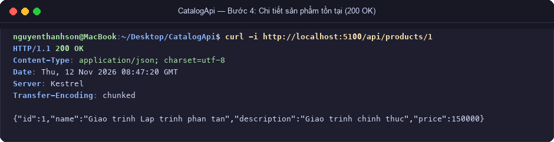

#### Ca 2: Sản phẩm không tồn tại (Id = 999) -> Kỳ vọng 404 Not Found kèm ApiError
- **Lệnh thực thi:**
  ```bash
  curl -i http://localhost:5100/api/products/999
  ```
- **Phản hồi HTTP thực tế:**
  ```http
  HTTP/1.1 404 Not Found
  Content-Type: application/json; charset=utf-8

  {"code":"PRODUCT_NOT_FOUND","message":"Khong tim thay san pham."}
  ```

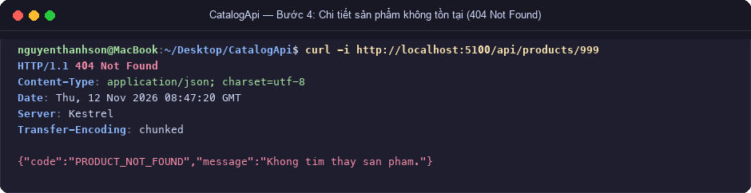

---

<a id="b1-b5"></a>
### Bước 5: Thêm Sản phẩm Mới (`POST /api/products`)

#### Ca 1: Dữ liệu hợp lệ từ tệp `sp-hop-le.json` -> Kỳ vọng 201 Created + Header Location
- **Nội dung payload `sp-hop-le.json`:**
  ```json
  {
    "name": "Lap trinh gRPC",
    "description": "Tai lieu bai 5",
    "price": 80000
  }
  ```
- **Lệnh thực thi:**
  ```bash
  curl -i -X POST http://localhost:5100/api/products \
    -H "Content-Type: application/json" \
    --data @sp-hop-le.json
  ```
- **Phản hồi HTTP thực tế:** Mã `201 Created`, Header `Location: /api/products/4`, Body trả về sản phẩm mới vừa được gán Id = 4.

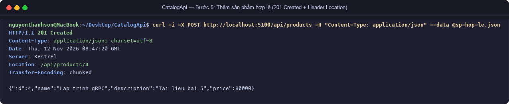

#### Ca 2: Dữ liệu không hợp lệ từ tệp `sp-sai.json` -> Kỳ vọng 400 Bad Request kèm ApiError
- **Nội dung payload `sp-sai.json`:** (tên rỗng, giá âm `-10000`)
- **Lệnh thực thi:**
  ```bash
  curl -i -X POST http://localhost:5100/api/products \
    -H "Content-Type: application/json" \
    --data @sp-sai.json
  ```
- **Phản hồi HTTP thực tế:**
  ```http
  HTTP/1.1 400 Bad Request
  Content-Type: application/json; charset=utf-8

  {"code":"INVALID_PRODUCT","message":"Ten san pham khong duoc de trong va gia phai lon hon 0."}
  ```

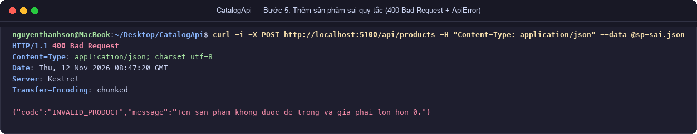

---

<a id="b1-b6"></a>
### Bước 6: Tập Kịch bản Kiểm thử Tự động `requests.http`

Tệp kịch bản `requests.http` kiểm thử toàn diện 10 ca kiểm thử khác nhau:
1. `GET /` (200 OK)
2. `GET /api/products` (200 OK)
3. `GET /api/products/1` (200 OK)
4. `GET /api/products/999` (404 Not Found)
5. `GET /api/products/abc` (404 route type mismatch)
6. `POST /api/products` hợp lệ (201 Created)
7. `POST /api/products` dữ liệu sai nghiệp vụ (400 Bad Request)
8. `POST /api/products` thiếu Content-Type (415 Unsupported Media Type)
9. `POST /api/products` gửi cú pháp JSON hỏng (400 Bad Request)
10. `PUT /api/products/1` sai phương thức HTTP (405 Method Not Allowed)

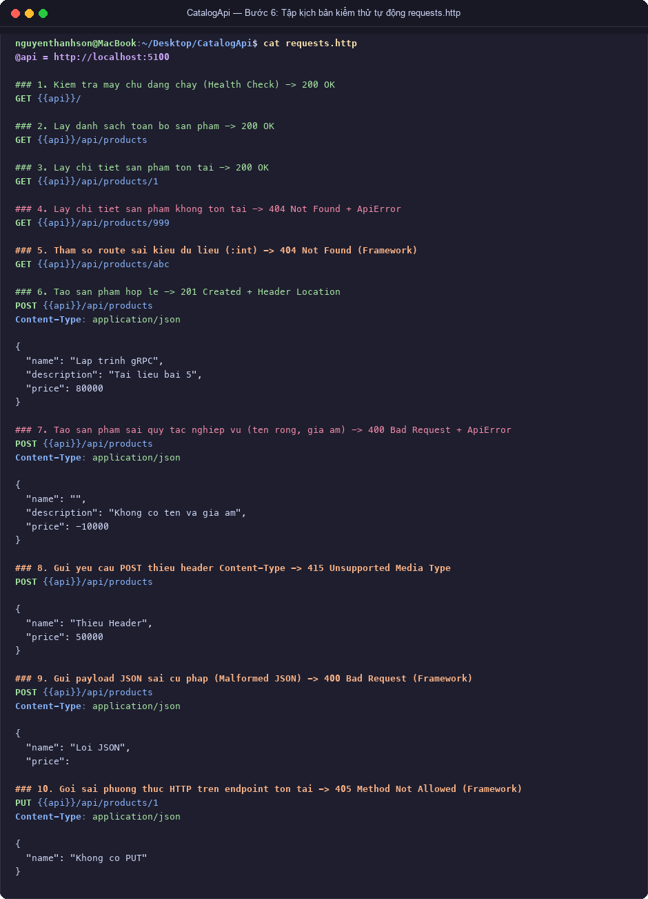

---

<a id="b1-b7"></a>
### Bước 7: Ứng dụng Console Client Kiểm thử 4 Nấc An toàn

- **Mục tiêu:** Ứng dụng `Catalog.Client` sử dụng `HttpClient` tự động thực hiện chuỗi giao tiếp 4 nấc theo nguyên lý lập trình phòng thủ (Defensive Programming):
  - **Nấc 1:** Lấy toàn bộ danh sách sản phẩm hiện có qua `GET /api/products`.
  - **Nấc 2:** Gửi yêu cầu `POST /api/products` tạo sản phẩm mới; **kiểm tra mã `response.StatusCode == HttpStatusCode.Created` trước khi giải tuần tự body**; trích xuất Header `Location`.
  - **Nấc 3:** Dùng URL từ Header `Location` để gửi `GET` đọc lại đúng sản phẩm vừa tạo.
  - **Nấc 4:** Cố ý gửi payload sai quy tắc; bắt mã phản hồi `400 BadRequest`, đọc đối tượng `ApiError` và in thông báo lỗi rõ ràng ra màn hình mà **tuyệt đối không để ứng dụng bị crash hay văng ngoại lệ không kiểm soát**.
- **Lệnh thực thi:**
  ```bash
  dotnet run --project src/Catalog.Client
  ```

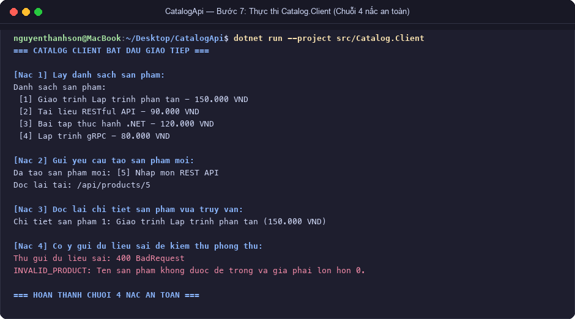

---

<a id="b1-b8"></a>
### Bước 8: Lịch sử Git Commit Từng Bước

- **Lệnh thực thi:**
  ```bash
  git log --oneline
  ```
- **Kết quả thực tế (8 commit chuẩn mực):**
  - `7f011dd` Buoc 8: hoan thien README.md va ho so nop bai
  - `4a0256f` Buoc 7: hien thuc Catalog.Client voi 4 buoc kiem thu
  - `a9150c1` Buoc 6: them requests.http kiem thu API
  - `11c4ad6` Buoc 5: them POST /api/products va payload mau
  - `97f4d98` Buoc 4: them GET /api/products/{id}
  - `4cb9258` Buoc 3: them ProductDto va GET /api/products
  - `1a9cbfd` Buoc 2: them GET / kiem tra may chu
  - `4eff6e0` Buoc 1: tao solution CatalogApi

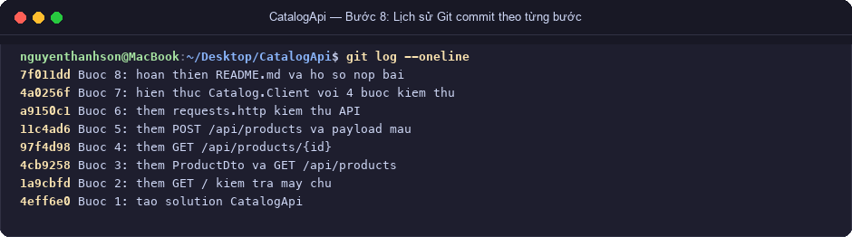

---

<a id="b1-chaos"></a>
### Bảng Phá thử (Chaos Testing) Bài 1

| STT | Kịch bản phá thử | Lệnh / Request | Mã kỳ vọng | Mã thực tế | Kết quả đánh giá |
|:---:|:---|:---|:---:|:---:|:---|
| 1 | Id sản phẩm không tồn tại | `GET /api/products/999` | 404 | 404 | Đạt chuẩn: Trả về `PRODUCT_NOT_FOUND` |
| 2 | Id sai kiểu dữ liệu | `GET /api/products/abc` | 404 | 404 | Đạt chuẩn: Routing constraint `:int` chặn |
| 3 | Tên sản phẩm rỗng | `POST /api/products` `{"name":"","price":100}` | 400 | 400 | Đạt chuẩn: Bắt `INVALID_PRODUCT` |
| 4 | Giá sản phẩm âm | `POST /api/products` `{"name":"A","price":-50}` | 400 | 400 | Đạt chuẩn: Bắt `INVALID_PRODUCT` |
| 5 | Thiếu header Content-Type | `POST /api/products` không Content-Type | 415 | 415 | Đạt chuẩn: Kestrel từ chối media type |
| 6 | Payload JSON hỏng cú pháp | `POST /api/products` `{"name": "Loi", "price": }` | 400 | 400 | Đạt chuẩn: Framework chặn Bad Request |
| 7 | Sai phương thức HTTP | `PUT /api/products/1` | 405 | 405 | Đạt chuẩn: Method Not Allowed |

---
---

<a id="phan-2-bai-2--edusubmit-restfulclientserver"></a>
# PHẦN 2: BÀI 2 — EDUSUBMIT (`RestfulClientServer`)

Hệ thống nộp bài tập trực tuyến sinh viên theo chuẩn kiến trúc Client-Server RESTful, gồm Web API `Submission.Api` chạy tại cổng `http://localhost:5000` và ứng dụng `Submission.Client`.

---

<a id="b2-b1"></a>
### Bước 1: Khởi tạo Solution và Kiểm tra Biên dịch

- **Mục tiêu:** Tạo cấu trúc Solution `RestfulClientServer.slnx` gồm `src/Submission.Api` và `src/Submission.Client`, file `.gitignore`, kiểm tra biên dịch không có lỗi.
- **Lệnh thực thi:**
  ```bash
  cd /Users/nguyenthanhson/Desktop/RestfulClientServer
  dotnet build RestfulClientServer.slnx
  ```
- **Kết quả thực tế:** Biên dịch thành công 100% (`0 Warning(s)`, `0 Error(s)`).

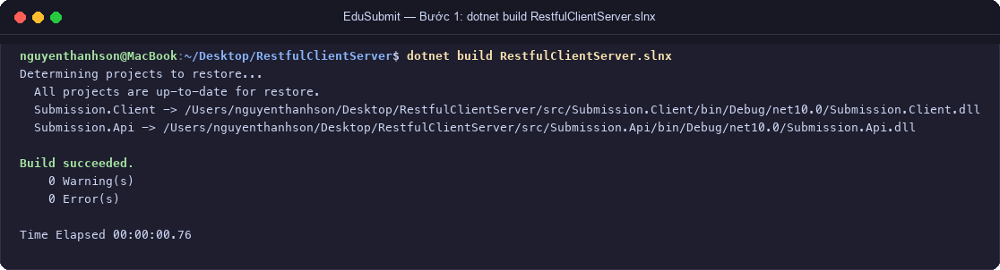

---

<a id="b2-b2"></a>
### Bước 2: Endpoint Kiểm tra Máy chủ (`GET /`)

- **Mục tiêu:** Kiểm tra máy chủ tiếp nhận request và phản hồi thông tin định danh `Submission.Api`.
- **Lệnh thực thi:**
  ```bash
  curl -i http://localhost:5000/
  ```
- **Phản hồi HTTP thực tế:**
  ```http
  HTTP/1.1 200 OK
  Content-Type: application/json; charset=utf-8
  Server: Kestrel

  {"service":"Submission.Api","status":"running"}
  ```

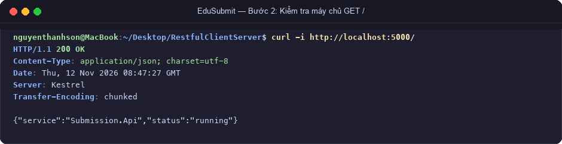

---

<a id="b2-b3"></a>
### Bước 3: Lấy Danh sách Bài tập (`GET /api/assignments`)

- **Mục tiêu:** Trả về danh sách tất cả bài tập (cả bài đang mở và bài đã đóng).
- **Lệnh thực thi:**
  ```bash
  curl -i http://localhost:5000/api/assignments
  ```
- **Phản hồi HTTP thực tế:** Trả về `200 OK` cùng mảng 3 bài tập mẫu.

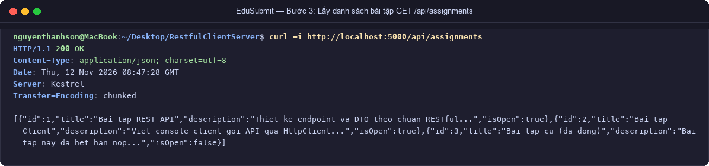

---

<a id="b2-b4"></a>
### Bước 4: Tra cứu Chi tiết Bài tập (`GET /api/assignments/{id}`)

#### Ca 1: Bài tập tồn tại (Id = 1) -> Kỳ vọng 200 OK
- **Lệnh thực thi:** `curl -i http://localhost:5000/api/assignments/1`
- **Phản hồi HTTP thực tế:** `200 OK`, JSON bài tập 1 ("Bai tap REST API").

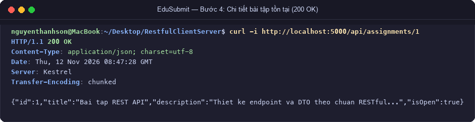

#### Ca 2: Bài tập không tồn tại (Id = 999) -> Kỳ vọng 404 Not Found kèm ApiError
- **Lệnh thực thi:** `curl -i http://localhost:5000/api/assignments/999`
- **Phản hồi HTTP thực tế:**
  ```http
  HTTP/1.1 404 Not Found
  Content-Type: application/json; charset=utf-8

  {"code":"ASSIGNMENT_NOT_FOUND","message":"Khong tim thay bai tap."}
  ```

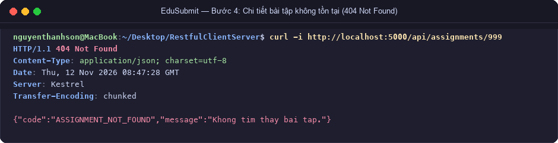

---

<a id="b2-b5"></a>
### Bước 5: Nộp Bài 3 Cổng Kiểm soát (`POST /api/assignments/{id}/submissions`)

Quy trình nộp bài kiểm tra nghiêm ngặt 3 cổng logic:
1. **Cổng 1: Bài tập có tồn tại không?** -> Nếu không, trả về `404 Not Found` (`ASSIGNMENT_NOT_FOUND`).
2. **Cổng 2: Bài tập còn mở hạn nộp không?** -> Nếu đóng (`IsOpen == false`), trả về `400 Bad Request` (`ASSIGNMENT_CLOSED`).
3. **Cổng 3: Dữ liệu nộp có đầy đủ không?** -> Nếu mã sinh viên hoặc URL repo để trống/khoảng trắng, trả về `400 Bad Request` (`INVALID_SUBMISSION`).

#### Ca 1: Nộp bài tập 1 hợp lệ (`sv001.json`) -> Kỳ vọng 201 Created + Header Location
- **Nội dung payload `sv001.json`:**
  ```json
  {
    "studentCode": "SV001",
    "repositoryUrl": "https://example.com/sv001/rest-api"
  }
  ```
- **Lệnh thực thi:**
  ```bash
  curl -i -X POST http://localhost:5000/api/assignments/1/submissions \
    -H "Content-Type: application/json" \
    --data @sv001.json
  ```
- **Phản hồi HTTP thực tế:** `201 Created`, Header `Location: /api/submissions/{guid}`, sinh mã GUID mới và gán trạng thái `"received"`.

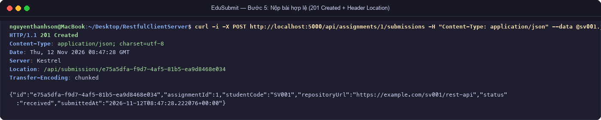

#### Ca 2: Nộp vào bài tập 3 đã đóng hạn nộp -> Kỳ vọng 400 Bad Request (`ASSIGNMENT_CLOSED`)
- **Lệnh thực thi:**
  ```bash
  curl -i -X POST http://localhost:5000/api/assignments/3/submissions \
    -H "Content-Type: application/json" \
    --data @sv001.json
  ```
- **Phản hồi HTTP thực tế:**
  ```http
  HTTP/1.1 400 Bad Request
  Content-Type: application/json; charset=utf-8

  {"code":"ASSIGNMENT_CLOSED","message":"Bai tap da dong."}
  ```

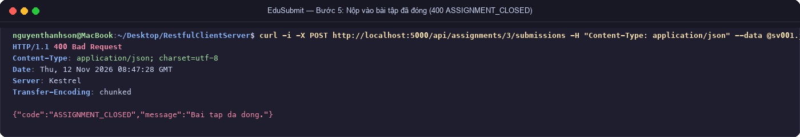

#### Ca 3: Nộp với payload rỗng (`rong.json`) -> Kỳ vọng 400 Bad Request (`INVALID_SUBMISSION`)
- **Nội dung payload `rong.json`:** `{"studentCode": "", "repositoryUrl": ""}`
- **Lệnh thực thi:**
  ```bash
  curl -i -X POST http://localhost:5000/api/assignments/1/submissions \
    -H "Content-Type: application/json" \
    --data @rong.json
  ```
- **Phản hồi HTTP thực tế:**
  ```http
  HTTP/1.1 400 Bad Request
  Content-Type: application/json; charset=utf-8

  {"code":"INVALID_SUBMISSION","message":"Ma sinh vien va duong dan kho khong duoc de trong."}
  ```

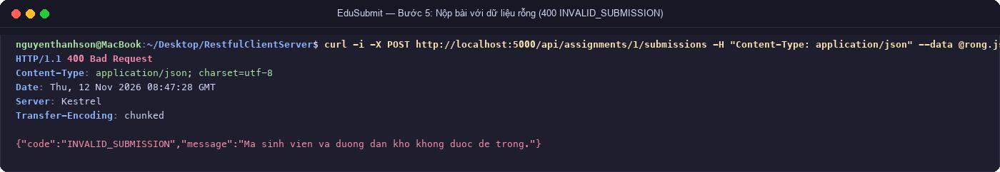

---

<a id="b2-b6"></a>
### Bước 6: Tra cứu Lượt Nộp theo GUID (`GET /api/submissions/{guid}`)

- **Mục tiêu:** Tra cứu thông tin lượt nộp bài vừa tạo dựa trên mã định danh toàn cục ngẫu nhiên `GUID`.
- **Lệnh thực thi 1 (GUID vừa nộp thành công):**
  ```bash
  curl -i http://localhost:5000/api/submissions/<guid-vua-tao>
  ```
  -> Phản hồi: `200 OK` kèm đầy đủ thông tin: AssignmentId, StudentCode, RepositoryUrl, Status, SubmittedAt.
- **Lệnh thực thi 2 (GUID giả mạo không tồn tại):**
  ```bash
  curl -i http://localhost:5000/api/submissions/00000000-0000-0000-0000-000000000000
  ```
  -> Phản hồi: `404 Not Found` kèm `ApiError("SUBMISSION_NOT_FOUND", "Khong tim thay luot nop.")`.

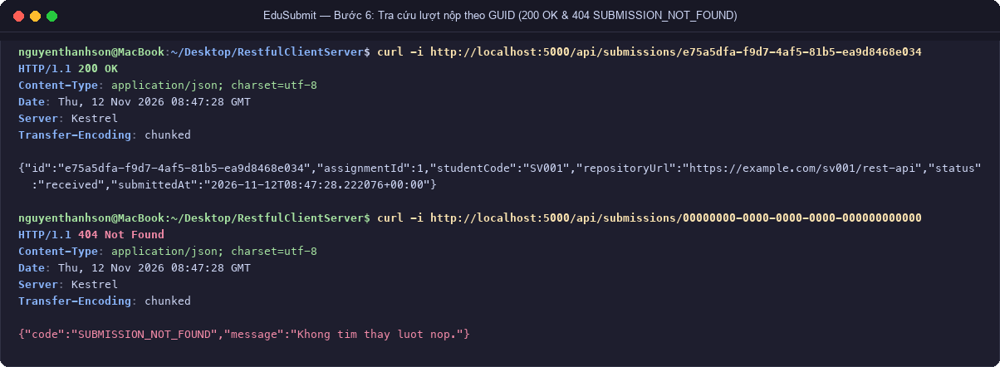

---

<a id="b2-b7"></a>
### Bước 7: Tập Kịch bản Kiểm thử Tự động `requests.http`

Tệp kịch bản kiểm thử bao phủ toàn diện 11 ca nghiệp vụ và kỹ thuật:
- Sử dụng biến toàn cục `@api = http://localhost:5000`.
- Sử dụng dynamic variable: `GET {{api}}/api/submissions/{{createSubmission.response.body.$.id}}`.
- Kiểm thử các mã trạng thái: `200 OK`, `201 Created`, `400 Bad Request`, `404 Not Found`, `415 Unsupported Media Type`, `405 Method Not Allowed`.

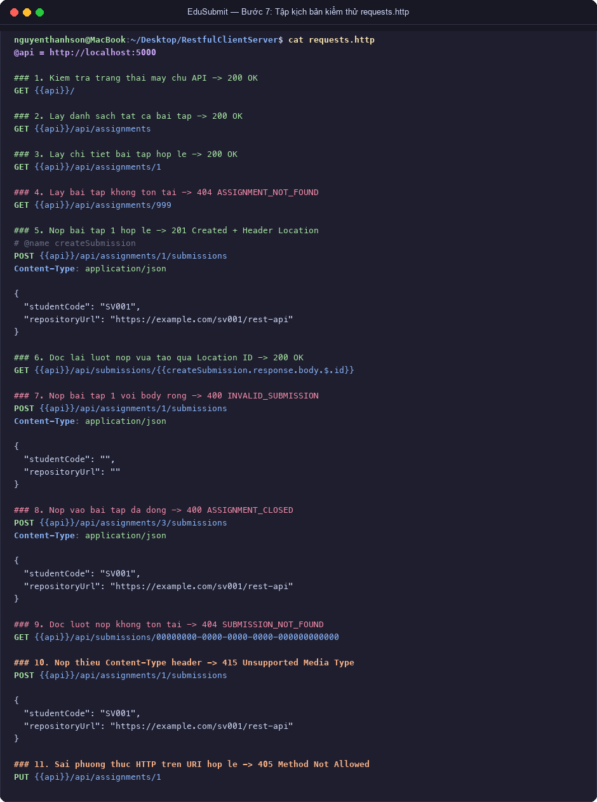

---

<a id="b2-b8"></a>
### Bước 8: Ứng dụng Console Client Nộp Bài Chuỗi 4 Nấc An toàn

Ứng dụng `Submission.Client` hỗ trợ truyền tham số CLI để đổi địa chỉ API (`dotnet run --project src/Submission.Client -- http://localhost:5000`), thực thi chuỗi giao tiếp 4 nấc:
- **Nấc 1:** Lấy danh sách bài tập đang mở (`IsOpen == true`) để sinh viên lựa chọn.
- **Nấc 2:** Nộp bài tập 1; kiểm tra phản hồi phải là `201 Created` trước khi đọc body; trích xuất Header `Location`.
- **Nấc 3:** Đọc lại thông tin lượt nộp từ URL trong Header `Location` (`GET /api/submissions/{guid}`).
- **Nấc 4:** Cố ý gửi payload rỗng vào bài tập 1; client nhận diện mã `400 BadRequest`, gọi hàm xử lý lỗi an toàn để trích xuất `ApiError` mà không bị exception crash.

- **Lệnh thực thi:**
  ```bash
  dotnet run --project src/Submission.Client
  ```

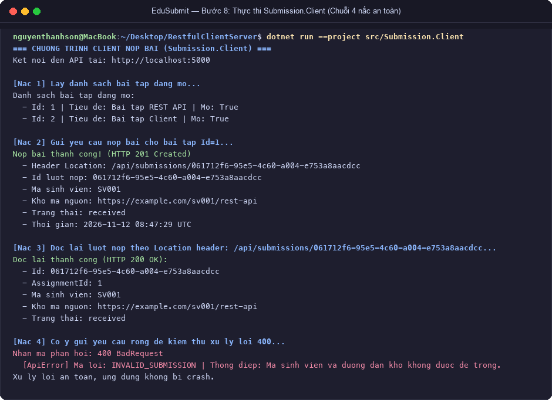

---

<a id="b2-git"></a>
### Bước 8b: Lịch sử Git Commit Từng Bước

- **Lệnh thực thi:**
  ```bash
  git log --oneline
  ```
- **Kết quả thực tế (8 commit chuẩn mực):**
  - `8367bed` Buoc 8: hien thuc Submission.Client va hoan thien README.md
  - `5751edf` Buoc 7: them requests.http kiem thu API
  - `cb2e8bb` Buoc 6: them GET /api/submissions/{guid}
  - `5f66f1f` Buoc 5: them POST nop bai va payload mau
  - `cc224d4` Buoc 4: them GET /api/assignments/{id}
  - `1cf40be` Buoc 3: them AssignmentDto va GET /api/assignments
  - `4fbc928` Buoc 2: them GET / kiem tra may chu
  - `bc9020e` Buoc 1: tao solution RestfulClientServer

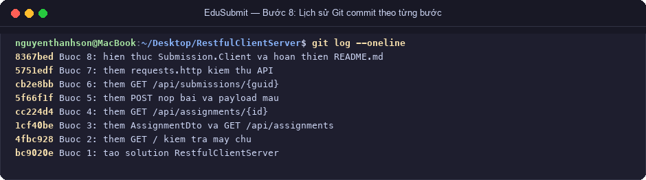

---

<a id="b2-chaos"></a>
### Bảng Phá thử (Chaos Testing) Bài 2

| STT | Kịch bản phá thử | Lệnh / Request | Mã kỳ vọng | Mã thực tế | Kết quả đánh giá |
|:---:|:---|:---|:---:|:---:|:---|
| 1 | Nộp vào bài không tồn tại | `POST /api/assignments/999/submissions` | 404 | 404 | Đạt chuẩn: Cổng 1 chặn `ASSIGNMENT_NOT_FOUND` |
| 2 | Nộp vào bài tập đã đóng | `POST /api/assignments/3/submissions` | 400 | 400 | Đạt chuẩn: Cổng 2 chặn `ASSIGNMENT_CLOSED` |
| 3 | Nộp thiếu mã sinh viên | `POST ...` `{"studentCode":"","repositoryUrl":"https://..."}` | 400 | 400 | Đạt chuẩn: Cổng 3 chặn `INVALID_SUBMISSION` |
| 4 | Nộp thiếu URL kho | `POST ...` `{"studentCode":"SV001","repositoryUrl":""}` | 400 | 400 | Đạt chuẩn: Cổng 3 chặn `INVALID_SUBMISSION` |
| 5 | Tra cứu GUID không tồn tại | `GET /api/submissions/00000000-...` | 404 | 404 | Đạt chuẩn: Trả về `SUBMISSION_NOT_FOUND` |
| 6 | GUID sai định dạng | `GET /api/submissions/abc` | 404 | 404 | Đạt chuẩn: Routing constraint `:guid` chặn |
| 7 | Thiếu Header Content-Type | `POST /api/assignments/1/submissions` không Header | 415 | 415 | Đạt chuẩn: Unsupported Media Type |
| 8 | Phương thức sai trên URI | `PUT /api/assignments/1` | 405 | 405 | Đạt chuẩn: Method Not Allowed |

---
---

<a id="phan-3-giai-thich-3-cau-hoi-ly-thuyet-trong-tam"></a>
# PHẦN 3: GIẢI THÍCH 3 CÂU HỎI LÝ THUYẾT TRỌNG TÂM

### Câu hỏi 1: Tại sao POST trả về 201 Created thay vì 200 OK? Header Location có vai trò gì?
- **Tại sao 201 Created thay vì 200 OK?**
  - Theo đặc tả chuẩn RFC 9110 (HTTP Semantics), mã `200 OK` chỉ biểu thị yêu cầu đã được xử lý thành công chung chung.
  - Mã `201 Created` biểu thị rõ ràng rằng một hoặc nhiều **tài nguyên mới đã được khởi tạo thành công** trên máy chủ do tác động của yêu cầu. Việc này giúp tầng Client phân biệt rành mạch giữa các thao tác chỉ xử lý dữ liệu đơn thuần với thao tác có lưu vết tạo mới thực thể.
- **Vai trò của Header `Location`:**
  - Header `Location` cung cấp URI định danh duy nhất (URI canonical) của tài nguyên vừa được tạo (ví dụ: `Location: /api/products/4` hoặc `Location: /api/submissions/e75a5dfa-...`).
  - Cho phép Client lập tức truy xuất hoặc điều hướng đến tài nguyên mới mà không cần phải tự suy đoán URL hoặc bóc tách cấu trúc bên trong body của phản hồi.

### Câu hỏi 2: Tại sao phải kiểm tra StatusCode trước khi Deserialize dữ liệu ở Client?
- **Bảo đảm an toàn kiểu dữ liệu (Type Safety):**
  - Khi API thành công (`200` hoặc `201`), body trả về cấu trúc DTO chính tắc (`ProductDto` hoặc `SubmissionDto`).
  - Khi API xảy ra lỗi nghiệp vụ (`400`, `404`), body trả về cấu trúc `ApiError(Code, Message)`.
  - Nếu Client vội vàng gọi `ReadFromJsonAsync<ProductDto>()` khi server trả về `400` hay `404`, trình giải tuần tự JSON sẽ đọc dữ liệu lỗi vào DTO chính dẫn đến các trường bị gán giá trị mặc định (`null`, `0`), hoặc gây ném ngoại lệ `JsonException`.
- **Phòng chống sập ứng dụng (Fault Tolerance):**
  - Kiểm tra `response.IsSuccessStatusCode` hoặc so sánh mã trạng thái cụ thể giúp luồng chương trình phân nhánh chính xác: đọc DTO khi thành công, hoặc đọc `ApiError` để in thông báo thân thiện và phục hồi luồng nghiệp vụ khi có lỗi.

### Câu hỏi 3: Phân biệt sự khác nhau giữa lỗi 400 Bad Request và 404 Not Found trong thiết kế RESTful API?
- **Mã `400 Bad Request`:**
  - Phản ánh **lỗi về phía cú pháp hoặc vi phạm quy tắc nghiệp vụ (Business Logic Validation)** do Client gửi lên: dữ liệu thiếu trường bắt buộc, giá âm, định dạng ngày tháng sai, nộp vào bài tập đã hết hạn (`ASSIGNMENT_CLOSED`), cú pháp JSON dị dạng.
  - Máy chủ đã tiếp nhận và hiểu được tài nguyên mục tiêu nhưng từ chối thực thi vì dữ liệu đầu vào không hợp lệ.
- **Mã `404 Not Found`:**
  - Phản ánh **sự không tồn tại của tài nguyên đích** được chỉ định trong URI yêu cầu: ví dụ ID sản phẩm không có trong cơ sở dữ liệu (`/api/products/999`), mã GUID không tồn tại, hoặc đường dẫn endpoint không được đăng ký trong bảng định tuyến.
  - Phục vụ nguyên lý định danh tài nguyên (Resource Identification): nếu tài nguyên không tồn tại, server dứt khoát trả về `404` để Client biết đối tượng tìm kiếm không có thực.
