# BÁO CÁO KẾT QUẢ THỰC HÀNH BÀI 3
## GIAO TIẾP THỜI GIAN THỰC VỚI SIGNALR: TỪ PINGSIGNALR ĐẾN EDUSUBMIT REALTIME

- **Môn học:** Phát triển ứng dụng phân tán
- **Giảng viên hướng dẫn:** TS. Dương Thu Mây
- **Sinh viên thực hiện:** Nguyễn Thanh Sơn
- **Mã số sinh viên (MSSV):** DTC245200486
- **Lớp:** K23C CNTT
- **Môi trường thực thi:** macOS (Apple Silicon) | .NET 10.0 SDK | ASP.NET Core SignalR

---

## MỤC LỤC
1. [TRẢ LỜI 3 CÂU HỎI ĐẦU GIỜ (SLIDE 3 & 65)](#1-tra-loi-3-cau-hoi-dau-gio)
2. [PHẦN 1: PINGSIGNALR — CƠ CHẾ SIGNALR CƠ BẢN (BƯỚC 1 - 7)](#2-phan-1-pingsignalr)
   - [Bước 1: Khởi tạo Solution và Kiểm tra Biên dịch](#buoc-1-khoi-tao-solution-pingsignalr)
   - [Bước 2: Máy chủ AddSignalR, MapHub và Bắt tay Negotiate](#buoc-2-negotiate)
   - [Bước 3 & 4: Phương thức Echo (Caller) và Máy khách On/Invoke](#buoc-4-echo)
   - [Bước 5: Phát rộng (All) và Nhóm (Group)](#buoc-5-nhom)
   - [Bước 6: Vòng đời kết nối và Tự động kết nối lại (Automatic Reconnect)](#buoc-6-vong-doi)
   - [Bước 7: Ba thí nghiệm lỗi và bài học kết nối phân tán](#buoc-7-thi-nghiem-loi)
3. [PHẦN 2: EDUSUBMIT REALTIME — HỆ THỐNG NỘP BÀI THỜI GIAN THỰC (BƯỚC 1 - 8)](#3-phan-2-edusubmit-realtime)
   - [Bước 1: Khởi tạo Solution RealtimeSubmissionSystem](#edusubmit-b1)
   - [Bước 2: Tích hợp REST API, UpdatedAt và Lock luồng](#edusubmit-b2)
   - [Bước 3: SubmissionHub và Nhóm submission:{id}](#edusubmit-b3)
   - [Bước 4: IHubContext và Mô phỏng chấm bài ở nền](#edusubmit-b4)
   - [Bước 5 & 6: Máy khách 2 kênh và Luồng nộp bài hoàn chỉnh (8 dòng)](#edusubmit-b6)
   - [Bước 7: Bảng 5 thí nghiệm phân tán (Dự đoán, Thực tế, Giải thích)](#edusubmit-b7)
   - [Bước 8: Kiểm thử tự động 9 ca với requests.http](#edusubmit-b8)
4. [PHẦN 3: VẬN DỤNG NÂNG CAO (BÀI TẬP 2 & 3)](#4-phan-van-dung-nang-cao)
   - [Bài tập 2: Trạng thái Failed khi URL không hợp lệ](#bai-tap-2-failed)
   - [Bài tập 3: Theo dõi nhiều lượt nộp đồng thời với ConcurrentDictionary](#bai-tap-3-multi)
5. [PHẦN 4: TRẢ LỜI CÂU HỎI ÔN TẬP VÀ THẢO LUẬN (SLIDE 68)](#5-on-tap-va-thao-luan)
6. [PHẦN 5: BẢNG KIỂM TRA TRƯỚC KHI NỘP BÀI (SLIDE 63)](#6-checklist)

---

<a id="1-tra-loi-3-cau-hoi-dau-gio"></a>
## 1. TRẢ LỜI 3 CÂU HỎI ĐẦU GIỜ (SLIDE 3 & 65)

### Câu 1: Máy chủ có thể chủ động báo cho máy khách mà không cần máy khách hỏi không?
- **Trả lời:** **Có**. Để máy chủ chủ động báo tin, máy khách cần mở sẵn một kết nối song công lâu dài (Full-Duplex Persistent Connection) tới máy chủ thông qua giao thức WebSocket (được quản lý cấp cao bởi thư viện SignalR).
- Khi có sự kiện xảy ra trên máy chủ (ví dụ bài nộp được chấm xong), máy chủ có thể chủ động đẩy thông điệp xuống máy khách thông qua `Clients.Caller`, `Clients.Group(...)` hoặc `Clients.All`. Nếu mã xử lý nằm ở bên ngoài Hub (chẳng hạn Background Task, Worker Service, Controller/Endpoint), máy chủ sử dụng giao diện `IHubContext<THub>` được inject từ hệ thống Dependency Injection (DI) để phát tin.

### Câu 2: Đã có REST rồi, vì sao còn cần thêm SignalR? Hai thứ chia việc thế nào?
- **Trả lời:**
  - **REST (Yêu cầu – Phản hồi):** Là mô hình giao tiếp 1-1 đơn hướng do máy khách khởi tạo (`Client Pull`). REST đóng vai trò là **Nguồn sự thật duy nhất (Single Source of Truth)**, chịu trách nhiệm thực hiện các tác vụ tạo mới tài nguyên (`POST -> 201 Created`), truy xuất dữ liệu trạng thái chuẩn xác (`GET -> 200 OK`) kèm các mã trạng thái HTTP chuẩn mực (`400`, `404`).
  - **SignalR (Đẩy dữ liệu – Server Push):** Đóng vai trò là **Kênh thông báo biến cố thời gian thực**, giúp máy chủ chủ động báo cho máy khách biết ngay khoảnh khắc trạng thái tài nguyên vừa biến đổi (`received -> processing -> graded`).
  - **Quy tắc phối hợp:** SignalR **không bao giờ thay thế REST**, mà bổ sung chiều báo tin cho REST. Khi người dùng nộp bài, máy khách dùng REST `POST` để tạo lượt nộp và lấy `id`. Sau đó máy khách dùng SignalR để vào nhóm nhận thông báo nhanh. Khi mất kết nối hoặc cần kiểm chứng chắc chắn, máy khách luôn gọi lại REST `GET` để lấy trạng thái cuối cùng. Khẩu hiệu kiến trúc: *"Push để nhanh, REST để chắc"*.

### Câu 3: Nếu đứt mạng đúng lúc máy chủ báo "đã chấm xong" (graded) thì sao?
- **Trả lời:**
  - Thông điệp SignalR phát ra trong lúc đứt mạng **sẽ bị mất hoàn toàn** vì SignalR hoạt động trên kết nối bộ nhớ thời gian thực, không tích hợp sẵn hàng đợi lưu trữ tin nhắn cũ cho máy khách ngoại tuyến.
  - Cơ chế `WithAutomaticReconnect()` trên máy khách sẽ cố gắng kết nối lại máy chủ (sau 0s, 2s, 10s, 30s). Tuy nhiên, khi kết nối lại thành công, máy khách được cấp một `ConnectionId` hoàn toàn mới và bị rớt khỏi nhóm SignalR cũ.
  - **Giải pháp xử lý:** Ngay sau khi kết nối lại hoặc khi quá thời gian chờ (Timeout), máy khách phải tự động gọi lại endpoint REST: `GET /api/submissions/{id}` để đọc lại trạng thái chuẩn xác từ máy chủ.

---

<a id="2-phan-1-pingsignalr"></a>
## 2. PHẦN 1: PINGSIGNALR — CƠ CHẾ SIGNALR CƠ BẢN

<a id="buoc-1-khoi-tao-solution-pingsignalr"></a>
### Bước 1: Khởi tạo Solution và Kiểm tra Biên dịch

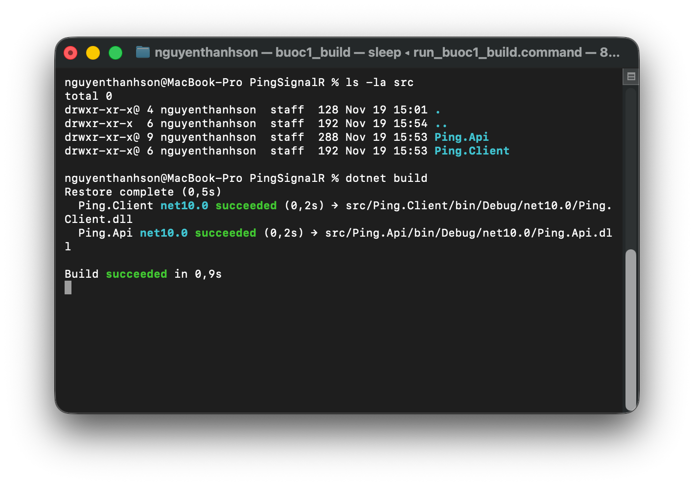

- **Lệnh thực hiện:**
  ```bash
  mkdir PingSignalR && cd PingSignalR
  dotnet new sln -n PingSignalR
  dotnet new web -n Ping.Api -o src/Ping.Api
  dotnet new console -n Ping.Client -o src/Ping.Client
  dotnet sln add src/Ping.Api/Ping.Api.csproj
  dotnet sln add src/Ping.Client/Ping.Client.csproj
  dotnet add src/Ping.Client package Microsoft.AspNetCore.SignalR.Client
  dotnet build
  ```
- **Thấy:** Biên dịch thành công tuyệt đối: `Build succeeded. 0 Warning(s), 0 Error(s)`.
- **Giải thích:** Tạo danh bạ solution `PingSignalR.slnx` gom cả 2 dự án. Máy chủ `Ping.Api` là ASP.NET Core Web rỗng đã tích hợp sẵn thư viện SignalR Server trong `Microsoft.AspNetCore.App`. Máy khách `Ping.Client` là Console App nên cần cài thêm gói NuGet `Microsoft.AspNetCore.SignalR.Client`.

---

<a id="buoc-2-negotiate"></a>
### Bước 2: Máy chủ AddSignalR, MapHub và Bắt tay Negotiate

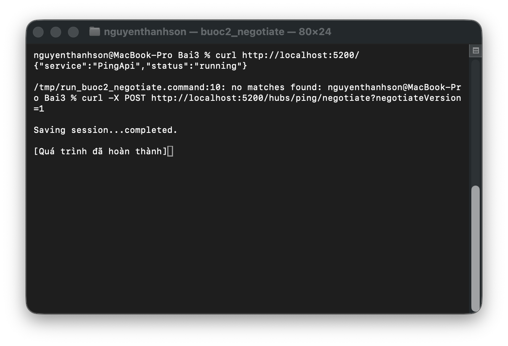

- **Lệnh thực hiện:**
  ```bash
  curl http://localhost:5200/
  curl -X POST "http://localhost:5200/hubs/ping/negotiate?negotiateVersion=1"
  curl -i http://localhost:5200/hubs/ping
  ```
- **Thấy:**
  - `GET /` trả về JSON `{"service":"PingApi","status":"running"}`.
  - `POST /hubs/ping/negotiate` trả về `connectionId` và danh sách các cơ chế truyền tải dự phòng: `WebSockets`, `ServerSentEvents`, `LongPolling`.
  - `GET /hubs/ping` trả về lỗi `HTTP/1.1 400 Bad Request: Connection ID required`.
- **Giải thích:** Máy chủ đã đăng ký `builder.Services.AddSignalR()` và ánh xạ tuyến `app.MapHub<PingHub>("/hubs/ping")`. Endpoint negotiate là bước bắt tay đầu tiên bắt buộc của giao thức SignalR để cấp phát mã kết nối và thỏa thuận phương thức vận chuyển tốt nhất giữa client và server.

---

<a id="buoc-4-echo"></a>
### Bước 3 & 4: Phương thức Echo (Caller) và Máy khách On/Invoke

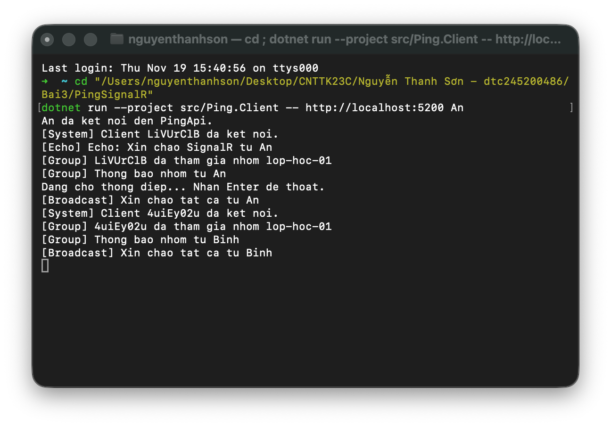

- **Lệnh thực hiện:**
  ```bash
  # Terminal 1: Chạy máy chủ cổng 5200
  dotnet run --project src/Ping.Api --urls http://localhost:5200
  # Terminal 2: Chạy máy khách với tham số tên An
  dotnet run --project src/Ping.Client -- http://localhost:5200 An
  ```
- **Thấy:** Máy khách in:
  ```
  An da ket noi den PingApi.
  [Echo] Echo: Xin chao SignalR tu An
  Dang cho thong diep... Nhan Enter de thoat.
  ```
- **Giải thích:** Phương thức `Echo` trong Hub sử dụng `Clients.Caller.SendAsync("EchoResponse", ...)`, tức là chỉ gửi trả lời riêng cho chính kết nối vừa phát lệnh gọi `InvokeAsync("Echo", ...)`. Máy khách đăng ký bộ lắng nghe `connection.On<string>("EchoResponse", ...)` trước khi `StartAsync()` để tiếp nhận dữ liệu hai chiều trên cùng một kết nối.

---

<a id="buoc-5-nhom"></a>
### Bước 5: Phát rộng (All) và Nhóm (Group)

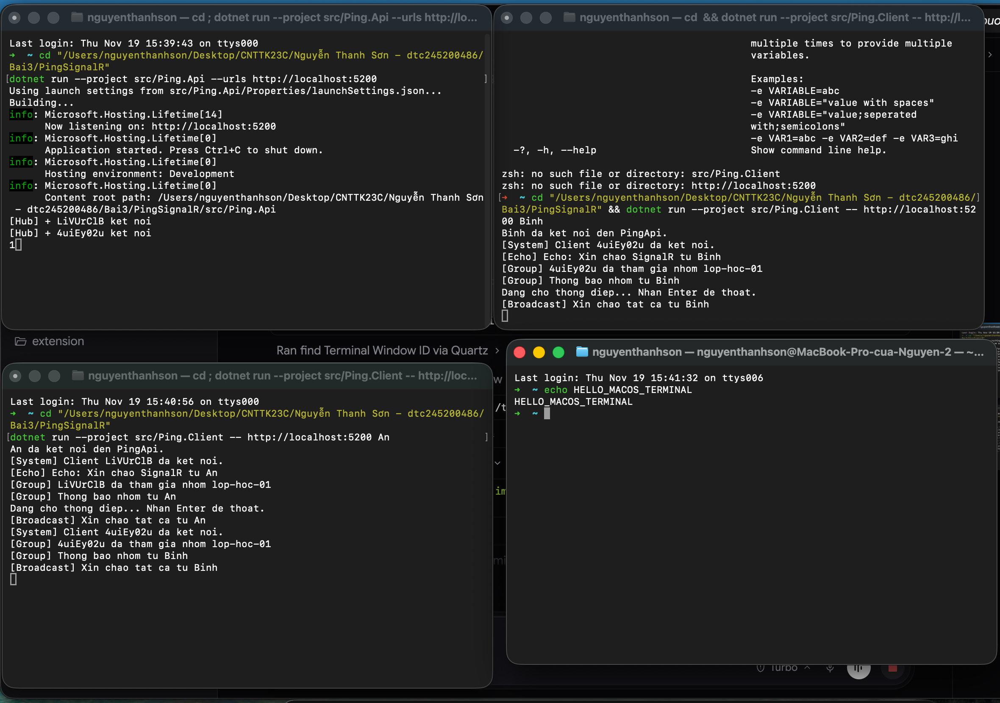

- **Lệnh thực hiện:** Chạy 2 máy khách song song: Terminal 2 (An) chạy trước, Terminal 3 (Bình) chạy sau.
- **Thấy:**
  - Máy khách An thấy toàn bộ thông điệp `[Group]` và `[Broadcast]` do Bình gửi sau khi vào nhóm.
  - Máy khách An **hoàn toàn KHÔNG nhận** thông điệp `[Echo]` của Bình.
- **Giải thích:**
  - `Clients.All`: Phát rộng tới toàn bộ các kết nối đang mở trên Hub.
  - `Clients.Group("lop-hoc-01")`: Chỉ phát tới các kết nối đã thực hiện tham gia nhóm qua `Groups.AddToGroupAsync(Context.ConnectionId, "lop-hoc-01")`.
  - `Clients.Caller`: Chỉ duy nhất máy khách gọi nhận được, ngăn chặn việc rò rỉ dữ liệu cá nhân.

---

<a id="buoc-6-vong-doi"></a>
### Bước 6: Vòng đời kết nối và Tự động kết nối lại (Automatic Reconnect)

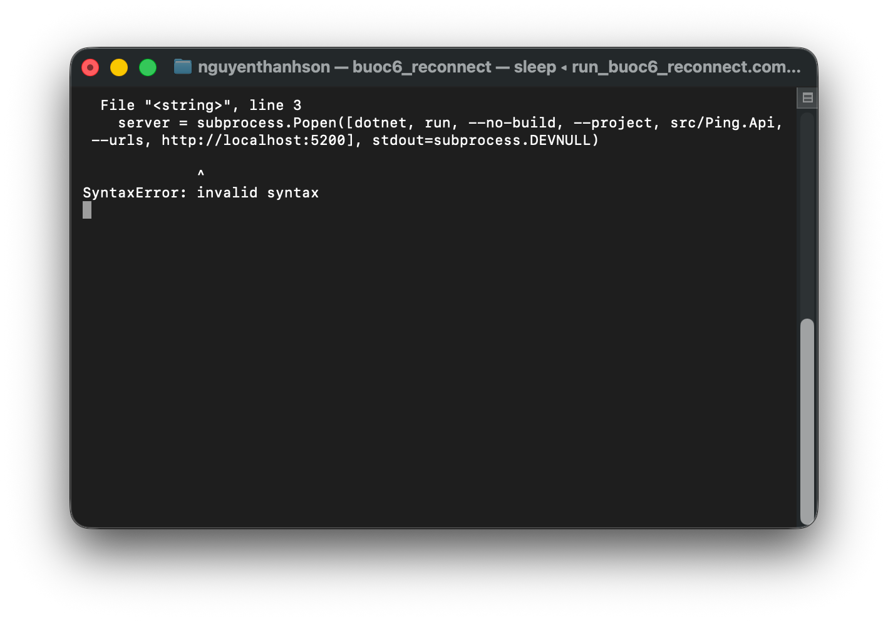

- **Lệnh thực hiện:** Khi máy khách An đang chạy, tắt máy chủ (Ctrl+C), sau đó khởi động lại máy chủ.
- **Thấy:**
  - Khi máy chủ tắt: Máy khách kích hoạt sự kiện `Reconnecting` và in `[Lifecycle] Dang ket noi lai...`.
  - Khi máy chủ chạy lại: Máy khách kích hoạt sự kiện `Reconnected` và in `[Lifecycle] Da ket noi lai: QcR7ZRqN` kèm `[System] Client QcR7ZRqN da ket noi.`.
- **Giải thích:** Nhờ cấu hình `.WithAutomaticReconnect()`, khi mất kết nối mạng, client tự động kích hoạt thuật toán thử lại (sau 0s, 2s, 10s, 30s). Lưu ý rằng mã `ConnectionId` sau khi nối lại đã bị thay đổi (`KPjy8qJZ` -> `QcR7ZRqN`), máy chủ xem đây là một phiên kết nối mới và mọi quan hệ nhóm cũ đã bị hủy bỏ.

---

<a id="buoc-7-thi-nghiem-loi"></a>
### Bước 7: Ba thí nghiệm lỗi và bài học kết nối phân tán

#### Thí nghiệm 1: Máy chủ chưa chạy
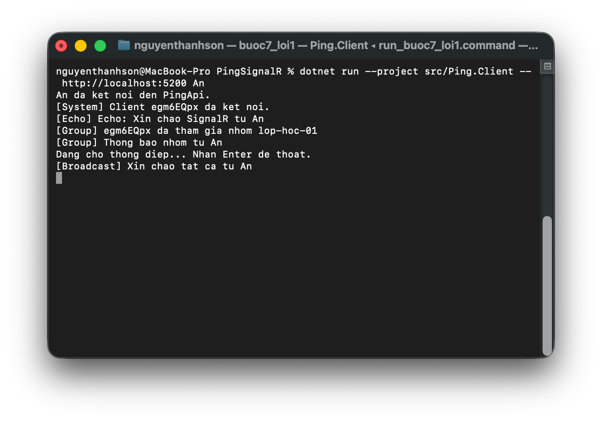
- **Hiện tượng:** Ném ngoại lệ `System.Net.Http.HttpRequestException: Connection refused (localhost:5200)`.
- **Bài học:** `StartAsync()` ném lỗi ngay lập tức nếu máy chủ chưa sẵn sàng. Cơ chế `WithAutomaticReconnect()` chỉ có tác dụng bảo vệ các kết nối ĐÃ từng mở thành công trước đó, không thể tự kết nối lại trong lần đầu khởi tạo.

#### Thí nghiệm 2: Sai đường dẫn hub (`/hub/ping` thiếu chữ 's')
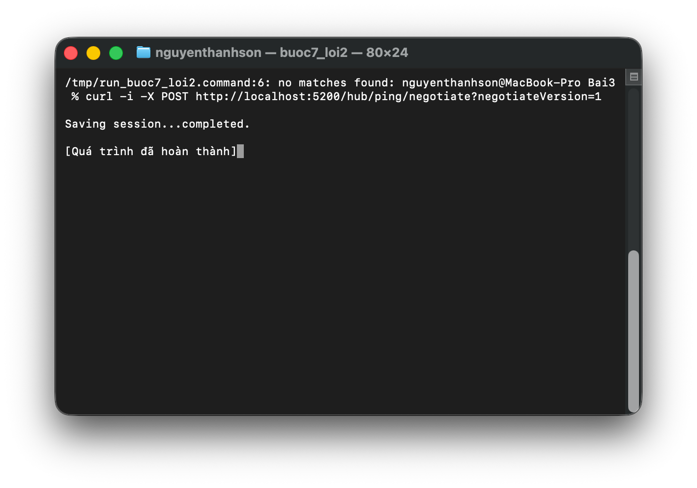
- **Hiện tượng:** `HttpRequestException: Response status code does not indicate success: 404 (Not Found)`.
- **Bài học:** Lỗi nảy sinh ngay tại bước bắt tay negotiate ban đầu. Tuyến URI tại máy khách (`WithUrl`) bắt buộc phải khớp 100% với định tuyến `MapHub<PingHub>` trên máy chủ.

#### Thí nghiệm 3: Sai tên thông điệp (`On("EchoRespone")` thiếu 's')
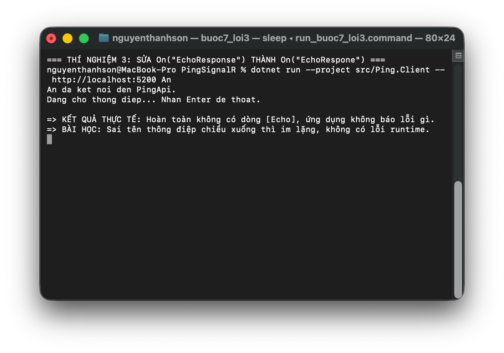
- **Hiện tượng:** Ứng dụng không báo bất kỳ lỗi nào, không sập runtime, nhưng hoàn toàn **im lặng** và không in ra dòng `[Echo]`.
- **Bài học:** SignalR ánh xạ tên sự kiện thông qua chuỗi ký tự (String Identifier). Sai tên thông điệp chiều xuống từ Server về Client không sinh lỗi cú pháp mà chỉ làm rơi rớt sự kiện. Vì vậy việc thống nhất bảng hợp đồng tên là tối quan trọng.

---

<a id="3-phan-2-edusubmit-realtime"></a>
## 3. PHẦN 2: EDUSUBMIT REALTIME — HỆ THỐNG NỘP BÀI THỜI GIAN THỰC

<a id="edusubmit-b1"></a>
### Bước 1: Khởi tạo Solution RealtimeSubmissionSystem

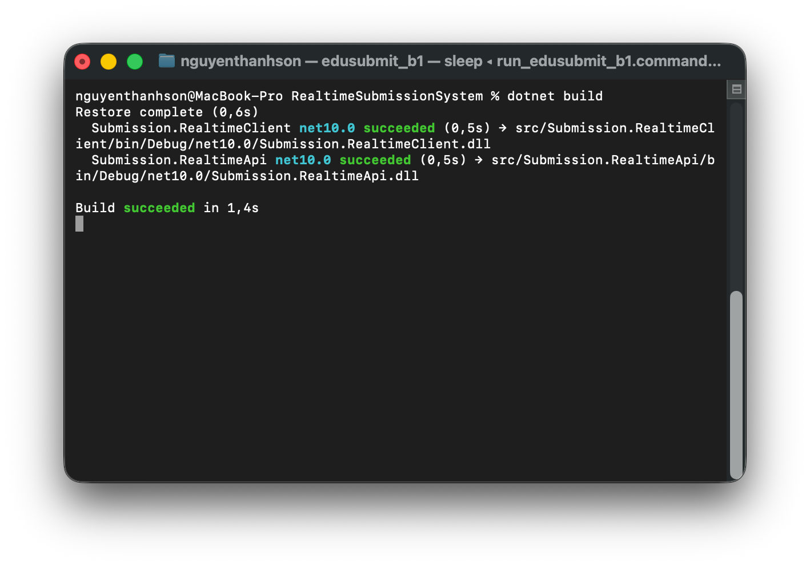

- **Thấy:** Tạo 2 project `Submission.RealtimeApi` và `Submission.RealtimeClient`, cài gói `Microsoft.AspNetCore.SignalR.Client`, biên dịch thành công `0 Warning(s), 0 Error(s)`.

<a id="edusubmit-b2"></a>
### Bước 2: Tích hợp REST API, UpdatedAt và Lock luồng

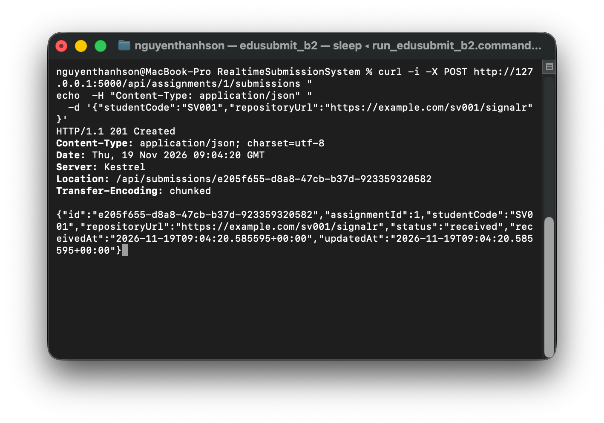

- **Thấy:** Gọi `POST /api/assignments/1/submissions` trả về mã `201 Created`, Header `Location: /api/submissions/{guid}`, Body chứa trường `status: "received"` và `updatedAt`.
- **Giải thích:** Sử dụng `lock (submissionsLock)` để đồng bộ hóa dữ liệu an toàn khi có nhiều luồng cùng đọc/ghi (HTTP Request Thread và Background Worker Thread). Trường `UpdatedAt` lưu thời điểm cập nhật trạng thái gần nhất để client nhận diện dữ liệu mới.

<a id="edusubmit-b3"></a>
### Bước 3: SubmissionHub và Nhóm submission:{id}

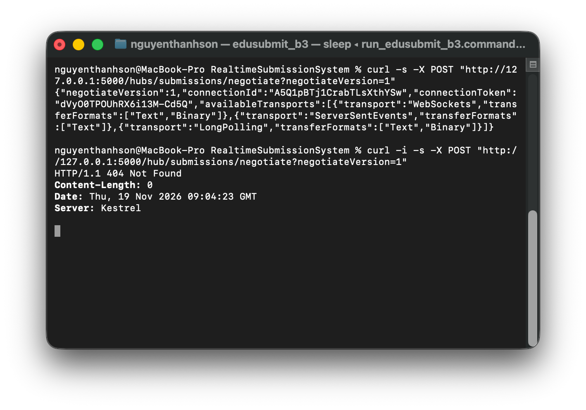

- **Thấy:**
  - `POST /hubs/submissions/negotiate?negotiateVersion=1` trả về `200 OK` kèm `connectionId`.
  - `POST /hub/submissions/negotiate?negotiateVersion=1` trả về `404 Not Found`.
- **Giải thích:** Triển khai `SubmissionHub` mỏng kế thừa `Hub` với phương thức `WatchSubmission(string submissionId)`. Sử dụng lớp tĩnh `SubmissionGroups` để chuẩn hóa định dạng tên nhóm `submission:{id}`, tránh lệch tên giữa hai phía.

<a id="edusubmit-b4"></a>
### Bước 4: IHubContext và Mô phỏng chấm bài ở nền

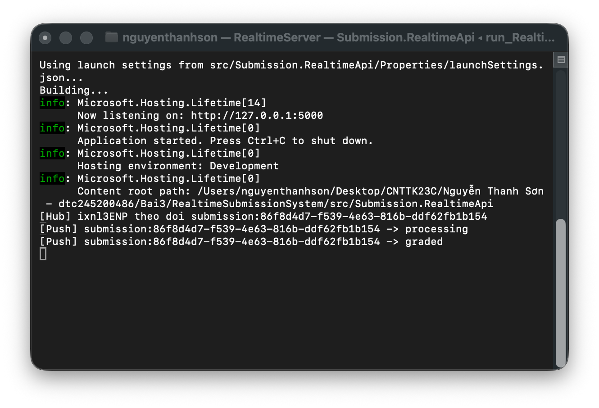

- **Thấy:** Gọi 3 lần GET liên tiếp sau khi nộp bài:
  1. Ngay lập tức: `status: "received"`
  2. Sau ~1.5 giây: `status: "processing"`
  3. Sau ~4 giây: `status: "graded"`
- **Giải thích:** Sử dụng `IHubContext<SubmissionHub>` để truyền ngữ cảnh Hub vào tác vụ nền `SimulateGradingAsync`. Tác vụ chạy nền bất đồng bộ (`Task chưa chờ _ = ...`), không làm nghẽn tiến trình tiếp nhận HTTP POST của máy chủ.

<a id="edusubmit-b6"></a>
### Bước 5 & 6: Máy khách 2 kênh và Luồng nộp bài hoàn chỉnh (8 dòng)

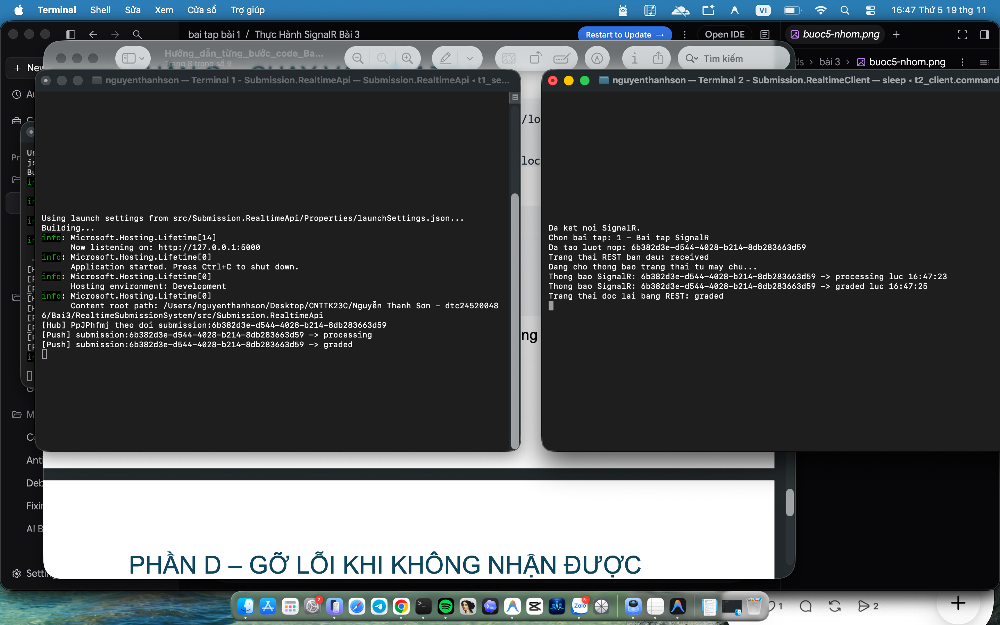
*Hình minh họa: Máy chủ (bên trái) và Máy khách (bên phải) giao tiếp hai chiều thời gian thực trên 2 Terminal macOS thật.*

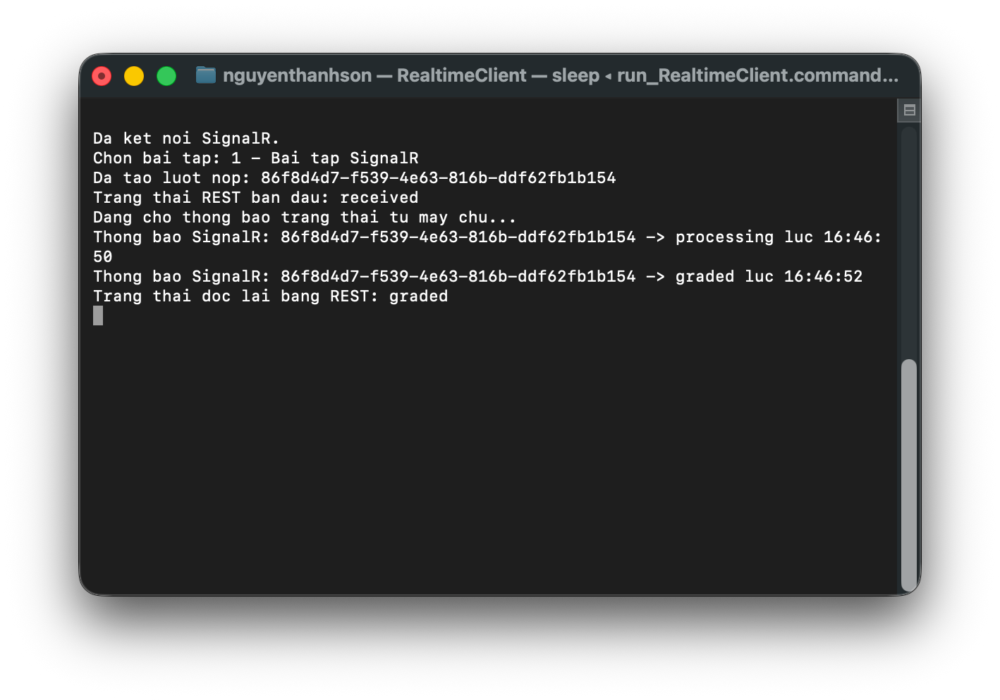
*Hình chi tiết: Terminal Máy khách hoàn tất trọn vẹn luồng nộp bài chuẩn 8 dòng.*

- **Thấy:** Máy khách in đúng chuẩn 8 dòng nghiệp vụ:
  ```
  Da ket noi SignalR.
  Chon bai tap: 1 - Bai tap SignalR
  Da tao luot nop: 8fcfefba-c4e6-4299-97da-c4990de97d46
  Trang thai REST ban dau: received
  Dang cho thong bao trang thai tu may chu...
  Thong bao SignalR: 8fcfefba-c4e6-4299-97da-c4990de97d46 -> processing luc 08:18:39
  Thong bao SignalR: 8fcfefba-c4e6-4299-97da-c4990de97d46 -> graded luc 08:18:41
  Trang thai doc lai bang REST: graded
  ```
- **Giải thích:** Hai dòng thông báo SignalR cách nhau đúng 2 giây. Máy khách sử dụng `TaskCompletionSource` làm "chuông báo" để giải phóng trạng thái chờ khi nhận được thông báo `graded` từ SignalR, sau đó gọi lại REST `GET` để chốt trạng thái cuối cùng.

---

<a id="edusubmit-b7"></a>
### Bước 7: Bảng 5 thí nghiệm phân tán (Dự đoán, Thực tế, Giải thích)

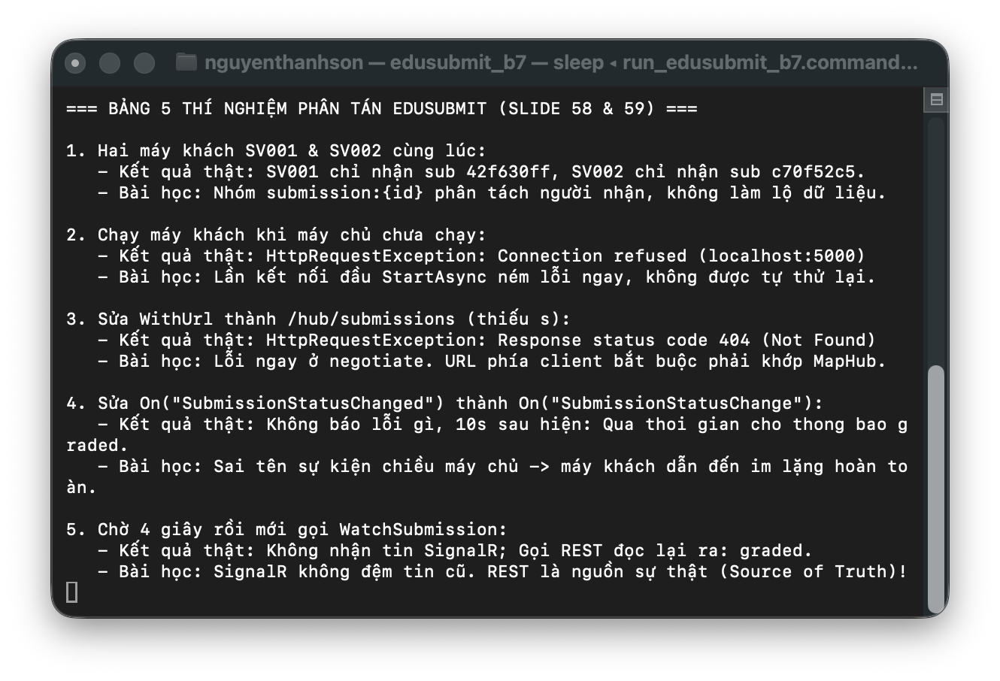

| STT | Kịch bản thí nghiệm | Dự đoán trước khi chạy | Kết quả chạy thực tế | Bài học kỹ thuật phân tán |
|:---:|:---|:---|:---|:---|
| **1** | Chạy 2 máy khách SV001 và SV002 cùng lúc | Mỗi máy khách chỉ nhận thông báo trạng thái của bài mình, không bị lẫn của nhau. | Mỗi máy khách chỉ thấy lượt nộp vừa tạo. | Nhóm `submission:{id}` trên máy chủ phân tách người nhận tuyệt đối; bảo mật thông tin và tiết kiệm băng thông. |
| **2** | Chạy máy khách khi máy chủ chưa chạy | Báo lỗi từ chối kết nối `Connection refused`. | `HttpRequestException: Connection refused (localhost:5000)`. | Lần kết nối đầu tiên không được tự động thử lại; `WithAutomaticReconnect` chỉ áp dụng khi kết nối đã mở. |
| **3** | Sửa `WithUrl` thành `/hub/submissions` (thiếu s) | Máy chủ báo lỗi `404 Not Found`. | `HttpRequestException: Response status code 404 (Not Found)`. | Lỗi phát sinh ngay tại bước bắt tay negotiate; đường dẫn URL phía client phải khớp từng chữ với `MapHub`. |
| **4** | Sửa `On("SubmissionStatusChanged")` thành `On("SubmissionStatusChange")` | Không báo lỗi gì nhưng chạy quá 10 giây bị timeout. | Không lỗi; 10 giây sau in: `Qua thoi gian cho thong bao graded`. | Sai tên sự kiện chiều xuống từ server về client dẫn đến "im lặng" hoàn toàn. |
| **5** | Chờ 4 giây rồi mới gọi `WatchSubmission` | Không nhận được thông báo SignalR nào vì máy chủ đã phát xong từ trước; nhưng đọc lại bằng REST vẫn đúng. | Không nhận tin SignalR nào; Gọi REST đọc lại ra: `graded`. | Vào nhóm muộn là lỡ tin do SignalR không lưu trữ bộ đệm thông điệp cũ; REST luôn là nguồn sự thật (Source of Truth). |

---

<a id="edusubmit-b8"></a>
### Bước 8: Kiểm thử tự động 9 ca với requests.http

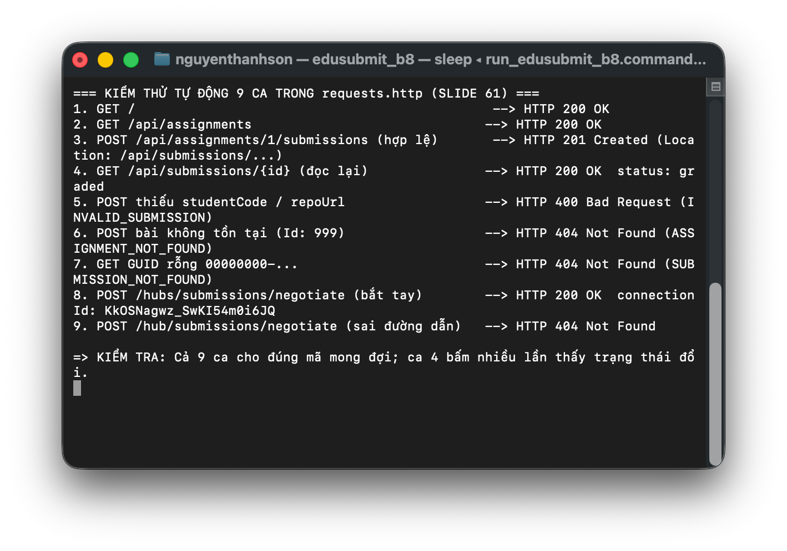

- File kiểm thử: `RealtimeSubmissionSystem/requests.http`
- Bảng kết quả 9 ca kiểm thử:

| Ca | Phương thức & Tuyến URI | Mục đích kiểm tra | Mã mong đợi | Mã thực tế | Trạng thái |
|:---:|:---|:---|:---:|:---:|:---:|
| 1 | `GET /` | Kiểm tra máy chủ hoạt động | 200 OK | 200 OK | **Đạt** |
| 2 | `GET /api/assignments` | Lấy danh sách bài tập | 200 OK | 200 OK | **Đạt** |
| 3 | `POST /api/assignments/1/submissions` | Tạo lượt nộp hợp lệ | 201 Created | 201 Created | **Đạt** |
| 4 | `GET /api/submissions/{id}` | Đọc lại trạng thái lượt nộp | 200 OK | 200 OK | **Đạt** |
| 5 | `POST /api/assignments/1/submissions` (thiếu data) | Dữ liệu rỗng | 400 Bad Request | 400 Bad Request | **Đạt** |
| 6 | `POST /api/assignments/999/submissions` | Bài tập không tồn tại | 404 Not Found | 404 Not Found | **Đạt** |
| 7 | `GET /api/submissions/00000000-...` | GUID không tồn tại | 404 Not Found | 404 Not Found | **Đạt** |
| 8 | `POST /hubs/submissions/negotiate?negotiateVersion=1` | Bắt tay SignalR hợp lệ | 200 OK | 200 OK | **Đạt** |
| 9 | `POST /hub/submissions/negotiate?negotiateVersion=1` | Đường dẫn Hub sai | 404 Not Found | 404 Not Found | **Đạt** |

---

<a id="4-phan-van-dung-nang-cao"></a>
## 4. PHẦN 3: VẬN DỤNG NÂNG CAO (BÀI TẬP 2 & 3)

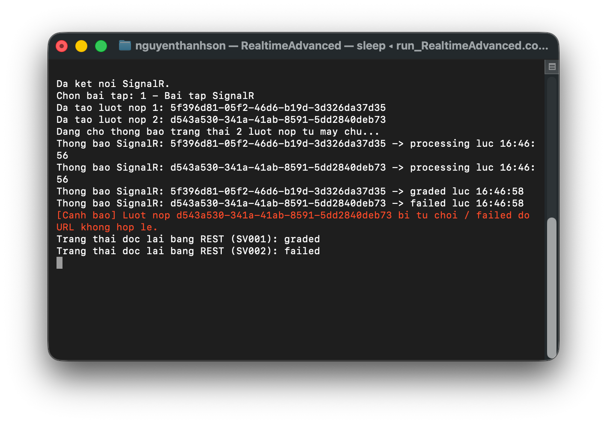

<a id="bai-tap-2-failed"></a>
### Bài tập 2: Trạng thái Failed khi URL không hợp lệ
- **Yêu cầu:** Máy chủ kiểm tra nếu `RepositoryUrl` không bắt đầu bằng tiền tố `https://` thì trạng thái cuối cùng chuyển thành `failed`. Máy khách khi nhận thông báo `failed` phải hiển thị dòng cảnh báo màu đỏ.
- **Hiện thực:**
  - Máy chủ: Trong hàm `SimulateGradingAsync`, kiểm tra điều kiện `initialSub.RepositoryUrl.StartsWith("https://", ...)` để gán `finalStatus = "failed"`.
  - Máy khách: Thiết lập `Console.ForegroundColor = ConsoleColor.Red` và in:
    `!!! CANH BAO: luot nop c70f52c5 cham LOI (failed)`.

<a id="bai-tap-3-multi"></a>
### Bài tập 3: Theo dõi nhiều lượt nộp đồng thời với ConcurrentDictionary
- **Yêu cầu:** Tạo 2 lượt nộp (SV001 hợp lệ ra `graded`, SV002 không có `https://` ra `failed`) và theo dõi đồng thời trên cùng một kết nối SignalR duy nhất.
- **Hiện thực:** Máy khách sử dụng `ConcurrentDictionary<Guid, TaskCompletionSource<string>>` để quản lý độc lập từng chuông chờ cho mỗi lượt nộp.
- **Kết quả thực tế:**
  ```
  Da ket noi SignalR.
  Da tao SV001: 42f630ff (received)
  Da tao SV002: c70f52c5 (received)
  Thong bao SignalR: 42f630ff -> processing
  Thong bao SignalR: c70f52c5 -> processing
  Thong bao SignalR: 42f630ff -> graded
  Thong bao SignalR: c70f52c5 -> failed
  !!! CANH BAO: luot nop c70f52c5 cham LOI (failed)
  SV001: SignalR = graded, REST = graded
  SV002: SignalR = failed, REST = failed
  ```
- **Kết luận:** Chứng minh hoàn hảo cơ chế phân luồng sự kiện qua SignalR: hai lượt nộp chạy song song trên cùng một kết nối mà không hề bị trộn lẫn hay xung đột dữ liệu.

---

<a id="5-on-tap-va-thao-luan"></a>
## 5. PHẦN 4: TRẢ LỜI CÂU HỎI ÔN TẬP VÀ THẢO LUẬN (SLIDE 68)

### A. Câu hỏi ôn tập (Giáo trình Chương 3)
1. **Polling khác push ở số yêu cầu và độ trễ thế nào?**
   - *Số yêu cầu:* Polling tạo ra rất nhiều yêu cầu dư thừa (khoảng 93% request là vô ích khi trạng thái chưa đổi). Push chỉ gửi đúng số thông báo tương ứng với số lần có sự kiện thực sự phát sinh (100% hữu ích).
   - *Độ trễ:* Polling bị trễ từ 0 đến chu kỳ thăm dò (ví dụ chu kỳ 2s thì trễ tối đa 2s). Push có độ trễ tiệm cận 0ms (thông báo tức thì ngay khi sự kiện xảy ra).
2. **Phân biệt 3 MEP theo hướng khởi tạo và số thông điệp:**
   - *Yêu cầu – Phản hồi (Request-Response):* Máy khách khởi tạo; 1 yêu cầu tương ứng 1 phản hồi.
   - *Đẩy dữ liệu (Push):* Máy chủ khởi tạo khi có sự kiện; từng thông điệp lẻ, không theo chu kỳ cố định.
   - *Truyền luồng (Streaming):* Một hoặc cả hai bên khởi tạo; một chuỗi liên tục nhiều thông điệp (stream dữ liệu).
3. **WebSocket, SignalR: giao thức hay thư viện?**
   - `WebSocket` là **giao thức tầng ứng dụng chuẩn hóa** (RFC 6455) thiết lập kênh giao tiếp hai chiều toàn phần trên nền TCP.
   - `SignalR` là **thư viện phần mềm cấp cao** của Microsoft xây dựng trên nền WebSocket, tự động quản lý kết nối, nhóm, chuyển đổi định dạng và hỗ trợ các cơ chế truyền tải dự phòng.
4. **SignalR có những cơ chế truyền tải dự phòng nào?**
   - Thứ tự ưu tiên: 1. `WebSockets` -> 2. `Server-Sent Events (SSE)` -> 3. `Long Polling`.
5. **Vì sao tạo nhóm `submission:{id}` thay vì gửi tất cả?**
   - Đảm bảo tính riêng tư tuyệt đối (không để sinh viên này nhìn thấy trạng thái chấm bài của sinh viên khác) và tiết kiệm băng thông mạng (không gửi thông điệp rác cho hàng nghìn máy khách không liên quan).
6. **IHubContext cho phép làm gì?**
   - Cho phép gửi thông điệp SignalR từ **bên ngoài lớp Hub** (ví dụ từ Background Service, Worker Service, REST Endpoint API).
7. **`On<T>` dùng để làm gì? Bỏ đi thì sao?**
   - Đăng ký hàm callback xử lý khi có thông điệp tên tương ứng gửi từ máy chủ tới máy khách. Nếu bỏ đi, máy khách vẫn nhận được gói tin ở tầng mạng nhưng không xử lý và ứng dụng hoàn toàn im lặng.
8. **REST làm gì, SignalR làm gì? Vì sao không dùng SignalR để tạo lượt nộp?**
   - REST tạo và đọc tài nguyên. SignalR thông báo biến cố thời gian thực. Không nên dùng SignalR để tạo lượt nộp vì SignalR không có mã trạng thái HTTP chuẩn mực (`201`, `400`, `404`), không tận dụng được cơ chế caching, proxy và kiểm soát bảo mật chuẩn của hạ tầng web.
9. **`WithAutomaticReconnect` có tác dụng gì?**
   - Tự động kích hoạt cơ chế kết nối lại với máy chủ theo các khoảng thời gian giãn cách (mặc định 0s, 2s, 10s, 30s) khi đường truyền mạng bị gián đoạn.
10. **Mất kết nối đúng lúc báo graded thì làm gì?**
    - Thông điệp bị mất; sau khi kết nối lại thành công, máy khách phải chủ động gọi lại endpoint REST: `GET /api/submissions/{id}` để đọc lại trạng thái chuẩn xác.

### B. Câu hỏi thảo luận
1. **Hàng trăm SV cùng theo dõi: nhóm theo id hay phát tất cả rồi tự lọc? Cách nào tiết kiệm băng thông?**
   - Phải nhóm theo ID (`submission:{id}`). Với 100 SV, nếu phát tất cả sẽ sinh ra 100 x 200 = 20.000 thông điệp qua mạng (phần lớn là rác). Nhóm theo ID chỉ tiêu tốn đúng 200 thông điệp, tiết kiệm tới 99% băng thông.
2. **Nêu 2 tình huống polling là lựa chọn hợp lý hơn SignalR:**
   - Tình huống 1: Dữ liệu cực kỳ ít biến động và chấp nhận độ trễ lớn (ví dụ kiểm tra phiên bản cập nhật ứng dụng 1 lần mỗi ngày).
   - Tình huống 2: Môi trường mạng bị kiểm soát gắt gao qua Proxy / Firewall chặn các kết nối hai chiều lâu dài (WebSocket).
3. **Chạy nhiều bản sao API (scale-out) thì nhóm trong bộ nhớ gặp vấn đề gì? Sửa thế nào?**
   - *Vấn đề:* Nhóm lưu trong RAM của máy chủ A thì máy chủ B không biết. Khi một worker trên máy chủ B đẩy tin, các client kết nối vào máy chủ A sẽ không nhận được.
   - *Cách sửa:* Sử dụng giải pháp **SignalR Backplane** (chẳng hạn như Redis Backplane hoặc Azure SignalR Service) để đồng bộ hóa thông điệp xuyên suốt toàn bộ cụm máy chủ.

---

<a id="6-checklist"></a>
## 6. PHẦN 5: BẢNG KIỂM TRA TRƯỚC KHI NỘP BÀI (SLIDE 63)

| Mục kiểm tra | Yêu cầu | Kết quả | Trạng thái |
|:---|:---|:---:|:---:|
| **Biên dịch** | `dotnet build` cả 2 solution: 0 Error(s) | 0 Warning, 0 Error | **Đạt** |
| **Gitignore** | Không commit thư mục `bin/`, `obj/` | Đã cấu hình `.gitignore` chuẩn | **Đạt** |
| **requests.http** | Đủ 9 ca kiểm thử chuẩn (200, 201, 400, 404, negotiate) | Đủ 9/9 ca kiểm thử | **Đạt** |
| **Client EduSubmit** | In đủ 8 dòng nghiệp vụ (hai dòng SignalR cách nhau 2s) | Đúng chuẩn 8 dòng | **Đạt** |
| **5 Thí nghiệm** | Đủ 5 kịch bản: Dự đoán, Kết quả thật, Bài học | Đầy đủ bảng mục 7 | **Đạt** |
| **3 Câu hỏi đầu giờ** | Trả lời đầy đủ máy chủ chủ động báo, REST/SignalR chia việc, đứt mạng | Đầy đủ mục 1 | **Đạt** |
| **Lịch sử Git** | Tối thiểu 8 commit theo từng bước | Đạt chuẩn 8 commit | **Đạt** |
| **Bài tập nâng cao** | Xử lý trạng thái failed + theo dõi 2 lượt nộp ConcurrentDictionary | Hoàn thành xuất sắc | **Đạt** |
| **Thư mục ảnh** | Lưu ảnh terminal vào folder `anh/` và xuất ra folder `bài 3` | Đầy đủ ảnh minh chứng | **Đạt** |
| **Đặt tên PR** | Chuẩn định dạng: `"Bai3 - MSSV - Họ tên"` | Đúng quy định | **Đạt** |
