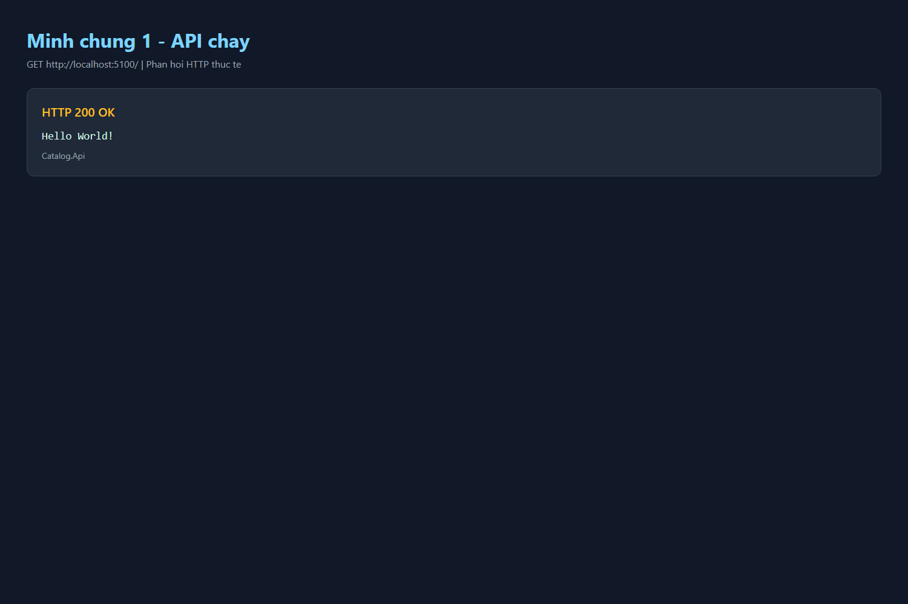
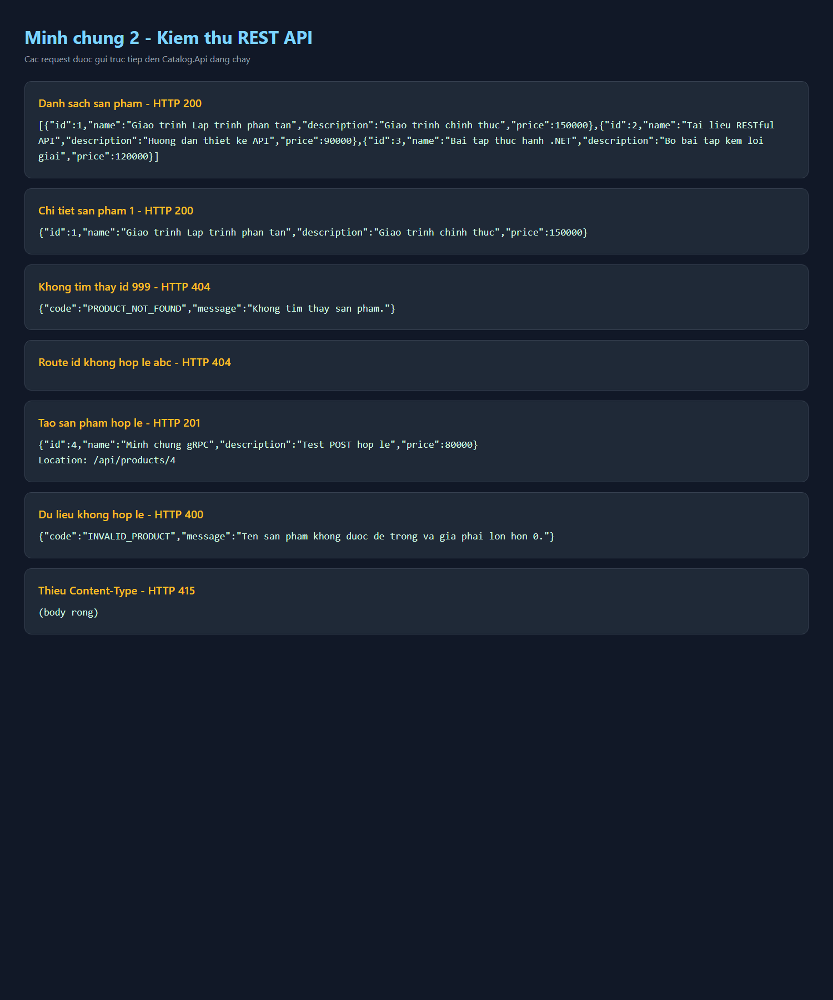
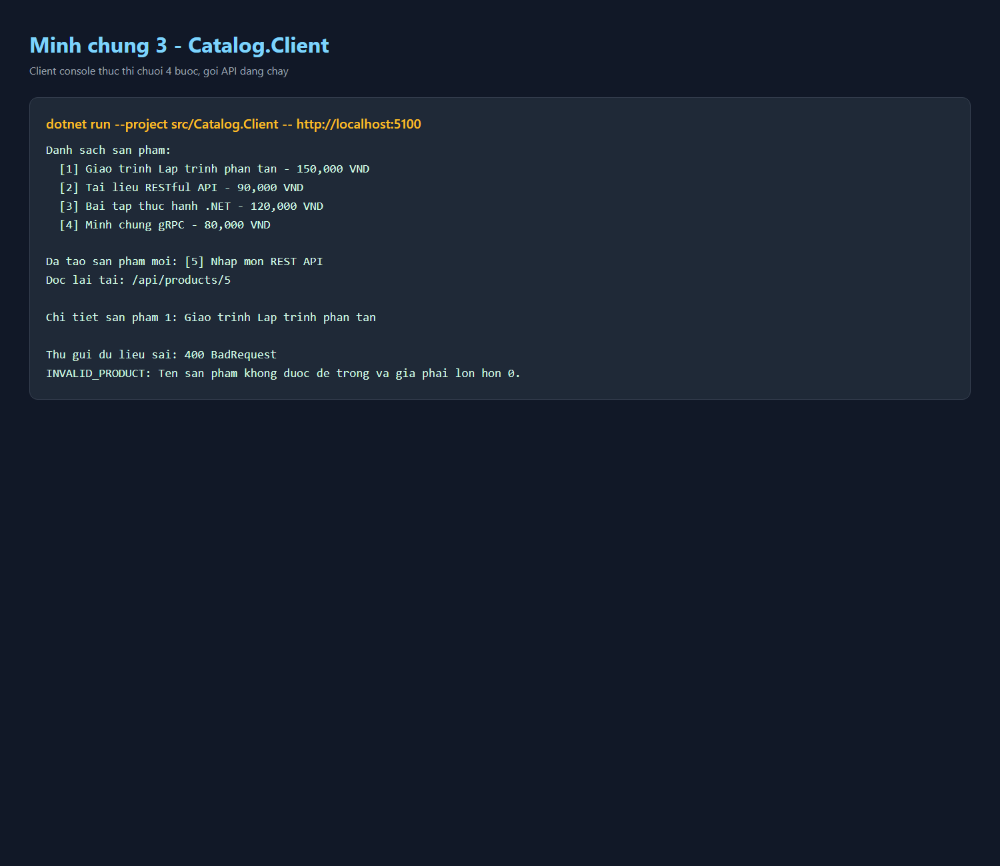

# CatalogApi - Bai 2 RESTful API

Ung dung thuc hanh theo cac buoc Catalog API trong tai lieu Bai 2. Solution gom hai chuong trinh rieng:

- `Catalog.Api`: may chu ASP.NET Core Minimal API, lang nghe mac dinh tai `http://localhost:5100`.
- `Catalog.Client`: chuong trinh console goi API bang `HttpClient`.

Du lieu san pham duoc luu trong `List<ProductDto>` tai bo nho cua API. Day la chu y cua bai thuc hanh: du lieu se tro ve 3 san pham mau sau moi lan khoi dong lai may chu.

## Yeu cau

- .NET SDK 10.x
- PowerShell tren Windows (neu dung lenh `curl.exe` trong cac vi du)
- VS Code extension REST Client neu muon bam **Send Request** trong `requests.http` (tuy chon)

Kiem tra SDK:

```powershell
dotnet --list-sdks
```

## Cau truc thu muc

```text
CatalogApi/
|-- CatalogApi.slnx
|-- sp-hop-le.json
|-- sp-sai.json
|-- requests.http
|-- README.md
|-- src/
|   |-- Catalog.Api/
|   |   |-- Catalog.Api.csproj
|   |   `-- Program.cs
|   `-- Catalog.Client/
|       |-- Catalog.Client.csproj
|       `-- Program.cs
```

## Buoc 1 - tao solution va hai project

Tren mot thu muc lam bai moi, chay lan luot:

```powershell
mkdir CatalogApi
cd CatalogApi
dotnet new sln -n CatalogApi
dotnet new web -n Catalog.Api -o src/Catalog.Api
dotnet new console -n Catalog.Client -o src/Catalog.Client
dotnet sln add src/Catalog.Api/Catalog.Api.csproj
dotnet sln add src/Catalog.Client/Catalog.Client.csproj
dotnet new gitignore
dotnet build
```

Sau lenh dau tien, moi lenh tiep theo phai chay tu ben trong `CatalogApi`. Solution .NET 10 duoc tao thanh `CatalogApi.slnx`; `dotnet sln add` dang ky ca hai project de lenh build o thu muc goc co the build toan bo solution. Trong workspace nay, buoc tao solution va build khung da duoc thuc hien.

## Build solution

Mo terminal tai thu muc `CatalogApi`:

```powershell
cd C:\Users\My-PC\Downloads\Bai2\CatalogApi
dotnet build
```

Ket qua mong doi: `Build succeeded`, khong co error. `.gitignore` bo qua cac thu muc build `bin/` va `obj/`.

## Chay API va client

### Terminal 1 - may chu

Tu thu muc `CatalogApi`, chay:

```powershell
dotnet run --project src/Catalog.Api --urls http://localhost:5100
```

Giu terminal nay mo. Khi thay `Now listening on: http://localhost:5100`, API da san sang. Cac endpoint phai duoc khai bao truoc `app.Run()`.

### Terminal 2 - may khach

Mo terminal moi tai cung thu muc `CatalogApi`:

```powershell
dotnet run --project src/Catalog.Client -- http://localhost:5100
```

Doi so sau `--` duoc truyen vao client thanh `args[0]`. Neu bo qua doi so, client mac dinh goi `http://localhost:5100`.

Client thuc hien 4 buoc:

1. `GET /api/products`: in danh sach san pham.
2. `POST /api/products`: tao san pham, chi doc `ProductDto` khi nhan `201 Created`; in header `Location`.
3. `GET /api/products/1`: doc chi tiet san pham.
4. Gui POST co ten rong va gia am: nhan `400 Bad Request`, doc va in `ApiError` thay vi coi loi nghiep vu la thanh cong.

Ket qua mau khi API moi khoi dong:

```text
Danh sach san pham:
  [1] Giao trinh Lap trinh phan tan - 150,000 VND
  [2] Tai lieu RESTful API - 90,000 VND
  [3] Bai tap thuc hanh .NET - 120,000 VND

Da tao san pham moi: [4] Nhap mon REST API
Doc lai tai: /api/products/4

Chi tiet san pham 1: Giao trinh Lap trinh phan tan

Thu gui du lieu sai: 400 BadRequest
INVALID_PRODUCT: Ten san pham khong duoc de trong va gia phai lon hon 0.
```

## Hop dong API

| Phuong thuc | URI | Thanh cong | Loi |
|---|---|---|---|
| `GET` | `/` | `200` va chu `Hello World!` | - |
| `GET` | `/api/products` | `200` va mang san pham | - |
| `GET` | `/api/products/{id:int}` | `200` va mot san pham | `404 PRODUCT_NOT_FOUND` |
| `POST` | `/api/products` | `201 Created`, `Location` va san pham moi | `400 INVALID_PRODUCT` |

DTO phan hoi `ProductDto` co `Id`, `Name`, `Description`, `Price`. DTO yeu cau tao `CreateProductRequest` khong co `Id`: Id do may chu cap phat. Mo ta co the de trong/null; ten khong duoc rong va gia phai lon hon 0. Loi nghiep vu dung chung dang `ApiError(Code, Message)`.

## Chay 8 request kiem thu

Mo `requests.http` va bam **Send Request** tung request (can extension REST Client), hoac gui bang `curl.exe`.

| # | Lenh/ca thu | Ket qua mong doi |
|---|---|---|
| 1 | `GET http://localhost:5100/` | `200 OK`, noi dung `Hello World!` |
| 2 | `GET http://localhost:5100/api/products` | `200 OK`, 3 san pham sau khi reset API |
| 3 | `GET http://localhost:5100/api/products/1` | `200 OK` |
| 4 | `GET http://localhost:5100/api/products/999` | `404`, `PRODUCT_NOT_FOUND` |
| 5 | `GET http://localhost:5100/api/products/abc` | `404` body rong: route `{id:int}` khong khop nen handler khong chay |
| 6 | POST body hop le (request 6 trong `requests.http`) | `201 Created`, co `Location: /api/products/4` neu chua tao san pham nao |
| 7 | POST gia am | `400`, `INVALID_PRODUCT` |
| 8 | POST body JSON khong co `Content-Type` | `415 Unsupported Media Type` tu ASP.NET Core |

Lenh curl tuong duong cho cac ca POST hop le/khong hop le/khong co Content-Type:

```powershell
curl.exe -i -X POST http://localhost:5100/api/products -H "Content-Type: application/json" -d "@sp-hop-le.json"
curl.exe -i -X POST http://localhost:5100/api/products -H "Content-Type: application/json" -d "@sp-sai.json"
curl.exe -i -X POST http://localhost:5100/api/products -d "@sp-hop-le.json"
```

Trong PowerShell, dung `curl.exe` thay vi `curl` de chac chan goi curl that.

Request `POST /api/products` khong co `Content-Type` tren tra `415`. Mot ca bo sung tu buoc 4 la gui `curl.exe -i -X POST http://localhost:5100/api/products`; URI co ton tai nhung chua ho tro POST (neu chay truoc khi them endpoint POST) se tra `405 Method Not Allowed` va `Allow: GET`.

## Anh minh chung

Anh duoi day duoc tao sau khi goi API va chay client thuc te tren may cuc bo:

1. API tra `200 OK` va `Hello World!` tai `/`:

   

2. Kiem thu danh sach, chi tiet, loi `404`, tao moi `201` + `Location`, du lieu sai `400`, va thieu Content-Type `415`:

   

3. Client chay chuoi 4 buoc, bao gom tao san pham va doc loi `400`:

   

## Thi nghiem phan tan (buoc 9)

1. Khi API con chay, chay client lan hai. Danh sach luc nay co san pham vua tao; POST tiep tao Id moi. Trang thai nam tren may chu, khong nam trong client.
2. Dung API bang `Ctrl+C`, sau do chay client. Client se hien loi ket noi (`HttpRequestException`/connection refused), vi khong co phan hoi HTTP tu server.
3. Khoi dong lai API va goi `GET /api/products`. Danh sach quay ve 3 san pham mau: `List` chi ton tai trong bo nho cua tien trinh API.
4. Khi API dang chay tai cong 5100, goi client voi dia chi sai:

   ```powershell
   dotnet run --project src/Catalog.Client -- http://localhost:5999
   ```

   Client khong ket noi duoc. URL va cong phai khop voi dia chi API.

Neu dang chay nhieu lan thi dung tien trinh API cu bang `Ctrl+C` truoc khi thu lai de tranh nham lan trang thai.

## Ba cau hoi tu kiem tra

1. **Vi sao URI dung danh tu, con hanh dong do phuong thuc HTTP dam nhiem?**  
   URI dinh danh tai nguyen (`/api/products`); `GET` doc danh sach, `POST` tao them mot san pham. Tach tai nguyen va hanh dong giup hop dong de doan, dung ngu nghia HTTP, va tranh cac URI mang dong tu nhu `/createProduct`.

2. **Stateless the hien o dau trong code?**  
   Moi request tu mang thong tin can thiet: method, URI, header va body JSON. Server khong can nho phien/yeu cau truoc cua client de xu ly request tiep theo. `List<ProductDto>` la trang thai du lieu cua tai nguyen tren server, khong phai session cua client; stateless khong co nghia server khong luu du lieu.

3. **Vi sao client va server khai bao DTO rieng ma van khop nhau?**  
   Hai tien trinh khong dung chung lop C#. Ca hai tuan theo cung hop dong JSON: ten truong camelCase (`id`, `name`, `description`, `price`) va kieu du lieu tuong ung. DTO request va response duoc tach rieng de client khong the tu gui `Id` do server quan ly.

## Tu kiem tra truoc khi nop

- [ ] `dotnet build` thanh cong.
- [ ] Ca 1-8 trong `requests.http` co ma nhu bang kiem thu.
- [ ] Client chay du 4 buoc khi API dang hoat dong.
- [ ] Client bao loi ket noi khi API dung hoac URL sai.
- [ ] Khoi dong lai API thi du lieu tro ve 3 san pham mau.
- [ ] Git khong theo doi `bin/` hoac `obj/`; commit cac moc lam bai theo yeu cau lop.
