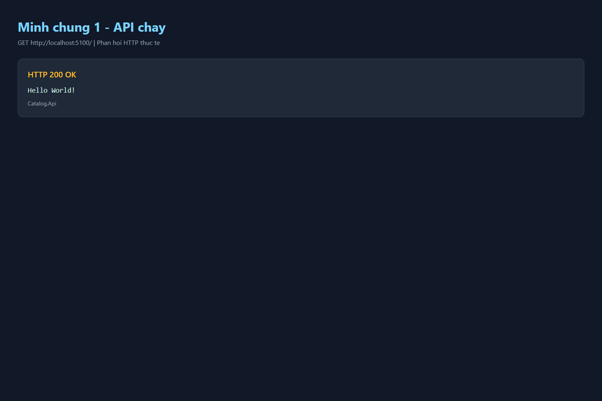
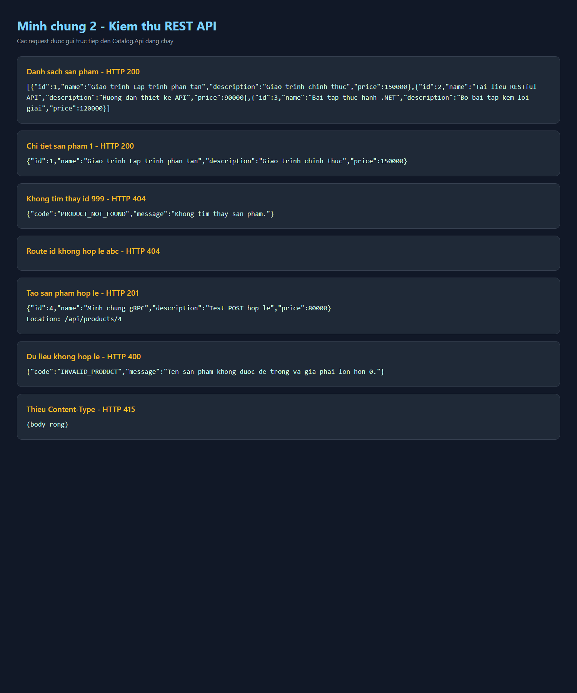
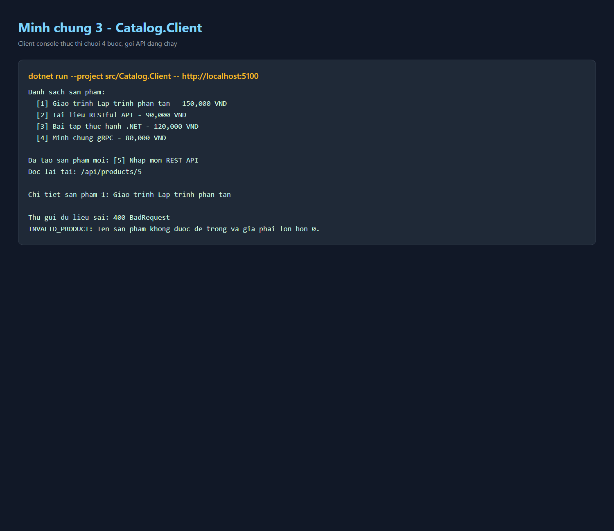

# Bài 2 - RESTful API cho tương tác client–server (Catalog API)

**Họ tên:** Nguyễn Thành Long  
**MSSV:** DTC245200171  
**Lớp:** CNTT K23C  

---

## 1. Giới thiệu & Cấu trúc Solution
Dự án được xây dựng theo kiến trúc RESTful Client–Server gồm 2 thành phần độc lập:
- **`Catalog.Api`**: Máy chủ ASP.NET Core Minimal API, cấu hình lắng nghe tại `http://localhost:5100`. Lưu trữ danh sách sản phẩm in-memory (`List<ProductDto>`).
- **`Catalog.Client`**: Ứng dụng Console đóng vai trò máy khách, sử dụng `HttpClient` để gọi API, kiểm tra mã trạng thái trước khi phân tích dữ liệu body.

### Cấu trúc thư mục:
```text
Bai2/
├── CatalogApi/
│   ├── CatalogApi.slnx
│   ├── requests.http
│   ├── sp-hop-le.json
│   ├── sp-sai.json
│   ├── README.md
│   ├── evidence/
│   │   ├── 01-api-running.png
│   │   ├── 02-api-tests.png
│   │   └── 03-client-workflow.png
│   └── src/
│       ├── Catalog.Api/
│       │   ├── Catalog.Api.csproj
│       │   └── Program.cs
│       └── Catalog.Client/
│           ├── Catalog.Client.csproj
│           └── Program.cs
├── CatalogApi.slnx
├── requests.http
├── sp-hop-le.json
├── sp-sai.json
├── evidence/
├── docs/
│   └── bai2.md
└── README.md
```

---

## 2. Bảng hợp đồng API

| Phương thức | URI | Mô tả | Mã thành công | Mã lỗi |
|---|---|---|---|---|
| `GET` | `/` | Kiểm tra trạng thái máy chủ | `200 OK` ("Hello World!") | - |
| `GET` | `/api/products` | Lấy toàn bộ danh sách sản phẩm | `200 OK` (Mảng JSON) | - |
| `GET` | `/api/products/{id:int}` | Xem chi tiết sản phẩm theo ID | `200 OK` (ProductDto) | `404 Not Found` (`PRODUCT_NOT_FOUND`) |
| `POST` | `/api/products` | Thêm mới một sản phẩm | `201 Created` + Header `Location` | `400 Bad Request` (`INVALID_PRODUCT`) |

### Định dạng dữ liệu (DTO):
- **Phản hồi sản phẩm (`ProductDto`)**: `(int Id, string Name, string Description, decimal Price)`.
- **Yêu cầu tạo mới (`CreateProductRequest`)**: `(string Name, string? Description, decimal Price)`. *Lưu ý: Không gửi kèm `Id` vì `Id` do máy chủ tự sinh.*
- **Thông báo lỗi nghiệp vụ (`ApiError`)**: `(string Code, string Message)`.

---

## 3. Kiểm thử 8 ca (requests.http & curl)

| # | Ca kiểm thử / Lệnh | Kết quả mong đợi | Kết quả thực tế |
|---|---|---|---|
| 1 | `GET http://localhost:5100/` | `200 OK` - Chuỗi "Hello World!" | `200 OK` |
| 2 | `GET http://localhost:5100/api/products` | `200 OK` - Danh sách 3 sản phẩm ban đầu | `200 OK` |
| 3 | `GET http://localhost:5100/api/products/1` | `200 OK` - Chi tiết sản phẩm ID 1 | `200 OK` |
| 4 | `GET http://localhost:5100/api/products/999` | `404 Not Found` kèm `ApiError: PRODUCT_NOT_FOUND` | `404 Not Found` |
| 5 | `GET http://localhost:5100/api/products/abc` | `404 Not Found` từ framework (sai ràng buộc kiểu `int`) | `404 Not Found` |
| 6 | `POST /api/products` với body hợp lệ | `201 Created` kèm header `Location: /api/products/4` | `201 Created` |
| 7 | `POST /api/products` với tên rỗng, giá âm | `400 Bad Request` kèm `ApiError: INVALID_PRODUCT` | `400 Bad Request` |
| 8 | `POST /api/products` bỏ header Content-Type | `415 Unsupported Media Type` do framework từ chối | `415 Unsupported Media Type` |

---

## 4. Hình ảnh minh chứng

### 4.1. Máy chủ khởi động và hoạt động
API lắng nghe tại cổng 5100 và trả về `200 OK` khi truy cập `/`:



### 4.2. Kiểm thử các endpoint với HTTP requests
Bao phủ đầy đủ các mã trạng thái: `200 OK`, `201 Created` kèm `Location`, `400 Bad Request`, `404 Not Found`, và `415 Unsupported Media Type`:



### 4.3. Máy khách Catalog.Client chạy đủ 4 nấc workflow
1. Liệt kê danh sách sản phẩm ban đầu.
2. Nộp yêu cầu tạo sản phẩm mới, kiểm tra `201 Created` trước khi đọc body, in ra `Location`.
3. Đọc lại chi tiết sản phẩm theo ID.
4. Cố ý gửi dữ liệu sai (tên rỗng, giá âm), nhận `400 Bad Request`, đọc đối tượng `ApiError` và không làm sập tiến trình:



---

## 5. Thí nghiệm phân tán (Bước 9)

| # | Thao tác thí nghiệm | Dự đoán trước khi chạy | Kết quả thực tế quan sát được | Ý nghĩa / Bài học rút ra |
|---|---|---|---|---|
| **1** | Giữ API chạy, thực thi Client lần 2 | Danh sách có thêm sản phẩm vừa tạo; gửi POST tiếp sẽ sinh ID = 5 | Client in 4 sản phẩm; sản phẩm mới tạo nhận `Id = 5` | **Trạng thái nằm trên server**: Client không lưu trạng thái sản phẩm, toàn bộ dữ liệu do máy chủ quản lý. |
| **2** | Dừng máy chủ API (`Ctrl+C`), chạy Client | Client không kết nối được và ném lỗi mạng | Báo lỗi `HttpRequestException: No connection could be made because the target machine actively refused it` | **Tính phụ thuộc mạng**: Ứng dụng phân tán luôn có rủi ro mất kết nối; client phải xử lý ngoại lệ mạng. |
| **3** | Khởi động lại máy chủ API, gọi `GET /api/products` | Dữ liệu được làm mới về 3 sản phẩm mẫu ban đầu | Danh sách quay về đúng 3 sản phẩm mặc định | **Vòng đời bộ nhớ**: Dữ liệu lưu trong RAM tiến trình server sẽ biến mất khi server tắt/khởi động lại. |
| **4** | API chạy cổng 5100, Client gọi cổng sai 5999 | Client báo lỗi chối từ kết nối tại cổng 5999 | Ném lỗi `HttpRequestException`. Khi truyền lại `dotnet run -- http://localhost:5100` thì chạy thành công | **Cấu hình linh hoạt**: Client nhận địa chỉ API từ đối số dòng lệnh (`args[0]`), giúp chuyển đổi môi trường mà không cần biên dịch lại mã. |

---

## 6. Trả lời 3 câu hỏi bắt buộc

### Câu 1: Vì sao URI dùng danh từ, còn hành động do phương thức HTTP đảm nhiệm?
- **Trả lời:**
  - Trong kiến trúc REST, **URI định danh tài nguyên** (ví dụ: `/api/products`, `/api/assignments`), biểu diễn danh từ chỉ thực thể cần thao tác.
  - **Hành động nghiệp vụ được giao cho các động từ HTTP chuẩn hóa**:
    - `GET`: Đọc/truy vấn tài nguyên (an toàn và idempotent).
    - `POST`: Tạo mới tài nguyên con.
    - `PUT`/`PATCH`: Cập nhật tài nguyên.
    - `DELETE`: Xóa tài nguyên.
  - **Lợi ích:** Tránh việc tạo ra hàng loạt URI tùy tiện chứa động từ (như `/api/getProducts`, `/api/createProduct`, `/api/deleteProduct`), giúp hợp đồng API chuẩn hóa, trực quan, dễ dự đoán và tương thích tốt với các cơ chế bộ đệm (HTTP Cache), proxy trên mạng.

### Câu 2: "Stateless" thể hiện ở đâu trong code?
- **Trả lời:**
  - "Stateless" (không trạng thái) thể hiện ở việc **mỗi yêu cầu HTTP từ client gửi lên đều tự chứa đầy đủ mọi thông tin cần thiết** (method, path param `{id}`, header `Content-Type`, body JSON) để server hiểu và xử lý ngay lập tức mà không cần biết các yêu cầu trước đó của client.
  - Máy chủ hoàn toàn không duy trì phiên làm việc (Session ID, Cookie theo dõi client) giữa các lần gọi.
  - *Lưu ý quan trọng:* Danh sách `List<ProductDto> products` trên server là **trạng thái của tài nguyên (resource state)**, chứ không phải trạng thái phiên của client. Stateless nghĩa là server không lưu trạng thái liên lạc của client, chứ không có nghĩa server không được lưu trữ dữ liệu.

### Câu 3: Vì sao client và server khai báo DTO riêng mà vẫn khớp nhau?
- **Trả lời:**
  - Client và server là **hai tiến trình phần mềm hoàn toàn độc lập**, chạy ở hai không gian bộ nhớ khác nhau (thậm chí trên hai hệ điều hành/máy tính khác nhau) và không chia sẻ tham chiếu mã nguồn C# với nhau.
  - Hai bên giao tiếp thông qua **hợp đồng thông điệp JSON**:
    - Khi server gửi phản hồi, đối tượng được tuần tự hóa (serialize) thành chuỗi JSON dạng chuẩn (tên thuộc tính camelCase như `id`, `name`, `price`).
    - Khi client nhận chuỗi JSON, thư viện `System.Net.Http.Json` sẽ ánh xạ (deserialize) các trường JSON vào các thuộc tính tương ứng của lớp DTO nội bộ phía client.
  - Việc tách riêng DTO còn giúp đảm bảo tính đóng gói và an toàn bảo mật: ví dụ client sử dụng `CreateProductRequest` không chứa trường `Id`, ngăn chặn việc client tự ý gán `Id` vốn thuộc thẩm quyền kiểm soát của máy chủ.

---

## 7. Bảng tự kiểm tra trước khi nộp
- [x] Solution `CatalogApi.slnx` biên dịch thành công (`Build succeeded: 0 Warning, 0 Error`).
- [x] Máy chủ Minimal API hoạt động ổn định tại cổng 5100.
- [x] Đầy đủ 8 ca kiểm thử trong `requests.http` bao phủ các mã trạng thái `200`, `201`, `400`, `404`, `415`.
- [x] Client chạy tuần tự đủ 4 nấc workflow, kiểm tra mã trạng thái trước khi đọc body, xử lý lỗi `400` an toàn.
- [x] Đã loại bỏ hoàn toàn các thư mục nhị phân `bin/` và `obj/` khỏi thư mục nộp bài.
- [x] Đầy đủ hình ảnh minh chứng và phân tích thí nghiệm phân tán.
