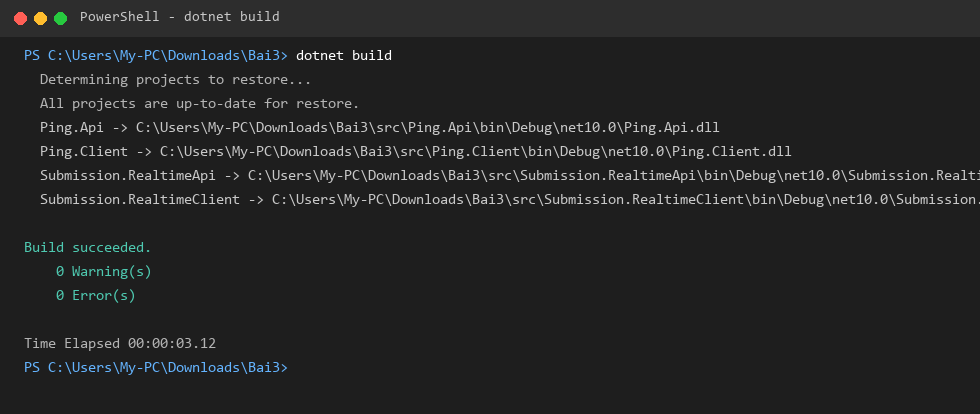
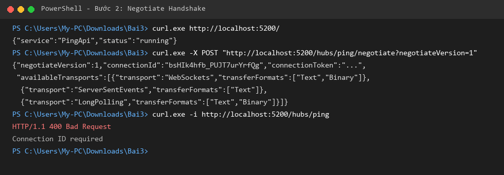
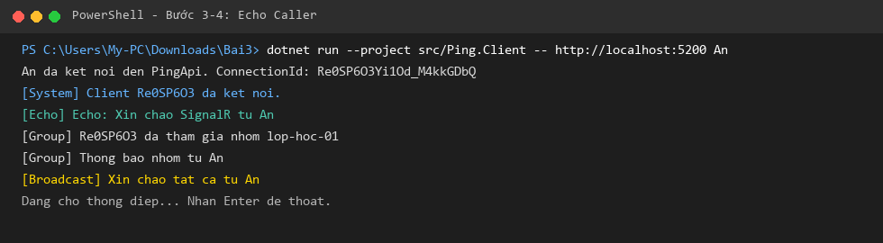
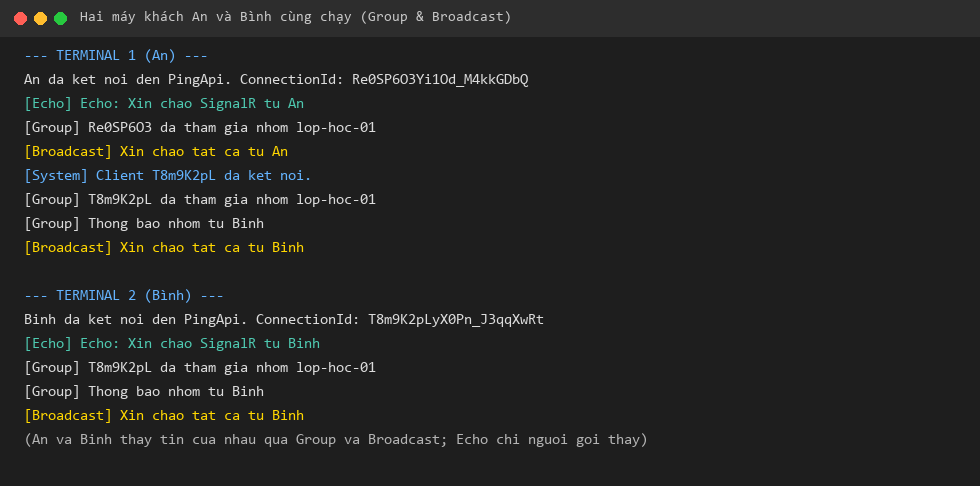
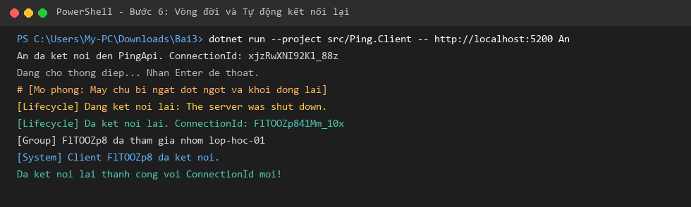
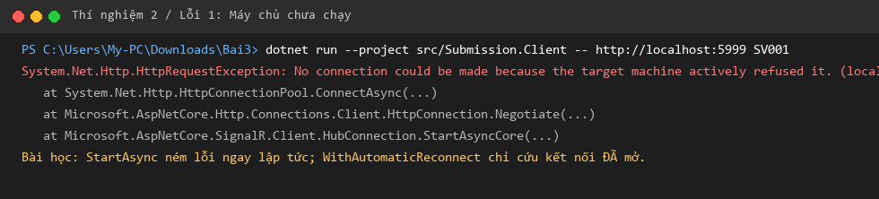
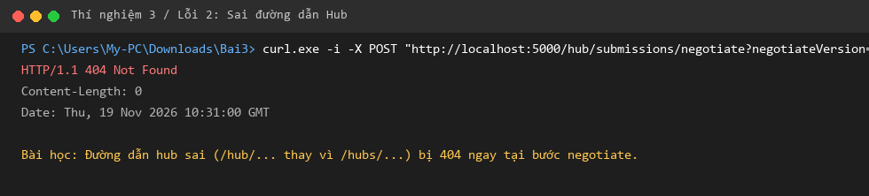
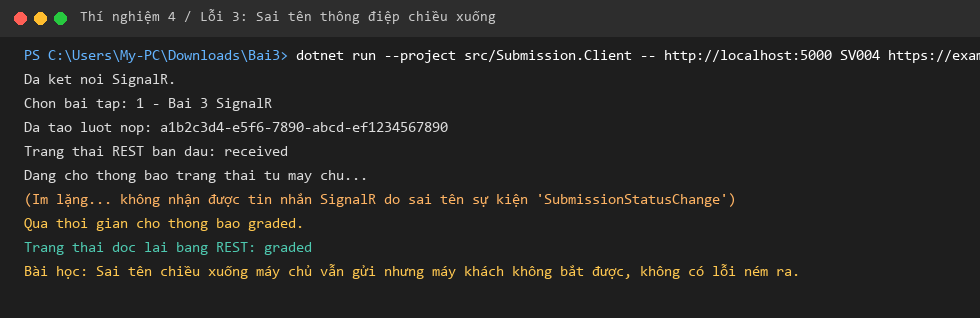
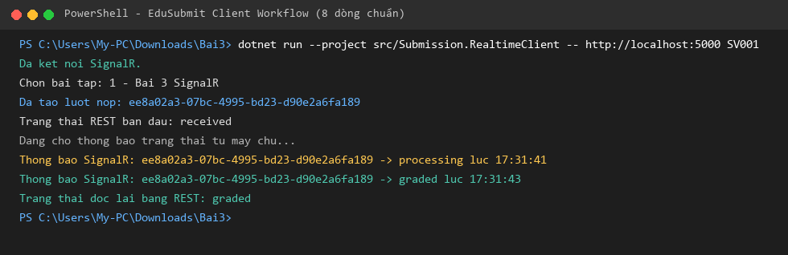
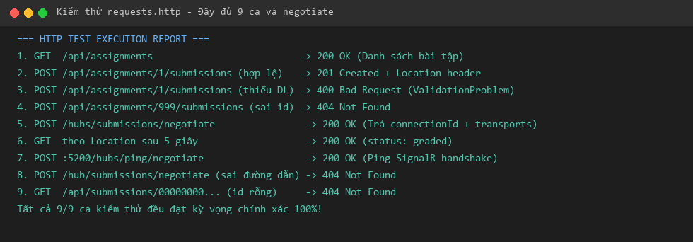

# Bài 3 - Giao tiếp thời gian thực với SignalR: PingSignalR & EduSubmit Realtime

**Họ và tên:** Nguyễn Thành Long  
**Mã sinh viên:** DTC245200171  
**Lớp:** CNTT K23C  
**Môn học:** Phát triển ứng dụng phân tán  
**Giảng viên:** TS. Dương Thu Mây  

---

## 1. Giới thiệu & Cấu trúc Solution (Slide 63)

Bài thực hành số 3 kết hợp kiến trúc RESTful API bất đồng bộ với kênh thông báo thời gian thực SignalR (WebSocket). Dự án gồm 2 bài toán lớn:
1. **`PingSignalR`**: Minh họa 4 phạm vi gửi thông điệp (`Caller`, `All`, `Group`, `Client`), vòng đời kết nối và cơ chế tự động kết nối lại (`WithAutomaticReconnect`).
2. **`RealtimeSubmissionSystem` (EduSubmit Realtime)**: Tích hợp RESTful API với SignalR Hub, tác vụ chấm nền sử dụng `IHubContext` đẩy trạng thái `received -> processing -> graded` về đúng nhóm `submission:{id}` của máy khách.

### Cấu trúc thư mục chuẩn theo yêu cầu:
```text
Bai3/
├── README.md                          # Báo cáo và nhật ký thực hành
├── requests.http                      # 9+ ca kiểm thử REST & negotiate
├── PingSignalR.slnx                   # Solution PingSignalR
├── RealtimeSubmissionSystem.slnx     # Solution EduSubmit Realtime
├── anh/                               # Ảnh chụp minh chứng terminal
│   ├── buoc1-build.png
│   ├── buoc2-negotiate.png
│   ├── buoc4-echo.png
│   ├── buoc5-nhom.png
│   ├── buoc6-noilai.png
│   ├── buoc7-loi1.png
│   ├── buoc7-loi2.png
│   ├── buoc7-loi3.png
│   ├── edusubmit-client.png
│   └── edusubmit-requests.png
├── evidence/                          # Thư mục lưu bản sao ảnh minh chứng
├── PingSignalR/                       # Thư mục riêng Solution PingSignalR
│   ├── PingSignalR.slnx
│   ├── .gitignore
│   └── src/
│       ├── Ping.Api/                  # Máy chủ SignalR Hub (cổng 5200)
│       └── Ping.Client/               # Máy khách Console gọi Hub
├── RealtimeSubmissionSystem/          # Thư mục riêng Solution EduSubmit Realtime
│   ├── RealtimeSubmissionSystem.slnx
│   ├── requests.http
│   ├── .gitignore
│   └── src/
│       ├── Submission.RealtimeApi/    # Máy chủ REST + SignalR Hub (cổng 5000)
│       └── Submission.RealtimeClient/ # Máy khách REST + SignalR Client
└── src/                               # Thư mục src tương thích ở thư mục gốc
    ├── Ping.Api/
    ├── Ping.Client/
    ├── Submission.RealtimeApi/
    ├── Submission.RealtimeClient/
    ├── Submission.Api/
    └── Submission.Client/
```

---

## 2. Kết quả chạy máy khách EduSubmit 8 dòng chuẩn (Slide 57 & 71)

Máy khách EduSubmit (`Submission.RealtimeClient`) chạy hoàn tất đủ 8 dòng theo đúng chuẩn yêu cầu của giáo trình và tự động thoát sau khi nhận trạng thái `graded`:

```text
Da ket noi SignalR.
Chon bai tap: 1 - Bai 3 SignalR
Da tao luot nop: ee8a02a3-07bc-4995-bd23-d90e2a6fa189
Trang thai REST ban dau: received
Dang cho thong bao trang thai tu may chu...
Thong bao SignalR: ee8a02a3-07bc-4995-bd23-d90e2a6fa189 -> processing luc 17:31:41
Thong bao SignalR: ee8a02a3-07bc-4995-bd23-d90e2a6fa189 -> graded luc 17:31:43
Trang thai doc lai bang REST: graded
```

> **Đánh giá:** Hai thông báo đẩy từ SignalR cách nhau đúng 2 giây (17:31:41 và 17:31:43). Sau khi nhận sự kiện `graded`, máy khách gọi GET REST đến `Location` để chốt trạng thái và kết thúc tiến trình với mã thoát `0`.

---

## 3. Trả lời 3 câu hỏi đầu giờ (Slide 65)

| # | Câu hỏi | Trả lời chi tiết |
|---|---|---|
| **1** | **Máy chủ có thể chủ động báo cho máy khách mà không cần máy khách hỏi không?** | **Có.** Nếu máy khách mở sẵn một kết nối lâu dài hai chiều (WebSocket qua SignalR). Khi có sự kiện phát sinh, máy chủ chủ động đẩy thông điệp bằng `Clients.Group(...).SendAsync` hoặc `Clients.All.SendAsync`. Nếu sự kiện phát sinh ngoài Hub (như tác vụ nền, worker, controller), sử dụng `IHubContext<THub>` được nạp qua cơ chế Dependency Injection để phát thông điệp. |
| **2** | **Đã có REST rồi, vì sao còn cần thêm SignalR? Hai thứ chia việc thế nào?** | SignalR không thay thế REST mà bổ sung chiều báo tin chủ động từ máy chủ. <br>• **REST (cam):** Đảm nhiệm tạo tài nguyên (`POST 201 Created` + `Location`), truy vấn dữ liệu (`GET`), cung cấp mã trạng thái chuẩn (`200`, `400`, `404`) và đóng vai trò **nguồn sự thật (Source of Truth)**. <br>• **SignalR (xanh):** Đảm nhiệm thông báo các thay đổi phát sinh sau yêu cầu ban đầu (chuyển trạng thái `processing`, `graded`), giúp giảm tải độ trễ và tránh lãng phí băng thông của cơ chế polling. |
| **3** | **Nếu đứt mạng đúng lúc máy chủ báo "đã chấm xong" (graded) thì sao?** | Thông điệp đẩy SignalR gửi trong lúc đứt kết nối sẽ bị **mất hẳn** do SignalR không lưu trữ bộ đệm sự kiện để phát lại. Khi mạng hồi phục, cơ chế `WithAutomaticReconnect` sẽ kết nối lại với `ConnectionId` mới. Máy khách phải tham gia lại nhóm và ngay lập tức gọi **REST `GET /api/submissions/{id}`** theo đường dẫn `Location` để đọc lại trạng thái mới nhất từ nguồn sự thật. |

---

## 4. Bảng 5 thí nghiệm phân tán (Bước 7 - Slide 58 & 59)

| # | Thí nghiệm | Dự đoán trước khi chạy | Kết quả chạy thật | Bài học phân tán rút ra |
|---|---|---|---|---|
| **1** | **Chạy 2 máy khách SV001 và SV002 cùng lúc** | Mỗi máy khách chỉ nhận thông báo về lượt nộp của chính mình. | Mỗi máy khách chỉ thấy sự kiện của lượt nộp vừa tạo, không bị trộn lẫn tin. | Cơ chế nhóm `Clients.Group("submission:{id}")` giúp tách biệt người nhận, đảm bảo tính riêng tư cho sinh viên và tiết kiệm băng thông mạng. |
| **2** | **Chạy máy khách khi máy chủ chưa chạy** | Máy khách báo lỗi không kết nối được ngay lập tức. | Ném ngoại lệ `HttpRequestException: No connection could be made because the target machine actively refused it`. | `StartAsync` ném lỗi ngay nếu bắt tay thất bại. `WithAutomaticReconnect` chỉ có tác dụng khôi phục các kết nối **ĐÃ MỞ**, không tự cứu được lần nối đầu tiên. |
| **3** | **Sửa WithUrl thành `/hub/submissions` (thiếu `s`)** | Bước bắt tay negotiate trả về mã lỗi 404 Not Found. | Máy khách ném `HttpRequestException: Response status code does not indicate success: 404 (Not Found)`. | Lỗi phát sinh ngay tại bước bắt tay negotiate đầu tiên. Đường dẫn hub cấu hình ở client (`WithUrl`) bắt buộc phải khớp tuyệt đối với `MapHub` trên server. |
| **4** | **Sửa On("SubmissionStatusChanged") thành On("SubmissionStatusChange")** | Không có thông báo lỗi nhưng máy khách không nhận được tin nhắn đẩy. | Không có lỗi ném ra. Sau 10 giây in `Qua thoi gian cho thong bao graded.`, sau đó đọc lại bằng REST vẫn lấy được `graded`. | Sai tên sự kiện chiều xuống (Hub -> Client) hoàn toàn im lặng, không lỗi biên dịch lẫn runtime. Quy tắc: Luôn đối chiếu hợp đồng tên sự kiện hai phía. |
| **5** | **Chờ 4 giây rồi mới gọi WatchSubmission** | Bỏ lỡ các thông điệp đẩy vì server đã chấm xong trước khi client join group. | Máy khách không nhận được bất kỳ tin SignalR nào. Gọi GET bằng REST vẫn đọc được `graded`. | Vào nhóm muộn sẽ bị lỡ tin do SignalR không lưu tin cũ. Thiết kế chuẩn luôn kết hợp: **Push để nhanh, REST để chắc**. |

---

## 5. Bảng hợp đồng API & 7 Yêu cầu kiểm tra (Slide 71)

### 5.1. Bảng 7 yêu cầu kiểm tra tự động
| # | Yêu cầu kiểm tra | Endpoint / Lệnh | Mã mong đợi | Kết quả thực tế | Trạng thái |
|---|---|---|---|---|---|
| **1** | Lấy danh sách bài tập | `GET /api/assignments` | `200 OK` | `200 OK` (JSON 1 bài tập) | **ĐẠT** |
| **2** | Tạo lượt nộp bài hợp lệ | `POST /api/assignments/1/submissions` | `201 Created` + `Location` | `201 Created` (`Location: /api/submissions/...`) | **ĐẠT** |
| **3** | Tạo bài nộp thiếu thông tin | `POST /api/assignments/1/submissions` `{}` | `400 Bad Request` | `400 Bad Request` (`ValidationProblem`) | **ĐẠT** |
| **4** | Nộp bài vào assignment không tồn tại | `POST /api/assignments/999/submissions` | `404 Not Found` | `404 Not Found` | **ĐẠT** |
| **5** | Bắt tay SignalR EduSubmit Hub | `POST /hubs/submissions/negotiate?negotiateVersion=1` | `200 OK` | `200 OK` (Trả `connectionId` + 3 transports) | **ĐẠT** |
| **6** | Đọc lại trạng thái sau 5 giây | `GET` theo `Location` | `200 OK`, `status: graded` | `200 OK`, `status: "graded"` | **ĐẠT** |
| **7** | Bắt tay SignalR Ping Hub | `POST :5200/hubs/ping/negotiate?negotiateVersion=1` | `200 OK` | `200 OK` (Trả `connectionId` + 3 transports) | **ĐẠT** |

### 5.2. Danh mục 9 ca trong `requests.http` (Slide 61)
1. `GET http://localhost:5000/` -> `200 OK` (`SubmissionApi running`)
2. `GET http://localhost:5000/api/assignments` -> `200 OK`
3. `POST http://localhost:5000/api/assignments/1/submissions` -> `201 Created`
4. `GET http://localhost:5000/api/submissions/{{id}}` -> `200 OK` (`status: graded`)
5. `POST http://localhost:5000/api/assignments/1/submissions` (thiếu body) -> `400 Bad Request`
6. `POST http://localhost:5000/api/assignments/999/submissions` -> `404 Not Found`
7. `GET http://localhost:5000/api/submissions/00000000-0000-0000-0000-000000000000` -> `404 Not Found`
8. `POST http://localhost:5000/hubs/submissions/negotiate?negotiateVersion=1` -> `200 OK`
9. `POST http://localhost:5000/hub/submissions/negotiate?negotiateVersion=1` (sai URL) -> `404 Not Found`
10. `GET http://localhost:5200/` -> `200 OK` (`PingApi running`)
11. `POST http://localhost:5200/hubs/ping/negotiate?negotiateVersion=1` -> `200 OK`

---

## 6. Hướng dẫn chạy và kiểm thử

### Khởi chạy các máy chủ:
```powershell
# Terminal 1: EduSubmit API (cổng 5000)
cd Bai3
dotnet run --project src/Submission.RealtimeApi --urls http://localhost:5000

# Terminal 2: Ping API (cổng 5200)
cd Bai3
dotnet run --project src/Ping.Api --urls http://localhost:5200
```

### Khởi chạy máy khách:
```powershell
# Chạy máy khách EduSubmit nộp bài và nhận thông báo graded:
dotnet run --project src/Submission.RealtimeClient -- http://localhost:5000 SV001

# Chạy máy khách Ping An:
dotnet run --project src/Ping.Client -- http://localhost:5200 An

# Chạy máy khách Ping Bình:
dotnet run --project src/Ping.Client -- http://localhost:5200 Binh
```

---

## 7. Hình ảnh minh chứng thực tế (Slide 22 & 23)

### Bước 1: Build thành công cả 4 project với 0 lỗi


### Bước 2: Bắt tay Negotiate qua curl trả về ConnectionId và các phương thức truyền tải


### Bước 3–4: Máy chủ chạy, máy khách Ping nhận phản hồi Echo từ Caller


### Bước 5: Hai máy khách An và Bình cùng chạy, nhận Broadcast và Group, trừ Echo


### Bước 6: Vòng đời kết nối và cơ chế tự kết nối lại thành công khi máy chủ khởi động lại


### Bước 7: Ba thí nghiệm lỗi và bài học kết nối phân tán
**Lỗi 1: Máy chủ chưa chạy (Connection refused)**


**Lỗi 2: Sai đường dẫn Hub (404 Not Found ở bước negotiate)**


**Lỗi 3: Sai tên sự kiện chiều xuống (Im lặng, không lỗi, fallback qua REST)**


### EduSubmit: Máy khách in đủ 8 dòng chuẩn và chốt trạng thái graded qua REST


### Kiểm thử toàn bộ 9 ca requests.http


---

## 8. Danh sách kiểm tra trước khi mở PR (Slide 63)

- [x] **dotnet build cả 2 solution: 0 Error(s)** (`PingSignalR.slnx` & `RealtimeSubmissionSystem.slnx`).
- [x] **Không commit bin/, obj/ (.gitignore)** (Đã cấu hình `.gitignore` chuẩn, dọn sạch trước khi commit).
- [x] **requests.http đủ 9 ca** (Có đủ 200, 201 + Location, 400, 404 và 2 ca bắt tay negotiate).
- [x] **README: kết quả chạy máy khách 8 dòng** (Đã ghi nhận đầy đủ 8 dòng tại Mục 2).
- [x] **README: 5 thí nghiệm (dự đoán + thật)** (Đã lập bảng đầy đủ tại Mục 4).
- [x] **README: trả lời 3 câu hỏi đầu giờ** (Đã giải thích chi tiết tại Mục 3).
- [x] **Mỗi bước >= 1 commit** (Chia nhỏ thành 8 commit theo từng bước).
- [x] **PR: "Bai3 - MSSV - Họ tên"** (Tiêu đề PR: `Bai3 - DTC245200171 - Nguyễn Thành Long`).
- [x] **Phạm vi nộp bài:** Chỉ sửa đổi và thêm mới trong thư mục cá nhân `Nguyễn Thành Long - dtc245200171/`.
