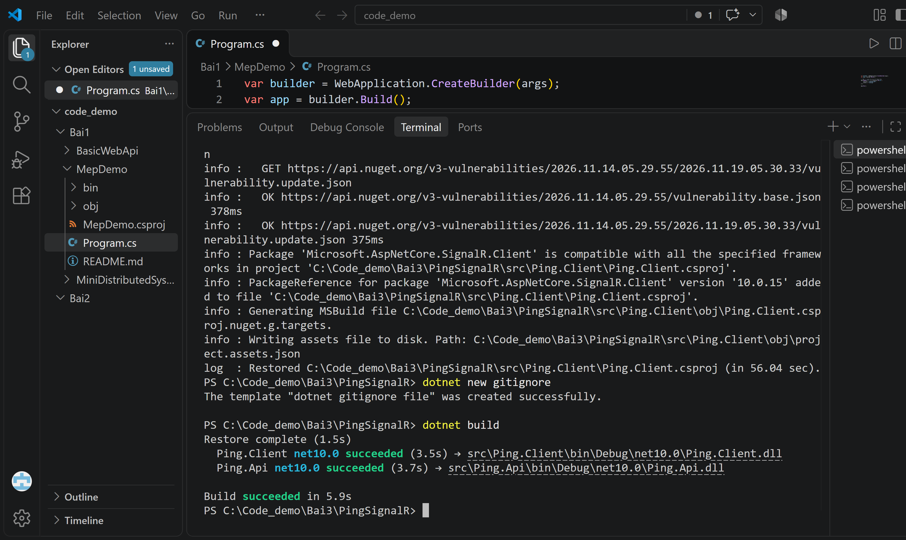
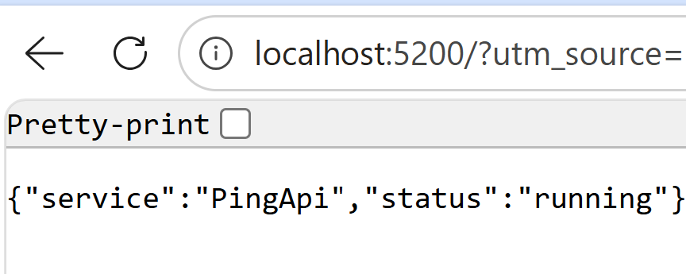
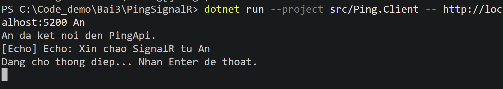
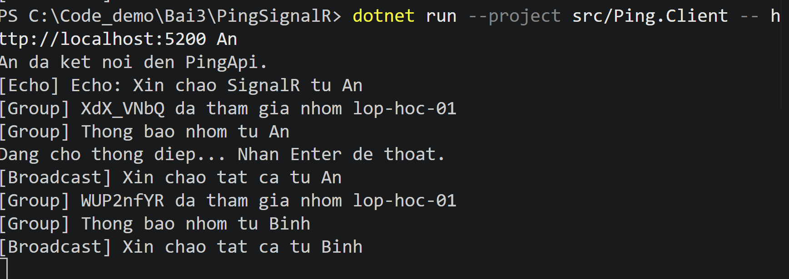
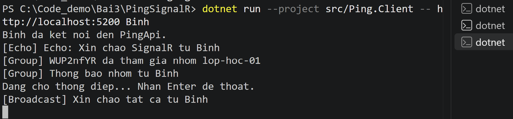
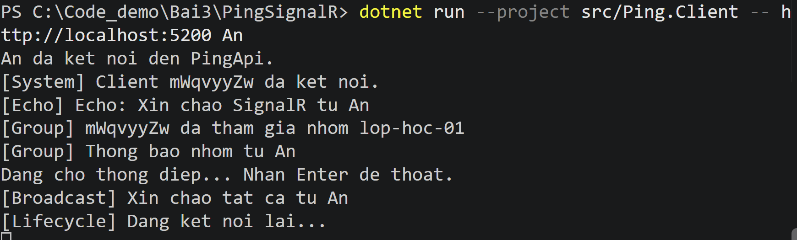
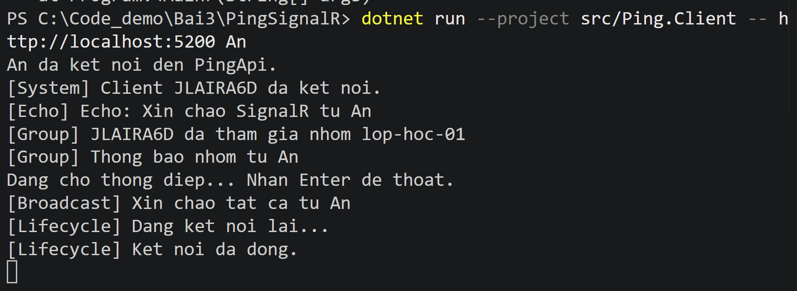
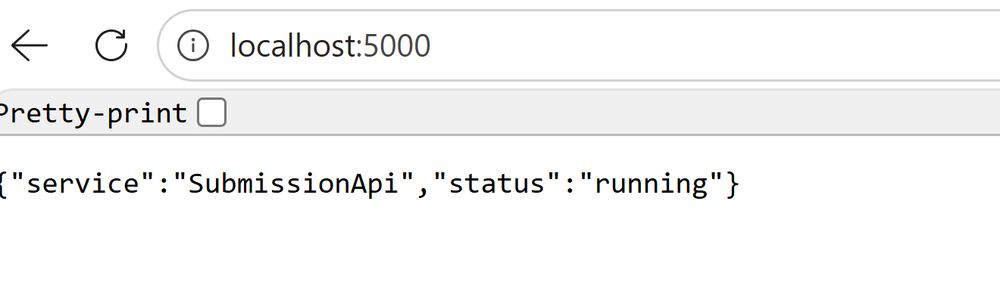
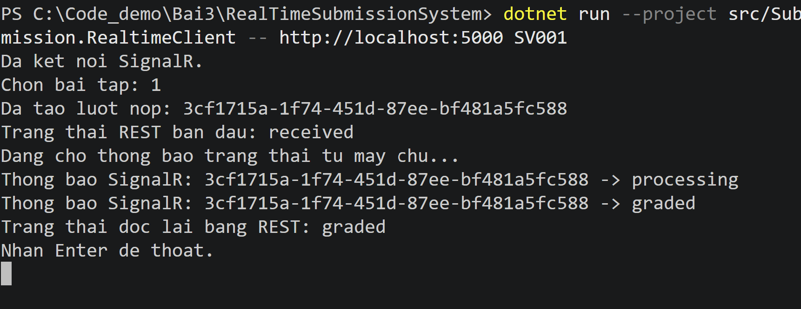

# Báo cáo Thực hành Bài 3: Giao tiếp thời gian thực với SignalR

**Sinh viên:** Nguyễn Thị Quỳnh Thơ  
**Mã sinh viên:** DTC245340007  
**Lớp:** PTUDPT - K23C  
**Môn học:** Phát triển ứng dụng phân tán  
**Giảng viên:** TS. Dương Thu Mây  

---

## 1. Trả lời 3 câu hỏi đầu giờ

### Câu 1: Máy chủ có thể chủ động báo cho máy khách mà không cần máy khách hỏi không?
**Trả lời:**  
Có. Bằng cách thiết lập một kết nối liên tục, hai chiều (full-duplex) thông qua **WebSocket** (được bọc trong thư viện **SignalR**). Khi có sự kiện xảy ra phía máy chủ, máy chủ sử dụng `Clients.Caller`, `Clients.Group(...)` hoặc `Clients.All` để gửi thông điệp xuống máy khách. Ở ngoài phạm vi vòng đời của Hub (như trong các Minimal API endpoint hoặc Background Worker), máy chủ có thể inject `IHubContext<THub>` để chủ động phát dữ liệu về máy khách theo thời gian thực.

### Câu 2: Đã có REST rồi, vì sao còn cần thêm SignalR? Hai thứ chia việc thế nào?
**Trả lời:**  
REST và SignalR không thay thế nhau mà chia việc rõ ràng để bổ trợ cho nhau:
- **REST (cam):** Đóng vai trò là **nguồn sự thật (Source of Truth)**, chịu trách nhiệm cho các thao tác CRUD: tạo mới tài nguyên (`POST` trả về mã trạng thái `201 Created`), truy vấn dữ liệu hiện tại (`GET` trả về `200 OK`, `404 Not Found`). Giao tiếp theo cơ chế Request - Response do máy khách chủ động.
- **SignalR (xanh lá):** Chịu trách nhiệm **đẩy thông báo biến động trạng thái (Push Notifications)** phát sinh sau yêu cầu ban đầu (ví dụ: `received -> processing -> graded`). Nhờ đó, máy khách không phải liên tục polling gây lãng phí tài nguyên mạng và CPU. Khi máy khách bị ngắt kết nối hoặc tải lại trang, quy tắc vàng là luôn gọi lại REST để đồng bộ trạng thái chính xác nhất.

### Câu 3: Nếu đứt mạng đúng lúc máy chủ báo "đã chấm xong" (graded) thì sao?
**Trả lời:**  
Thông điệp SignalR phát ra trong lúc mất kết nối sẽ bị mất (SignalR không tự động lưu hàng đợi tin nhắn chưa gửi trên RAM máy chủ). Khi mạng phục hồi, tính năng `WithAutomaticReconnect` sẽ tự động kết nối lại và cấp một `ConnectionId` mới (mất tư cách thành viên nhóm cũ). Để khắc phục:
1. Đăng ký sự kiện `connection.Reconnected` để tham gia lại nhóm theo dõi (`WatchSubmission`).
2. Luôn gọi lại REST API (`GET /api/submissions/{id}`) để lấy trạng thái thực tế mới nhất từ cơ sở dữ liệu/bộ nhớ máy chủ.

---

## 2. Nhật ký minh chứng thực hành PingSignalR (Phần 2)

### Bước 1: Khởi tạo Solution và cài đặt gói thư viện SignalR Client
- Tạo solution `PingSignalR`, web API `Ping.Api`, console `Ping.Client`, thêm gói `Microsoft.AspNetCore.SignalR.Client` (v10.0.15) và cấu hình `.gitignore`.
- Build thành công 0 Warning, 0 Error.



---

### Bước 2: Khởi tạo Hub và Endpoint kiểm tra `GET /`
- Cấu hình `builder.Services.AddSignalR()` và `app.MapHub<PingHub>("/hubs/ping")`.
- Kiểm tra endpoint kiểm tra trạng thái hoạt động của server `GET /`:



---

### Bước 3 & 4: Phương thức Echo (Caller) và Máy khách kiểm thử
- Hub triển khai `Echo(string message)` gửi về `EchoResponse` cho riêng `Clients.Caller`.
- Máy khách `Ping.Client` kết nối qua `HubConnectionBuilder`, đăng ký lắng nghe và invoke `Echo`:



---

### Bước 5: Broadcast (All) và Nhóm (Group)
- Thêm các phương thức `Broadcast`, `JoinGroup`, `SendToGroup`.
- Kiểm thử với 2 máy khách **An** và **Bình**:
  - Bình kết nối vào sau, tham gia nhóm `lop-hoc-01`, gửi tin nhắn nhóm và tin nhắn broadcast.
  - Cửa sổ của An nhận được đầy đủ `[Group]` và `[Broadcast]` từ Bình, nhưng **không nhận tin [Echo]** của Bình vì Echo chỉ gửi cho riêng Caller.

*Cửa sổ của An nhận thông điệp từ Bình:*


*Cửa sổ của Bình khi gửi và nhận tin:*


---

### Bước 6: Quản lý vòng đời kết nối và Tự động kết nối lại
- Ghi đè `OnConnectedAsync` và `OnDisconnectedAsync` trên server để thông báo `SystemMessage`.
- Client cấu hình `.WithAutomaticReconnect()` và bắt các sự kiện `Reconnecting`, `Reconnected`, `Closed`.
- Thử nghiệm tắt server: Client chuyển sang trạng thái `[Lifecycle] Dang ket noi lai...`.



- Khi không kết nối lại được sau các chu kỳ thử nghiệm (0s, 2s, 10s, 30s), kết nối chuyển sang đóng:



---

## 3. Nhật ký minh chứng thực hành EduSubmit Realtime (Phần 3)

### Bước 1 & 2: Dựng nền tảng EduSubmit Realtime & REST API
- Tích hợp REST API quản lý bài tập và bài nộp:
  - `GET /` kiểm tra trạng thái hoạt động của dịch vụ:



---

### Bước 3 - 6: Tích hợp SubmissionHub, IHubContext và Máy khách chạy thực tế
- Khởi chạy đồng thời:
  1. Máy chủ `Submission.RealtimeApi` (cổng 5000) với `SubmissionHub` (`/hubs/submissions`) và tác vụ chấm nền `SimulateGradingAsync` sử dụng `IHubContext<SubmissionHub>`.
  2. Máy khách `Submission.RealtimeClient`: Tạo lượt nộp qua REST `POST` $\rightarrow$ Nhận ID $\rightarrow$ `WatchSubmission` vào nhóm SignalR $\rightarrow$ Nhận lần lượt các thông báo đổi trạng thái `processing` rồi `graded` $\rightarrow$ Xác nhận trạng thái cuối cùng bằng `GET` REST.

*Kết quả chạy hoàn chỉnh của máy khách:*


**Nội dung text kết quả 8 dòng đạt chuẩn:**
```text
Da ket noi SignalR.
Chon bai tap: 1
Da tao luot nop: 3cf1715a-1f74-451d-87ee-bf481a5fc588
Trang thai REST ban dau: received
Dang cho thong bao trang thai tu may chu...
Thong bao SignalR: 3cf1715a-1f74-451d-87ee-bf481a5fc588 -> processing
Thong bao SignalR: 3cf1715a-1f74-451d-87ee-bf481a5fc588 -> graded
Trang thai doc lai bang REST: graded
```

---

## 4. Bảng 5 thí nghiệm phân tán (Bước 7)

| STT | Thí nghiệm | Dự đoán | Kết quả thực tế | Giải thích / Bài học |
| :--- | :--- | :--- | :--- | :--- |
| **1** | Chạy 2 máy khách SV001 và SV002 cùng lúc | Mỗi sinh viên chỉ nhận được thông báo chấm bài của chính mình, không thấy bài của nhau. | Mỗi máy khách chỉ nhận 2 thông báo `processing` và `graded` của đúng mã `submissionId` tương ứng. | Nhờ cơ chế gom nhóm `submission:{id}` qua `Clients.Group(...)`, dữ liệu được phân lập riêng tư và tiết kiệm băng thông tối đa. |
| **2** | Chạy máy khách khi máy chủ chưa chạy | Kết nối thất bại ngay lập tức và ném ra ngoại lệ. | `HttpRequestException: No connection could be made because the target machine actively refused it. (localhost:5000)` | Lần bắt tay ban đầu (`StartAsync`) yêu cầu server khả dụng. `WithAutomaticReconnect` chỉ có tác dụng khôi phục các kết nối **đã từng mở thành công**. |
| **3** | Sửa `WithUrl` thành `/hub/submissions` (thiếu chữ 's') | Không tìm thấy route trên server, trả về mã lỗi 404. | `HttpRequestException: Response status code does not indicate success: 404 (Not Found)`. | Quá trình `negotiate` bắt tay ban đầu gọi sai URL endpoint đã cấu hình trong `app.MapHub(...)`, dẫn tới 404. |
| **4** | Sửa `On("SubmissionStatusChanged")` thành `On("SubmissionStatusChange")` (thiếu chữ 'd') | Máy khách không nhận được thông báo nào, sau 10 giây báo timeout. | Không có lỗi runtime; sau 10s màn hình hiện: `Qua thoi gian cho thong bao graded. Trang thai doc lai bang REST: graded`. | Sai tên sự kiện ở chiều nhận (chiều xuống) sẽ bị bỏ qua trong im lặng (silent fail). Do đó việc chuẩn hóa tên sự kiện giữa hai bên là cực kỳ quan trọng. |
| **5** | Chờ 4 giây rồi mới gọi `WatchSubmission` | Máy khách bị lỡ các sự kiện SignalR vì bài đã chấm xong trước khi kịp vào nhóm. | Không nhận được thông báo SignalR `processing` và `graded`; tuy nhiên dòng REST đọc lại vẫn trả về trạng thái cuối `graded`. | Vào nhóm muộn thì các thông điệp đã phát tán trước đó sẽ bị trôi qua. Tuy nhiên REST là nguồn sự thật giúp cứu vãn và lấy được trạng thái cuối cùng. |

---

## 5. Trả lời câu hỏi ôn tập & Thảo luận (Slide 68)

### Ôn tập:
1. **Polling khác Push ở số yêu cầu và độ trễ thế nào?**
   - *Polling:* Client liên tục gửi request thăm dò (ví dụ 2 giây/lần), đa số là request thừa không có dữ liệu mới; có độ trễ bằng chu kỳ polling.
   - *Push:* Kết nối mở sẵn một lần, server gửi ngay lập tức khi phát sinh sự kiện, không có request thừa, độ trễ gần như bằng 0.
2. **Phân biệt 3 MEP (Message Exchange Patterns):**
   - *Yêu cầu - phản hồi (Request-Reply):* Client khởi tạo, 1 request $\rightarrow$ 1 response (ví dụ: REST).
   - *Đẩy dữ liệu (Push):* Server chủ động gửi các thông điệp đơn lẻ khi có sự kiện (ví dụ: SignalR).
   - *Truyền luồng (Streaming):* Client hoặc Server khởi tạo một chuỗi liên tục các thông điệp (ví dụ: SignalR streaming, gRPC streaming).
3. **WebSocket, SignalR: Giao thức hay thư viện?**
   - WebSocket là **giao thức chuẩn** (RFC 6455) truyền thông hai chiều full-duplex qua kết nối TCP dài hạn.
   - SignalR là **thư viện/framework cấp cao** của ASP.NET Core, trừu tượng hóa giao thức truyền tải, tự động chọn WebSocket/SSE/LongPolling, quản lý Hub, Group, ConnectionId, đóng gói bản tin JSON.
4. **Cơ chế truyền tải dự phòng của SignalR:**  
   Thứ tự ưu tiên: 1. WebSockets $\rightarrow$ 2. Server-Sent Events (SSE) $\rightarrow$ 3. Long Polling.
5. **Vì sao tạo nhóm `submission:{id}` thay vì gửi tất cả (`Clients.All`)?**  
   - *Bảo mật & Riêng tư:* Ngăn ngừa sinh viên này thấy mã và trạng thái bài của sinh viên khác.
   - *Hiệu năng băng thông:* Tránh bão thông điệp (broadcast vô ích tới hàng trăm client không liên quan).
6. **IHubContext cho phép làm gì?**  
   Cho phép phát thông điệp SignalR từ bên ngoài phạm vi của lớp Hub (như trong background thread, service, controller, minimal API endpoint).
7. **`On<T>` dùng để làm gì? Bỏ đi thì sao?**  
   Dùng để đăng ký hàm lắng nghe sự kiện từ Hub gửi xuống với kiểu dữ liệu `T`. Nếu bỏ đi, client sẽ hoàn toàn phớt lờ thông điệp máy chủ gửi về mà không có bất kỳ cảnh báo lỗi nào.
8. **REST làm gì, SignalR làm gì? Vì sao không dùng SignalR để tạo lượt nộp?**  
   - REST xử lý xác thực, kiểm tra biên, tạo tài nguyên với mã HTTP phân loại rõ ràng (201 Created, 400 Bad Request, 404 Not Found), là nguồn lưu trữ trạng thái gốc.
   - SignalR tối ưu cho việc push thông báo nhanh, không có mã trạng thái HTTP phong phú và khó caching/chuẩn hóa cho hành vi tạo dữ liệu.
9. **`WithAutomaticReconnect` có tác dụng gì?**  
   Tự động kích hoạt cơ chế thử kết nối lại với các mốc thời gian tăng dần (mặc định: 0s, 2s, 10s, 30s) khi đường truyền mạng bị gián đoạn.
10. **Mất kết nối đúng lúc báo graded thì làm gì?**  
    Chờ `WithAutomaticReconnect` kết nối lại, vào lại nhóm và chủ động gọi API `GET /api/submissions/{id}` để cập nhật trạng thái mới nhất.

### Thảo luận:
- **Hàng trăm SV cùng theo dõi:** Nên chia nhóm theo `submission:{id}` vì giúp giảm tải lưu lượng từ $N \times M$ thông điệp xuống chỉ đúng các thông điệp thực tế mà mỗi sinh viên cần nhận.
- **2 tình huống Polling hợp lý hơn SignalR:**
  1. Dữ liệu rất hiếm khi thay đổi (vài giờ hoặc vài ngày đổi một lần) hoặc chấp nhận độ trễ lớn.
  2. Môi trường mạng bị kiểm soát gắt gao (firewall chặn kết nối WebSocket dài hạn, proxy hạn chế kết nối giữ lâu).
- **Scale-out nhiều bản sao API:** Bộ nhớ RAM giữa các instance không đồng bộ nên Group lưu ở instance này sẽ không nhận được tin push từ instance khác. Cách khắc phục: Dùng **SignalR Backplane** (như Redis Backplane hoặc Azure SignalR Service) để định tuyến và đồng bộ tin nhắn qua các máy chủ.
