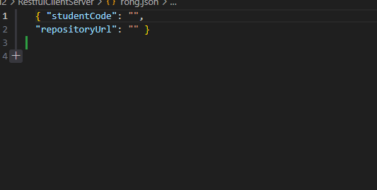
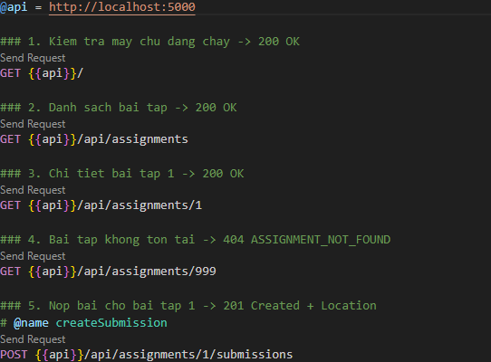
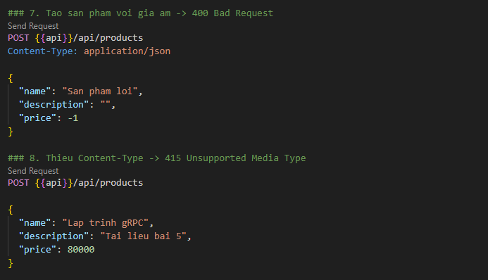
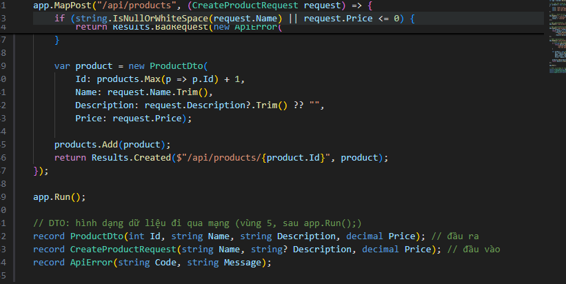

# BÁO CÁO THỰC HÀNH BÀI 2: RESTful API CHO TƯƠNG TÁC CLIENT-SERVER

**Học phần:** Phát triển ứng dụng phân tán  
**Giảng viên:** TS. Dương Thu Mây  
**Sinh viên thực hiện:** Nguyễn Trọng Nhuận 
**Mã sinh viên** dtc245200568 
**Bài làm:** Bài 2 - CatalogApi & EduSubmit (RestfulClientServer)

---

## I. MÃ NGUỒN VÀ KIẾN TRÚC HỆ THỐNG
Dự án được xây dựng theo kiến trúc phân tán gồm hai tiến trình riêng biệt (Máy chủ API và Máy khách Console) giao tiếp đồng bộ qua giao thức HTTP và định dạng JSON:
1. **Catalog.Api / Submission.Api**: Máy chủ dịch vụ Web RESTful xây dựng bằng ASP.NET Core Minimal API (.NET 10).
2. **Catalog.Client / Submission.Client**: Máy khách dòng lệnh giao tiếp thông qua `HttpClient`.
3. **requests.http**: Bộ kịch bản kiểm thử API độc lập hỗ trợ REST Client.

---

## II. DANH SÁCH LỆNH ĐÃ THỰC HIỆN






### 1. Khởi tạo dự án
```powershell
# Tạo solution và 2 project
dotnet new sln -n RestfulClientServer
dotnet new web -n Submission.Api -o src/Submission.Api
dotnet new console -n Submission.Client -o src/Submission.Client

# Gắn project vào solution và tạo .gitignore
dotnet sln add src/Submission.Api/Submission.Api.csproj
dotnet sln add src/Submission.Client/Submission.Client.csproj
dotnet new gitignore

# Biên dịch kiểm tra
dotnet build
```

### 2. Khởi chạy máy chủ (Terminal 1)
```powershell
dotnet run --project src/Submission.Api --urls http://localhost:5000
```

### 3. Khởi chạy máy khách (Terminal 2)
```powershell
dotnet run --project src/Submission.Client -- http://localhost:5000
```

---

## III. KẾT QUẢ THỰC THI (4 NẤC MÁY KHÁCH)

```text
Danh sach bai tap dang mo:
- 1: Bai tap REST API
- 2: Bai tap Client

Da tao luot nop: a388875b-6efd-41d6-86d2-3350fcc104e3
Trang thai ban dau: received
Doc lai luot nop: SV001 - https://example.com/sv001/rest-api

Thu gui yeu cau loi: 400 BadRequest
INVALID_SUBMISSION: https://github.com/dtc245200568/PTUDPT-K23C.git
```

---

## IV. BẢNG PHÁ THỬ VÀ KIỂM TRA MÃ TRẠNG THÁI (10 CA)

| STT | Yêu cầu kiểm thử | Mã mong đợi | Kết quả thực tế | Người từ chối / Phản hồi | Đánh giá |
|:---:|:---|:---:|:---:|:---|:---:|
| 1 | `GET /` | 200 | 200 OK | Handler: `{"service":"Submission.Api","status":"running"}` | Đạt |
| 2 | `GET /api/assignments` | 200 | 200 OK | Handler: Trả danh sách mảng JSON các bài tập | Đạt |
| 3 | `GET /api/assignments/1` | 200 | 200 OK | Handler: Trả chi tiết bài tập ID = 1 | Đạt |
| 4 | `GET /api/assignments/999` | 404 | 404 Not Found | Handler: Trả JSON ApiError `ASSIGNMENT_NOT_FOUND` | Đạt |
| 5 | `GET /api/assignments/abc` | 404 | 404 Not Found | Framework: Rỗng (Content-Length: 0) do sai ràng buộc `:int` | Đạt |
| 6 | `POST` bài tập 1 hợp lệ | 201 | 201 Created | Handler: Sinh Guid, trả Location header và SubmissionDto | Đạt |
| 7 | `POST` rỗng/thiếu thông tin | 400 | 400 Bad Request | Handler: Trả JSON ApiError `INVALID_SUBMISSION` | Đạt |
| 8 | `POST` thiếu Content-Type | 415 | 415 Unsupported Media | Framework: Chặn do không có header `application/json` | Đạt |
| 9 | Máy khách chạy 4 nấc | Đủ 4 nấc | In đủ 4 nấc | Client chạy hoàn chỉnh từ lấy danh sách đến bắt lỗi 400 | Đạt |
| 10 | Tắt máy chủ, chạy máy khách | Lỗi kết nối | HttpRequestException | Báo Connection refused (đặc trưng lỗi mạng phân tán) | Đạt |

---

## V. TRẢ LỜI BA CÂU HỎI GIẢI THÍCH

### Câu 1: Vì sao URI dùng danh từ, còn hành động do phương thức HTTP đảm nhận?
- **Trả lời:** Trong kiến trúc RESTful, URI đại diện cho **tài nguyên** (Resource), là các đối tượng/thực thể danh từ trong thế giới bài toán (ví dụ: `assignments`, `submissions`, `products`).
- Hành động thực hiện trên tài nguyên do các **phương thức chuẩn của giao thức HTTP** đảm nhận theo đúng ngữ nghĩa nghiệp vụ: `GET` (đọc dữ liệu), `POST` (tạo mới tài nguyên con), `PUT` (thay thế trạng thái toàn phần), `PATCH` (sửa một phần), `DELETE` (xóa).
- *Ví dụ minh họa từ code:* Để nộp bài cho bài tập 1, ta dùng `POST /api/assignments/1/submissions` thay vì đặt động từ vào URI như `/submitAssignment` hoặc `POST /doSubmit`. Điều này giúp hợp đồng API rõ ràng, chuẩn hóa và máy khách có thể dự đoán chính xác cách thức tương tác.

### Câu 2: "Stateless" thể hiện ở đâu trong code đã viết?
- **Trả lời:** Tính chất phi trạng thái (Stateless) có nghĩa là mỗi yêu cầu (HTTP request) gửi từ máy khách lên máy chủ phải tự mang đầy đủ toàn bộ thông tin ngữ cảnh cần thiết để máy chủ hiểu và xử lý độc lập. Máy chủ không cần lưu vết hay ghi nhớ phiên hội thoại (session) giữa các lần gọi liên tiếp.
- *Ví dụ minh họa từ code:* Khi gọi `POST /api/assignments/{assignmentId}/submissions`, mã bài tập được định danh trực tiếp trên đường dẫn URI `{assignmentId}`, còn thông tin người nộp và link kho mã nguồn được gửi kèm trọn vẹn trong phần thân JSON (`studentCode`, `repositoryUrl`). Máy chủ xử lý trực tiếp dựa trên request đó mà không phụ thuộc vào việc client trước đó đã từng gọi trang nào hay lưu biến session nào trong bộ nhớ.

### Câu 3: Vì sao client và server mỗi bên khai báo DTO riêng mà vẫn khớp nhau?
- **Trả lời:** DTO (Data Transfer Object) đóng vai trò là **hợp đồng trao đổi dữ liệu ở biên hệ thống (System Boundary)**. Trong hệ phân tán, client và server là hai tiến trình độc lập, không dùng chung bộ nhớ và không nên chia sẻ phụ thuộc mã nguồn nội bộ (không tham chiếu DLL/Project).
- Hai bên chỉ thống nhất và liên kết với nhau qua chuỗi byte JSON đi qua đường truyền mạng. Miễn là tên thuộc tính (property names) và kiểu dữ liệu tương thích với định dạng JSON (chuẩn camelCase/PascalCase được framework tự động ánh xạ), thì mỗi bên hoàn toàn có thể tự định nghĩa lớp/record DTO riêng của mình mà vẫn tuần tự hóa và giải tuần tự hóa chính xác 100%.
- Việc này giúp đảm bảo tính tự chủ (loose coupling), tránh việc server vô tình làm lộ các trường nội bộ (như điểm số, ghi chú chấm, mật khẩu) cho máy khách.

---
*Báo cáo hoàn thành đầy đủ các tiêu chí thực hành theo slide hướng dẫn.*

