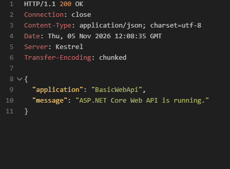
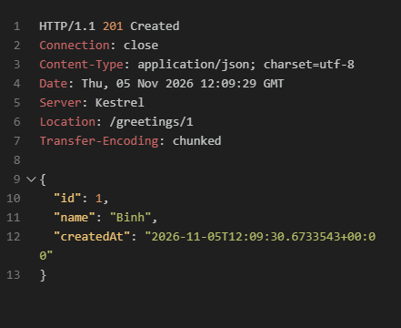
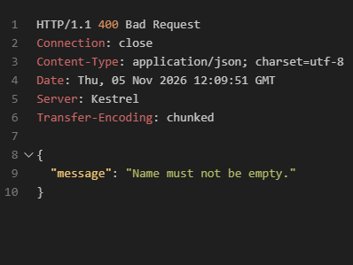
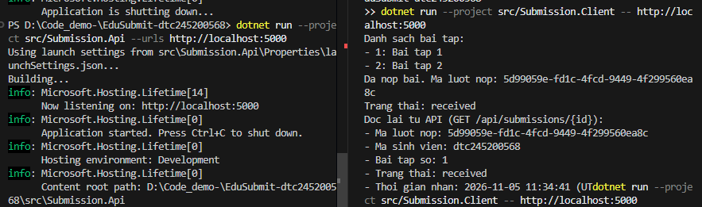
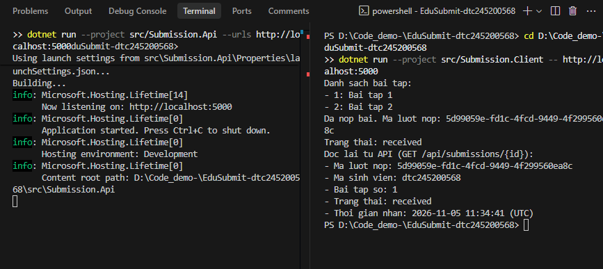

# Bài 1 – Tổng quan hệ thống và MEP

Họ tên: [Nguyễn Trọng Nhuận]                       MSSV: dtc245200568                              Lớp: [CNTT K23C]  

---

## 1. Cài đặt

---

## 2. MepDemo (Bước 7)

### Trả lời các câu hỏi:

1. **Ở MEP 3, mỗi bài nộp `sub-x` được mấy worker xử lý?**
   - **Trả lời:** Mỗi bài nộp chỉ do **duy nhất 1 worker** xử lý (Worker-A hoặc Worker-B).
   - **Bản chất:** Đây là mô hình *Competing Consumers* (các worker cạnh tranh nhau lấy việc từ hàng đợi). Khi một bài nộp được một worker lấy ra khỏi `Channel/Queue`, bài nộp đó không còn trong hàng đợi cho worker khác nữa. Các worker chia sẻ tải công việc để tăng thông lượng xử lý.

2. **Ở MEP 4, một sự kiện được gửi tới mấy dịch vụ?**
   - **Trả lời:** Một sự kiện được gửi tới **cả 3 dịch vụ** đã đăng ký (`ScoreService`, `NotificationService`, `StatsService`).
   - **Bản chất:** Đây là mô hình *Publish–Subscribe (1-to-N)*. Bên phát hành (Publisher) bắn sự kiện vào Event Bus mà không cần biết ai nhận; mọi Subscriber đã đăng ký lắng nghe loại sự kiện đó đều nhận được bản sao độc lập của sự kiện.

3. **Một câu mô tả cho mỗi MEP:**
   - **MEP 1 (Request–Response):** Bên gửi phát một yêu cầu và chặn/chờ bên nhận xử lý để nhận về phản hồi (hoặc hết thời gian timeout).
   - **MEP 2 (One-Way / Fire-and-Forget):** Bên gửi phát thông điệp đi và lập tức tiếp tục công việc khác mà không đợi bất kỳ kết quả phản hồi nghiệp vụ nào từ bên nhận.
   - **MEP 3 (Queue-Based):** Công việc được đẩy vào một hàng đợi trung gian và mỗi công việc chỉ được nhận và xử lý bởi duy nhất một worker trong nhóm worker cạnh tranh.
   - **MEP 4 (Publish–Subscribe):** Bên phát đưa sự kiện lên kênh/bus chung; tất cả các bên đăng ký quan tâm đến sự kiện đó đều nhận được một bản sao để xử lý riêng biệt.
   - **MEP 5 (Streaming / Push):** Sau khi kênh truyền được thiết lập, máy chủ chủ động đẩy liên tục luồng thông điệp cập nhật về máy khách theo thời gian thực mà khách không phải gửi yêu cầu mới cho mỗi lần cập nhật.

---

## 3. BasicWebApi (Bước 8)

### Trả lời 3 câu hỏi mục 8.4:

1. **Hai dòng `builder.Services.AddSingleton…` và `var app = builder.Build();` – dòng nào phải đứng trước? Vì sao?**
   - **Dòng đứng trước:** `builder.Services.AddSingleton<GreetingService>();` **phải đứng trước** `var app = builder.Build();`.
   - **Vì sao:** Trong ASP.NET Core, `builder.Services` là `IServiceCollection` dùng để đăng ký dịch vụ vào Dependency Injection (DI) Container. Lệnh `builder.Build()` sẽ đóng gói, hoàn thiện và "khóa" (freeze) container để tạo ra đối tượng ứng dụng `WebApplication`. Sau khi `Build()` đã chạy, container là bất biến (immutable), không thể đăng ký thêm dịch vụ mới được nữa.

2. **Trong `/hello/{name}?language=en`, tham số `name` lấy từ đâu, `language` lấy từ đâu?**
   - **`name`:** Được lấy từ **Route parameter** (đoạn đường dẫn URL) khớp với placeholder `{name}` trong route template `"/hello/{name}"`.
   - **`language`:** Được lấy từ **Query string** (chuỗi tham số nằm phía sau dấu `?` trên URL, cụ thể là `language=en`).

3. **Vì sao POST hợp lệ trả `Results.Created` (201) chứ không phải `Results.Ok` (200)?**
   - Theo chuẩn HTTP (RFC 9110 / RESTful): Mã `200 OK` chỉ là thành công chung, trong khi `201 Created` xác nhận rõ ràng rằng **một tài nguyên mới đã được tạo thành công** trên máy chủ.
   - `Results.Created` tự động sinh kèm header `Location: /greetings/{id}` trỏ trực tiếp đến URL của tài nguyên vừa tạo, giúp máy khách dễ dàng truy xuất tài nguyên mới tạo.

---

## 4. MiniDistributedSystem (Bước 9)

### Trả lời 3 câu hỏi:

1. **Client gọi những endpoint nào của API? Mỗi lần gọi là một cặp request–response gồm method, URL, mã trạng thái gì?**
   - **Lần gọi 1:**
     - *Method:* `GET`
     - *URL:* `http://localhost:5000/api/assignments`
     - *Status code:* `200 OK`
     - *Dữ liệu trả về:* Danh sách các bài tập dạng JSON.
   - **Lần gọi 2:**
     - *Method:* `POST`
     - *URL:* `http://localhost:5000/api/submissions`
     - *Request body:* JSON chứa `{ assignmentId, studentCode, repositoryUrl }`
     - *Status code:* `201 Created` (kèm header `Location`)
     - *Dữ liệu trả về:* Bản ghi lượt nộp bài `{ id, assignmentId, studentCode, status, receivedAt }`.

2. **Client có tham chiếu (dùng chung) code của API không? Hai bên "thống nhất" với nhau bằng gì?**
   - **Không.** Phía Client hoàn toàn độc lập, không tham chiếu bất kỳ project hay file code DLL nào của API.
   - **Hai bên thống nhất bằng:** **Hợp đồng dữ liệu (Data Contract)** và giao thức truyền tải chuẩn HTTP / JSON. Client tự định nghĩa lại các `record` độc lập có các trường trùng khớp với định dạng JSON của API.

3. **Vì sao địa chỉ API được truyền qua tham số `-- http://localhost:5000` mà không viết cứng trong code?**
   - Để đảm bảo tính linh hoạt (Loose Coupling) và dễ dàng cấu hình theo từng môi trường triển khai (Dev, Test, Staging, Production). Nếu viết cứng vào code, mỗi khi đổi IP, cổng (port) hoặc domain máy chủ sẽ phải sửa code và biên dịch lại chương trình.

---

## 5. Thí nghiệm lỗi (Bước 10)

| # | Thao tác | Dự đoán | Thực tế | Đúng/Sai | Giải thích |
|---|---|---|---|:---:|---|
| **a** | Thêm bài tập thứ 3 vào mảng `assignments` ở API. Chạy lại API và Client. | Client tự động hiển thị 3 bài tập mà không cần sửa code. | Client in ra đầy đủ 3 bài tập: `1: Bai tap 1`, `2: Bai tap 2`, `3: Bai tap 3`. | **Đúng** | Client nhận dữ liệu dạng mảng động `List<Assignment>` và lặp qua `foreach`, nên số lượng phần tử tăng lên không làm ảnh hưởng đến mã nguồn Client. |
| **b** | Tắt API (Ctrl+C), rồi chạy Client. | Client không kết nối được và báo lỗi kết nối mạng. | Ném ngoại lệ `HttpRequestException`: *No connection could be made because the target machine actively refused it*. | **Đúng** | Bản chất phân tán: Lời gọi hàm nội bộ (in-process) chạy trên cùng bộ nhớ nên luôn đến đích; lời gọi qua mạng phụ thuộc vào socket TCP, đường truyền và tiến trình máy chủ. Khi server tắt, kết nối socket bị từ chối. |
| **c** | Trong Client, sửa `StudentCode: ""` thành chuỗi rỗng. Chạy lại. | API trả mã 400 Bad Request; Client dừng do dòng `EnsureSuccessStatusCode`. | Báo lỗi `HttpRequestException: Response status code does not indicate success: 400 (Bad Request)` tại dòng 28. | **Đúng** | Nguyên tắc bảo mật *Never Trust Client Input*. Máy chủ luôn phải tự thẩm định dữ liệu đầu vào. `EnsureSuccessStatusCode()` chặn chương trình không cho đọc dữ liệu lỗi. |
| **d** | Chạy API ở cổng 5050, Client vẫn gọi 5000. Sửa cho chạy được mà không sửa code. | Dùng tham số dòng lệnh truyền cổng 5050 cho Client. | Chạy lệnh `dotnet run -- http://localhost:5050`, Client kết nối thành công tới API cổng 5050. | **Đúng** | Nhờ code Client đọc `args[0]`, ta có thể truyền địa chỉ URL mới ngay từ câu lệnh terminal mà không cần sửa mã nguồn. |

---

## 6. Dự án EduSubmit tự làm (Bước 11-12)

- **Phần nào phải xem code mẫu:** Tự xây dựng lại từ đầu theo đặc tả. Chỉ tham khảo lại cú pháp khai báo ngắn gọn của `record` trong C#.
- **Luồng thông điệp trong hệ thống:**
  1. `Client --(HTTP GET /api/assignments)--> Api`  
     *Kiểu MEP:* **Request–Response** (Client gửi yêu cầu lấy danh sách bài tập, API trả về mảng 2 bài tập, mã 200 OK).
  2. `Client --(HTTP POST /api/submissions)--> Api`  
     *Kiểu MEP:* **Request–Response** (Client gửi thông tin nộp bài JSON, API thẩm định, lưu vào danh sách bộ nhớ và trả về mã 201 Created cùng ID lượt nộp).
  3. `Client --(HTTP GET /api/submissions/{id})--> Api` *(Mở rộng Bước 12)*  
     *Kiểu MEP:* **Request–Response** (Client dùng ID vừa nhận được để gọi tra cứu lại lượt nộp bài từ máy chủ; API tìm kiếm và trả về thông tin chi tiết, mã 200 OK).

---

## 7. Khó khăn gặp phải và cách giải quyết

1. **Lỗi Connection Refused (`http://localhost:5000` từ chối kết nối):**
   - *Nguyên nhân:* Do gửi request từ Client hoặc REST Client khi máy chủ API chưa được bật hoặc terminal chạy server đã bị tắt.
   - *Cách giải quyết:* Luôn mở Terminal riêng khởi chạy máy chủ API trước (`dotnet run --project src/Submission.Api --urls http://localhost:5000`), chờ thông báo `Now listening...` rồi mới chạy Client hoặc gửi request.
2. **Hiểu về vòng đời Dependency Injection trong Minimal API:**
   - *Khó khăn:* Ban đầu dễ nhầm lẫn vị trí đăng ký dịch vụ `builder.Services` sau `builder.Build()`.
   - *Cách giải quyết:* Nắm vững quy tắc 2 pha của Minimal API: Pha 1 (Cấu hình và nạp DI Services vào Builder) -> Pha 2 (`builder.Build()` tạo App và định tuyến endpoints).
3. **Độc lập dữ liệu giữa 2 tiến trình:**
   - *Khó khăn:* Việc không dùng chung class giữa 2 project có thể dẫn đến sai lệch kiểu dữ liệu nếu không cẩn thận.
   - *Cách giải quyết:* Dùng `record` với tên trường và kiểu tương thích chính xác theo JSON Schema của API.

