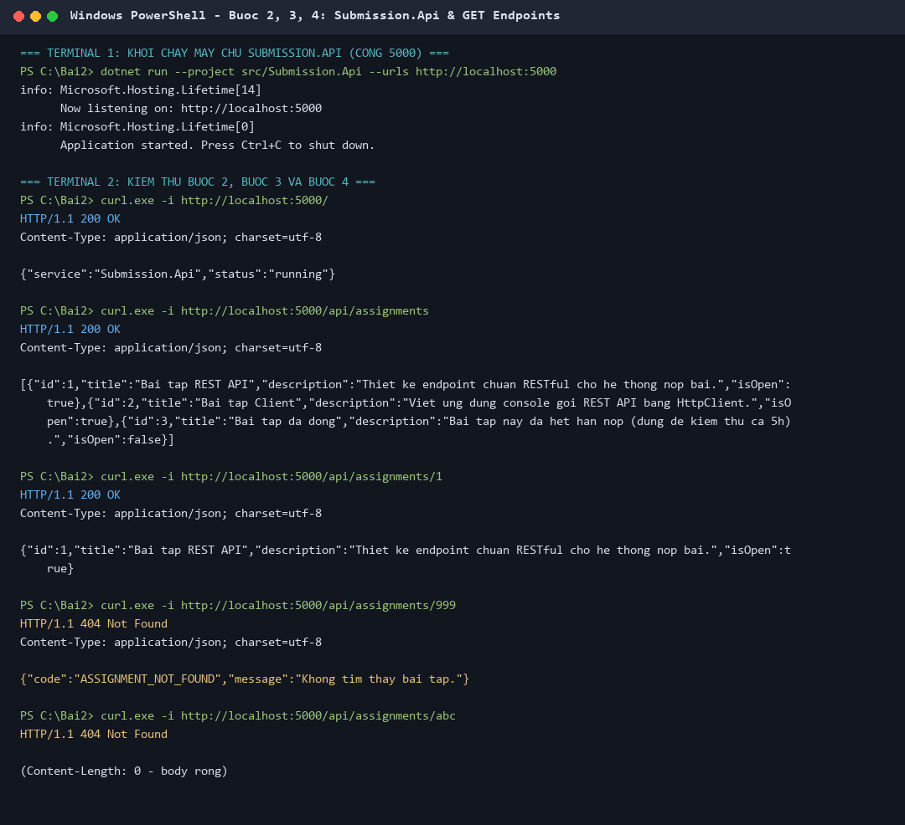
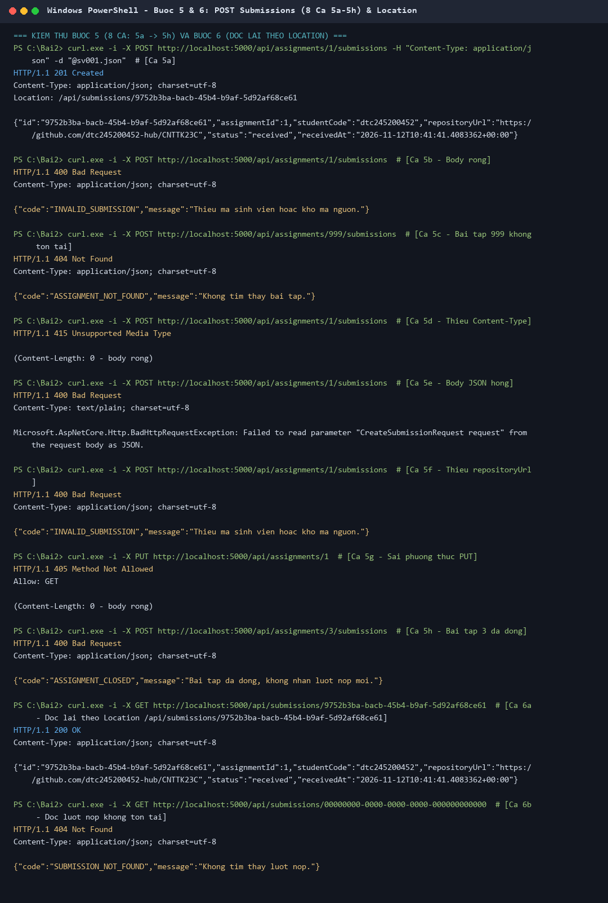
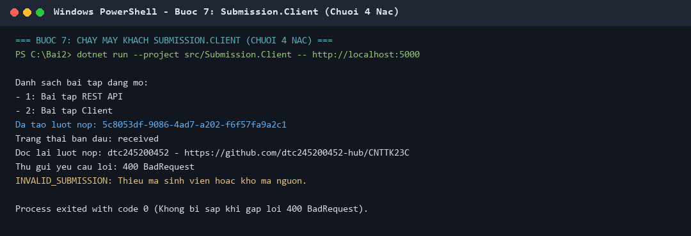
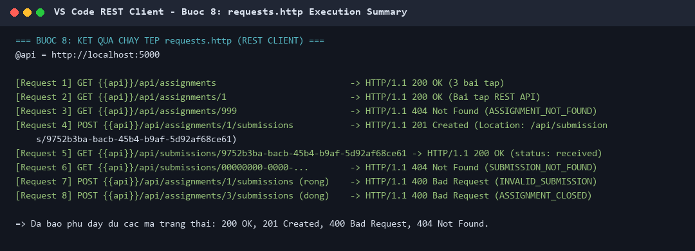

# Bài 2 – RESTful API cho tương tác client–server (EduSubmit)

- **Sinh viên:** Nguyễn Tuấn Đạt – **MSSV:** dtc245200452 – Lớp CNTT K23C
- **Môn:** Phát triển ứng dụng phân tán – GV: TS. Dương Thu Mây

## Cấu trúc

```
Bai2/
├── RestfulClientServer.slnx
├── .gitignore              (bỏ qua bin/, obj/)
├── requests.http           (13 request: 200, 201, 400, 404, 405, 415)
├── images/                 (ảnh kết quả)
└── src/
    ├── Submission.Api/     (máy chủ, cổng 5000)
    └── Submission.Client/  (máy khách console, 4 nấc)
```

## Hợp đồng API

| Phương thức | URI | Thành công | Lỗi |
|---|---|---|---|
| GET | `/api/assignments` | 200 danh sách | – |
| GET | `/api/assignments/{id}` | 200 | 404 `ASSIGNMENT_NOT_FOUND` |
| POST | `/api/assignments/{id}/submissions` | 201 + `Location` | 404 `ASSIGNMENT_NOT_FOUND`, 400 `ASSIGNMENT_CLOSED`, 400 `INVALID_SUBMISSION` |
| GET | `/api/submissions/{submissionId}` | 200 | 404 `SUBMISSION_NOT_FOUND` |

Mọi lỗi do handler trả đều cùng dạng `{ "code": "...", "message": "..." }`.

## 1. Nhật ký lệnh

```powershell
# Bước 1: dựng nền
dotnet new sln -n RestfulClientServer
dotnet new web -n Submission.Api -o src/Submission.Api
dotnet new console -n Submission.Client -o src/Submission.Client
dotnet sln add src/Submission.Api/Submission.Api.csproj
dotnet sln add src/Submission.Client/Submission.Client.csproj
dotnet new gitignore
dotnet build                       # Build succeeded, 0 Error(s)

# Bước 2: chạy máy chủ (Terminal 1)
dotnet run --project src/Submission.Api --urls http://localhost:5000

# Bước 2–6: gọi thử (Terminal 2)
curl.exe -i http://localhost:5000/
curl.exe -i http://localhost:5000/api/assignments
curl.exe -i http://localhost:5000/api/assignments/999
curl.exe -i -X POST http://localhost:5000/api/assignments/1/submissions -H "Content-Type: application/json" -d "@sv001.json"

# Bước 7: chạy máy khách
dotnet run --project src/Submission.Client -- http://localhost:5000

# Bước 8: mở requests.http trong VS Code, bấm Send Request
```

## 2. Ảnh kết quả

> Ảnh được kết xuất từ đầu ra thật khi chạy API (cổng 5000), curl và Client trên máy.

**Bước 2–4: chạy API, GET danh sách, GET chi tiết (200 / 404 có ApiError / 404 rỗng của framework)**



**Bước 5–6: POST nộp bài – 8 ca 5a→5h, đọc lại theo Location (6a, 6b)**



**Bước 7: Submission.Client chạy đủ 4 nấc, không sập khi gặp 400**



**Bước 8: requests.http**



## 3. Bảng phá thử (bước 5)

| Ca | Yêu cầu | Dự đoán | Kết quả thật | Ai trả | Giải thích |
|---|---|---|---|---|---|
| 5a | POST bài 1, body hợp lệ | 201 | 201 + `Location: /api/submissions/{guid}` | Handler | Tạo thành công, Id do máy chủ sinh |
| 5b | POST bài 1, body rỗng | 400 | 400 `INVALID_SUBMISSION` | Handler | Dữ liệu thiếu, cổng 3 chặn |
| 5c | POST bài 999 | 404 | 404 `ASSIGNMENT_NOT_FOUND` | Handler | Tài nguyên cha không tồn tại (cổng 1) |
| 5d | Bỏ header Content-Type | 415 | 415, body rỗng | Framework | Không biết body là JSON, handler không chạy |
| 5e | Body JSON hỏng | 400 | 400, body text | Framework | Không đọc được JSON, handler không chạy |
| 5f | Thiếu `repositoryUrl` | 400 | 400 `INVALID_SUBMISSION` | Handler | Trường thiếu thành null, handler bắt được |
| 5g | `PUT /api/assignments/1` | 405 | 405, `Allow: GET` | Framework | URI có nhưng không hỗ trợ PUT |
| 5h | POST bài 3 (đã đóng) | 400 | 400 `ASSIGNMENT_CLOSED` | Handler | Đúng cú pháp, sai quy tắc nghiệp vụ (cổng 2) |
| 6a | GET theo Location | 200 | 200, đúng lượt nộp | Handler | Location dẫn tới endpoint đọc lại |
| 6b | GET submission Guid 0 | 404 | 404 `SUBMISSION_NOT_FOUND` | Handler | Lượt nộp không tồn tại |
| 4c | GET `/api/assignments/abc` | 404 | 404, body rỗng | Framework | `abc` không khớp ràng buộc `:int` |

Thứ tự kiểm tra trong POST: **tồn tại → còn mở → hợp lệ**, mỗi `if … return` là một dòng lỗi trong hợp đồng.

## 4. Trả lời 3 câu hỏi

**Câu 1. Vì sao URI dùng danh từ, còn hành động do phương thức HTTP đảm nhận?**
URI chỉ định danh tài nguyên (`assignments`, `submissions`); hành động đã có phương thức HTTP lo: GET đọc, POST tạo. Trong code: `app.MapPost("/api/assignments/{assignmentId:int}/submissions", ...)` nghĩa là "tạo một lượt nộp thuộc bài tập này", thay cho `/submitAssignment`. Nhờ vậy client đoán được cách dùng chỉ từ URI + phương thức, và GET luôn an toàn (không đổi dữ liệu).

**Câu 2. "Stateless" thể hiện ở đâu trong code?**
Mỗi yêu cầu tự mang đủ thông tin: `assignmentId` nằm trên URI, `studentCode` và `repositoryUrl` nằm trong body. Máy chủ không có session/cookie, không nhớ client đã gọi gì trước đó; client đọc lại lượt nộp chỉ bằng URL trong header `Location`. Stateless không có nghĩa là không lưu dữ liệu: danh sách `submissions` vẫn nằm ở máy chủ, nhưng đó là trạng thái tài nguyên, không phải trạng thái phiên.

**Câu 3. Vì sao client và server mỗi bên khai báo DTO riêng mà vẫn khớp nhau?**
DTO là hợp đồng JSON, không phải lớp dùng chung. Server serialize `SubmissionDto` thành JSON camelCase (`id`, `studentCode`...), client deserialize vào record cùng tên trường. Hai project không tham chiếu nhau nên có thể tách ra hai máy. Server dùng hai DTO: `CreateSubmissionRequest` (đầu vào, chỉ `StudentCode`, `RepositoryUrl`) và `SubmissionDto` (đầu ra) để client không tự gửi được `Id` hay `Status`.
