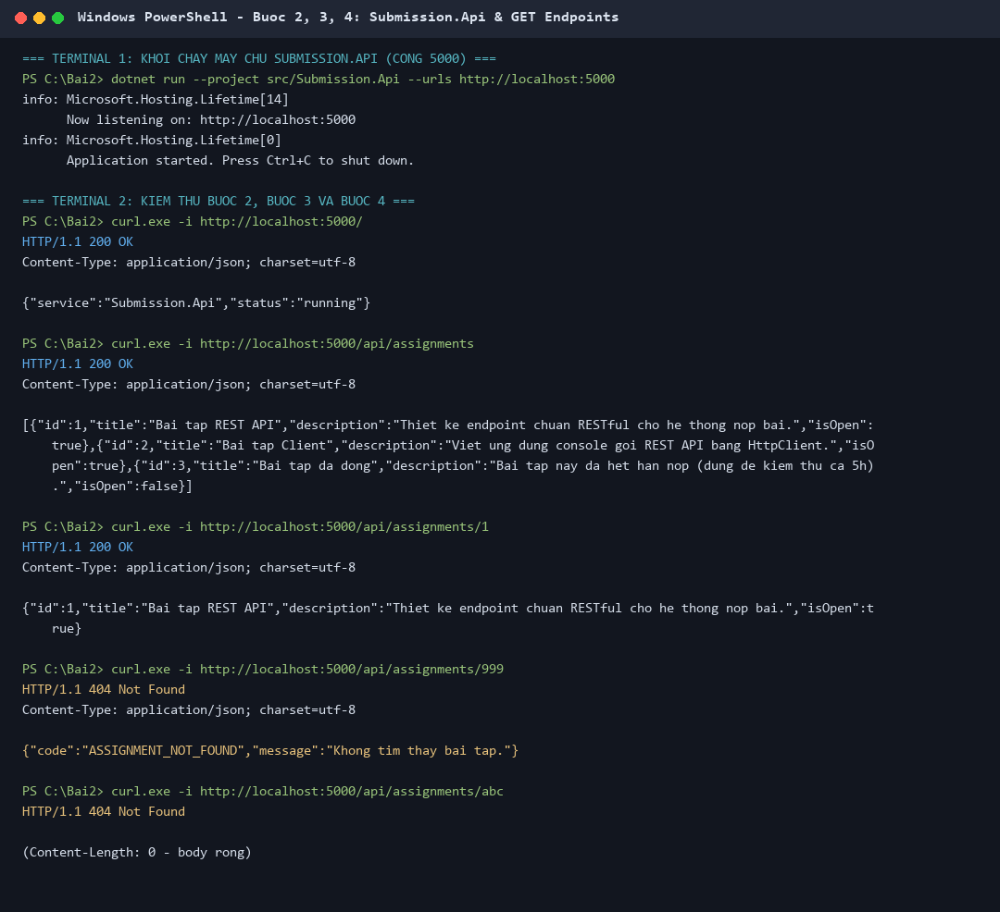
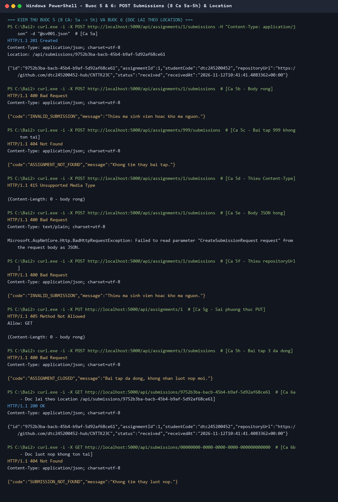
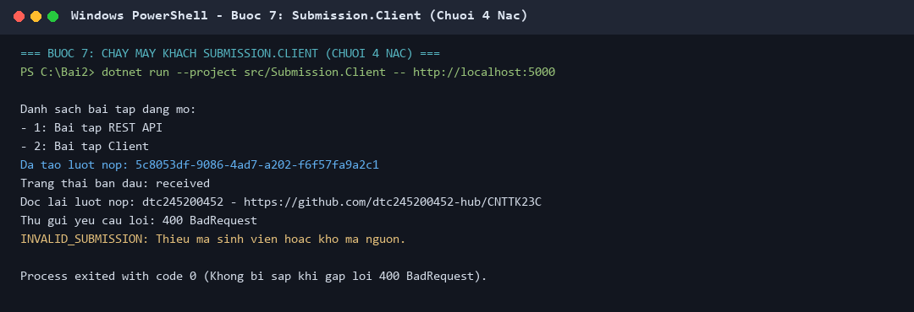
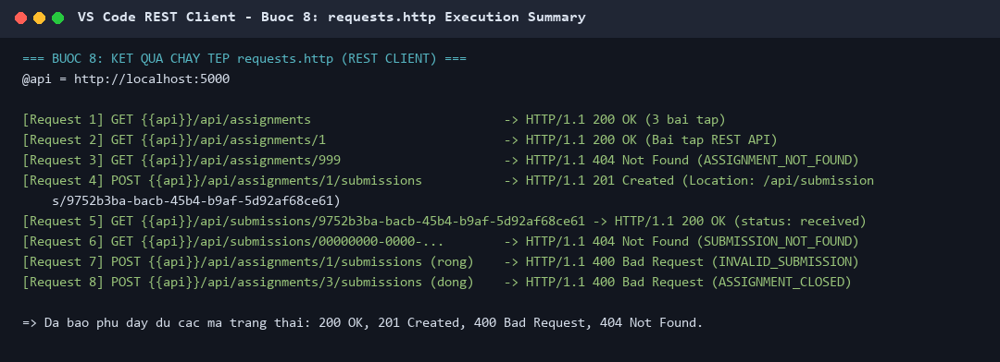

# Bài 2 – RESTful API cho tương tác client–server (EduSubmit)

- **Sinh viên:** Nguyễn Tuấn Đạt – **MSSV:** `dtc245200452` – **Lớp:** CNTT K23C
- **Môn học:** Phát triển ứng dụng phân tán – **Giảng viên:** TS. Dương Thu Mây

## Cấu trúc thư mục

```text
Bai2/
├── RestfulClientServer.slnx
├── .gitignore              # Bỏ qua bin/, obj/
├── requests.http           # 15 request: 200, 201, 204, 400, 404, 405, 415
├── images/                 # Ảnh kết quả chạy API, Client, requests.http
└── src/
    ├── Submission.Api/     # Máy chủ Minimal API (cổng 5000, 4 endpoint chính + DELETE mở rộng)
    └── Submission.Client/  # Máy khách console (HttpClient chạy đủ 4 nấc)
```

## Hợp đồng API

| Phương thức | URI | Thành công | Lỗi |
|---|---|---|---|
| `GET` | `/` | `200 OK` `{service, status}` | – |
| `GET` | `/api/assignments` | `200 OK` danh sách bài tập | – |
| `GET` | `/api/assignments/{assignmentId:int}` | `200 OK` chi tiết bài tập | `404` `ASSIGNMENT_NOT_FOUND` (hoặc `404` rỗng nếu `id` không phải số) |
| `POST` | `/api/assignments/{assignmentId:int}/submissions` | `201 Created` + header `Location` | `404` `ASSIGNMENT_NOT_FOUND`, `400` `ASSIGNMENT_CLOSED`, `400` `INVALID_SUBMISSION` |
| `GET` | `/api/submissions/{submissionId:guid}` | `200 OK` thông tin lượt nộp | `404` `SUBMISSION_NOT_FOUND` |
| `DELETE` | `/api/submissions/{submissionId:guid}` *(Bước 9 mở rộng)* | `204 No Content` | `404` `SUBMISSION_NOT_FOUND` |

Mọi lỗi do handler trả đều dùng chung cấu trúc `ApiError`: `{ "code": "...", "message": "..." }`.

---

## 1. Lệnh đã chạy (Nhật ký thực hành)

```powershell
# Bước 1: Khởi tạo solution, 2 project và .gitignore
dotnet new sln -n RestfulClientServer
dotnet new web -n Submission.Api -o src/Submission.Api
dotnet new console -n Submission.Client -o src/Submission.Client
dotnet sln add src/Submission.Api/Submission.Api.csproj
dotnet sln add src/Submission.Client/Submission.Client.csproj
dotnet new gitignore
dotnet build
# -> Build succeeded. 0 Warning(s), 0 Error(s)

# Bước 2: Chạy máy chủ tại cổng 5000 (Terminal 1)
dotnet run --project src/Submission.Api --urls http://localhost:5000

# Bước 2–6: Gọi thử các endpoint bằng curl.exe (Terminal 2)
curl.exe -i http://localhost:5000/
curl.exe -i http://localhost:5000/api/assignments
curl.exe -i http://localhost:5000/api/assignments/1
curl.exe -i http://localhost:5000/api/assignments/999
curl.exe -i http://localhost:5000/api/assignments/abc
curl.exe -i -X POST http://localhost:5000/api/assignments/1/submissions -H "Content-Type: application/json" -d "@sv001.json"

# Bước 7: Chạy máy khách console đủ 4 nấc (Terminal 2)
dotnet run --project src/Submission.Client -- http://localhost:5000

# Bước 8: Mở tệp requests.http trong VS Code (REST Client), bấm Send Request từng ca
```

Kết quả thực tế khi chạy `Submission.Client` đủ 4 nấc (đối chiếu ảnh bước 7):

```text
Danh sach bai tap dang mo:
- 1: Bai tap REST API
- 2: Bai tap Client
Da tao luot nop: b3450347-bf3f-44c9-9187-a868c18f5de7
Trang thai ban dau: received
Doc lai luot nop: dtc245200452 - https://github.com/dtc245200452-hub/CNTTK23C
Thu gui yeu cau loi: 400 BadRequest
INVALID_SUBMISSION: Thieu ma sinh vien hoac kho ma nguon.
```

---

## 2. Ảnh kết quả (thư mục `images/`)

> Ảnh được kết xuất trực tiếp từ đầu ra thật khi chạy `Submission.Api` (cổng 5000), `curl.exe`, `Submission.Client` và `requests.http`.

**Bước 2–4: Khởi chạy API cổng 5000, GET danh sách và GET chi tiết (200 / 404 có `ApiError` / 404 rỗng)**



**Bước 5–6: POST nộp bài (8 ca 5a → 5h) và đọc lại theo header `Location` (6a, 6b)**



**Bước 7: `Submission.Client` chạy đủ 4 nấc (liệt kê → nộp → đọc lại → thử lỗi 400 không sập)**



**Bước 8: Thực thi kiểm thử từ tệp `requests.http`**



---

## 3. Bảng phá thử

| Ca thử | Yêu cầu | Mong đợi | Thực tế | Ai trả | Giải thích |
|---|---|---|---|---|---|
| `4a` | `GET /api/assignments/1` | `200 OK` + bài tập 1 | `200 OK`, trả JSON `{"id":1,"title":"Bai tap REST API",...}` | Handler | Tìm thấy phần tử `Id == 1` trong `assignments` |
| `4b` | `GET /api/assignments/999` | `404 Not Found` + `ASSIGNMENT_NOT_FOUND` | `404 Not Found`, `{"code":"ASSIGNMENT_NOT_FOUND","message":"Khong tim thay bai tap."}` | Handler | Route khớp `:int`, handler chạy nhưng không tìm thấy bài tập |
| `4c` | `GET /api/assignments/abc` | `404 Not Found` (body rỗng) | `404 Not Found`, body rỗng | Framework | `abc` không khớp ràng buộc tuyến `{assignmentId:int}` nên handler không chạy |
| `5a` | `POST /api/assignments/1/submissions` với `studentCode` & `repositoryUrl` hợp lệ | `201 Created` + `Location` | `201 Created`, header `Location: /api/submissions/{id}`, `status: "received"` | Handler | Qua đủ 3 cổng kiểm tra; máy chủ tự sinh `Id` (`Guid`), `Status`, `ReceivedAt` |
| `5b` | `POST /api/assignments/1/submissions` với body rỗng (`""`, `""`) | `400 Bad Request` + `INVALID_SUBMISSION` | `400 Bad Request`, `{"code":"INVALID_SUBMISSION",...}` | Handler | Cổng 3 chặn dữ liệu rỗng (`string.IsNullOrWhiteSpace`) |
| `5c` | `POST /api/assignments/999/submissions` | `404 Not Found` + `ASSIGNMENT_NOT_FOUND` | `404 Not Found`, `{"code":"ASSIGNMENT_NOT_FOUND",...}` | Handler | Cổng 1 chặn vì tài nguyên cha (bài tập 999) không tồn tại |
| `5d` | `POST /api/assignments/1/submissions` bỏ header `Content-Type` | `415 Unsupported Media Type` | `415 Unsupported Media Type`, body rỗng | Framework | Thiếu `Content-Type: application/json`, ASP.NET không parse được body |
| `5e` | `POST /api/assignments/1/submissions` với JSON hỏng (`{"studentCode":"dtc245200452",`) | `400 Bad Request` | `400 Bad Request`, framework báo `BadHttpRequestException` | Framework | JSON sai cú pháp bị chặn trước khi vào handler |
| `5f` | `POST /api/assignments/1/submissions` thiếu trường `repositoryUrl` | `400 Bad Request` + `INVALID_SUBMISSION` | `400 Bad Request`, `{"code":"INVALID_SUBMISSION",...}` | Handler | Trường thiếu thành `null`, cổng 3 bắt được và trả `ApiError` |
| `5g` | `PUT /api/assignments/1` | `405 Method Not Allowed` | `405 Method Not Allowed`, `Allow: GET` | Framework | URI tồn tại nhưng API chỉ khai báo `MapGet`, không hỗ trợ `PUT` |
| `5h` | `POST /api/assignments/3/submissions` (bài 3 có `IsOpen = false`) | `400 Bad Request` + `ASSIGNMENT_CLOSED` | `400 Bad Request`, `{"code":"ASSIGNMENT_CLOSED",...}` | Handler | Cổng 2 từ chối vì bài tập đã đóng dù dữ liệu gửi lên đúng cú pháp |
| `6a` | `GET /api/submissions/{id}` theo header `Location` từ ca `5a` | `200 OK` + lượt nộp vừa tạo | `200 OK`, trả đúng bản ghi `SubmissionDto` vừa nộp | Handler | URI trong `Location` trỏ đúng vào endpoint đọc chi tiết |
| `6b` | `GET /api/submissions/00000000-0000-0000-0000-000000000000` | `404 Not Found` + `SUBMISSION_NOT_FOUND` | `404 Not Found`, `{"code":"SUBMISSION_NOT_FOUND",...}` | Handler | GUID không có trong danh sách `submissions` |
| `6c` | Tắt `Submission.Api`, khởi động lại rồi `GET` lại `{id}` cũ | `404 Not Found` + `SUBMISSION_NOT_FOUND` | `404 Not Found`, `{"code":"SUBMISSION_NOT_FOUND",...}` | Handler | Dữ liệu lưu trong `List<SubmissionDto>` trên RAM nên mất khi tiến trình API dừng |
| `7a` | Tắt `Submission.Api`, chạy `Submission.Client` | Client báo lỗi kết nối mạng | Ném `HttpRequestException: No connection could be made because the target machine actively refused it. (localhost:5000)` | Hệ điều hành / Mạng | Lỗi mạng (bên kia vắng mặt) khác lỗi HTTP `4xx` có phản hồi từ server |
| `9d` | `DELETE /api/submissions/{id}` (mở rộng Bước 9) | `204 No Content` | `204 No Content` (body rỗng), gọi lại lần 2 trả `404 SUBMISSION_NOT_FOUND` | Handler | Xóa khỏi `submissions` thành công; `DELETE` có tính lũy đẳng về trạng thái tài nguyên |

Thứ tự 3 cổng kiểm tra trong `POST /api/assignments/{assignmentId:int}/submissions`: **tồn tại (404) → còn mở (400) → hợp lệ (400)**; mỗi `if … return` trong code tương ứng một dòng lỗi trong bảng hợp đồng.

---

## 4. Trả lời 3 câu hỏi

### Câu 1: Vì sao URI dùng danh từ, còn hành động do phương thức HTTP đảm nhận?

- **Ý chính:** Trong kiến trúc REST, **URI đại diện cho tài nguyên nghiệp vụ** (danh từ chỉ *thứ* cần thao tác như bài tập, lượt nộp), còn **phương thức HTTP (`GET`, `POST`, `PUT`, `DELETE`) thể hiện hành động** tác động lên tài nguyên đó. Cách tách này tận dụng được ngữ nghĩa chuẩn của HTTP về tính an toàn (*safe* — `GET` chỉ đọc, không làm thay đổi dữ liệu) và tính lũy đẳng (*idempotent* — `GET`, `DELETE` lặp lại cho kết quả trạng thái như một lần), giúp bất kỳ client nào nhìn URI + phương thức là đoán ngay được cách gọi.
- **Ví dụ trong code (`src/Submission.Api/Program.cs`):** API khai báo `app.MapGet("/api/assignments", ...)` để đọc danh sách, `app.MapPost("/api/assignments/{assignmentId:int}/submissions", ...)` để tạo một lượt nộp con thuộc bài tập đó, và `app.MapGet("/api/submissions/{submissionId:guid}", ...)` để đọc lại lượt nộp — thay vì đặt động từ trong URI kiểu `/getAssignments` hay `/submitAssignment`.

### Câu 2: "Stateless" thể hiện ở đâu trong code đã viết?

- **Ý chính:** *Stateless* có nghĩa là **máy chủ không lưu trạng thái phiên (session) của từng client giữa các request**; mỗi yêu cầu gửi lên phải tự mang đầy đủ thông tin để máy chủ hiểu và xử lý độc lập. Cần phân biệt: *stateless* không có nghĩa là server "không lưu dữ liệu" — danh sách bài tập và lượt nộp vẫn lưu ở server (`assignments`, `submissions`), chỉ là server không nhớ cuộc hội thoại trước đó của client.
- **Ví dụ trong code:**
  - Trong `src/Submission.Api/Program.cs`, server không cấu hình `HttpContext.Session`, không dùng cookie hay biến toàn cục kiểu "bài tập client đang chọn". Ở `POST /api/assignments/{assignmentId:int}/submissions`, `assignmentId` nằm trực tiếp trên URI còn `studentCode`, `repositoryUrl` nằm trong body `CreateSubmissionRequest`; ở `GET /api/submissions/{submissionId:guid}`, mã `submissionId` đi qua URI nên bất kỳ instance API nào (hoặc `requests.http` / `curl.exe`) gọi đúng URL đó đều nhận cùng kết quả.
  - Trong `src/Submission.Client/Program.cs`, client tự lấy `locationUri` từ `createResponse.Headers.Location` để thực hiện một request `GET` độc lập hoàn toàn ở Nấc 3.

### Câu 3: Vì sao client và server mỗi bên khai báo DTO riêng mà vẫn khớp nhau?

- **Ý chính:** DTO (*Data Transfer Object*) chỉ là **khuôn hợp đồng dữ liệu JSON ở biên hệ thống**, không phải class thư viện dùng chung trong bộ nhớ. Client và server là hai tiến trình độc lập giao tiếp qua chuỗi byte JSON theo HTTP; chỉ cần tên thuộc tính và kiểu dữ liệu khớp với cấu trúc JSON quy ước (camelCase) thì `System.Text.Json` ở hai đầu tự serialize và deserialize chính xác mà hai project không cần tham chiếu mã nguồn của nhau.
- **Ví dụ trong code:**
  - `Submission.Client.csproj` không có `<ProjectReference>` tới `Submission.Api.csproj`. Cả `Submission.Api/Program.cs` và `Submission.Client/Program.cs` đều tự khai báo bộ record `AssignmentDto`, `CreateSubmissionRequest`, `SubmissionDto`, `ApiError` khớp từng tên trường JSON (`Id` ↔ `id`, `AssignmentId` ↔ `assignmentId`, `StudentCode` ↔ `studentCode`, `IsOpen` ↔ `isOpen`, `Code` ↔ `code`, `Message` ↔ `message`).
  - Đồng thời phía API tách riêng DTO đầu vào `CreateSubmissionRequest(StudentCode, RepositoryUrl)` với DTO đầu ra `SubmissionDto(Id, AssignmentId, StudentCode, RepositoryUrl, Status, ReceivedAt)` để client không thể tự điền hay giả mạo `Id` hoặc `Status`.
