# Bài 3 – Giao tiếp thời gian thực với SignalR (PingSignalR & EduSubmit Realtime)

- **Sinh viên:** Nguyễn Tuấn Đạt – **MSSV:** `dtc245200452` – **Lớp:** CNTT K23C
- **Môn học:** Phát triển ứng dụng phân tán – **Giảng viên:** TS. Dương Thu Mây

## Cấu trúc thư mục

```text
Bai3/
├── README.md
├── anh/                               # Ảnh chụp thực tế từng bước (12 ảnh)
├── PingSignalR/
│   ├── PingSignalR.slnx
│   ├── .gitignore                     # Bỏ qua bin/, obj/
│   └── src/
│       ├── Ping.Api/                  # Máy chủ SignalR (cổng 5200, /hubs/ping)
│       └── Ping.Client/               # Máy khách console SignalR
└── RealtimeSubmissionSystem/
    ├── RealtimeSubmissionSystem.slnx
    ├── .gitignore                     # Bỏ qua bin/, obj/
    ├── requests.http                  # 11 ca kiểm thử (9 ca chuẩn + 2 ca failed)
    └── src/
        ├── Submission.RealtimeApi/    # REST + SignalR (cổng 5000, /hubs/submissions, graded/failed)
        └── Submission.RealtimeClient/ # Máy khách theo dõi 2 lượt nộp (graded & failed) tự thoát sạch
```

---

## Phần 1. Nhật ký thực hành `PingSignalR` (cổng `5200`, `/hubs/ping`)

### Bước 1: Tạo solution, hai project và build

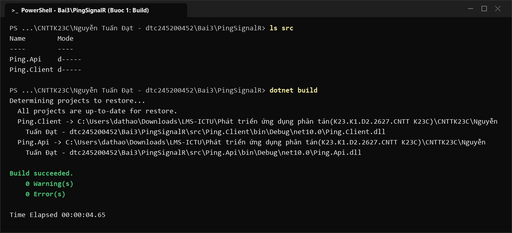

- **Thấy:** `dotnet build` thành công với `0 Warning(s), 0 Error(s)` cho cả `Ping.Api` và `Ping.Client`.
- **Giải thích:** `Ping.Api` dùng sẵn SignalR tích hợp trong ASP.NET Core; `Ping.Client` cài thêm gói `Microsoft.AspNetCore.SignalR.Client` và có `.gitignore` để không đưa `bin/`, `obj/` vào Git.

### Bước 2: Chạy `Ping.Api` cổng `5200` và kiểm tra bắt tay `negotiate`

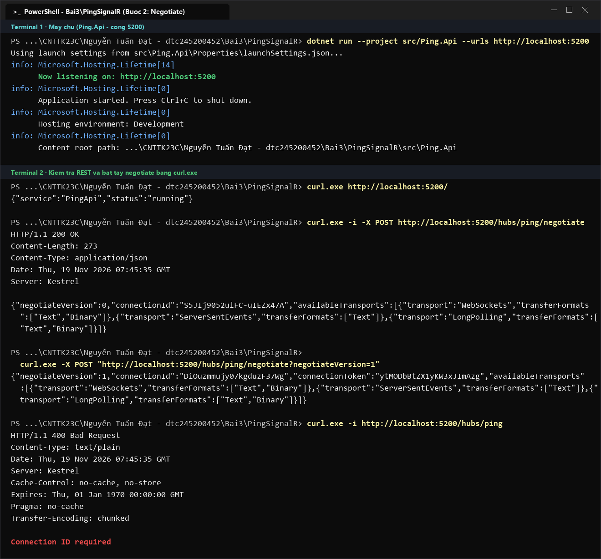

- **Thấy:** `GET /` trả `200 OK`; `POST /hubs/ping/negotiate` trả `200 OK` kèm `connectionId` và 3 phương thức truyền tải (`WebSockets`, `ServerSentEvents`, `LongPolling`); `GET /hubs/ping` trả `400 Connection ID required`.
- **Giải thích:** Trước khi mở WebSocket, máy khách SignalR luôn gửi `POST .../negotiate` để nhận `connectionId` và danh sách cơ chế truyền tải (có dự phòng nếu môi trường chặn WebSocket).

### Bước 3–4: `PingHub.Echo` (`Clients.Caller`) và `Ping.Client`

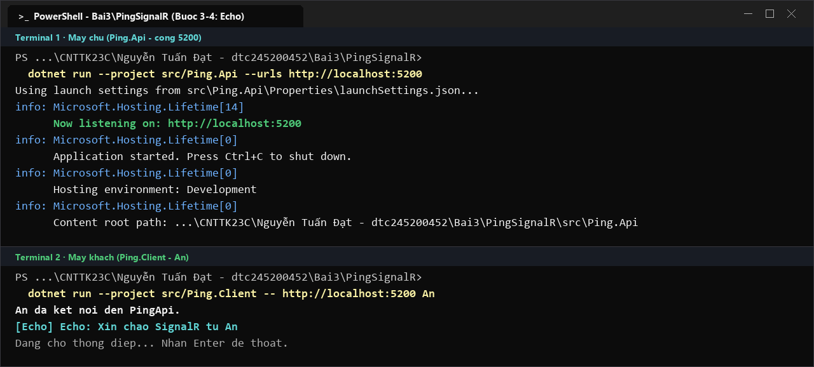

- **Thấy:** `Ping.Api` lắng nghe tại `http://localhost:5200`; `Ping.Client` kết nối thành công, in `[Echo] Echo: Xin chao SignalR tu An` và thoát gọn khi nhấn Enter.
- **Giải thích:** Máy khách đăng ký `On<string>("EchoResponse", ...)` trước `StartAsync()`, sau đó gọi `InvokeAsync("Echo", ...)` để hub trả lời riêng người gọi qua `Clients.Caller`.

### Bước 5: Chạy 2 máy khách (`An`, `Binh`) — `Caller`, `Group`, `All`

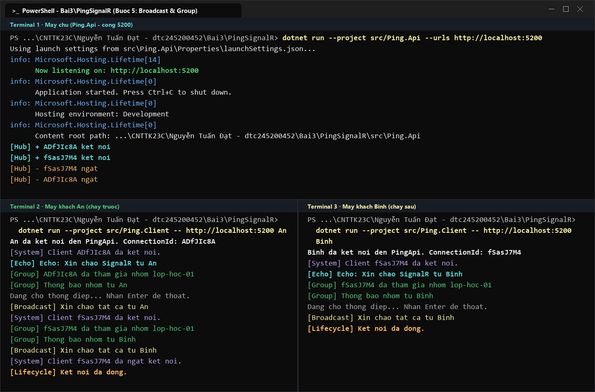

- **Thấy:** Khi `Binh` kết nối sau `An`, `An` nhận được `[System]`, `[Group]` (vào nhóm và tin nhóm `lop-hoc-01`), `[Broadcast]` của `Binh` nhưng **không** nhận tin `[Echo]` của `Binh`.
- **Giải thích:** `Clients.Caller` chỉ gửi về đúng người gọi, `Clients.Group("lop-hoc-01")` gửi tới thành viên trong nhóm, còn `Clients.All` phát tới mọi kết nối đang mở.

### Bước 6: Vòng đời kết nối và `WithAutomaticReconnect()`

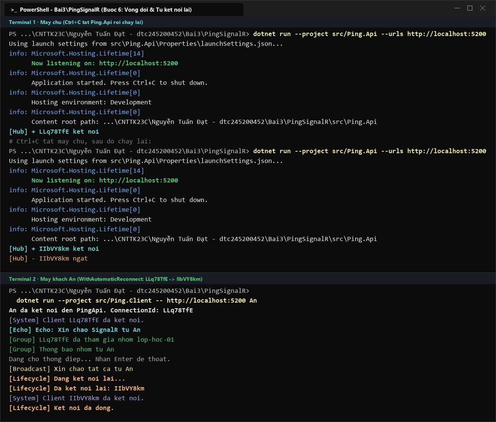

- **Thấy:** Khi tắt và bật lại `Ping.Api`, máy khách in `[Lifecycle] Dang ket noi lai...` rồi `[Lifecycle] Da ket noi lai: IIbVY8km` với `ConnectionId` mới khác ban đầu (`LLq78TfE` → `IIbVY8km`).
- **Giải thích:** `WithAutomaticReconnect()` tự thử lại theo lịch mặc định 0s → 2s → 10s → 30s. Vì kết nối lại nhận `ConnectionId` mới, tư cách thành viên nhóm cũ bị mất (muốn ở lại nhóm phải gọi `JoinGroup` trong sự kiện `Reconnected`) và tin gửi lúc đứt kết nối sẽ mất.

### Bước 7: Ba thí nghiệm lỗi cố ý (Slide 40)

#### Lỗi 1 – Chạy máy khách khi `Ping.Api` chưa chạy

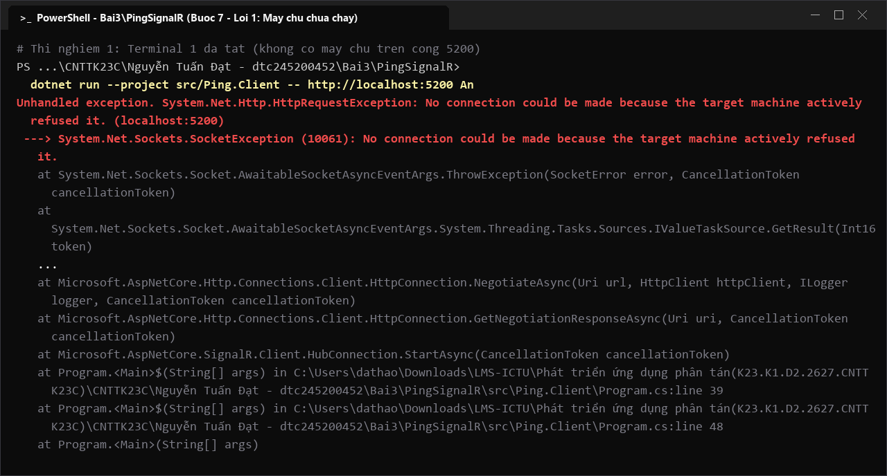

- **Làm gì:** Tắt `Ping.Api` ở cổng `5200`, chạy `Ping.Client`.
- **Thấy:** Ném `HttpRequestException: No connection could be made because the target machine actively refused it. (localhost:5200)` ngay tại `StartAsync()`.
- **Giải thích:** `WithAutomaticReconnect()` chỉ cứu kết nối **đã mở thành công trước đó**, không tự thử lại cho lần `StartAsync()` đầu tiên.

#### Lỗi 2 – Sai đường dẫn hub (`/hub/ping` thiếu `s`)

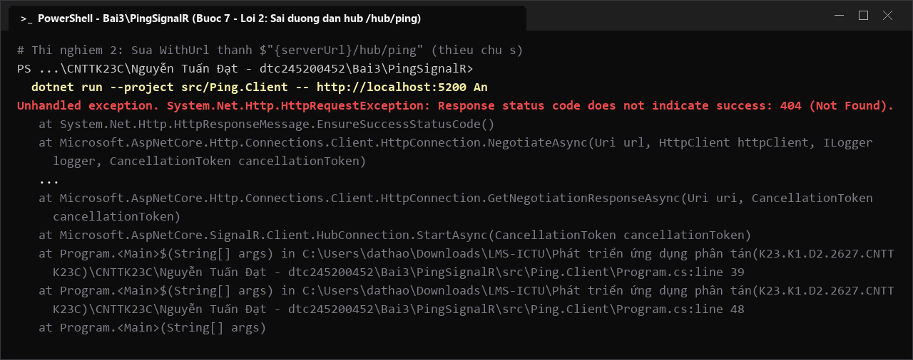

- **Làm gì:** Đổi `WithUrl` trong `Ping.Client` thành `http://localhost:5200/hub/ping`.
- **Thấy:** Ném `HttpRequestException: Response status code does not indicate success: 404 (Not Found)` tại `HttpConnection.NegotiateAsync`.
- **Giải thích:** Lỗi xảy ra ngay ở bước HTTP `negotiate` vì đường dẫn không khớp với `app.MapHub<PingHub>("/hubs/ping")`.

#### Lỗi 3 – Sai tên thông điệp chiều xuống (`EchoRespone` thiếu chữ `s`)

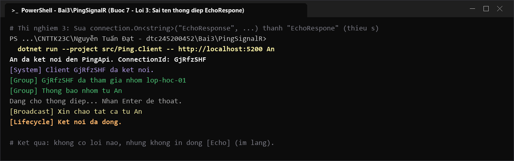

- **Làm gì:** Đổi `connection.On<string>("EchoResponse", ...)` thành `On<string>("EchoRespone", ...)`.
- **Thấy:** Chương trình chạy bình thường, không ném lỗi nào, vẫn in `[System]`, `[Group]`, `[Broadcast]` nhưng **không có dòng `[Echo]`**.
- **Giải thích:** Hợp đồng SignalR dựa trên chuỗi tên; sai tên chiều máy chủ gửi xuống (`SendAsync` ↔ `On`) thì máy khách bỏ qua trong im lặng.

---

## Phần 2. EduSubmit Realtime (`RealtimeSubmissionSystem`, cổng `5000`)

Hệ thống giữ nguyên hợp đồng REST từ Bài 2 (`GET /api/assignments`, `GET /api/assignments/{id}`, `POST /api/assignments/{id}/submissions` trả `201 + Location`, `GET /api/submissions/{id}`, chuẩn lỗi `ApiError`), bổ sung trường `UpdatedAt`, khóa đồng bộ `lock (submissionsLock)`, hub `/hubs/submissions` với phương thức `WatchSubmission(submissionId)` đưa client vào nhóm `submission:{id}`, và tác vụ nền dùng `IHubContext<SubmissionHub>` cập nhật bộ nhớ **trước khi** đẩy `processing` (~1s) → `graded` (~3s).

### Kết quả chạy máy khách `Submission.RealtimeClient` (đủ 8 dòng)

```text
Da ket noi SignalR.
Chon bai tap: 1 - Bai tap SignalR
Da tao luot nop: a81b4580-f610-4947-98df-bdc591bd06d7
Trang thai REST ban dau: received
Dang cho thong bao trang thai tu may chu...
Thong bao SignalR: a81b4580-f610-4947-98df-bdc591bd06d7 -> processing luc 07:48:33
Thong bao SignalR: a81b4580-f610-4947-98df-bdc591bd06d7 -> graded luc 07:48:35
Trang thai doc lai bang REST: graded
```

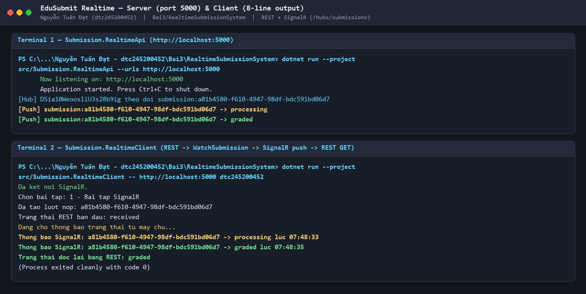

- **Thấy:** Đủ 8 dòng theo đúng trình tự *nghe → nối → tạo (REST) → theo dõi (SignalR) → nhận `processing`, `graded` cách nhau ~2 giây → đọc lại chốt trạng thái bằng REST (`graded`)* và tiến trình tự thoát với mã `0`.

### Kiểm thử 9 ca trong `requests.http`

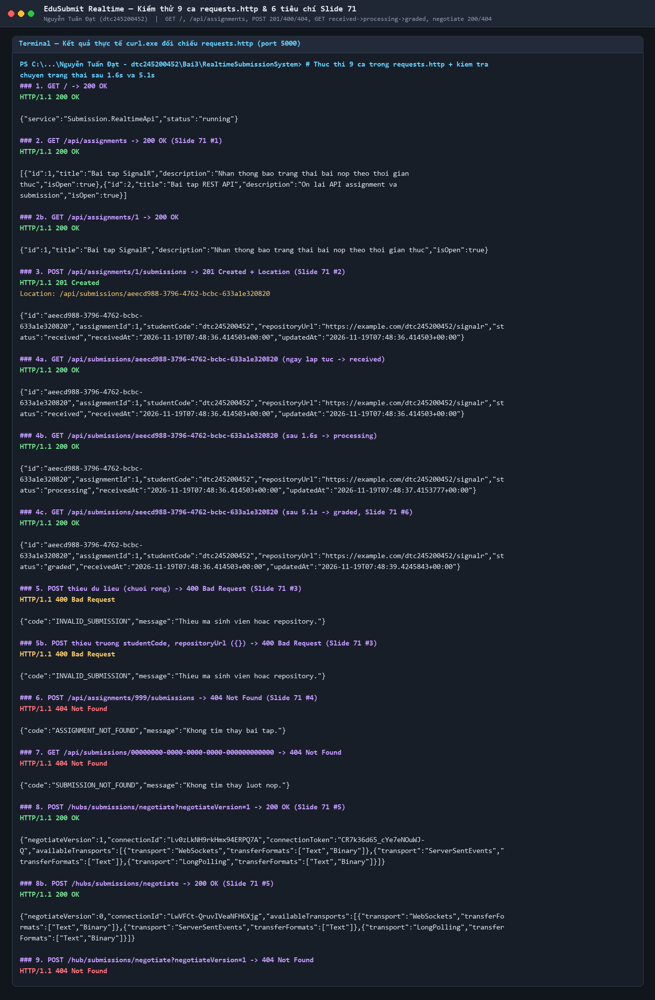

- **Thấy:** Đủ 9 ca theo Slide 61: `GET /` (`200`), `GET /api/assignments` (`200`), `POST /api/assignments/1/submissions` (`201` + `Location`, `received`), `GET` theo `id` vừa tạo (`200`, chuyển `received` → `processing` → `graded`), `POST` thiếu dữ liệu (`400 INVALID_SUBMISSION`), `POST` bài `999` (`404 ASSIGNMENT_NOT_FOUND`), `GET` GUID rỗng (`404 SUBMISSION_NOT_FOUND`), `POST /hubs/submissions/negotiate?negotiateVersion=1` (`200` + `connectionId`), `POST /hub/submissions/negotiate?negotiateVersion=1` (`404`).

---

## Phần 3. Bảng 5 thí nghiệm phân tán (Bước 7 – Slide 58–59)

| # | Thí nghiệm | Dự đoán trước khi chạy | Kết quả thật | Giải thích / Bài học |
|---|---|---|---|---|
| 1 | Chạy 2 máy khách `SV001` và `SV002` cùng lúc | Mỗi máy khách chỉ nhận thông báo `processing` và `graded` của đúng lượt nộp mình tạo, không bị lẫn nhau. | `SV001` (`c71a54a4-...`) và `SV002` (`d49873f6-...`) nộp cùng giây (`07:48:43`/`07:48:45`), mỗi bên chỉ in đúng GUID của mình và chốt REST `graded`. | Nhóm `submission:{id}` cô lập người nhận, vừa bảo đảm riêng tư vừa tránh phát thừa tới client khác. |
| 2 | Chạy máy khách khi `Submission.RealtimeApi` chưa chạy | `StartAsync()` báo lỗi không kết nối được tới `localhost:5000` và dừng ngay. | Ném `HttpRequestException: No connection could be made because the target machine actively refused it. (localhost:5000)` (`SocketException 10061`). | `WithAutomaticReconnect()` không thử lại cho lần kết nối đầu tiên; lỗi mạng ở `StartAsync()` phải được ứng dụng tự xử lý. |
| 3 | Sửa `WithUrl` thành `/hub/submissions` (thiếu `s`) | Lỗi `404 Not Found` khi bắt tay mở kết nối SignalR. | Ném `HttpRequestException: Response status code does not indicate success: 404 (Not Found)` tại `HttpConnection.NegotiateAsync`. | Lỗi xảy ra ngay ở bước HTTP `negotiate`; đường dẫn `WithUrl` phải khớp tuyệt đối với `MapHub("/hubs/submissions")`. |
| 4 | Sửa `On("SubmissionStatusChanged")` thành `On("SubmissionStatusChange")` | Không báo lỗi nhưng không nhận được thông báo đẩy nào, hết thời gian chờ 10s rồi đọc REST vẫn thấy `graded`. | Không có ngoại lệ; sau 10 giây in `Qua thoi gian cho thong bao graded.`, sau đó dòng cuối `Trang thai doc lai bang REST: graded`. | Sai tên thông điệp chiều xuống làm client im lặng bỏ qua tin đẩy; nhờ chốt lại bằng REST vẫn biết trạng thái thật. |
| 5 | Chờ 4 giây sau `POST` rồi mới gọi `WatchSubmission` | Lúc vào nhóm thì máy chủ đã đẩy xong `processing` (~1s) và `graded` (~3s) nên client lỡ cả hai tin, hết 10s rồi REST vẫn trả `graded`. | Không nhận tin SignalR nào; sau 10 giây in `Qua thoi gian cho thong bao graded.`, tiếp theo `Trang thai doc lai bang REST: graded`. | SignalR không phát lại tin cũ cho thành viên vào nhóm muộn; thông điệp đẩy có thể bị lỡ nên **REST luôn là nguồn sự thật**. |

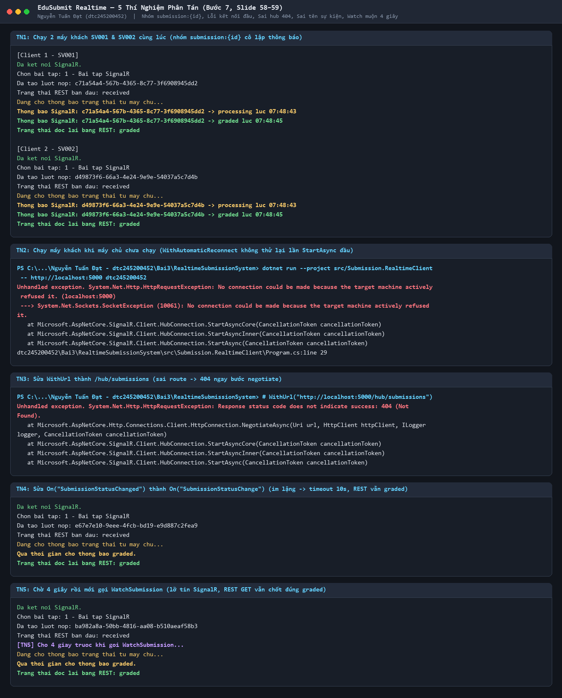

---

## Phần 4. Trả lời 3 câu hỏi đầu giờ (Slide 3, 65 & 70)

### 1. Máy chủ có thể chủ động báo cho máy khách mà không cần máy khách hỏi (polling) không?

- **Có**, với điều kiện máy khách mở sẵn một **kết nối hai chiều lâu dài** (WebSocket thông qua SignalR) tới máy chủ thay vì định kỳ gửi yêu cầu HTTP lặp đi lặp lại (*polling* gây lãng phí băng thông, tăng tải máy chủ và luôn có độ trễ giữa các chu kỳ hỏi).
- **Trong code (`Submission.RealtimeApi/Program.cs`):** Máy chủ đăng ký `AddSignalR()` và `MapHub<SubmissionHub>("/hubs/submissions")`. Khi tác vụ chấm bài nền đổi trạng thái từ `received` → `processing` → `graded`, máy chủ dùng `IHubContext<SubmissionHub>` gọi `hubContext.Clients.Group($"submission:{submissionId}").SendAsync("SubmissionStatusChanged", message)` để chủ động đẩy cập nhật ngay lập tức tới đúng máy khách đang theo dõi.

### 2. Đã có REST rồi, vì sao còn cần thêm SignalR? Hai thứ chia việc thế nào?

- REST theo mô hình **yêu cầu–phản hồi (request–response)**: rất mạnh cho việc tạo, đọc, sửa, xóa tài nguyên với URI rõ ràng, mã trạng thái HTTP chuẩn (`200`, `201 + Location`, `400`, `404`), chuẩn lỗi `ApiError` và tính *stateless* dễ kiểm thử; tuy nhiên REST không thể tự đẩy tin từ máy chủ xuống khi sự kiện xảy ra về sau.
- SignalR theo mô hình **đẩy dữ liệu (server push)**: bổ sung đúng khoảng trống đó bằng cách thông báo tức thời các thay đổi trạng thái phát sinh sau yêu cầu ban đầu.
- **Cách chia việc trong EduSubmit:**
  - **REST:** Lấy danh sách bài tập (`GET /api/assignments`), tạo lượt nộp mới (`POST /api/assignments/{id}/submissions` trả `201 + Location` và `received`), và đọc lại trạng thái chính thức (`GET /api/submissions/{id}`).
  - **SignalR:** Đăng ký theo dõi (`WatchSubmission`) và đẩy sự kiện chuyển trạng thái (`processing`, `graded`) tới nhóm `submission:{id}`. SignalR **không thay thế REST** mà phối hợp cùng REST.

### 3. Nếu đứt mạng đúng lúc máy chủ báo `"graded"` thì sao?

- **Tin đẩy `"graded"` đó bị mất hẳn**, vì SignalR không lưu hàng đợi để phát lại tin đã gửi trong lúc kết nối bị ngắt.
- Khi mạng khôi phục, `WithAutomaticReconnect()` tự nối lại theo lịch 0s → 2s → 10s → 30s nhưng máy chủ cấp một `ConnectionId` mới, nên tư cách thành viên nhóm `submission:{id}` gắn với `ConnectionId` cũ cũng không còn.
- **Cách xử lý đúng trong thiết kế phân tán:**
  1. Ở máy chủ, luôn **cập nhật trạng thái vào nguồn dữ liệu chính (`submissions`, bảo vệ bằng `lock`) trước khi đẩy SignalR**.
  2. Ở máy khách, khi kết nối lại (trong `Reconnected`) hoặc khi hết thời gian chờ (`Task.WhenAny` timeout), gọi lại `WatchSubmission` (nếu còn theo dõi) và **gọi `GET /api/submissions/{id}` qua REST** để đồng bộ trạng thái cuối `"graded"`.
- **Nguyên tắc:** *Push để nhanh, REST để chắc* — REST luôn là nguồn sự thật (*source of truth*).

---

## Phần 5. Bài tập cộng điểm (Slide 62 – Bài tập 2 & Bài tập 3)

### Bài tập 2 – Bổ sung trạng thái `failed` và cảnh báo màu đỏ

- **Máy chủ (`Submission.RealtimeApi/Program.cs`):** Trong `SimulateGradingAsync`, sau bước `processing` (~1s), máy chủ kiểm tra `repositoryUrl.StartsWith("https://", StringComparison.OrdinalIgnoreCase)`:
  - Đúng `https://` → trạng thái cuối là `"graded"`.
  - Không bắt đầu bằng `https://` (ví dụ `http://...`, `ftp://...`, thiếu giao thức) → trạng thái cuối là `"failed"`.
  - Vẫn cập nhật nguồn sự thật trong `submissions` (dưới `lock`) **trước khi** đẩy `SubmissionStatusChanged` tới nhóm `submission:{id}`.
  - Đã bổ sung ca 10–11 vào `requests.http` (`POST` URL `http://...` → `201 received`, sau ~3s `GET` → `200 failed`).
- **Máy khách (`Submission.RealtimeClient/Program.cs`):** Khi nhận `message.Status == "failed"`, đổi `Console.ForegroundColor = ConsoleColor.Red` (reset trong `finally` dưới `consoleLock`), in `!!! CANH BAO: luot nop {id} cham LOI (failed) ...`, đồng thời hoàn tất `TaskCompletionSource<string>` tương ứng và vẫn gọi REST chốt lại.
- **Hai câu hỏi khung bị ảnh hưởng (Slide 17 & Slide 62):**
  - **① Sự kiện nào?** Mở rộng vòng đời sự kiện từ một nhánh kết thúc (`received → processing → graded`) thành hai nhánh kết thúc (`processing → graded` hoặc `processing → failed`).
  - **③ Gửi kèm gì?** Giữ nguyên bản ghi tối thiểu `SubmissionStatusMessage(SubmissionId, Status, UpdatedAt)`, chỉ mở rộng miền giá trị `Status` thêm `"failed"` để máy khách nhận biết nhánh lỗi mà không phá hợp đồng cũ.

### Bài tập 3 – Theo dõi đồng thời 2 lượt nộp trên cùng một kết nối SignalR

- **Thiết kế (`Submission.RealtimeClient/Program.cs`):**
  - Tạo 2 lượt nộp trên cùng một `HubConnection`: lượt 1 (`dtc245200452`, URL `https://...` → `graded`) và lượt 2 (`dtc245200452-fail`, URL `http://...` → `failed`).
  - Dùng `ConcurrentDictionary<Guid, TaskCompletionSource<string>>` lưu riêng một `TaskCompletionSource<string>` cho từng `SubmissionId` **trước khi** gọi `WatchSubmission` cho cả hai trên cùng kết nối (tránh race condition nếu máy chủ đẩy sớm).
  - Trong callback `On<SubmissionStatusMessage>`, tra đúng `pending.TryGetValue(message.SubmissionId, out var tcs)` và chỉ gọi `tcs.TrySetResult(message.Status)` khi trạng thái là `"graded"` hoặc `"failed"`, chờ cả hai bằng `Task.WhenAll(...)` kèm timeout 10s rồi đọc lại từng lượt nộp qua `GET /api/submissions/{id}`.
- **Chứng minh thông báo không trộn lẫn:**
  - Log máy chủ cho thấy cùng một `ConnectionId` (`NN5i4Dem8yCaRmNhaDVDEg`) tham gia 2 nhóm riêng `submission:f13b6e52-...` và `submission:b2b3ceaa-...`.
  - Mỗi thông báo đẩy mang đúng `SubmissionId`, chỉ giải phóng đúng `TaskCompletionSource` của lượt nộp đó, và kết quả đối chiếu cuối khớp 100% giữa SignalR và REST (`SignalR = graded, REST = graded` và `SignalR = failed, REST = failed`).
  - Kiểm thử chạy đồng thời 2 tiến trình client độc lập (`SV001`/`SV002` và `SV003`/`SV004`) xác nhận 4 GUID hoàn toàn tách biệt, không có thông báo chéo giữa các kết nối.

### Kết quả chạy thật (Bài tập 2 & 3)

```text
Da ket noi SignalR.
Chon bai tap: 1 - Bai tap SignalR
Da tao dtc245200452: f13b6e52-72bf-4086-ae74-804b84c742c9 (received)
Da tao dtc245200452-fail: b2b3ceaa-5b3d-4a0f-8aa4-342a7aa0d8b2 (received)
Dang cho thong bao trang thai tu may chu cho 2 luot nop...
Thong bao SignalR: f13b6e52-72bf-4086-ae74-804b84c742c9 -> processing luc 08:10:37
Thong bao SignalR: b2b3ceaa-5b3d-4a0f-8aa4-342a7aa0d8b2 -> processing luc 08:10:37
Thong bao SignalR: f13b6e52-72bf-4086-ae74-804b84c742c9 -> graded luc 08:10:39
!!! CANH BAO: luot nop b2b3ceaa-5b3d-4a0f-8aa4-342a7aa0d8b2 cham LOI (failed) luc 08:10:39
dtc245200452 (f13b6e52-72bf-4086-ae74-804b84c742c9): SignalR = graded, REST = graded
dtc245200452-fail (b2b3ceaa-5b3d-4a0f-8aa4-342a7aa0d8b2): SignalR = failed, REST = failed
```

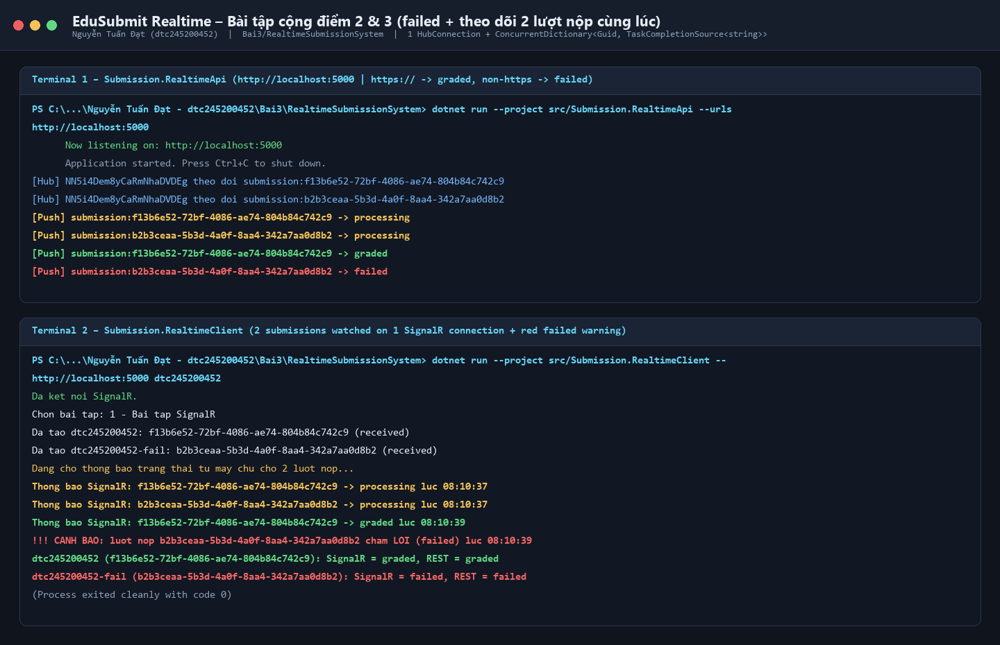
