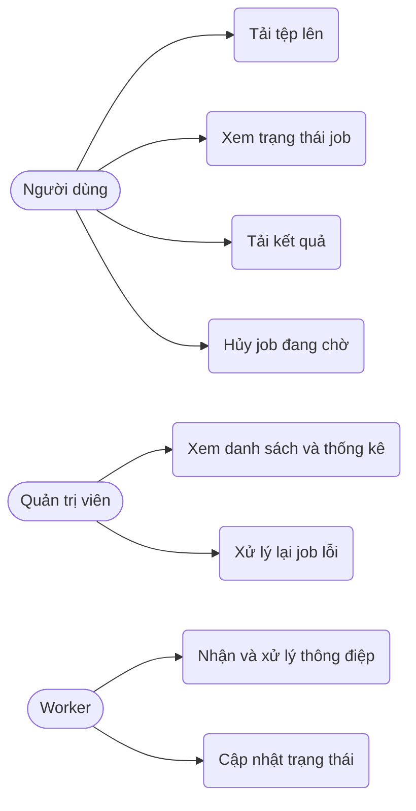
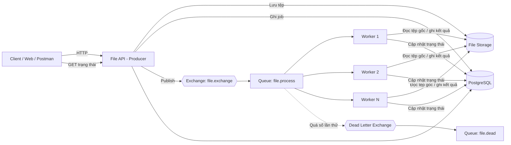
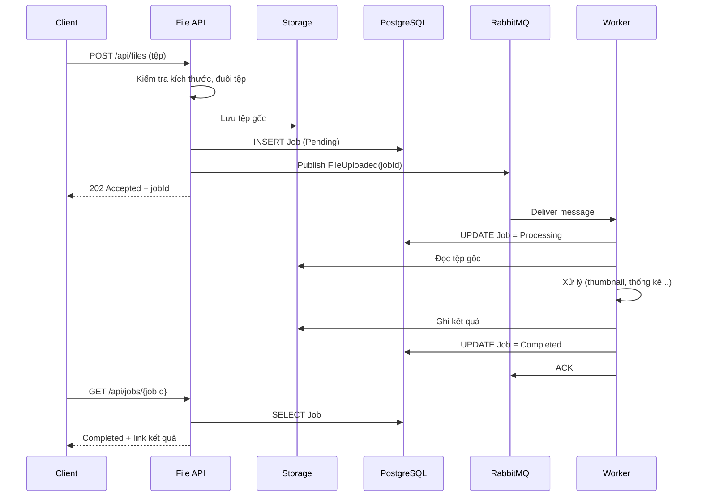
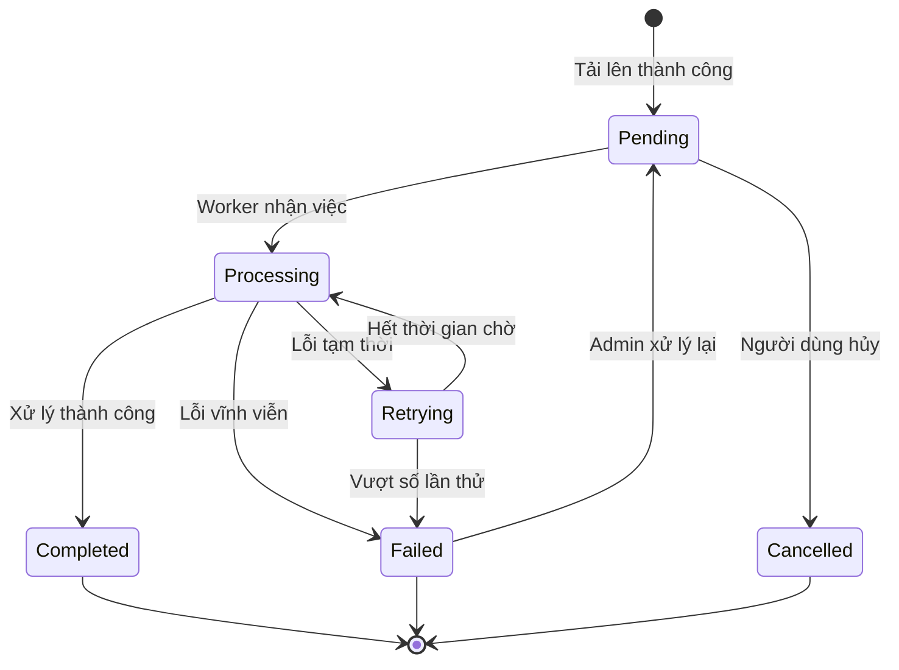
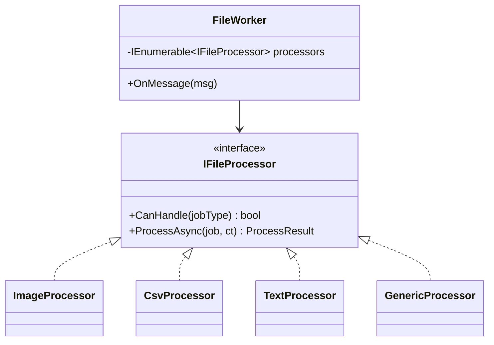

# BÁO CÁO MÔN PHÁT TRIỂN ỨNG DỤNG PHÂN TÁN

## Đề tài 05: HỆ THỐNG XỬ LÝ TỆP BẤT ĐỒNG BỘ
### (Asynchronous File Processing System)

| Thông tin | Nội dung |
|---|---|
| Sinh viên thực hiện | Nguyễn Văn Dũng |
| Mã sinh viên | dtc245201007 |
| Lớp | CNTT K23C |
| Môn học | Phát triển ứng dụng phân tán |
| Tài khoản GitHub | dtc245201007-boop |

---

## MỤC LỤC

1. [Giới thiệu đề tài](#1-giới-thiệu-đề-tài)
2. [Cơ sở lý thuyết](#2-cơ-sở-lý-thuyết)
3. [Phân tích yêu cầu](#3-phân-tích-yêu-cầu)
4. [Thiết kế kiến trúc hệ thống](#4-thiết-kế-kiến-trúc-hệ-thống)
5. [Thiết kế chi tiết](#5-thiết-kế-chi-tiết)
6. [Công nghệ sử dụng](#6-công-nghệ-sử-dụng)
7. [Cài đặt](#7-cài-đặt)
8. [Xử lý lỗi và đảm bảo độ tin cậy](#8-xử-lý-lỗi-và-đảm-bảo-độ-tin-cậy)
9. [Khả năng mở rộng và triển khai](#9-khả-năng-mở-rộng-và-triển-khai)
10. [Kiểm thử và đánh giá](#10-kiểm-thử-và-đánh-giá)
11. [Bảo mật](#11-bảo-mật)
12. [Hạn chế và hướng phát triển](#12-hạn-chế-và-hướng-phát-triển)
13. [Kết luận](#13-kết-luận)
14. [Tài liệu tham khảo](#14-tài-liệu-tham-khảo)

---

## 1. Giới thiệu đề tài

### 1.1. Bối cảnh

Trong các ứng dụng hiện đại (thương mại điện tử, mạng xã hội, hệ thống quản lý học tập, hệ thống kế toán...), người dùng thường xuyên tải lên các tệp như ảnh, video, tài liệu PDF, bảng tính CSV/Excel. Những tệp này cần được xử lý sau khi tải lên: nén ảnh, tạo ảnh thu nhỏ (thumbnail), quét virus, trích xuất văn bản, chuyển đổi định dạng, nhập dữ liệu từ CSV vào cơ sở dữ liệu...

Nếu xử lý **đồng bộ** (synchronous), tức là API nhận tệp, xử lý xong rồi mới trả kết quả, hệ thống sẽ gặp các vấn đề:

- Người dùng phải chờ lâu, dễ bị timeout (HTTP request thường giới hạn 30–60 giây).
- Một tệp nặng chiếm luồng (thread) của máy chủ web, làm giảm khả năng phục vụ người dùng khác.
- Khi máy chủ lỗi giữa chừng, toàn bộ công việc bị mất, người dùng phải tải lại từ đầu.
- Khó mở rộng: muốn tăng tốc xử lý phải tăng cả máy chủ web.

Giải pháp là **xử lý bất đồng bộ (asynchronous processing)**: API chỉ nhận tệp, lưu lại, ghi nhận một "công việc" (job) và trả về ngay mã công việc; việc xử lý nặng được giao cho các tiến trình nền (worker) chạy độc lập thông qua hàng đợi thông điệp (message queue). Đây là một mẫu thiết kế điển hình của hệ thống phân tán.

### 1.2. Mục tiêu đề tài

- Nghiên cứu mô hình xử lý bất đồng bộ và kiến trúc hướng thông điệp (message-driven).
- Thiết kế và xây dựng hệ thống cho phép tải tệp lên, đưa vào hàng đợi, xử lý bởi nhiều worker song song và theo dõi trạng thái xử lý.
- Áp dụng các kỹ thuật đảm bảo độ tin cậy trong hệ thống phân tán: retry, dead-letter queue, idempotency, xác nhận thông điệp (acknowledgement).
- Đánh giá hiệu năng so với cách xử lý đồng bộ.

### 1.3. Phạm vi

Hệ thống hỗ trợ các loại tác vụ xử lý tệp tiêu biểu:

| Loại tệp | Tác vụ xử lý |
|---|---|
| Ảnh (JPG, PNG) | Nén, đổi kích thước, tạo thumbnail |
| CSV | Kiểm tra dữ liệu, đếm dòng hợp lệ/không hợp lệ, thống kê |
| PDF/TXT | Trích xuất văn bản, đếm từ |
| Mọi tệp | Tính mã băm SHA-256, kiểm tra định dạng, kích thước |

> **Ghi chú:** Phạm vi có thể mở rộng thêm tác vụ mới bằng cách bổ sung một "processor" mà không cần sửa API.

### 1.4. Bố cục báo cáo

Phần 2 trình bày cơ sở lý thuyết; phần 3–5 phân tích và thiết kế; phần 6–9 trình bày công nghệ, cài đặt, độ tin cậy và triển khai; phần 10–13 đánh giá, bảo mật, hướng phát triển và kết luận.

---

## 2. Cơ sở lý thuyết

### 2.1. Hệ thống phân tán

Hệ thống phân tán là tập hợp các thành phần chạy trên nhiều tiến trình/máy khác nhau, giao tiếp qua mạng và phối hợp để thực hiện một mục tiêu chung. Các đặc trưng chính:

- **Tính đồng thời (concurrency):** nhiều thành phần hoạt động cùng lúc.
- **Không có đồng hồ toàn cục:** khó xác định thứ tự tuyệt đối của sự kiện.
- **Lỗi độc lập:** một thành phần lỗi không làm hỏng toàn hệ thống (nếu thiết kế tốt).
- **Độ trễ mạng và mất thông điệp** có thể xảy ra.

### 2.2. Xử lý đồng bộ và bất đồng bộ

| Tiêu chí | Đồng bộ | Bất đồng bộ |
|---|---|---|
| Thời gian phản hồi | Chờ xử lý xong mới trả lời | Trả lời ngay, xử lý sau |
| Ghép nối (coupling) | Chặt (caller chờ callee) | Lỏng (qua hàng đợi) |
| Chịu tải đột biến | Kém, dễ quá tải | Tốt, hàng đợi hấp thụ tải |
| Chịu lỗi | Lỗi là mất yêu cầu | Có thể thử lại |
| Độ phức tạp | Thấp | Cao hơn (theo dõi trạng thái, nhất quán cuối cùng) |

### 2.3. Hàng đợi thông điệp (Message Queue)

Message queue là thành phần trung gian lưu trữ tạm thời các thông điệp giữa **producer** (bên gửi) và **consumer** (bên nhận). Lợi ích:

- **Tách rời (decoupling)** producer và consumer về thời gian, vị trí và tốc độ.
- **San phẳng tải (load leveling).**
- **Đảm bảo giao hàng** nhờ lưu bền (persistent) và cơ chế ACK.
- **Mở rộng ngang:** thêm consumer để tăng thông lượng.

Các hệ thống phổ biến: RabbitMQ, Apache Kafka, Azure Service Bus, AWS SQS, Redis Streams.

**RabbitMQ** triển khai giao thức AMQP 0-9-1 với các khái niệm: *exchange* (định tuyến), *queue* (lưu trữ), *binding* (liên kết), *routing key*, *acknowledgement*, *prefetch (QoS)* và *dead-letter exchange*.

### 2.4. Mẫu Producer – Consumer và Competing Consumers

Nhiều worker cùng đọc một hàng đợi; mỗi thông điệp chỉ được giao cho một worker. Mẫu này giúp xử lý song song và cân bằng tải tự nhiên: worker nhanh lấy nhiều việc hơn.

### 2.5. Ngữ nghĩa giao hàng thông điệp

| Ngữ nghĩa | Mô tả | Hệ quả |
|---|---|---|
| At-most-once | Gửi tối đa một lần | Có thể mất thông điệp |
| **At-least-once** | Gửi ít nhất một lần | Có thể trùng lặp, cần xử lý idempotent |
| Exactly-once | Đúng một lần | Rất khó đạt trong thực tế |

Hệ thống này chọn **at-least-once** kết hợp **xử lý idempotent** để đạt hiệu quả gần như exactly-once.

### 2.6. Idempotency

Một thao tác là idempotent nếu thực hiện nhiều lần cho kết quả giống thực hiện một lần. Với xử lý tệp, ta đảm bảo bằng cách kiểm tra trạng thái job và dùng khóa duy nhất (JobId, mã băm tệp) trước khi xử lý; kết quả được ghi theo kiểu "ghi đè theo JobId".

### 2.7. Retry, Backoff và Dead Letter Queue (DLQ)

- **Retry:** thử lại khi gặp lỗi tạm thời (mạng, khóa DB).
- **Exponential backoff:** tăng dần thời gian chờ giữa các lần thử (ví dụ 5s, 25s, 125s) để tránh dồn dập.
- **Dead Letter Queue:** thông điệp thất bại quá số lần cho phép được chuyển sang hàng đợi riêng để phân tích thủ công, tránh chặn hàng đợi chính ("poison message").

### 2.8. Nhất quán cuối cùng (Eventual Consistency)

Sau khi tải lên, trạng thái job ban đầu là *Pending*; sau một khoảng thời gian mới là *Completed*. Hệ thống không đảm bảo nhất quán tức thì mà đảm bảo nhất quán sau cùng. Client cần cơ chế **polling** hoặc **push (SignalR/Webhook)** để biết kết quả.

### 2.9. Backpressure và Prefetch

Khi producer nhanh hơn consumer, hàng đợi dài ra. Cấu hình `prefetchCount` giới hạn số thông điệp chưa ACK trên mỗi worker, tránh một worker ôm quá nhiều việc và giúp phân phối công bằng.

---

## 3. Phân tích yêu cầu

### 3.1. Yêu cầu chức năng

| Mã | Yêu cầu |
|---|---|
| FR1 | Người dùng tải một hoặc nhiều tệp lên hệ thống qua API. |
| FR2 | Hệ thống kiểm tra sơ bộ (kích thước, đuôi tệp) và trả ngay `jobId` với mã HTTP 202 Accepted. |
| FR3 | Mỗi tệp tạo một công việc xử lý được đưa vào hàng đợi. |
| FR4 | Worker nhận công việc, xử lý theo loại tệp và lưu kết quả. |
| FR5 | Người dùng tra cứu trạng thái công việc (Pending, Processing, Completed, Failed). |
| FR6 | Người dùng tải về kết quả xử lý khi hoàn thành. |
| FR7 | Công việc lỗi tạm thời được tự động thử lại; lỗi vĩnh viễn được đưa vào DLQ. |
| FR8 | Quản trị viên xem danh sách job, thống kê và có thể xử lý lại job lỗi. |
| FR9 | Có thể hủy công việc đang chờ. |

### 3.2. Yêu cầu phi chức năng

| Mã | Yêu cầu | Cách đáp ứng |
|---|---|---|
| NFR1 | Hiệu năng: API phản hồi dưới 500 ms cho thao tác tải lên | Chỉ lưu tệp và gửi message, không xử lý nặng |
| NFR2 | Khả năng mở rộng ngang | Competing consumers, worker không trạng thái (stateless) |
| NFR3 | Độ tin cậy: không mất công việc khi worker/broker khởi động lại | Queue durable, message persistent, ACK thủ công |
| NFR4 | Khả năng chịu lỗi | Retry + backoff + DLQ |
| NFR5 | Khả năng quan sát | Ghi log có cấu trúc, health check, thống kê job |
| NFR6 | Bảo mật | Xác thực, giới hạn kích thước, kiểm tra loại tệp, tên tệp an toàn |

### 3.3. Tác nhân (Actors)

- **Người dùng (Client):** tải tệp, xem trạng thái, tải kết quả.
- **Quản trị viên:** theo dõi, xử lý lại job lỗi.
- **Worker (tác nhân hệ thống):** tiêu thụ thông điệp và xử lý tệp.

### 3.4. Biểu đồ use case



### 3.5. Kịch bản chính: tải và xử lý tệp

1. Client gửi `POST /api/files` kèm tệp.
2. API kiểm tra hợp lệ, lưu tệp vào kho lưu trữ, tạo bản ghi Job (Pending), phát thông điệp `FileUploaded` vào queue.
3. API trả về `202 Accepted` kèm `jobId`.
4. Worker nhận thông điệp, đổi trạng thái sang Processing, xử lý tệp, lưu kết quả, đổi trạng thái sang Completed, gửi ACK.
5. Client gọi `GET /api/jobs/{id}` để biết trạng thái và nhận link tải kết quả.

---

## 4. Thiết kế kiến trúc hệ thống

### 4.1. Kiến trúc tổng thể



### 4.2. Các thành phần

| Thành phần | Vai trò |
|---|---|
| **File API (Producer)** | Nhận tệp, kiểm tra, lưu, tạo job, phát thông điệp, cung cấp API tra cứu trạng thái. Stateless. |
| **RabbitMQ (Broker)** | Lưu và phân phối thông điệp, định tuyến, hỗ trợ DLQ. |
| **Worker (Consumer)** | Tiến trình nền nhận thông điệp, xử lý tệp, ghi kết quả. Có thể chạy nhiều bản sao. |
| **PostgreSQL** | Lưu thông tin job, lịch sử trạng thái, kết quả. |
| **File Storage** | Lưu tệp gốc và tệp kết quả (đĩa cục bộ/volume; có thể thay bằng MinIO/S3). |

### 4.3. Nguyên tắc thiết kế

- **Tách rời:** API và Worker chỉ giao tiếp qua queue và DB.
- **Stateless:** mọi trạng thái nằm ở DB/Storage, cho phép nhân bản tùy ý.
- **Claim-check pattern:** thông điệp chỉ chứa `jobId` và đường dẫn tệp, không chứa nội dung tệp (tránh thông điệp quá lớn).
- **Idempotent consumer:** worker kiểm tra trạng thái job trước khi xử lý.
- **Failure-first:** coi lỗi là chuyện bình thường, có retry và DLQ.

### 4.4. Biểu đồ tuần tự (Sequence)



### 4.5. Chu trình trạng thái của Job



---

## 5. Thiết kế chi tiết

### 5.1. Thiết kế cơ sở dữ liệu

**Bảng `jobs`**

| Cột | Kiểu | Mô tả |
|---|---|---|
| id | UUID (PK) | Mã công việc |
| original_name | VARCHAR(255) | Tên tệp gốc |
| stored_path | VARCHAR(500) | Đường dẫn tệp đã lưu (tên ngẫu nhiên) |
| content_type | VARCHAR(100) | MIME type |
| size_bytes | BIGINT | Kích thước |
| sha256 | CHAR(64) | Mã băm nội dung |
| job_type | VARCHAR(30) | Image / Csv / Text / Generic |
| status | VARCHAR(20) | Pending, Processing, Retrying, Completed, Failed, Cancelled |
| attempt_count | INT | Số lần đã thử |
| result_path | VARCHAR(500) | Đường dẫn kết quả |
| result_summary | JSONB | Tóm tắt kết quả (số dòng, kích thước ảnh...) |
| error_message | TEXT | Thông báo lỗi gần nhất |
| created_at | TIMESTAMPTZ | Thời điểm tạo |
| started_at | TIMESTAMPTZ | Bắt đầu xử lý |
| finished_at | TIMESTAMPTZ | Kết thúc |
| worker_id | VARCHAR(100) | Worker đã xử lý |

**Bảng `job_events`** (lịch sử trạng thái, phục vụ truy vết)

| Cột | Kiểu | Mô tả |
|---|---|---|
| id | BIGSERIAL (PK) | |
| job_id | UUID (FK) | |
| status | VARCHAR(20) | Trạng thái mới |
| message | TEXT | Ghi chú |
| created_at | TIMESTAMPTZ | |

Chỉ mục: `jobs(status)`, `jobs(created_at)`, `jobs(sha256)`, `job_events(job_id)`.

### 5.2. Thiết kế API (REST)

| Phương thức | Đường dẫn | Mô tả | Mã trả về |
|---|---|---|---|
| POST | `/api/files` | Tải một hoặc nhiều tệp, tạo job | 202, 400, 413, 415 |
| GET | `/api/jobs/{id}` | Xem trạng thái job | 200, 404 |
| GET | `/api/jobs?status=&page=` | Danh sách job có phân trang | 200 |
| GET | `/api/jobs/{id}/result` | Tải kết quả | 200, 404, 409 (chưa xong) |
| DELETE | `/api/jobs/{id}` | Hủy job đang Pending | 204, 409 |
| POST | `/api/jobs/{id}/retry` | Xử lý lại job Failed (admin) | 202 |
| GET | `/api/stats` | Thống kê số job theo trạng thái | 200 |
| GET | `/health` | Kiểm tra sức khỏe | 200 |

**Ví dụ phản hồi `POST /api/files` (202 Accepted):**

```json
{
  "jobId": "5b0c2f7e-8a3d-4a8e-9a1f-2d5f0b3c7e11",
  "status": "Pending",
  "statusUrl": "/api/jobs/5b0c2f7e-8a3d-4a8e-9a1f-2d5f0b3c7e11"
}
```

**Ví dụ phản hồi `GET /api/jobs/{id}`:**

```json
{
  "jobId": "5b0c2f7e-8a3d-4a8e-9a1f-2d5f0b3c7e11",
  "fileName": "anh-san-pham.jpg",
  "status": "Completed",
  "attempts": 1,
  "createdAt": "2026-11-17T08:30:00Z",
  "finishedAt": "2026-11-17T08:30:02Z",
  "summary": { "width": 1920, "height": 1080, "thumbnail": "320x180" },
  "resultUrl": "/api/jobs/5b0c2f7e-8a3d-4a8e-9a1f-2d5f0b3c7e11/result"
}
```

### 5.3. Thiết kế thông điệp

```json
{
  "messageId": "b1d6...",
  "jobId": "5b0c2f7e-8a3d-4a8e-9a1f-2d5f0b3c7e11",
  "jobType": "Image",
  "storedPath": "/data/uploads/9f3a....jpg",
  "attempt": 1,
  "createdAt": "2026-11-17T08:30:00Z"
}
```

### 5.4. Thiết kế topology RabbitMQ

| Thành phần | Tên | Thuộc tính |
|---|---|---|
| Exchange chính | `file.exchange` | direct, durable |
| Queue chính | `file.process` | durable; `x-dead-letter-exchange=file.dlx` |
| Retry queue 1 | `file.retry.5s` | durable; TTL 5s; dead-letter về `file.exchange` |
| Retry queue 2 | `file.retry.30s` | durable; TTL 30s |
| Retry queue 3 | `file.retry.120s` | durable; TTL 120s |
| Dead-letter exchange | `file.dlx` | direct, durable |
| Dead-letter queue | `file.dead` | durable |

**Cơ chế retry bằng TTL queue:** khi xử lý lỗi tạm thời, worker publish lại thông điệp (tăng `attempt`) vào retry queue tương ứng. Hết TTL, thông điệp tự quay về `file.exchange` rồi vào `file.process`. Nếu `attempt` vượt giới hạn (3), thông điệp được đưa vào `file.dead`.

### 5.5. Thiết kế lớp xử lý (Strategy Pattern)



Việc thêm loại tệp mới chỉ cần viết thêm một lớp `IFileProcessor` và đăng ký vào DI (tuân thủ nguyên lý Open/Closed).

### 5.6. Cấu trúc thư mục dự án

```
FileProcessingSystem/
├── docker-compose.yml
├── src/
│   ├── FileProcessing.Api/          # Producer
│   │   ├── Program.cs
│   │   ├── Controllers/FilesController.cs
│   │   └── Services/MessagePublisher.cs
│   ├── FileProcessing.Worker/       # Consumer
│   │   ├── Program.cs
│   │   ├── FileWorker.cs
│   │   └── Processors/
│   │       ├── IFileProcessor.cs
│   │       ├── ImageProcessor.cs
│   │       ├── CsvProcessor.cs
│   │       └── TextProcessor.cs
│   └── FileProcessing.Shared/       # Model, DbContext, hằng số
│       ├── Entities/Job.cs
│       ├── Messages/FileUploadedMessage.cs
│       └── Data/AppDbContext.cs
└── tests/
```

---

## 6. Công nghệ sử dụng

| Lớp | Công nghệ | Lý do chọn |
|---|---|---|
| Ngôn ngữ / Framework | C# / ASP.NET Core 8, Worker Service | Phù hợp với các bài thực hành trước (Catalog API), hỗ trợ `BackgroundService` |
| Message broker | RabbitMQ 3.x (AMQP 0-9-1) | Phổ biến, hỗ trợ DLQ, ACK, prefetch, dễ chạy bằng Docker |
| Cơ sở dữ liệu | PostgreSQL 16 + Entity Framework Core | Lưu trạng thái job, hỗ trợ JSONB |
| Xử lý ảnh | SixLabors.ImageSharp | Thư viện .NET thuần, không phụ thuộc hệ điều hành |
| Xử lý CSV | CsvHelper | Đọc CSV ổn định, hỗ trợ streaming |
| Đóng gói | Docker, Docker Compose | Triển khai nhiều thành phần đồng nhất |
| Kiểm thử | xUnit, Postman, k6 (hoặc `hey`) | Kiểm thử đơn vị, API và tải |

---

## 7. Cài đặt

> Các đoạn mã dưới đây là phần cốt lõi của hệ thống, trình bày ở mức đủ để hiểu và chạy được; có thể bổ sung phần xử lý chi tiết khi hoàn thiện dự án.

### 7.1. Hạ tầng bằng Docker Compose

```yaml
services:
  rabbitmq:
    image: rabbitmq:3-management
    ports: ["5672:5672", "15672:15672"]
    environment:
      RABBITMQ_DEFAULT_USER: guest
      RABBITMQ_DEFAULT_PASS: guest
    healthcheck:
      test: ["CMD", "rabbitmq-diagnostics", "ping"]
      interval: 10s
      retries: 5

  postgres:
    image: postgres:16
    environment:
      POSTGRES_DB: filedb
      POSTGRES_USER: app
      POSTGRES_PASSWORD: app123
    ports: ["5432:5432"]
    volumes: [pgdata:/var/lib/postgresql/data]

  api:
    build: ./src/FileProcessing.Api
    ports: ["8080:8080"]
    depends_on: [rabbitmq, postgres]
    volumes: [filedata:/data]

  worker:
    build: ./src/FileProcessing.Worker
    depends_on: [rabbitmq, postgres]
    volumes: [filedata:/data]
    deploy:
      replicas: 3        # chạy 3 worker song song

volumes:
  pgdata:
  filedata:
```

Chạy hệ thống: `docker compose up -d --build`. Có thể thay đổi số worker bằng `docker compose up -d --scale worker=5`.

### 7.2. Thực thể Job

```csharp
public enum JobStatus { Pending, Processing, Retrying, Completed, Failed, Cancelled }

public class Job
{
    public Guid Id { get; set; } = Guid.NewGuid();
    public string OriginalName { get; set; } = "";
    public string StoredPath { get; set; } = "";
    public string ContentType { get; set; } = "";
    public long SizeBytes { get; set; }
    public string Sha256 { get; set; } = "";
    public string JobType { get; set; } = "Generic";
    public JobStatus Status { get; set; } = JobStatus.Pending;
    public int AttemptCount { get; set; }
    public string? ResultPath { get; set; }
    public string? ResultSummary { get; set; }   // JSON
    public string? ErrorMessage { get; set; }
    public DateTime CreatedAt { get; set; } = DateTime.UtcNow;
    public DateTime? StartedAt { get; set; }
    public DateTime? FinishedAt { get; set; }
    public string? WorkerId { get; set; }
}

public record FileUploadedMessage(Guid MessageId, Guid JobId, string JobType,
                                  string StoredPath, int Attempt);
```

### 7.3. API – Producer nhận tệp và phát thông điệp

```csharp
[ApiController]
[Route("api/files")]
public class FilesController : ControllerBase
{
    private static readonly string[] Allowed = [".jpg", ".jpeg", ".png", ".csv", ".txt", ".pdf"];
    private const long MaxSize = 50 * 1024 * 1024; // 50 MB

    private readonly AppDbContext _db;
    private readonly IMessagePublisher _publisher;
    private readonly IConfiguration _cfg;

    public FilesController(AppDbContext db, IMessagePublisher publisher, IConfiguration cfg)
        => (_db, _publisher, _cfg) = (db, publisher, cfg);

    [HttpPost]
    [RequestSizeLimit(MaxSize)]
    public async Task<IActionResult> Upload(List<IFormFile> files, CancellationToken ct)
    {
        if (files.Count == 0) return BadRequest("Chưa chọn tệp.");
        var results = new List<object>();

        foreach (var file in files)
        {
            var ext = Path.GetExtension(file.FileName).ToLowerInvariant();
            if (!Allowed.Contains(ext)) return StatusCode(415, $"Không hỗ trợ định dạng {ext}");
            if (file.Length is 0 or > MaxSize) return StatusCode(413, "Kích thước không hợp lệ");

            // Tên lưu trữ ngẫu nhiên để tránh path traversal / trùng tên
            var storedName = $"{Guid.NewGuid()}{ext}";
            var path = Path.Combine(_cfg["Storage:Uploads"]!, storedName);

            string sha;
            await using (var fs = System.IO.File.Create(path))
            {
                await file.CopyToAsync(fs, ct);
            }
            await using (var rs = System.IO.File.OpenRead(path))
                sha = Convert.ToHexString(await System.Security.Cryptography.SHA256.HashDataAsync(rs, ct));

            var job = new Job
            {
                OriginalName = Path.GetFileName(file.FileName),
                StoredPath = path,
                ContentType = file.ContentType,
                SizeBytes = file.Length,
                Sha256 = sha,
                JobType = ext switch { ".jpg" or ".jpeg" or ".png" => "Image",
                                       ".csv" => "Csv", ".txt" => "Text", _ => "Generic" }
            };
            _db.Jobs.Add(job);
            await _db.SaveChangesAsync(ct);          // lưu job TRƯỚC khi publish

            _publisher.Publish(new FileUploadedMessage(Guid.NewGuid(), job.Id, job.JobType, path, 1));
            results.Add(new { jobId = job.Id, status = "Pending", statusUrl = $"/api/jobs/{job.Id}" });
        }
        return Accepted(results);
    }

    [HttpGet("/api/jobs/{id:guid}")]
    public async Task<IActionResult> GetJob(Guid id)
    {
        var job = await _db.Jobs.FindAsync(id);
        return job is null ? NotFound() : Ok(job);
    }
}
```

> **Lưu ý thiết kế:** job được ghi vào DB trước rồi mới publish. Nếu publish thất bại, job ở trạng thái Pending có thể được một tiến trình quét lại (Outbox pattern – xem mục 12).

### 7.4. Publisher RabbitMQ (khai báo topology + gửi bền vững)

```csharp
public class RabbitMqPublisher : IMessagePublisher, IDisposable
{
    private readonly IConnection _conn;
    private readonly IModel _ch;

    public RabbitMqPublisher(IConfiguration cfg)
    {
        var factory = new ConnectionFactory { HostName = cfg["Rabbit:Host"], DispatchConsumersAsync = true };
        _conn = factory.CreateConnection();
        _ch = _conn.CreateModel();
        RabbitTopology.Declare(_ch);
    }

    public void Publish(FileUploadedMessage msg)
    {
        var body = JsonSerializer.SerializeToUtf8Bytes(msg);
        var props = _ch.CreateBasicProperties();
        props.Persistent = true;                        // ghi xuống đĩa
        props.MessageId = msg.MessageId.ToString();
        props.ContentType = "application/json";
        _ch.BasicPublish("file.exchange", "process", props, body);
    }

    public void Dispose() { _ch.Close(); _conn.Close(); }
}

public static class RabbitTopology
{
    public static void Declare(IModel ch)
    {
        ch.ExchangeDeclare("file.exchange", ExchangeType.Direct, durable: true);
        ch.ExchangeDeclare("file.dlx", ExchangeType.Direct, durable: true);

        ch.QueueDeclare("file.process", durable: true, exclusive: false, autoDelete: false,
            arguments: new Dictionary<string, object> { ["x-dead-letter-exchange"] = "file.dlx",
                                                         ["x-dead-letter-routing-key"] = "dead" });
        ch.QueueBind("file.process", "file.exchange", "process");

        // Hàng đợi retry: hết TTL thì quay lại file.exchange
        foreach (var (name, ttl) in new[] { ("file.retry.5s", 5000), ("file.retry.30s", 30000), ("file.retry.120s", 120000) })
        {
            ch.QueueDeclare(name, durable: true, exclusive: false, autoDelete: false,
                arguments: new Dictionary<string, object> {
                    ["x-message-ttl"] = ttl,
                    ["x-dead-letter-exchange"] = "file.exchange",
                    ["x-dead-letter-routing-key"] = "process" });
            ch.QueueBind(name, "file.exchange", name);
        }

        ch.QueueDeclare("file.dead", durable: true, exclusive: false, autoDelete: false);
        ch.QueueBind("file.dead", "file.dlx", "dead");
    }
}
```

### 7.5. Worker – Consumer xử lý bất đồng bộ

```csharp
public class FileWorker : BackgroundService
{
    private const int MaxAttempts = 3;
    private static readonly string[] RetryQueues = ["file.retry.5s", "file.retry.30s", "file.retry.120s"];

    private readonly IServiceScopeFactory _scopes;
    private readonly IConfiguration _cfg;
    private readonly ILogger<FileWorker> _log;
    private readonly string _workerId = $"{Environment.MachineName}-{Guid.NewGuid().ToString()[..4]}";
    private IConnection? _conn;
    private IModel? _ch;

    public FileWorker(IServiceScopeFactory scopes, IConfiguration cfg, ILogger<FileWorker> log)
        => (_scopes, _cfg, _log) = (scopes, cfg, log);

    protected override Task ExecuteAsync(CancellationToken stop)
    {
        var factory = new ConnectionFactory { HostName = _cfg["Rabbit:Host"], DispatchConsumersAsync = true };
        _conn = factory.CreateConnection();
        _ch = _conn.CreateModel();
        RabbitTopology.Declare(_ch);
        _ch.BasicQos(0, prefetchCount: 2, global: false);   // mỗi worker giữ tối đa 2 việc chưa ACK

        var consumer = new AsyncEventingBasicConsumer(_ch);
        consumer.Received += async (_, ea) => await HandleAsync(ea, stop);
        _ch.BasicConsume("file.process", autoAck: false, consumer);   // ACK thủ công
        _log.LogInformation("Worker {Id} sẵn sàng", _workerId);
        return Task.CompletedTask;
    }

    private async Task HandleAsync(BasicDeliverEventArgs ea, CancellationToken ct)
    {
        var msg = JsonSerializer.Deserialize<FileUploadedMessage>(ea.Body.Span)!;
        using var scope = _scopes.CreateScope();
        var db = scope.ServiceProvider.GetRequiredService<AppDbContext>();
        var processors = scope.ServiceProvider.GetServices<IFileProcessor>();

        var job = await db.Jobs.FindAsync(new object[] { msg.JobId }, ct);

        // Idempotency: job đã xong/hủy thì bỏ qua và ACK
        if (job is null || job.Status is JobStatus.Completed or JobStatus.Cancelled)
        {
            _ch!.BasicAck(ea.DeliveryTag, false);
            return;
        }

        try
        {
            job.Status = JobStatus.Processing;
            job.AttemptCount = msg.Attempt;
            job.StartedAt = DateTime.UtcNow;
            job.WorkerId = _workerId;
            await db.SaveChangesAsync(ct);

            var processor = processors.First(p => p.CanHandle(job.JobType));
            var result = await processor.ProcessAsync(job, ct);

            job.Status = JobStatus.Completed;
            job.ResultPath = result.ResultPath;
            job.ResultSummary = result.SummaryJson;
            job.FinishedAt = DateTime.UtcNow;
            job.ErrorMessage = null;
            await db.SaveChangesAsync(ct);

            _ch!.BasicAck(ea.DeliveryTag, false);          // chỉ ACK khi đã lưu kết quả
            _log.LogInformation("Job {Id} hoàn thành bởi {W}", job.Id, _workerId);
        }
        catch (PermanentException ex)                      // lỗi vĩnh viễn: tệp hỏng, sai định dạng
        {
            await FailAsync(db, job, ex.Message, ea, ct);
        }
        catch (Exception ex)                               // lỗi tạm thời: thử lại
        {
            if (msg.Attempt >= MaxAttempts) { await FailAsync(db, job, ex.Message, ea, ct); return; }

            job.Status = JobStatus.Retrying;
            job.ErrorMessage = ex.Message;
            await db.SaveChangesAsync(ct);

            var next = msg with { Attempt = msg.Attempt + 1 };
            var props = _ch!.CreateBasicProperties();
            props.Persistent = true;
            _ch.BasicPublish("file.exchange", RetryQueues[msg.Attempt - 1], props,
                             JsonSerializer.SerializeToUtf8Bytes(next));
            _ch.BasicAck(ea.DeliveryTag, false);           // đã chuyển sang retry queue
            _log.LogWarning(ex, "Job {Id} lỗi lần {A}, sẽ thử lại", job.Id, msg.Attempt);
        }
    }

    private async Task FailAsync(AppDbContext db, Job job, string error, BasicDeliverEventArgs ea, CancellationToken ct)
    {
        job.Status = JobStatus.Failed;
        job.ErrorMessage = error;
        job.FinishedAt = DateTime.UtcNow;
        await db.SaveChangesAsync(ct);
        _ch!.BasicNack(ea.DeliveryTag, false, requeue: false);   // chuyển vào DLQ qua x-dead-letter
        _log.LogError("Job {Id} thất bại: {E}", job.Id, error);
    }
}
```

### 7.6. Bộ xử lý ảnh (ví dụ)

```csharp
public class ImageProcessor : IFileProcessor
{
    private readonly IConfiguration _cfg;
    public ImageProcessor(IConfiguration cfg) => _cfg = cfg;
    public bool CanHandle(string jobType) => jobType == "Image";

    public async Task<ProcessResult> ProcessAsync(Job job, CancellationToken ct)
    {
        try
        {
            using var image = await Image.LoadAsync(job.StoredPath, ct);
            var (w, h) = (image.Width, image.Height);

            image.Mutate(x => x.Resize(new ResizeOptions { Mode = ResizeMode.Max, Size = new Size(320, 320) }));

            // Ghi theo JobId => chạy lại nhiều lần vẫn cho cùng một tệp kết quả (idempotent)
            var outPath = Path.Combine(_cfg["Storage:Results"]!, $"{job.Id}_thumb.jpg");
            await image.SaveAsJpegAsync(outPath, ct);

            var summary = JsonSerializer.Serialize(new { width = w, height = h, thumbnail = $"{image.Width}x{image.Height}" });
            return new ProcessResult(outPath, summary);
        }
        catch (UnknownImageFormatException e)
        {
            throw new PermanentException("Tệp không phải ảnh hợp lệ", e);   // không thử lại
        }
    }
}
```

### 7.7. Bộ xử lý CSV (ví dụ)

```csharp
public class CsvProcessor : IFileProcessor
{
    private readonly IConfiguration _cfg;
    public CsvProcessor(IConfiguration cfg) => _cfg = cfg;
    public bool CanHandle(string jobType) => jobType == "Csv";

    public async Task<ProcessResult> ProcessAsync(Job job, CancellationToken ct)
    {
        int total = 0, valid = 0, invalid = 0;
        using var reader = new StreamReader(job.StoredPath);
        using var csv = new CsvReader(reader, CultureInfo.InvariantCulture);
        await csv.ReadAsync(); csv.ReadHeader();
        int cols = csv.HeaderRecord!.Length;

        while (await csv.ReadAsync())
        {
            total++;
            if (csv.Parser.Count == cols && !Enumerable.Range(0, cols).Any(i => string.IsNullOrWhiteSpace(csv.GetField(i)))) valid++;
            else invalid++;
        }
        var summary = JsonSerializer.Serialize(new { total, valid, invalid, columns = csv.HeaderRecord });
        var outPath = Path.Combine(_cfg["Storage:Results"]!, $"{job.Id}_report.json");
        await File.WriteAllTextAsync(outPath, summary, ct);
        return new ProcessResult(outPath, summary);
    }
}
```

### 7.8. Đăng ký dịch vụ (Program.cs của Worker)

```csharp
var builder = Host.CreateApplicationBuilder(args);
builder.Services.AddDbContext<AppDbContext>(o => o.UseNpgsql(builder.Configuration.GetConnectionString("Default")));
builder.Services.AddScoped<IFileProcessor, ImageProcessor>();
builder.Services.AddScoped<IFileProcessor, CsvProcessor>();
builder.Services.AddScoped<IFileProcessor, TextProcessor>();
builder.Services.AddHostedService<FileWorker>();
await builder.Build().RunAsync();
```

### 7.9. Hướng dẫn chạy và sử dụng thử

```bash
# 1. Khởi động hệ thống
docker compose up -d --build

# 2. Tải tệp lên
curl -F "files=@anh.jpg" http://localhost:8080/api/files

# 3. Xem trạng thái (thay <jobId> bằng mã nhận được)
curl http://localhost:8080/api/jobs/<jobId>

# 4. Xem hàng đợi trong giao diện quản trị RabbitMQ
#    http://localhost:15672  (guest / guest)
```

---

## 8. Xử lý lỗi và đảm bảo độ tin cậy

### 8.1. Bảng tình huống lỗi và cách xử lý

| Tình huống | Hậu quả nếu không xử lý | Giải pháp |
|---|---|---|
| Worker chết giữa lúc xử lý | Mất công việc | ACK thủ công: chưa ACK thì RabbitMQ giao lại cho worker khác |
| RabbitMQ khởi động lại | Mất thông điệp | Exchange/queue `durable`, message `Persistent` |
| Thông điệp bị giao hai lần | Xử lý trùng, kết quả sai | Consumer idempotent: kiểm tra trạng thái job, ghi kết quả theo JobId |
| Lỗi tạm thời (DB bận, mạng) | Job thất bại oan | Retry với backoff 5s, 30s, 120s |
| Tệp hỏng / sai định dạng | Thử lại vô ích, chặn hàng đợi | `PermanentException`: không retry, chuyển DLQ |
| Một thông điệp luôn gây lỗi (poison) | Lặp vô hạn | Giới hạn số lần thử, đưa vào `file.dead` |
| Producer ghi DB xong nhưng publish lỗi | Job treo ở Pending | Tiến trình quét lại job Pending quá hạn (Outbox/Reconciler) |
| Worker xử lý quá chậm | Hàng đợi tồn đọng | Tăng số worker; `prefetch` để chia đều |

### 8.2. Đảm bảo giao hàng

- **Phía producer:** thông điệp `Persistent`; có thể bật *publisher confirms* để biết broker đã nhận.
- **Phía broker:** queue bền vững, lưu trên đĩa.
- **Phía consumer:** `autoAck = false`; chỉ ACK sau khi đã cập nhật DB thành công. Kết quả: ngữ nghĩa **at-least-once**.

### 8.3. Giám sát

- Log có cấu trúc (JobId, WorkerId, Attempt) phục vụ truy vết.
- Giao diện RabbitMQ Management: độ dài queue, tốc độ publish/consume, số thông điệp trong DLQ.
- Endpoint `/api/stats` và `/health`.
- Bảng `job_events` lưu lịch sử chuyển trạng thái.

---

## 9. Khả năng mở rộng và triển khai

### 9.1. Mở rộng ngang

Do worker không giữ trạng thái, có thể tăng số bản sao bằng một lệnh:

```bash
docker compose up -d --scale worker=5
```

RabbitMQ tự phân phối thông điệp theo mô hình competing consumers. API cũng có thể nhân bản phía sau bộ cân bằng tải (Nginx/Traefik), vì không lưu trạng thái cục bộ.

### 9.2. Lưu trữ dùng chung

Khi chạy nhiều máy, tệp cần ở kho dùng chung: NFS, hoặc object storage như MinIO/S3. Lúc này `StoredPath` được thay bằng khóa đối tượng (object key).

### 9.3. Nút thắt (bottleneck) tiềm tàng

| Thành phần | Nguy cơ | Hướng xử lý |
|---|---|---|
| Worker (CPU-bound xử lý ảnh) | Chậm khi nhiều tệp lớn | Tăng worker, tách queue riêng theo loại tệp |
| PostgreSQL | Nhiều cập nhật trạng thái | Chỉ mục, connection pooling, ghi sự kiện theo lô |
| Storage | Băng thông I/O | Object storage, CDN cho tệp kết quả |
| RabbitMQ | Một node duy nhất | Cụm RabbitMQ, quorum queue |

---

## 10. Kiểm thử và đánh giá

### 10.1. Kế hoạch kiểm thử chức năng

| STT | Kịch bản | Dữ liệu | Kết quả mong đợi |
|---|---|---|---|
| 1 | Tải ảnh JPG hợp lệ | anh.jpg (2 MB) | 202 + jobId; sau vài giây trạng thái Completed, có thumbnail |
| 2 | Tải CSV hợp lệ | data.csv | Completed; summary có total/valid/invalid |
| 3 | Tải định dạng không hỗ trợ | virus.exe | 415 Unsupported Media Type |
| 4 | Tải tệp vượt giới hạn | tệp 100 MB | 413 Payload Too Large |
| 5 | Tệp ảnh bị hỏng | anh-hong.jpg | Job Failed ngay, không retry, vào DLQ |
| 6 | Tra cứu job không tồn tại | id ngẫu nhiên | 404 |
| 7 | Lấy kết quả khi chưa xong | job Pending | 409 Conflict |
| 8 | Hủy job Pending | jobId | 204; worker bỏ qua khi nhận |
| 9 | Tải nhiều tệp một lúc | 10 tệp | 10 jobId, xử lý song song |

### 10.2. Kiểm thử độ tin cậy

| STT | Kịch bản | Cách thực hiện | Kết quả mong đợi |
|---|---|---|---|
| R1 | Worker chết khi đang xử lý | `docker kill` một worker giữa chừng | Thông điệp được giao lại, job vẫn hoàn thành |
| R2 | Restart RabbitMQ | `docker restart rabbitmq` khi còn thông điệp | Thông điệp không mất |
| R3 | Lỗi tạm thời | Tạm dừng PostgreSQL vài giây | Job vào Retrying rồi Completed |
| R4 | Lỗi vĩnh viễn | Gửi tệp hỏng | Sau tối đa số lần thử quy định, vào `file.dead` |
| R5 | Thông điệp trùng | Publish tay cùng JobId hai lần | Chỉ xử lý một lần, lần hai bị bỏ qua |

### 10.3. Đánh giá hiệu năng

**Phương pháp:** so sánh hai phiên bản của cùng chức năng xử lý ảnh: (A) đồng bộ trong API, (B) bất đồng bộ qua queue với 1, 3, 5 worker. Công cụ: k6 hoặc `hey`; kịch bản: 200 yêu cầu tải ảnh 2 MB, 20 yêu cầu đồng thời.

**Các chỉ số đo:** thời gian phản hồi của API (trung bình, p95), tổng thời gian hoàn thành 200 tệp, thông lượng (tệp/giây), tỷ lệ lỗi.

**Bảng ghi kết quả** (điền số liệu đo thực tế khi chạy kiểm thử):

| Phương án | Resp. TB (ms) | Resp. p95 (ms) | Tổng thời gian (s) | Thông lượng (tệp/s) | Tỷ lệ lỗi |
|---|---|---|---|---|---|
| A. Đồng bộ | … | … | … | … | … |
| B. Bất đồng bộ, 1 worker | … | … | … | … | … |
| B. Bất đồng bộ, 3 worker | … | … | … | … | … |
| B. Bất đồng bộ, 5 worker | … | … | … | … | … |

**Nhận định kỳ vọng (cần đối chiếu với số liệu thực đo):**

- Thời gian phản hồi của API ở phương án B thấp hơn đáng kể so với A vì chỉ lưu tệp và gửi thông điệp.
- Tổng thời gian hoàn thành giảm gần tuyến tính khi tăng số worker, cho đến khi gặp nút thắt CPU hoặc I/O.
- Khi tải đột biến, phương án A dễ timeout còn phương án B vẫn nhận yêu cầu, hàng đợi dài ra rồi giảm dần.

### 10.4. Ảnh chụp minh họa

> Chèn ảnh chụp màn hình khi chạy thực tế vào thư mục `images/` và tham chiếu tại đây:
>
> - `images/01-upload-postman.png`: gọi API tải tệp
> - `images/02-rabbitmq-queues.png`: các queue trong RabbitMQ Management
> - `images/03-job-completed.png`: kết quả `GET /api/jobs/{id}`
> - `images/04-dead-letter.png`: thông điệp trong `file.dead`
> - `images/05-scale-workers.png`: nhiều worker cùng xử lý

---

## 11. Bảo mật

| Nguy cơ | Biện pháp |
|---|---|
| Tải tệp độc hại (malware, script) | Giới hạn đuôi tệp, kiểm tra MIME và magic bytes, quét virus (ClamAV) như một bước xử lý |
| Path traversal qua tên tệp | Không dùng tên gốc để lưu; dùng GUID, `Path.GetFileName` |
| Tấn công từ chối dịch vụ bằng tệp lớn | `RequestSizeLimit`, giới hạn tốc độ (rate limiting) |
| Truy cập trái phép | Xác thực JWT, phân quyền (user chỉ xem job của mình, admin xem tất cả) |
| Lộ thông tin lỗi | Không trả stack trace cho client; ghi log nội bộ |
| Lộ khóa kết nối | Dùng biến môi trường/secret, không commit mật khẩu lên GitHub |
| Truyền dữ liệu | Dùng HTTPS; TLS cho kết nối RabbitMQ/PostgreSQL ở môi trường thật |

---

## 12. Hạn chế và hướng phát triển

### 12.1. Hạn chế hiện tại

- Chưa triển khai Outbox pattern nên vẫn có khoảng hở nhỏ giữa "ghi DB" và "publish".
- Kho lưu trữ dùng volume cục bộ, chưa phải object storage phân tán.
- Chưa có xác thực người dùng đầy đủ trong phạm vi bài.
- Client phải polling để biết kết quả.

### 12.2. Hướng phát triển

1. **Transactional Outbox:** ghi job và thông điệp trong cùng một giao dịch DB, một tiến trình khác đẩy thông điệp sang RabbitMQ, loại bỏ hoàn toàn khoảng hở.
2. **Thông báo thời gian thực:** dùng SignalR/WebSocket hoặc webhook thay cho polling.
3. **Object storage:** chuyển sang MinIO/S3 với pre-signed URL để client tải thẳng lên, giảm tải cho API.
4. **Hàng đợi theo mức ưu tiên và theo loại tệp:** tệp nhỏ/VIP được xử lý trước.
5. **Tự động co giãn:** tăng/giảm số worker theo độ dài queue (KEDA trên Kubernetes).
6. **Khả năng quan sát đầy đủ:** OpenTelemetry, Prometheus, Grafana, truy vết phân tán (distributed tracing) theo JobId.
7. **Kafka hoặc quorum queue** cho yêu cầu thông lượng và độ sẵn sàng cao hơn.

---

## 13. Kết luận

Báo cáo đã trình bày quá trình nghiên cứu, thiết kế và cài đặt **Hệ thống xử lý tệp bất đồng bộ** theo kiến trúc hướng thông điệp. Hệ thống tách việc tiếp nhận tệp (API, phản hồi nhanh) khỏi việc xử lý nặng (worker chạy nền) thông qua RabbitMQ, từ đó giải quyết các hạn chế của mô hình đồng bộ: thời gian chờ lâu, dễ quá tải, khó mở rộng.

Các kết quả chính:

- Xây dựng được luồng hoàn chỉnh: tải tệp, tạo job, đưa vào hàng đợi, xử lý song song, theo dõi trạng thái, tải kết quả.
- Áp dụng các kỹ thuật cốt lõi của hệ thống phân tán: message queue, competing consumers, ACK thủ công, ngữ nghĩa at-least-once, idempotent consumer, retry với exponential backoff và dead-letter queue.
- Kiến trúc stateless, đóng gói bằng Docker Compose, có thể mở rộng ngang chỉ bằng việc tăng số worker.

Qua đề tài, em hiểu rõ hơn sự đánh đổi giữa tính đơn giản của xử lý đồng bộ và khả năng chịu tải, chịu lỗi của xử lý bất đồng bộ (nhất quán cuối cùng, độ phức tạp vận hành), cũng như tầm quan trọng của việc thiết kế "coi lỗi là chuyện bình thường" trong hệ thống phân tán.

---

## 14. Tài liệu tham khảo

1. Martin Kleppmann, *Designing Data-Intensive Applications*, O'Reilly Media, 2017.
2. Gregor Hohpe, Bobby Woolf, *Enterprise Integration Patterns*, Addison-Wesley, 2003.
3. Andrew S. Tanenbaum, Maarten van Steen, *Distributed Systems: Principles and Paradigms*.
4. Tài liệu RabbitMQ: https://www.rabbitmq.com/docs
5. Microsoft Learn, *Competing Consumers pattern*, *Queue-Based Load Leveling pattern*, *Claim-Check pattern*: https://learn.microsoft.com/azure/architecture/patterns/
6. Microsoft Learn, *Background tasks with hosted services in ASP.NET Core*: https://learn.microsoft.com/aspnet/core/fundamentals/host/hosted-services
7. Chris Richardson, *Microservices Patterns* (Transactional Outbox), Manning, 2018.
8. Tài liệu SixLabors ImageSharp: https://docs.sixlabors.com
9. Tài liệu Docker Compose: https://docs.docker.com/compose/
