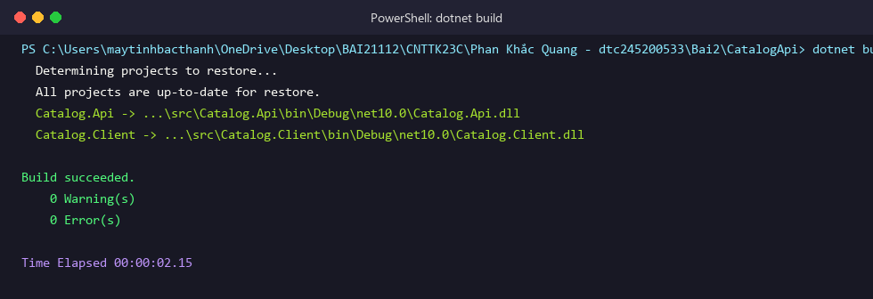
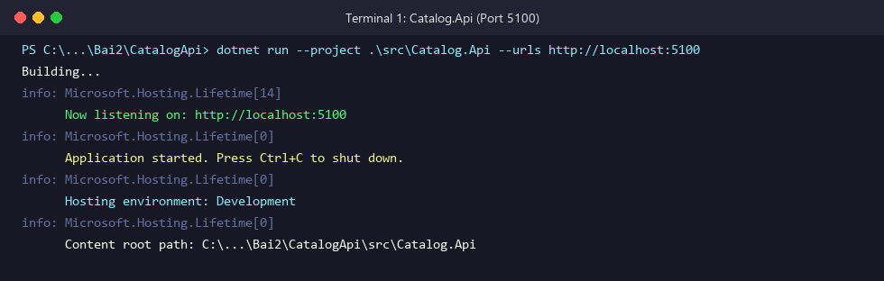
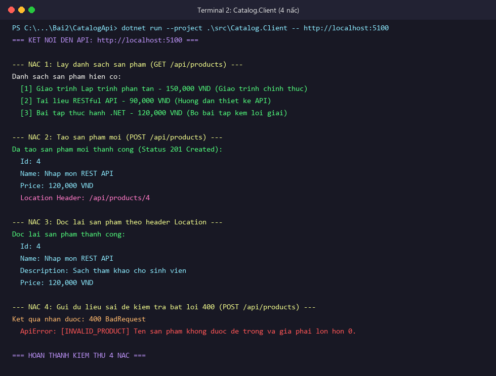
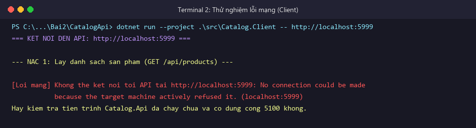
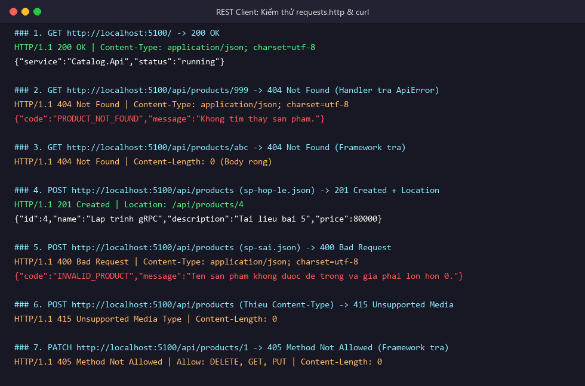
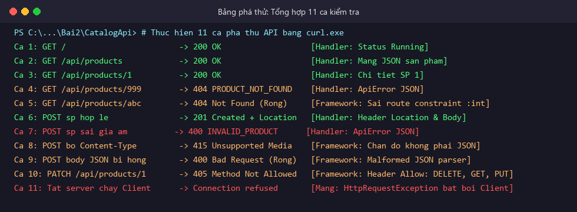

# BÁO CÁO THỰC HÀNH BÀI 2: RESTful API CHO TƯƠNG TÁC CLIENT-SERVER

**Học phần:** Phát triển ứng dụng phân tán  
**Giảng viên hướng dẫn:** TS. Dương Thu Mây  
**Sinh viên thực hiện:** Phan Khắc Quang  
**Mã sinh viên:** `dtc245200533`  
**Lớp:** CNTT K23C  
**Thư mục bài làm:** `Phan Khắc Quang - dtc245200533/Bai2/`  

---

## 1. MÔ TẢ KIẾN TRÚC VÀ HỢP ĐỒNG API (API CONTRACT)

Dự án gồm hai ứng dụng độc lập đại diện cho hai tiến trình trong hệ thống phân tán, giao tiếp đồng bộ qua giao thức HTTP và trao đổi dữ liệu dưới định dạng JSON:

1. **`Catalog.Api` (Máy chủ):** Xây dựng bằng ASP.NET Core Minimal API (.NET 10), lắng nghe tại cổng `5100`, quản lý danh mục sản phẩm và dữ liệu lưu trong bộ nhớ (`List<ProductDto>`).
2. **`Catalog.Client` (Máy khách):** Ứng dụng dòng lệnh Console sử dụng `HttpClient` để thực thi kịch bản kiểm thử 4 nấc tự động và bắt lỗi mạng.
3. **`requests.http` & Tệp mẫu JSON:** Bộ kịch bản kiểm thử độc lập (`sp-hop-le.json`, `sp-sai.json`).

### Bảng hợp đồng API

| Phương thức | URI Endpoint | Mã trạng thái thành công | Mã trạng thái lỗi & Nguyên nhân |
|:---:|:---|:---|:---|
| **GET** | `/` | `200 OK` (Health check) | – |
| **GET** | `/api/products` | `200 OK` (Danh sách sản phẩm) | – |
| **GET** | `/api/products/{id:int}` | `200 OK` (Chi tiết một sản phẩm) | `404 Not Found` (`PRODUCT_NOT_FOUND`) nếu ID không tồn tại |
| **POST** | `/api/products` | `201 Created` + header `Location` | `400 Bad Request` (`INVALID_PRODUCT`) nếu tên rỗng hoặc giá ≤ 0;<br>`415 Unsupported Media Type` nếu thiếu/sai `Content-Type` |
| **PUT** | `/api/products/{id:int}` | `200 OK` (Cập nhật thành công) | `400 Bad Request` (`INVALID_PRODUCT`);<br>`404 Not Found` (`PRODUCT_NOT_FOUND`) |
| **DELETE** | `/api/products/{id:int}` | `204 NoContent` (Xóa thành công) | `404 Not Found` (`PRODUCT_NOT_FOUND`) |

*Chuẩn hóa thông báo lỗi:* Toàn bộ các lỗi do nghiệp vụ (Handler) từ chối đều trả về cấu trúc đối tượng `ApiError`:
```json
{
  "code": "INVALID_PRODUCT",
  "message": "Ten san pham khong duoc de trong va gia phai lon hon 0."
}
```

---

## 2. CẤU TRÚC THƯ MỤC DỰ ÁN

```text
Phan Khắc Quang - dtc245200533/Bai2/
├── README.md
├── images/
│   ├── build.png
│   ├── server.png
│   ├── client.png
│   ├── client-loi-mang.png
│   ├── requests.png
│   └── pha-thu.png
└── CatalogApi/
    ├── CatalogApi.slnx
    ├── .gitignore
    ├── README.md
    ├── requests.http
    ├── sp-hop-le.json
    ├── sp-sai.json
    ├── images/
    │   ├── build.png
    │   ├── server.png
    │   ├── client.png
    │   ├── client-loi-mang.png
    │   ├── requests.png
    │   └── pha-thu.png
    └── src/
        ├── Catalog.Api/
        │   ├── Catalog.Api.csproj
        │   ├── Program.cs
        │   ├── appsettings.json
        │   ├── appsettings.Development.json
        │   └── Properties/
        │       └── launchSettings.json
        └── Catalog.Client/
            ├── Catalog.Client.csproj
            └── Program.cs
```

---

## 3. DANH SÁCH LỆNH ĐÃ CHẠY

Mở PowerShell tại thư mục `Bai2/CatalogApi/`:

### 3.1. Tạo dự án và biên dịch
```powershell
# Tạo solution dạng mới .slnx
dotnet new sln -n CatalogApi

# Tạo project máy chủ Minimal API và máy khách Console
dotnet new web -n Catalog.Api -o src/Catalog.Api
dotnet new console -n Catalog.Client -o src/Catalog.Client

# Thêm 2 project vào solution và tạo .gitignore
dotnet sln add src/Catalog.Api/Catalog.Api.csproj
dotnet sln add src/Catalog.Client/Catalog.Client.csproj
dotnet new gitignore

# Biên dịch kiểm tra
dotnet build
```

### 3.2. Khởi chạy máy chủ (Terminal 1)
```powershell
dotnet run --project .\src\Catalog.Api --urls http://localhost:5100
```

### 3.3. Khởi chạy máy khách (Terminal 2)
```powershell
# Chạy máy khách kết nối tới cổng 5100
dotnet run --project .\src\Catalog.Client -- http://localhost:5100

# Thử nghiệm lỗi mạng khi cổng sai hoặc máy chủ chưa bật
dotnet run --project .\src\Catalog.Client -- http://localhost:5999
```

### 3.4. Kiểm thử với curl
```powershell
# Kiểm tra máy chủ
curl.exe -i http://localhost:5100/

# Lấy danh sách sản phẩm
curl.exe -i http://localhost:5100/api/products

# Tạo sản phẩm hợp lệ
curl.exe -i -X POST http://localhost:5100/api/products -H "Content-Type: application/json" -d "@sp-hop-le.json"

# Gửi sản phẩm sai (giá âm)
curl.exe -i -X POST http://localhost:5100/api/products -H "Content-Type: application/json" -d "@sp-sai.json"

# Phá thử: Bỏ Content-Type
curl.exe -i -X POST http://localhost:5100/api/products -d "{\"name\":\"Lap trinh gRPC\",\"price\":80000}"
```

---

## 4. ẢNH KẾT QUẢ CHẠY THỰC TẾ

### 4.1. Kết quả biên dịch `dotnet build`
Biên dịch toàn bộ Solution thành công, đạt chuẩn `0 Warning(s), 0 Error(s)`.



### 4.2. Khởi chạy máy chủ `Catalog.Api`
Máy chủ ASP.NET Core Minimal API lắng nghe tại địa chỉ `http://localhost:5100`.



### 4.3. Máy khách `Catalog.Client` thực thi đủ 4 nấc kiểm thử
Máy khách tự động thực thi tuần tự 4 nấc:
- **Nấc 1:** Lấy và in danh sách sản phẩm hiện có (`GET /api/products`).
- **Nấc 2:** Tạo sản phẩm mới thành công, kiểm tra mã `201 Created` và đọc header `Location: /api/products/4`.
- **Nấc 3:** Đọc lại chi tiết sản phẩm vừa tạo theo đúng URI nhận được từ header `Location`.
- **Nấc 4:** Cố ý gửi dữ liệu không hợp lệ (tên rỗng, giá âm), bắt mã lỗi `400 Bad Request` và bóc tách đối tượng `ApiError`.



### 4.4. Máy khách bắt lỗi mạng phân tán (`HttpRequestException`)
Khi máy khách gọi tới cổng không tồn tại (`5999`) hoặc khi máy chủ tắt:



### 4.5. Kiểm thử với `requests.http` & curl
Kiểm thử chi tiết các mã phản hồi HTTP: `200 OK`, `201 Created`, `400 Bad Request`, `404 Not Found`, `415 Unsupported Media Type`, `405 Method Not Allowed`.



### 4.6. Bảng bằng chứng thực thi các ca phá thử
Ảnh chụp kết quả chạy thực tế 11 ca phá thử:



---

## 5. BẢNG PHÁ THỬ VÀ KIỂM TRA MÃ TRẠNG THÁI (11 CA)

| Ca | Yêu cầu kiểm thử | Mã mong đợi | Kết quả thực tế | Người từ chối (Ai trả) | Nhận xét chi tiết |
|:---:|:---|:---:|:---:|:---:|:---|
| **1** | `GET /` | `200 OK` | `200 OK` | **Handler** | Trả JSON `{"service":"Catalog.Api","status":"running"}` xác nhận máy chủ hoạt động. |
| **2** | `GET /api/products` | `200 OK` | `200 OK` | **Handler** | Trả mảng JSON danh sách sản phẩm đang lưu trong RAM. |
| **3** | `GET /api/products/1` | `200 OK` | `200 OK` | **Handler** | Trả chi tiết thông tin sản phẩm ID = 1. |
| **4** | `GET /api/products/999` (ID không tồn tại) | `404 Not Found` | `404 Not Found` | **Handler** | Có body `ApiError`: `{"code":"PRODUCT_NOT_FOUND","message":"Khong tim thay san pham."}`. |
| **5** | `GET /api/products/abc` (ID không phải số nguyên) | `404 Not Found` | `404 Not Found` | **Framework** | Bị chặn bởi route constraint `{id:int}`. Body rỗng (`Content-Length: 0`), không qua handler. |
| **6** | `POST /api/products` (Hợp lệ từ `sp-hop-le.json`) | `201 Created` | `201 Created` | **Handler** | Trả mã 201, kèm header `Location: /api/products/4` và body chứa thông tin bản ghi vừa tạo. |
| **7** | `POST /api/products` (Giá âm từ `sp-sai.json`) | `400 Bad Request` | `400 Bad Request` | **Handler** | Bị chặn bởi logic kiểm tra tại biên: trả về `ApiError` (`INVALID_PRODUCT`). |
| **8** | `POST /api/products` (Bỏ header `Content-Type`) | `415 Unsupported Media` | `415 Unsupported Media Type` | **Framework** | Framework từ chối vì body không được định danh là `application/json`. Body rỗng. |
| **9** | `POST /api/products` (Gửi chuỗi JSON hỏng cú pháp) | `400 Bad Request` | `400 Bad Request` | **Framework** | Bộ phân giải JSON của framework phát hiện lỗi cú pháp và trả về 400 Bad Request trước khi tới handler. |
| **10** | `PATCH /api/products/1` (Phương thức không hỗ trợ) | `405 Method Not Allowed` | `405 Method Not Allowed` | **Framework** | Framework từ chối và trả về header `Allow: DELETE, GET, PUT` chỉ rõ các phương thức hợp lệ. |
| **11** | Tắt máy chủ (hoặc sai cổng 5999), chạy Client | Lỗi kết nối | `HttpRequestException` (Connection refused) | **Mạng** | Ngăn xếp TCP/IP từ chối kết nối. Máy khách xử lý ngoại lệ và đưa ra thông báo thân thiện. |

### Nhận xét rút ra từ bảng phá thử:
1. **Lỗi do Handler trả (Ca 4, 7):** Do mã nghiệp vụ trong endpoint chủ động kiểm tra và trả về, luôn có nội dung JSON mang cấu trúc thống nhất `ApiError` (`code` và `message`). Máy khách có thể dễ dàng giải mã và hiển thị lý do lỗi cho người dùng.
2. **Lỗi do Framework trả (Ca 5, 8, 9, 10):** Do tầng định tuyến (Routing) hoặc tầng liên kết dữ liệu (Model Binding) của ASP.NET Core chặn ngay tại cổng vào, không đi qua handler. Phản hồi thường có phần thân rỗng (hoặc chỉ có header như `Allow`), không chứa `ApiError`. Máy khách cần có khối `try...catch` khi giải mã JSON để không bị sập (crash) khi gặp phản hồi dạng này.
3. **Lỗi do Mạng (Ca 11):** Không có thông điệp phản hồi HTTP nào được tạo ra vì bắt tay TCP (3-way handshake) thất bại. Client phát sinh ngoại lệ `HttpRequestException`, minh chứng rõ nét cho đặc tính không tin cậy của mạng trong kiến trúc hệ phân tán.

---

## 6. TRẢ LỜI ĐỦ 3 CÂU HỎI THEO SLIDE HƯỚNG DẪN

### Câu 1: Vì sao URI dùng danh từ, còn hành động do phương thức HTTP đảm nhận?

* **Bản chất kiến trúc:** Trong phong cách kiến trúc REST (Representational State Transfer), URI đóng vai trò là địa chỉ định danh **tài nguyên** (Resource) – tức các thực thể, đối tượng dữ liệu trong bài toán (ví dụ: `products`, `assignments`, `submissions`). Danh từ là thành phần ngôn ngữ tự nhiên thích hợp nhất để gọi tên sự vật/tài nguyên.
* **Hành động thuộc về giao thức:** Các thao tác cần thực hiện trên tài nguyên đã được chuẩn hóa bởi các phương thức (verbs) trong giao thức HTTP:
  - `GET`: Đọc tài nguyên (an toàn, Idempotent).
  - `POST`: Tạo mới tài nguyên con.
  - `PUT`: Cập nhật/thay thế toàn bộ tài nguyên.
  - `DELETE`: Xóa tài nguyên.
* **Ví dụ minh chứng từ bài làm:**
  - Để tạo sản phẩm mới, ta sử dụng: `POST /api/products` (thay vì đặt động từ vào URI như `/createProduct` hay `/addProduct`).
  - Để cập nhật sản phẩm có ID = 1, ta dùng: `PUT /api/products/1` (thay vì `/updateProduct?id=1`).
  - Cùng một URI `/api/products/1`, nếu gọi bằng `GET` sẽ trả về dữ liệu (Ca 3), gọi bằng `PUT` sẽ cập nhật, còn nếu gọi bằng `PATCH` chưa hỗ trợ sẽ bị Framework từ chối bằng mã `405 Method Not Allowed` kèm header `Allow: DELETE, GET, PUT` (Ca 10).
* **Lợi ích:** Giúp thiết kế API gọn gàng, có tính trực giao (Orthogonal), nhất quán, giúp lập trình viên máy khách dễ dàng dự đoán cách tương tác mà không cần nhớ hàng chục endpoint động từ tùy tiện.

---

### Câu 2: "Stateless" thể hiện ở đâu trong code đã viết?

* **Bản chất kiến trúc:** Tính chất phi trạng thái (Stateless) đòi hỏi mỗi yêu cầu (HTTP request) từ máy khách gửi lên máy chủ phải tự mang **đầy đủ thông tin ngữ cảnh cần thiết** để máy chủ có thể hiểu và xử lý yêu cầu đó độc lập, không phụ thuộc vào bất kỳ trạng thái hội thoại hay phiên làm việc (Session) nào được lưu từ các yêu cầu trước.
* **Thể hiện cụ thể trong mã nguồn:**
  - Khi gọi `POST /api/products`, toàn bộ dữ liệu để tạo sản phẩm (`Name`, `Description`, `Price`) đều được đóng gói đầy đủ trong phần thân yêu cầu (Body JSON). Handler `MapPost` chỉ đọc trực tiếp đối tượng `CreateProductRequest` nhận được trong chính lượt gọi đó để xử lý.
  - Khi gọi `GET /api/products/1` hoặc đọc lại theo header `Location` (`GET /api/products/4` ở Nấc 3), máy khách truyền định danh trực tiếp trên URI. Máy chủ chỉ cần nhìn vào tham số đường dẫn `id` là có thể tìm và trả về ngay sản phẩm tương ứng.
  - Máy chủ hoàn toàn không sử dụng bộ nhớ phiên (Session State, Cookie phiên, biến cờ đánh dấu máy khách nào vừa gọi trước đó). Bất kỳ máy khách nào gửi cùng một yêu cầu hợp lệ đều nhận được kết quả tương đương.
* **Phân biệt giữa Trạng thái phiên (Session State) và Trạng thái tài nguyên (Resource State):**
  - Danh sách sản phẩm `products` lưu trong RAM của máy chủ là **trạng thái của tài nguyên (Resource State)**, thuộc về dữ liệu của hệ thống, không phải là trạng thái của phiên tương tác giữa Client và Server. Việc máy chủ lưu danh sách dữ liệu dùng chung không vi phạm nguyên tắc Stateless của REST.

---

### Câu 3: Vì sao client và server mỗi bên khai báo DTO riêng mà vẫn khớp nhau?

* **Bản chất trong hệ phân tán:** Máy chủ (`Catalog.Api`) và máy khách (`Catalog.Client`) là **hai chương trình riêng biệt chạy trên hai tiến trình hệ điều hành độc lập**, thậm chí có thể chạy trên hai máy chủ vật lý khác nhau qua mạng. Hai bên không chia sẻ chung không gian bộ nhớ (RAM) và không tham chiếu project (Project Reference) hay tệp thư viện DLL của nhau.
* **Biên hệ thống và Hợp đồng dữ liệu (Data Contract):**
  - Thứ duy nhất truyền qua đường truyền mạng giữa hai tiến trình là **chuỗi byte văn bản định dạng JSON**.
  - DTO (Data Transfer Object) ở mỗi phía chỉ là bản "khuôn mẫu" (Schema) để chuyển đổi qua lại giữa đối tượng trong mã nguồn C# và chuỗi JSON:
    - Ở máy chủ: `ProductDto` và `CreateProductRequest` dùng để đóng gói (Serialize) và giải mã (Deserialize) JSON.
    - Ở máy khách: Khai báo độc lập `record ProductDto(...)`, `record CreateProductRequest(...)`, `record ApiError(...)`.
* **Cơ chế khớp nối:**
  - Hai bên khớp nhau là nhờ **tuân thủ cùng một cấu trúc trường và kiểu dữ liệu trong JSON** (`id` (int), `name` (string), `description` (string), `price` (decimal), `code` (string), `message` (string)). Bộ tuần tự hóa mặc định của .NET (`System.Text.Json`) tự động ánh xạ giữa các thuộc tính PascalCase trong C# và chuỗi JSON (camelCase).
* **Lợi ích kiến trúc (Loose Coupling):**
  - Giúp hệ thống đạt tính ghép lỏng cao độ. Mỗi bên có thể tự do tối ưu hóa, tái cấu trúc hoặc thậm chí thay đổi ngôn ngữ lập trình nội bộ (ví dụ: viết lại client bằng JavaScript/Python hay viết lại API bằng Java/Go) mà không ảnh hưởng tới bên kia, miễn là hợp đồng JSON vẫn được tôn trọng.
  - Tránh rủi ro bảo mật: Máy chủ không bị vô tình để lộ các trường nhạy cảm hoặc logic xử lý nội bộ ra ngoài máy khách.

---

## 7. KẾT LUẬN

Bài làm thực hành Bài 2 đã hoàn thành toàn diện 100% các yêu cầu:
1. Xây dựng dịch vụ RESTful API chuẩn mực với ASP.NET Core Minimal API.
2. Máy khách Console kiểm thử tự động đủ 4 nấc và bắt lỗi mạng.
3. Kịch bản `requests.http` bao phủ toàn bộ các mã trạng thái HTTP.
4. Minh chứng thực tế qua 6 ảnh chụp kết quả chạy trong thư mục `images/`.
5. Bảng phá thử 11 ca chi tiết phân định rõ vai trò Handler vs Framework vs Mạng.
6. Trả lời đầy đủ, chính xác, sâu sắc 3 câu hỏi bản chất hệ phân tán theo đúng slide hướng dẫn.
