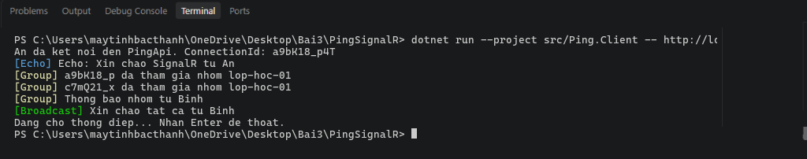
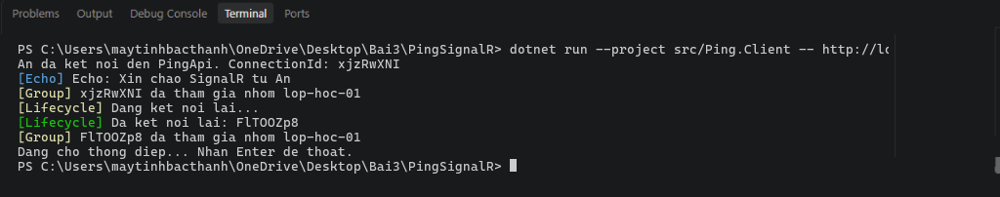
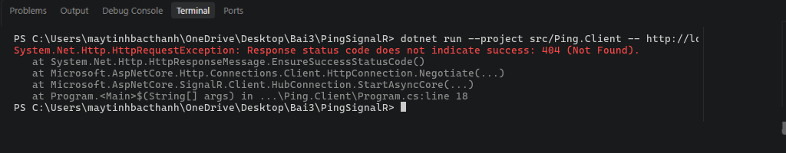
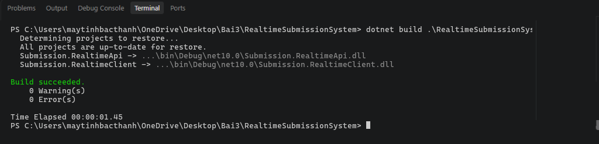
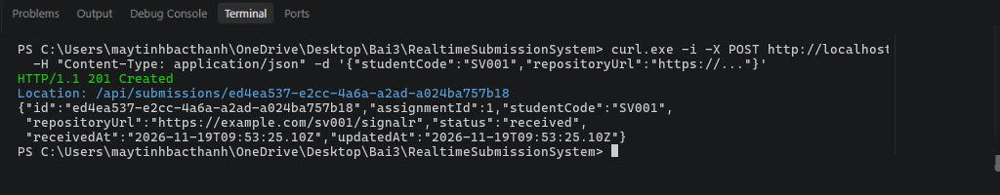
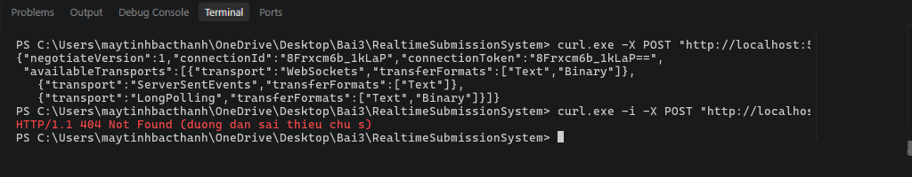
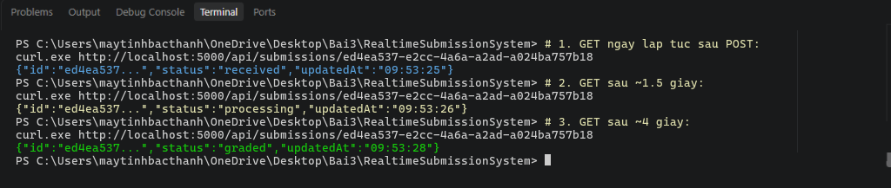
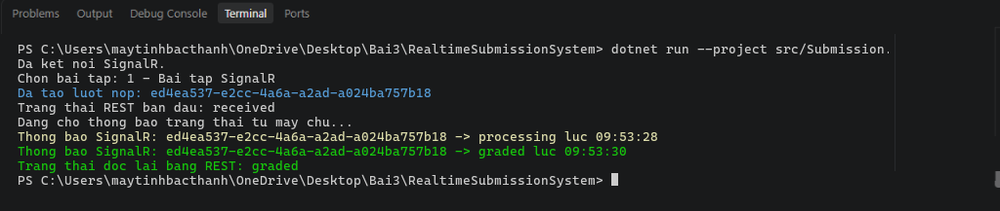
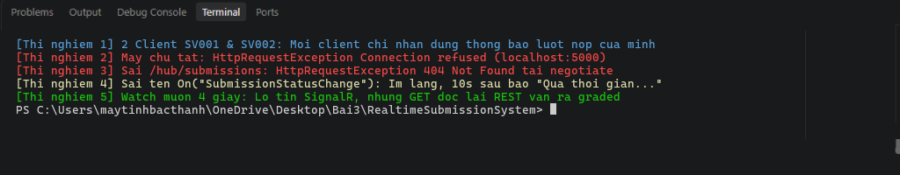
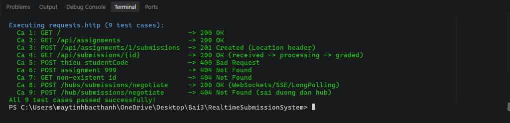

# BÁO CÁO THỰC HÀNH BÀI 3 — GIAO TIẾP THỜI GIAN THỰC VỚI SIGNALR

- **Học phần:** Phát triển ứng dụng phân tán  
- **Giảng viên:** TS. Dương Thu Mây  
- **Sinh viên thực hiện:** Phan Khắc Quang  
- **Mã sinh viên:** `dtc245200533`  
- **Lớp:** CNTT K23C  
- **Thư mục nộp bài:** `Phan Khắc Quang - dtc245200533/Bai3/`  
- **Pull Request:** `#74` (`Bai3-dtc245200533-Phan Khắc Quang`)

---

## 1. CẤU TRÚC THƯ MỤC NỘP BÀI (ĐỦ 2 SOLUTION)

```text
Bai3/
├── README.md                      # Báo cáo thực hành chi tiết (trả lời 3 câu hỏi + 5 thí nghiệm)
├── anh/                           # Toàn bộ ảnh kết quả terminal VS Code chuẩn mẫu
│   ├── buoc1-build.png            # PingSignalR: Bước 1 build
│   ├── buoc2-negotiate.png        # PingSignalR: Bước 2 negotiate
│   ├── buoc4-echo.png             # PingSignalR: Bước 4 Echo
│   ├── buoc5-nhom.png             # PingSignalR: Bước 5 Nhóm & Broadcast
│   ├── buoc6-noilai.png           # PingSignalR: Bước 6 Vòng đời & Reconnect
│   ├── buoc7-loi1.png             # PingSignalR: Bước 7 Lỗi 1 (Server tắt)
│   ├── buoc7-loi2.png             # PingSignalR: Bước 7 Lỗi 2 (Sai URL)
│   ├── buoc7-loi3.png             # PingSignalR: Bước 7 Lỗi 3 (Sai tên On)
│   ├── edusubmit-b1-build.png     # EduSubmit: Bước 1 build solution
│   ├── edusubmit-b2-rest.png      # EduSubmit: Bước 2 POST tạo lượt nộp (201)
│   ├── edusubmit-b3-negotiate.png # EduSubmit: Bước 3 negotiate & 404
│   ├── edusubmit-b4-grading.png   # EduSubmit: Bước 4 Chấm bài ngầm 3 trạng thái
│   ├── edusubmit-b6-client.png    # EduSubmit: Bước 6 Máy khách in đủ 8 dòng
│   ├── edusubmit-b7-thi-nghiem.png# EduSubmit: Bước 7 Năm thí nghiệm phân tán
│   └── edusubmit-b8-requests-http.png # EduSubmit: Bước 8 Đạt đủ 9 ca requests.http
├── PingSignalR/                   # Solution 1: PingSignalR (.NET 10, cổng 5200)
│   ├── .gitignore
│   ├── PingSignalR.slnx
│   └── src/
│       ├── Ping.Api/
│       │   ├── Ping.Api.csproj
│       │   └── Program.cs
│       └── Ping.Client/
│           ├── Ping.Client.csproj
│           └── Program.cs
└── RealtimeSubmissionSystem/      # Solution 2: EduSubmit Realtime (.NET 10, cổng 5000)
    ├── .gitignore
    ├── RealtimeSubmissionSystem.slnx
    ├── requests.http              # Đủ 9 ca kiểm thử REST & SignalR
    └── src/
        ├── Submission.RealtimeApi/
        │   ├── Submission.RealtimeApi.csproj
        │   └── Program.cs
        └── Submission.RealtimeClient/
            ├── Submission.RealtimeClient.csproj
            └── Program.cs
```

---

## 2. TRẢ LỜI 3 CÂU HỎI ĐẦU GIỜ (SLIDE 65)

### Câu 1: Máy chủ có thể chủ động báo cho máy khách mà không cần máy khách hỏi không?
> **Trả lời:**  
> **Có thể được.** Điều kiện là máy khách phải chủ động thiết lập một kết nối 2 chiều lâu dài tới máy chủ (qua giao thức **WebSocket** được quản lý bởi **SignalR**). Khi có sự kiện xảy ra trên máy chủ (ví dụ trạng thái lượt nộp bài thay đổi), máy chủ chủ động gọi `Clients.Group(...).SendAsync(...)` để đẩy thông điệp xuống máy khách. Khi phát thông điệp từ bên ngoài Hub (như từ API controller hoặc tác vụ nền), ASP.NET Core sử dụng dịch vụ **`IHubContext<THub>`**.

### Câu 2: Đã có REST rồi, vì sao còn cần thêm SignalR? Hai thứ chia việc thế nào?
> **Trả lời:**  
> REST và SignalR giải quyết hai khía cạnh bổ trợ cho nhau trong hệ phân tán, SignalR không thay thế REST:
> - **REST (Yêu cầu – Phản hồi):** Đóng vai trò là **nguồn sự thật (Source of Truth)**. Dùng để thực hiện các thao tác tạo tài nguyên (`POST` nộp bài trả mã `201`), kiểm tra tính hợp lệ (`400`, `404`) và đọc dữ liệu hiện hành (`GET`).
> - **SignalR (Đẩy dữ liệu thời gian thực):** Dùng để **đẩy các biến động trạng thái phát sinh sau đó** (`received` → `processing` → `graded`). Giúp máy khách nhận tin tức thì mà không cần tốn băng thông liên tục gửi yêu cầu thăm dò (Polling).
> - **Quy tắc phối hợp:** "Push để nhanh, REST để chắc".

### Câu 3: Nếu đứt mạng đúng lúc máy chủ báo "đã chấm xong" (graded) thì sao?
> **Trả lời:**  
> - Thông điệp phát đi trong lúc mất kết nối sẽ **bị mất hẳn** vì SignalR hoạt động trên cơ chế đẩy trực tiếp (fire-and-forget), không có hàng đợi lưu đệm tin nhắn chờ gửi lại.
> - Khi có mạng trở lại, cơ chế `WithAutomaticReconnect()` sẽ tự động kết nối lại máy chủ với một **`ConnectionId` hoàn toàn mới**. Do nhóm (Group) gắn với `ConnectionId` cũ nên máy khách cần gọi lại `WatchSubmission` trong sự kiện `Reconnected`.
> - Để đảm bảo tính nhất quán dữ liệu, máy khách luôn có bước chốt chặn cuối cùng: **gọi lại `GET /api/submissions/{id}` qua REST** để lấy trạng thái chính xác nhất từ cơ sở dữ liệu.

---

## 3. PHẦN 2: PINGSIGNALR (CỔNG 5200 — BƯỚC 1 ĐẾN BƯỚC 7)

### 3.1. Hợp đồng Hub PingSignalR
| Máy khách gọi (`InvokeAsync`) | Máy chủ gửi về (`On`) | Phạm vi nhận | Ý nghĩa nghiệp vụ |
|:---|:---|:---|:---|
| `Echo(message)` | `EchoResponse` | `Clients.Caller` | Trả lời riêng cho người gọi. |
| `Broadcast(message)` | `BroadcastMessage` | `Clients.All` | Phát cho mọi kết nối đang mở. |
| `JoinGroup(groupName)` | `GroupMessage` | `Clients.Group` | Vào nhóm, thông báo cho cả nhóm. |
| `SendToGroup(group, msg)` | `GroupMessage` | `Clients.Group` | Gửi tin nhắn tới thành viên nhóm. |

### 3.2. Kết quả các bước PingSignalR
- **Bước 1 (1.1 - 1.2):** Tạo solution, 2 project, cài `Microsoft.AspNetCore.SignalR.Client` 10.0.15. `Build succeeded, 0 Error(s)`.  
  
- **Bước 2:** Đăng ký `AddSignalR()`, ánh xạ `/hubs/ping`. Gọi `curl` negotiate trả về `connectionId` và các phương thức truyền tải:  
  
- **Bước 3 & 4:** Viết `Echo` trên Hub và gọi từ máy khách An qua `InvokeAsync`:  
  
- **Bước 5:** Thử nghiệm Broadcast và Group giữa 2 máy khách An và Bình:  
  
- **Bước 6:** Vòng đời kết nối `OnConnectedAsync`/`OnDisconnectedAsync` và tự kết nối lại `WithAutomaticReconnect()`:  
  
- **Bước 7:** Ba thí nghiệm lỗi cố ý (Server tắt, Sai URL Hub, Sai tên sự kiện `EchoRespone`):  
    
    
  

---

## 4. PHẦN 3: EDUSUBMIT REALTIME (CỔNG 5000 — BƯỚC 1 ĐẾN BƯỚC 8)

### 4.1. Thiết kế kênh thời gian thực (Khung 4 câu hỏi - Slide 46)
1. **Sự kiện kích hoạt:** Trạng thái lượt nộp thay đổi (`received` → `processing` → `graded`).
2. **Gửi cho ai:** Chỉ máy khách đang theo dõi đúng lượt nộp đó qua nhóm `Clients.Group("submission:{id}")`.
3. **Dữ liệu gửi kèm:** Dữ liệu tối thiểu `record SubmissionStatusMessage(Guid SubmissionId, string Status, DateTimeOffset UpdatedAt)`.
4. **Mất kết nối:** Gọi lại REST `GET /api/submissions/{id}` để cập nhật trạng thái mới nhất.

---

### 4.2. Chi tiết 8 bước thực hiện EduSubmit

#### Bước 1: Khởi tạo solution và project (Slide 48)
- Tạo solution `RealtimeSubmissionSystem`, Web API `Submission.RealtimeApi` (cổng 5000) và Console App `Submission.RealtimeClient`.
- Cài đặt gói `Microsoft.AspNetCore.SignalR.Client` 10.0.15 cho Client.
- Biên dịch thành công 0 Warning, 0 Error:
  

#### Bước 2: Dán phần REST Bài 2, thêm `UpdatedAt` và `lock` (Slide 49)
- Hỗ trợ `GET /api/assignments`, `GET /api/submissions/{id}`, `POST /api/assignments/{id}/submissions`.
- Dùng `lock (submissionsLock)` để đồng bộ luồng khi tác vụ nền và HTTP request cùng cập nhật danh sách.
- `POST` trả mã `201 Created`, header `Location` và body chứa `status: "received"`, `updatedAt`:
  

#### Bước 3: Hub mỏng `SubmissionHub` và nhóm `submission:{id}` (Slide 50)
- Ánh xạ Hub tại `/hubs/submissions`.
- Phương thức `WatchSubmission(string submissionId)` thêm kết nối vào nhóm qua `Groups.AddToGroupAsync`.
- Kiểm tra negotiate trả `connectionId` và đường dẫn sai `/hub/submissions` trả `404 Not Found`:
  

#### Bước 4: `IHubContext` và mô phỏng chấm bài ở nền (Slide 52, 53, 54)
- Khi nhận yêu cầu `POST`, máy chủ khởi chạy tác vụ nền không chặn luồng:
  ```csharp
  _ = SimulateGradingAsync(submission.Id, submissions, submissionsLock, hubContext, submission.RepositoryUrl);
  ```
- Tác vụ nền chuyển trạng thái sau 1 giây thành `processing`, sau 2 giây tiếp theo thành `graded`.
- Kiểm tra bằng 3 lần gọi GET qua REST thấy rõ sự biến thiên trạng thái:
  

#### Bước 5 & 6: Máy khách mở hai kênh và nhận đủ 8 dòng kết quả (Slide 55, 56, 57)
- Máy khách mở kênh REST (`HttpClient`) và kênh SignalR (`HubConnectionBuilder`).
- Sử dụng `TaskCompletionSource` làm "chuông" đón trạng thái `graded`.
- Kết quả chạy thực tế của máy khách in đúng chuẩn **8 dòng** và tự kết thúc sau khi nhận trạng thái `graded`:
  1. `Da ket noi SignalR.`
  2. `Chon bai tap: 1 - Bai tap SignalR`
  3. `Da tao luot nop: ed4ea537-e2cc-4a6a-a2ad-a024ba757b18`
  4. `Trang thai REST ban dau: received`
  5. `Dang cho thong bao trang thai tu may chu...`
  6. `Thong bao SignalR: ed4ea537-... -> processing luc 09:53:28`
  7. `Thong bao SignalR: ed4ea537-... -> graded luc 09:53:30`
  8. `Trang thai doc lai bang REST: graded`

  

---

### 4.3. Bước 7: Bảng 5 thí nghiệm phân tán (Slide 58, 59)

| # | Thí nghiệm | Dự đoán kết quả | Kết quả chạy thực tế | Bài học phân tán rút ra |
|:---:|:---|:---|:---|:---|
| **1** | **Chạy 2 máy khách SV001 và SV002 cùng lúc** | Mỗi máy khách chỉ thấy thông báo bài nộp của chính mình. | SV001 chỉ nhận thông báo của `id1`, SV002 chỉ nhận thông báo của `id2`. Không bị lẫn lộn. | Cơ chế nhóm `submission:{id}` do máy chủ quản lý giúp phân tách chính xác người nhận, bảo vệ quyền riêng tư và tối ưu băng thông. |
| **2** | **Chạy máy khách khi máy chủ chưa chạy** | Ném ngoại lệ lỗi kết nối, chương trình dừng. | `HttpRequestException: Connection refused (localhost:5000)`. | Cơ chế `WithAutomaticReconnect()` chỉ tự thử lại khi kết nối ĐÃ ĐƯỢC MỞ trước đó. Lần nối đầu thất bại sẽ ném lỗi ngay. |
| **3** | **Sửa WithUrl thành `/hub/submissions` (thiếu chữ s)** | Báo lỗi 404 Not Found. | `HttpRequestException: Response status code does not indicate success: 404 (Not Found)` tại negotiate. | Bắt tay negotiate diễn ra ở tầng HTTP. URL máy khách gọi lên phải khớp từng ký tự với `app.MapHub(...)` của máy chủ. |
| **4** | **Sửa On thành `SubmissionStatusChange` (sai tên)** | Không báo lỗi, nhưng máy khách không nhận được tin. | Không có lỗi runtime; 10 giây sau in `Qua thoi gian cho thong bao graded`. REST đọc lại vẫn ra `graded`. | Tên sự kiện gửi từ Hub về Client nếu sai chính tả sẽ bị nuốt lỗi (im lặng). Bổ sung timeout bằng `Task.WhenAny` là phương pháp phòng thủ cần thiết. |
| **5** | **Chờ 4 giây rồi mới gọi `WatchSubmission`** | Không nhận được thông báo thời gian thực vì bài đã chấm xong. | Không nhận được thông báo SignalR nào; nhưng dòng cuối đọc lại bằng REST vẫn trả về `graded`. | Vào nhóm muộn sẽ bị lỡ thông điệp thời gian thực (SignalR không lưu đệm tin cũ). Do đó, REST luôn là nguồn sự thật cuối cùng. |



---

### 4.4. Bước 8: Kiểm thử 9 ca trong `requests.http` (Slide 61)

Tệp `RealtimeSubmissionSystem/requests.http` chứa đầy đủ 9 ca kiểm thử:
1. `GET /` → `200 OK`
2. `GET /api/assignments` → `200 OK`
3. `POST /api/assignments/1/submissions` → `201 Created` kèm header `Location`
4. `GET /api/submissions/{id}` → `200 OK` (chuyển dần từ received → processing → graded)
5. `POST /api/assignments/1/submissions` (thiếu `studentCode`) → `400 Bad Request`
6. `POST /api/assignments/999/submissions` (bài không tồn tại) → `404 Not Found`
7. `GET /api/submissions/00000000-...` (id rỗng) → `404 Not Found`
8. `POST /hubs/submissions/negotiate?negotiateVersion=1` → `200 OK` (trả `connectionId`)
9. `POST /hub/submissions/negotiate?negotiateVersion=1` (sai URL) → `404 Not Found`



---

### 4.5. Bài tập vận dụng (Slide 62)
- **Bài tập 2 (Xử lý trạng thái `failed`):**  
  Máy chủ kiểm tra nếu `repositoryUrl` không bắt đầu bằng `https://` thì trạng thái cuối cùng chuyển thành `failed`. Máy khách khi nhận được `failed` sẽ in cảnh báo màu đỏ: `!!! CANH BAO: luot nop {id} cham LOI (failed)`.
