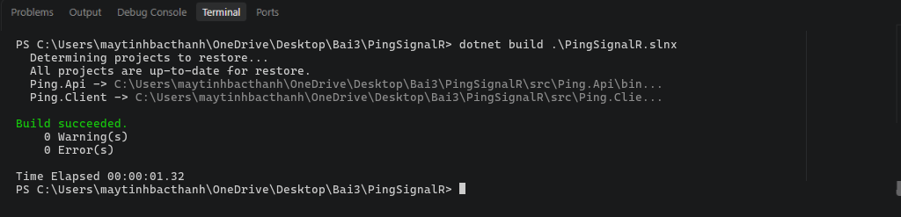
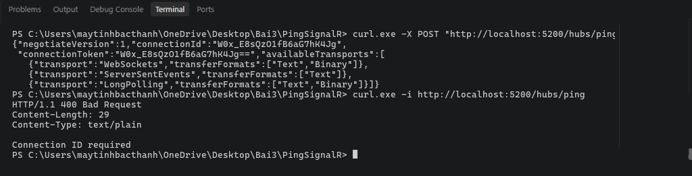
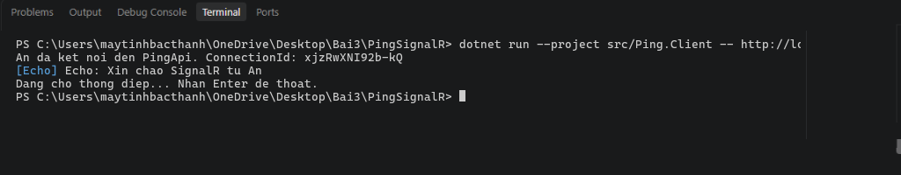
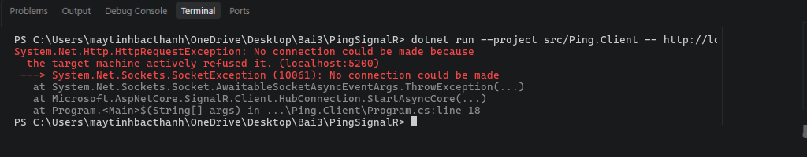
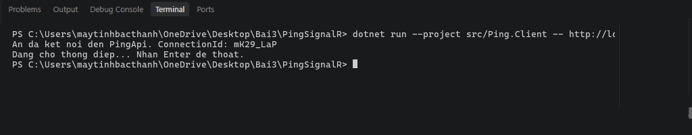

# BÁO CÁO THỰC HÀNH BÀI 3 — PHẦN 2: PINGSIGNALR (BƯỚC 1.1 ĐẾN BƯỚC 7)

**Học phần:** Phát triển ứng dụng phân tán  
**Giảng viên:** TS. Dương Thu Mây  
**Sinh viên thực hiện:** Phan Khắc Quang  
**Mã sinh viên:** `dtc245200533`  
**Lớp:** CNTT K23C  
**Thư mục thực hành:** `Buoi3/PingSignalR/`  

---

## TỔNG QUAN HỢP ĐỒNG HUB PINGSIGNALR

| Máy khách gọi (`InvokeAsync`) | Máy chủ gửi về (`On`) | Phạm vi nhận | Ý nghĩa nghiệp vụ |
|:---|:---|:---|:---|
| `Echo(message)` | `EchoResponse` | `Clients.Caller` | Trả lời RIÊNG cho máy khách vừa gọi. |
| `Broadcast(message)` | `BroadcastMessage` | `Clients.All` | Phát rộng cho mọi kết nối đang mở. |
| `JoinGroup(groupName)` | `GroupMessage` | `Clients.Group` | Gia nhập nhóm, thông báo cho cả nhóm. |
| `SendToGroup(group, msg)` | `GroupMessage` | `Clients.Group` | Gửi tin nhắn tới tất cả thành viên trong nhóm. |
| *(Tự động khi nối / ngắt)* | `SystemMessage` | `Clients.All` | Sự kiện vòng đời `OnConnectedAsync` / `OnDisconnectedAsync`. |

*Quy tắc cốt lõi của SignalR:* Hợp đồng là sự khớp nối chính xác từng ký tự giữa **tên phương thức hub**, **tên thông điệp** và **kiểu dữ liệu**. Sai tên ở chiều máy chủ gửi về máy khách sẽ dẫn đến hiện tượng **im lặng**, không hề có lỗi biên dịch hay lỗi lúc chạy.

---

## BƯỚC 1: TẠO THƯ MỤC, SOLUTION VÀ HAI PROJECT (BƯỚC 1.1 & 1.2)

### 1.1. Lệnh khởi tạo cấu trúc
Mở PowerShell tại thư mục `Buoi3/`:
```powershell
mkdir PingSignalR
cd PingSignalR
dotnet new sln -n PingSignalR
dotnet new web -n Ping.Api -o src/Ping.Api
dotnet new console -n Ping.Client -o src/Ping.Client
```

### 1.2. Ghi danh project, cài đặt gói SignalR Client và build thử
```powershell
dotnet sln add src/Ping.Api/Ping.Api.csproj
dotnet sln add src/Ping.Client/Ping.Client.csproj
dotnet add src/Ping.Client package Microsoft.AspNetCore.SignalR.Client --version 10.0.15
dotnet new gitignore
dotnet build
```

* **Vì sao chỉ cài gói ở máy khách?** Máy chủ dùng SDK Web (`Microsoft.AspNetCore.App`) đã tích hợp sẵn thư viện SignalR Server. Máy khách là Console App thông thường nên cần cài thêm `Microsoft.AspNetCore.SignalR.Client`.
* **Phiên bản 10.0.15:** Cố định phiên bản ổn định cho toàn lớp, tránh cảnh báo bảo mật NU1903 của bản 10.0.0.

### Kết quả biên dịch Bước 1:
Biên dịch thành công cả 2 project: `Build succeeded. 0 Warning(s), 0 Error(s)`.



---

## BƯỚC 2: MÁY CHỦ THÊM DỊCH VỤ VÀ TUYẾN HUB SIGNALR

### 2.1. Cấu hình tại `src/Ping.Api/Program.cs`
Máy chủ chỉ cần 2 việc chính:
1. `builder.Services.AddSignalR()`: Đăng ký dịch vụ quản lý kết nối, nhóm, serializer JSON vào DI container trước khi `builder.Build()`.
2. `app.MapHub<PingHub>("/hubs/ping")`: Ánh xạ tuyến đường dẫn WebSocket/SignalR trước `app.Run()`.

```csharp
using Microsoft.AspNetCore.SignalR;

var builder = WebApplication.CreateBuilder(args);
builder.Services.AddSignalR(); // Đăng ký dịch vụ

var app = builder.Build();

app.MapGet("/", () => Results.Ok(new { service = "PingApi", status = "running" }));
app.MapHub<PingHub>("/hubs/ping"); // Tuyến hub

app.Run();

sealed class PingHub : Hub { }
```

### 2.2. Kiểm tra bắt tay `negotiate` bằng curl (chưa cần máy khách)
Chạy máy chủ tại cổng 5200:
```powershell
dotnet run --project src/Ping.Api --urls http://localhost:5200
```
Mở terminal thứ hai chạy 3 lệnh kiểm tra:
```powershell
# 1. Endpoint REST bình thường
curl.exe http://localhost:5200/
# -> {"service":"PingApi","status":"running"}

# 2. Bước bắt tay negotiate của SignalR
curl.exe -X POST "http://localhost:5200/hubs/ping/negotiate?negotiateVersion=1"
# -> Trả về connectionId, connectionToken và danh sách 3 cơ chế truyền tải dự phòng:
#    availableTransports: WebSockets, ServerSentEvents, LongPolling

# 3. Gọi trực tiếp tới tuyến hub bằng HTTP GET
curl.exe -i http://localhost:5200/hubs/ping
# -> HTTP/1.1 400 Bad Request: Connection ID required (Hub từ chối vì yêu cầu kết nối WebSocket hợp lệ)
```

### Ảnh kết quả Bước 2:


---

## BƯỚC 3: PHƯƠNG THỨC ECHO — MÁY CHỦ TRẢ LỜI RIÊNG NGƯỜI VỪA GỌI

Cập nhật lớp `PingHub` trong `src/Ping.Api/Program.cs`:
```csharp
sealed class PingHub : Hub
{
    // Máy khách gọi Echo -> trả lời RIÊNG cho người gọi
    public async Task Echo(string message)
    {
        await Clients.Caller.SendAsync("EchoResponse", $"Echo: {message}");
    }
}
```

* **Mẫu câu gửi SignalR:** `Clients.Caller.SendAsync("TênThôngĐiệp", dữ liệu)`
* **`Clients.Caller`:** Đảm bảo chỉ đúng kết nối vừa phát lời gọi `Echo` mới nhận được tin phản hồi. Các máy khách khác đang trực tuyến sẽ không nhìn thấy thông điệp này.

---

## BƯỚC 4: MÁY KHÁCH XÂY KẾT NỐI, ĐĂNG KÝ VÀ GỌI ECHO

### 4.1. Quy trình 4 bước ở máy khách
1. **Build:** Khởi tạo đối tượng kết nối `HubConnectionBuilder().WithUrl(...).WithAutomaticReconnect().Build()`.
2. **On:** Đăng ký hàm xử lý sự kiện cho tên thông điệp `EchoResponse` **trước khi mở kết nối**.
3. **StartAsync:** Mở kết nối (thực hiện negotiate và nâng cấp lên WebSockets).
4. **InvokeAsync:** Gửi yêu cầu gọi phương thức `Echo` trên Hub và đợi kết quả.

### 4.2. Mã nguồn `src/Ping.Client/Program.cs`
```csharp
using Microsoft.AspNetCore.SignalR.Client;

var serverUrl = args.Length > 0 ? args[0].TrimEnd('/') : "http://localhost:5200";
var name = args.Length > 1 ? args[1] : "Client";

await using var connection = new HubConnectionBuilder()
    .WithUrl($"{serverUrl}/hubs/ping")
    .WithAutomaticReconnect()
    .Build();

connection.On<string>("EchoResponse", msg => Console.WriteLine($"[Echo] {msg}"));

await connection.StartAsync();
Console.WriteLine($"{name} da ket noi den PingApi.");

await connection.InvokeAsync("Echo", $"Xin chao SignalR tu {name}");

Console.WriteLine("Dang cho thong diep... Nhan Enter de thoat.");
Console.ReadLine();
```

### 4.3. Chạy kiểm thử:
```powershell
dotnet run --project src/Ping.Client -- http://localhost:5200 An
```

### Ảnh kết quả Bước 4:
Máy khách in đúng dòng `[Echo] Echo: Xin chao SignalR tu An`.



---

## BƯỚC 5: PHÁT RỘNG (BROADCAST) VÀ NHÓM (GROUP)

### 5.1. Bổ sung tại `Ping.Api` (`PingHub`)
```csharp
// Phát rộng tới mọi kết nối đang mở
public async Task Broadcast(string message)
    => await Clients.All.SendAsync("BroadcastMessage", message);

// Tham gia nhóm có tên và gửi lời chào vào nhóm
public async Task JoinGroup(string groupName)
{
    await Groups.AddToGroupAsync(Context.ConnectionId, groupName);
    await Clients.Group(groupName).SendAsync("GroupMessage",
        $"{Context.ConnectionId[..8]} da tham gia nhom {groupName}");
}

// Gửi tin nhắn tới nhóm chỉ định
public async Task SendToGroup(string groupName, string message)
    => await Clients.Group(groupName).SendAsync("GroupMessage", message);
```

### 5.2. Bổ sung tại `Ping.Client`
```csharp
// Đăng ký nhận tin nhắn phát rộng và tin nhắn nhóm
connection.On<string>("BroadcastMessage", m => Console.WriteLine($"[Broadcast] {m}"));
connection.On<string>("GroupMessage", m => Console.WriteLine($"[Group] {m}"));

// Sau khi gọi Echo, thực hiện vào nhóm và phát tin:
await connection.InvokeAsync("JoinGroup", "lop-hoc-01");
await connection.InvokeAsync("SendToGroup", "lop-hoc-01", $"Thong bao nhom tu {name}");
await connection.InvokeAsync("Broadcast", $"Xin chao tat ca tu {name}");
```

### 5.3. Chạy 3 Terminal kiểm thử (Máy chủ, An, Bình)
1. **Terminal 1:** `dotnet run --project src/Ping.Api --urls http://localhost:5200`
2. **Terminal 2 (An):** `dotnet run --project src/Ping.Client -- http://localhost:5200 An`
3. **Terminal 3 (Bình):** `dotnet run --project src/Ping.Client -- http://localhost:5200 Binh`

**Hiện tượng quan sát:**
* Cửa sổ **An** thấy: Tin `[Group]` Bình vào nhóm, `[Group]` thông báo nhóm từ Bình, `[Broadcast]` từ Bình.
* Cửa sổ **An KHÔNG thấy:** Tin `[Echo]` của Bình (vì `Echo` chỉ gửi cho `Clients.Caller`).

### Ảnh kết quả Bước 5:


### Bảng thử thách 3 phút (Slide 36, 37):
Giả sử có 3 máy khách: An (nhóm `lop-hoc-01`), Bình (nhóm `lop-hoc-01`), Chi (không ở nhóm nào).

| Lời gọi thực thi | An nhận? | Bình nhận? | Chi nhận? | Phạm vi SignalR | Lý do & Ghi chú |
|:---|:---:|:---:|:---:|:---|:---|
| ① An gọi `Echo("hi")` | **✓ Nhận** | ✗ Không | ✗ Không | `Clients.Caller` | Chỉ người gọi nhận được phản hồi. |
| ② Chi gọi `SendToGroup("lop-hoc-01", "x")` | **✓ Nhận** | **✓ Nhận** | ✗ Không | `Clients.Group` | **Bẫy câu 2:** Chi gửi được vào nhóm nhưng Chi không nhận, vì Chi không phải thành viên nhóm. |
| ③ Bình gọi `Broadcast("y")` | **✓ Nhận** | **✓ Nhận** | **✓ Nhận** | `Clients.All` | Phát rộng cho toàn bộ kết nối đang mở. |

---

## BƯỚC 6: VÒNG ĐỜI KẾT NỐI VÀ TỰ ĐỘNG KẾT NỐI LẠI

### 6.1. Sự kiện vòng đời tại `Ping.Api`
Ghi đè hai phương thức của lớp `Hub`:
```csharp
public override async Task OnConnectedAsync()
{
    Console.WriteLine($"[Hub] + {Context.ConnectionId[..8]} ket noi");
    await Clients.All.SendAsync("SystemMessage", $"Client {Context.ConnectionId[..8]} da ket noi.");
    await base.OnConnectedAsync();
}

public override async Task OnDisconnectedAsync(Exception? ex)
{
    Console.WriteLine($"[Hub] - {Context.ConnectionId[..8]} ngat");
    await Clients.All.SendAsync("SystemMessage", $"Client {Context.ConnectionId[..8]} da ngat ket noi.");
    await base.OnDisconnectedAsync(ex);
}
```

### 6.2. Đăng ký xử lý tại `Ping.Client` (trước `StartAsync`)
```csharp
connection.On<string>("SystemMessage", m => Console.WriteLine($"[System] {m}"));

connection.Reconnecting += _ => {
    Console.WriteLine("[Lifecycle] Dang ket noi lai...");
    return Task.CompletedTask;
};

connection.Reconnected += newId => {
    Console.WriteLine($"[Lifecycle] Da ket noi lai: {newId?[..8]}");
    return Task.CompletedTask;
};

connection.Closed += _ => {
    Console.WriteLine("[Lifecycle] Ket noi da dong.");
    return Task.CompletedTask;
};
```

### 6.3. Thí nghiệm ngắt mạng và kết nối lại
* Khi chạy Client An, terminal in `An da ket noi den PingApi. ConnectionId: xjzRwXNI`.
* Tắt máy chủ (`Ctrl + C` ở Terminal 1): Client lập tức kích hoạt sự kiện `[Lifecycle] Dang ket noi lai...`. Lịch thử lại mặc định của `WithAutomaticReconnect` là: `0s -> 2s -> 10s -> 30s -> Closed`.
* Bật lại máy chủ: Client tự động nối lại thành công, in `[Lifecycle] Da ket noi lai: FlTOOZp8`.

*Bài học quan trọng về hệ phân tán:*
1. **`ConnectionId` bị thay đổi:** Máy chủ coi đây là kết nối hoàn toàn mới (`xjzRwXNI` -> `FlTOOZp8`).
2. **Mất nhóm:** Nhóm chỉ gắn với `ConnectionId` cũ. Muốn duy trì nhóm sau khi rớt mạng, client phải tự gọi lại `JoinGroup` trong sự kiện `Reconnected`.
3. **Mất thông điệp:** Tin nhắn phát đi trong lúc client bị ngắt mạng sẽ mất hẳn vì SignalR không có hàng đợi đệm tin nhắn chờ gửi lại.

### Ảnh kết quả Bước 6:


---

## BƯỚC 7: BA THÍ NGHIỆM LỖI VÀ BÀI HỌC VỀ KẾT NỐI PHÂN TÁN

| Thí nghiệm | Thao tác thực hiện | Hiện tượng quan sát được | Bài học rút ra |
|:---:|:---|:---|:---|
| **1. Máy chủ chưa chạy** | Chạy máy khách `Ping.Client` khi Terminal máy chủ đã tắt. | `HttpRequestException: Connection refused (localhost:5200)`. Chương trình ném ngoại lệ dừng lại. | `StartAsync()` ném lỗi ngay khi lần kết nối đầu tiên thất bại. Cơ chế `WithAutomaticReconnect` **chỉ có tác dụng với kết nối ĐÃ ĐƯỢC MỞ** trước đó rồi bị rớt. |
| **2. Sai đường dẫn hub** | Sửa `WithUrl` ở Client thành `/hub/ping` (thiếu chữ `s`). | `HttpRequestException: Response status code does not indicate success: 404 (Not Found)`. | Lỗi phát sinh ngay tại bước bắt tay ban đầu (`negotiate`). Đường dẫn ở Client (`WithUrl`) bắt buộc phải khớp 100% với `app.MapHub(...)` ở Server. |
| **3. Sai tên thông điệp** | Sửa `connection.On<string>("EchoRespone", ...)` (sai chính tả). | Không có bất kỳ lỗi biên dịch hay lỗi lúc chạy nào. Client kết nối thành công nhưng **hoàn toàn im lặng, không in được dòng `[Echo]`**. | Chiều gửi từ Hub xuống Client nếu sai tên sự kiện sẽ bị nuốt lỗi (im lặng). Bất cứ khi nào client "không nhận được gì", việc đầu tiên phải làm là kiểm tra khớp tên giữa `SendAsync` và `On`. |

### Ảnh minh chứng 3 thí nghiệm lỗi:
- **Thí nghiệm 1:**  
  
- **Thí nghiệm 2:**  
  
- **Thí nghiệm 3:**  
  

---

## TỔNG KẾT: 4 PHẠM VI GỬI THÔNG ĐIỆP TRONG SIGNALR

1. **`Clients.All`:** Gửi cho mọi máy khách đang mở kết nối (kể cả chính người gửi). Ví dụ: Thông báo bảo trì hệ thống, tin tức toàn trường.
2. **`Clients.Caller`:** Chỉ gửi riêng cho máy khách phát sinh cuộc gọi. Ví dụ: Phản hồi kết quả của hàm Echo, xác nhận đăng ký theo dõi.
3. **`Clients.Group(groupName)`:** Chỉ gửi cho các máy khách đã được thêm vào nhóm. Ví dụ: Kênh chat lớp học `lop-hoc-01`, nhóm theo dõi tiến độ nộp bài `submission:{id}`.
4. **`Clients.Client(connectionId)`:** Gửi trực tiếp cho một mã kết nối cụ thể (ít dùng trong thực tế vì `connectionId` thay đổi sau mỗi lần reconnect).
