# Báo cáo Thực hành Bài 2: RESTful API cho tương tác Client–Server

- **Họ và tên:** Phan Ngô Huy Hoàng
- **Mã sinh viên:** `dtc245200477`
- **Lớp:** CNTT K23C
- **Học phần:** Phát triển ứng dụng phân tán

---

## PHẦN A: ỨNG DỤNG CATALOG API (Bài mẫu trên lớp)

### 1. Bước 1: Khởi tạo Solution và 2 Project
```powershell
mkdir CatalogApi
cd CatalogApi
dotnet new sln -n CatalogApi
dotnet new web -n Catalog.Api -o src/Catalog.Api
dotnet new console -n Catalog.Client -o src/Catalog.Client
dotnet sln add src/Catalog.Api/Catalog.Api.csproj
dotnet sln add src/Catalog.Client/Catalog.Client.csproj
```
**Ảnh kết quả tạo dự án:**
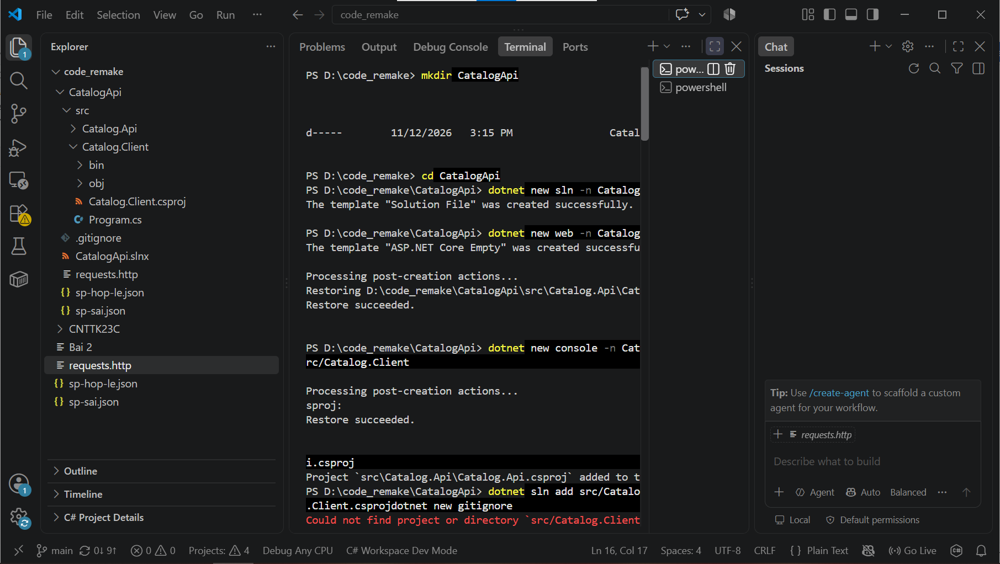

---

### 2. Bước 2: Build giải pháp và Chạy máy chủ Catalog.Api (cổng 5100)
```powershell
dotnet new gitignore
dotnet build
dotnet run --project src/Catalog.Api --urls http://localhost:5100
```
**Ảnh kết quả Build và Khởi động Catalog.Api:**
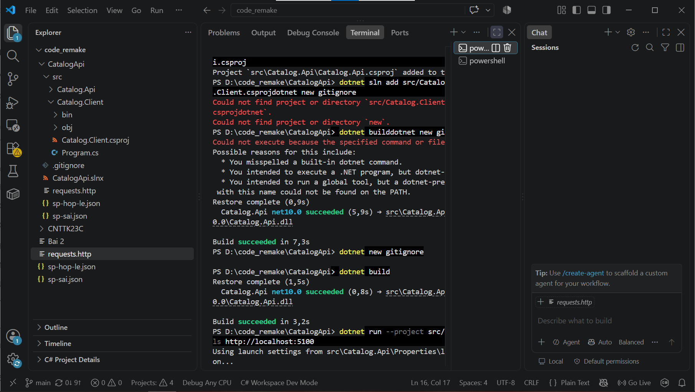

---

### 3. Bước 7 & 8: Chạy máy khách Catalog.Client chuỗi 4 nấc
```powershell
dotnet run --project src/Catalog.Client -- http://localhost:5100
```
**Ảnh kết quả máy khách in đủ 4 nấc và Thí nghiệm 1:**
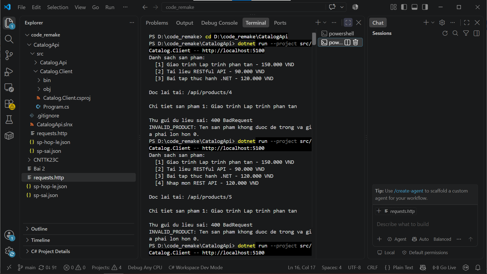

---

## PHẦN B: ỨNG DỤNG EDUSUBMIT (Dự án chính nộp bài)

### 1. Bước 1: Khởi tạo giải pháp EduSubmit
```powershell
cd CNTTK23C
cd "Phan Ngô Huy Hoàng - dtc245200477"
mkdir Bai2
cd Bai2
dotnet new sln -n RestfulClientServer
dotnet new web -n Submission.Api -o src/Submission.Api
dotnet new console -n Submission.Client -o src/Submission.Client
dotnet sln add src/Submission.Api/Submission.Api.csproj
dotnet sln add src/Submission.Client/Submission.Client.csproj
dotnet new gitignore
dotnet build
```
**Ảnh kết quả tạo thư mục Bai2 và project:**
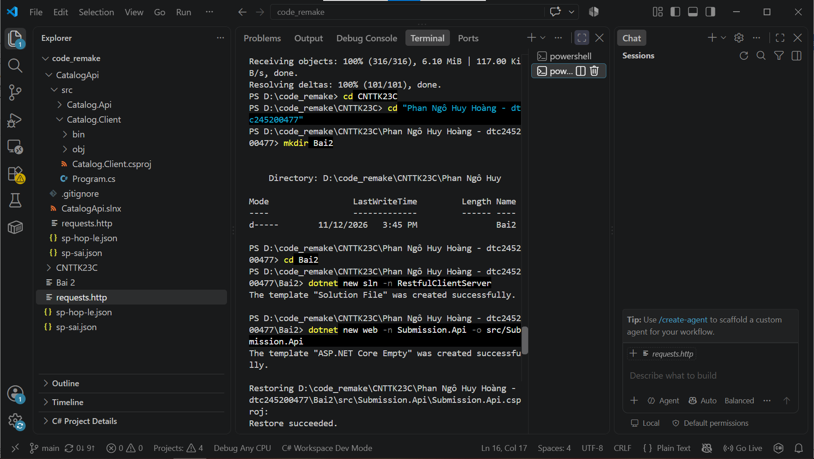

---

### 2. Bước 2: Khởi chạy máy chủ Submission.Api (cổng 5000 cố định)
```powershell
dotnet run --project src/Submission.Api --urls http://localhost:5000
```
**Ảnh kết quả máy chủ Submission.Api đang lắng nghe tại cổng 5000:**
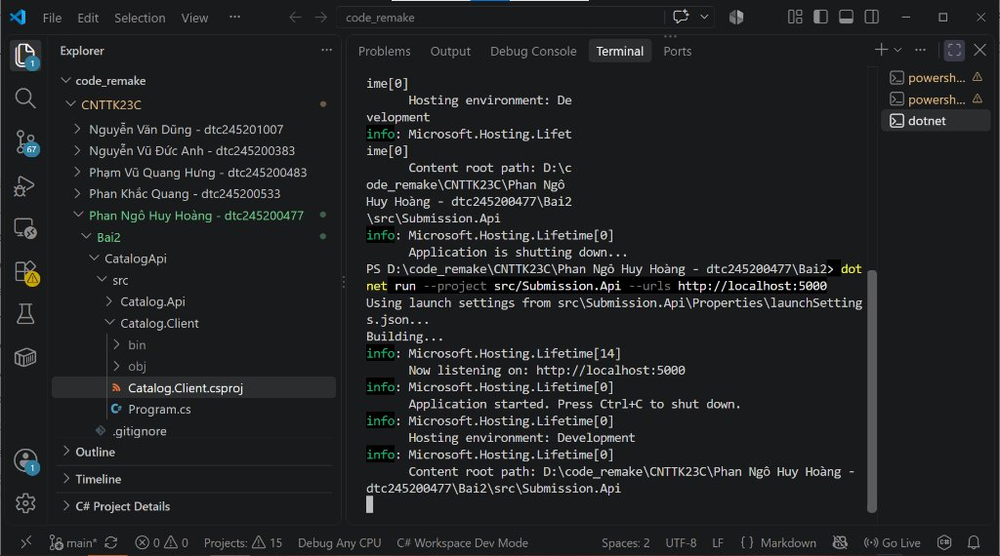

---

### 3. Bước 3 & 4: Kiểm thử lấy danh sách và chi tiết bài tập bằng curl.exe
- **Lấy danh sách bài tập (GET /api/assignments -> 200 OK):**
  ```powershell
  curl.exe -i http://localhost:5000/api/assignments
  ```
  **Ảnh kết quả:**
  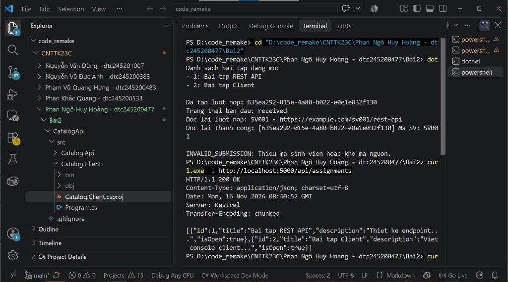

- **Lấy chi tiết bài tập 1 (GET /api/assignments/1 -> 200 OK):**
  ```powershell
  curl.exe -i http://localhost:5000/api/assignments/1
  ```
- **Nộp bài tập 1 hợp lệ (POST -> 201 Created kèm Location):**
  ```powershell
  curl.exe -i -X POST http://localhost:5000/api/assignments/1/submissions -H "Content-Type: application/json" -d "@sv001.json"
  ```
  **Ảnh kết quả chi tiết và nộp bài:**
  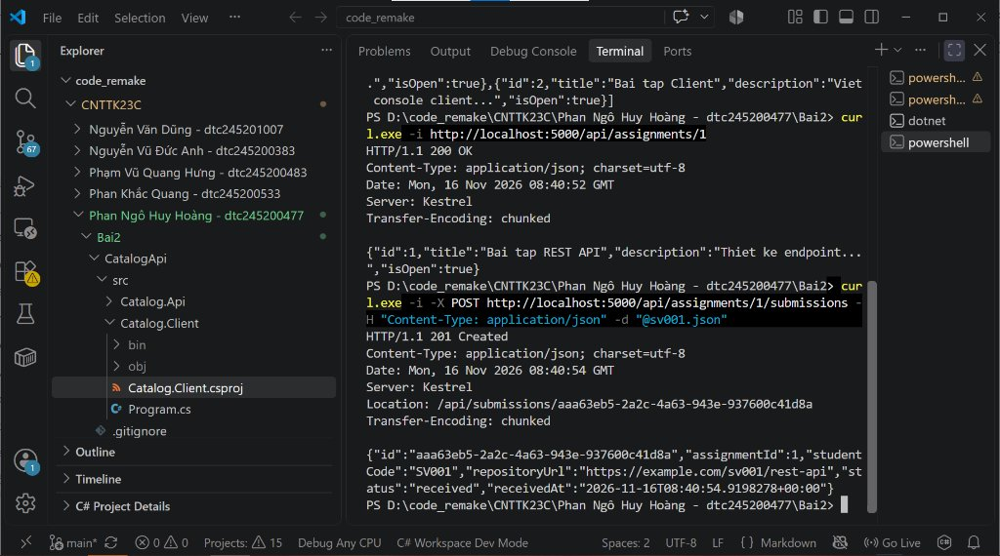

---

### 4. Bước 7: Chạy máy khách Submission.Client chuỗi 4 nấc
```powershell
dotnet run --project src/Submission.Client -- http://localhost:5000
```
**Ảnh kết quả máy khách Submission.Client hoàn thành đủ 4 nấc:**
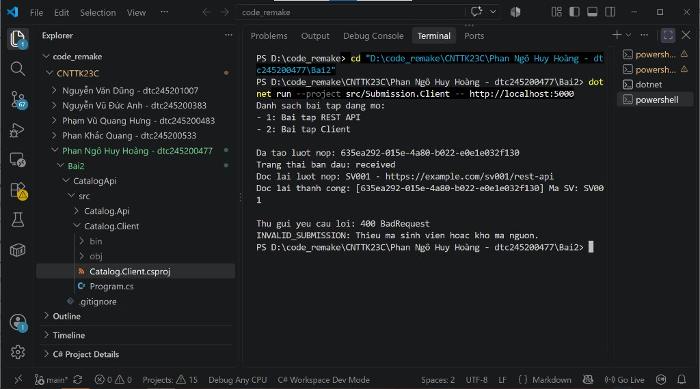

*Kết quả quan sát 4 nấc:*
1. **Nấc 1:** Liệt kê các bài tập đang mở (1: Bai tap REST API, 2: Bai tap Client).
2. **Nấc 2:** Nộp bài thành công, nhận mã Guid lượt nộp và đường dẫn `Location`.
3. **Nấc 3:** Đọc lại thông tin lượt nộp vừa tạo từ địa chỉ trong Location.
4. **Nấc 4:** Cố ý gửi dữ liệu sai, nhận mã `400 BadRequest: INVALID_SUBMISSION`, bắt lỗi từ ApiError mà chương trình không sập.

---

## PHẦN C: BẢNG PHÁ THỬ (BỐN THÍ NGHIỆM PHÂN TÁN)

| STT | Kịch bản thử nghiệm | Lệnh thực hiện | Kết quả quan sát | Bài học rút ra | Ảnh minh chứng |
|:---:|:---|:---|:---|:---|:---:|
| 1 | **Trạng thái nằm ở máy chủ** | Chạy Client lần 2 khi Server vẫn đang chạy | Danh sách tăng lên 4 sản phẩm, tạo mới ra ID `[5]` | Dữ liệu trạng thái nằm tập trung tại Server, Client chỉ gửi yêu cầu hỏi. |  |
| 2 | **Tắt máy chủ** | Dừng Server (`Ctrl+C`), chạy Client gọi sang | `HttpRequestException: Connection refused (localhost:5100)` | Đặc thù hệ phân tán: bên kia (Server) có thể vắng mặt / ngừng hoạt động. | 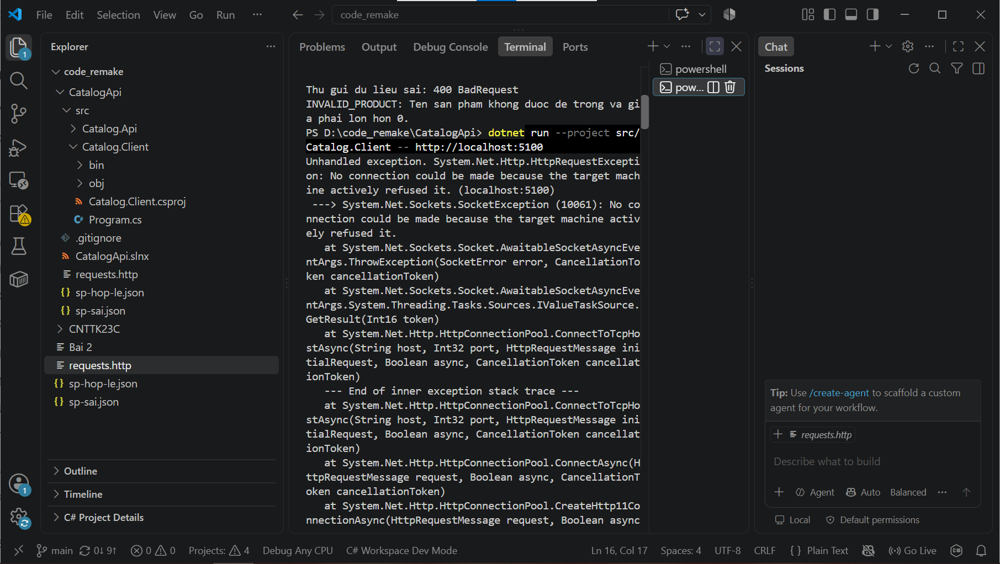 |
| 3 | **Khởi động lại máy chủ** | Khởi động lại Server, chạy Client | Danh sách quay về 3 sản phẩm ban đầu, tạo mới nhận ID `[4]` | Dữ liệu lưu trong bộ nhớ RAM của tiến trình sẽ bị mất khi khởi động lại. | 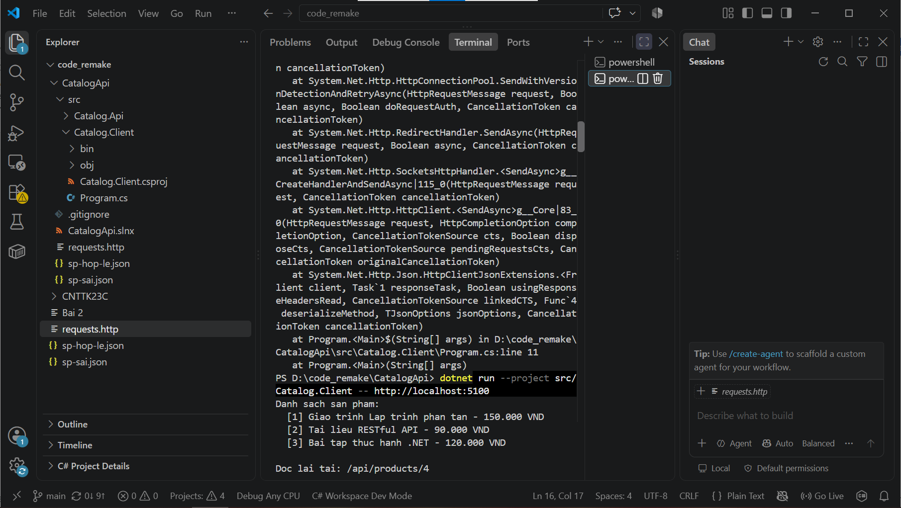 |
| 4 | **Sai cổng kết nối** | `dotnet run --project src/Catalog.Client -- http://localhost:5999` | `HttpRequestException: Connection refused (localhost:5999)` | Hai bên bắt buộc phải thống nhất địa chỉ dịch vụ (URL) thông qua cấu hình. | 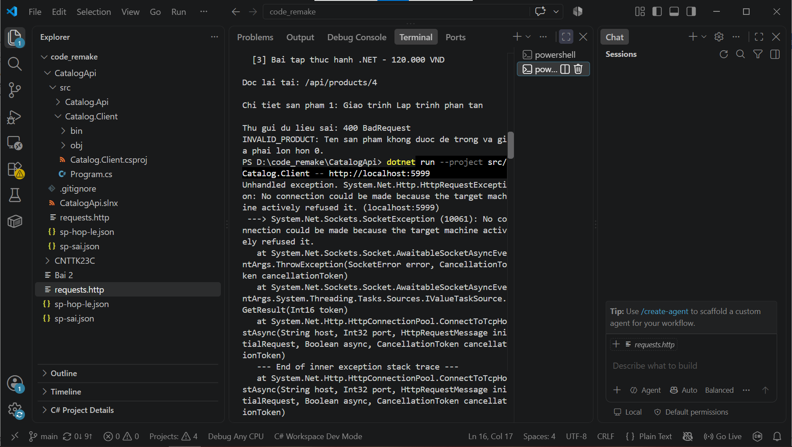 |

---

## PHẦN D: TRẢ LỜI BA CÂU HỎI GIẢI THÍCH

### Câu 1: Vì sao URI dùng danh từ, còn hành động do phương thức HTTP đảm nhận?
- **Trả lời:** Trong kiến trúc RESTful, URI được dùng để định danh **tài nguyên** (danh từ, ví dụ: `/api/assignments`, `/api/submissions`, `/api/products`). 
- Các hành động nghiệp vụ tác động lên tài nguyên được chuẩn hóa thông qua các **phương thức HTTP (HTTP Methods)**:
  - `GET`: Đọc biểu diễn của tài nguyên.
  - `POST`: Tạo mới tài nguyên con / gửi yêu cầu xử lý.
  - `PUT`: Cập nhật / thay thế toàn bộ tài nguyên.
  - `DELETE`: Xóa tài nguyên.
- Việc sử dụng danh từ cho URI và động từ cho phương thức HTTP giúp hợp đồng API rõ ràng, mang tính trực giác cao, dễ đoán cách sử dụng và tuân thủ đúng chuẩn RESTful thay vì đặt động từ vào URI (như `/getProducts`, `/submitAssignment`).

### Câu 2: "Stateless" thể hiện ở đâu trong code đã viết?
- **Trả lời:** Tính chất Stateless (phi trạng thái) quy định rằng: **Mỗi yêu cầu HTTP từ máy khách gửi lên đều phải tự chứa đầy đủ thông tin độc lập** để máy chủ có thể xử lý mà không cần phụ thuộc vào phiên làm việc (session) lưu trong bộ nhớ máy chủ từ các yêu cầu trước.
- Cụ thể trong mã nguồn:
  - Khi nộp bài, máy khách truyền `assignmentId` ngay trên route URI (`/api/assignments/{assignmentId}/submissions`).
  - Toàn bộ dữ liệu sinh viên (`StudentCode`) và link bài nộp (`RepositoryUrl`) được đóng gói trong body JSON (`CreateSubmissionRequest`).
  - Máy chủ không lưu trữ session hay ghi nhớ hội thoại; bất kỳ máy chủ nào (kể cả khi chạy nhiều bản sao sau bộ cân bằng tải) nhận được request này cũng đều có đủ thông tin để xử lý thành công.

### Câu 3: Vì sao client và server mỗi bên khai báo DTO riêng mà vẫn khớp nhau?
- **Trả lời:** DTO (Data Transfer Object) đóng vai trò là **hợp đồng cấu trúc dữ liệu JSON qua mạng**, không phải là class dùng chung (shared binary assembly).
- Hai chương trình Client và Server hoạt động như hai tiến trình độc lập, không tham chiếu trực tiếp project hay thư viện của nhau:
  - Phía Client tuần tự hóa (serialize) DTO của Client thành chuỗi byte JSON gửi đi qua mạng.
  - Phía Server giải tuần tự hóa (deserialize) chuỗi JSON đó thành DTO tương ứng của Server dựa trên sự tương thích về tên trường thuộc tính (khớp case-insensitive / camelCase) và kiểu dữ liệu.
  - Việc tách riêng DTO giúp giữ vững ranh giới biên hệ thống, tăng tính bảo mật (máy khách không thể can thiệp vào các trường nội bộ như `Id`, `Status`, `ReceivedAt`) và cho phép hai bên tiến hóa mã nguồn độc lập mà không bị phá vỡ hợp đồng giao tiếp.
