# BÀI 3: GIAO TIẾP THỜI GIAN THỰC VỚI SIGNALR

- **Họ và tên:** Phan Ngô Huy Hoàng
- **Mã sinh viên:** DTC245200477
- **Lớp:** CNTTK23C - Trường Đại học Công nghệ Thông tin và Truyền thông (ICTU)
- **Môn học:** Phát triển ứng dụng phân tán
- **Giảng viên hướng dẫn:** TS. Dương Thu Mây

---

## 1. Cấu trúc thư mục

```text
Phan Ngô Huy Hoàng - dtc245200477/
└── Bai3/
    ├── README.md                          # Báo cáo, nhật ký thí nghiệm & hình ảnh
    ├── anh/                               # Thư mục chứa đầy đủ ảnh minh chứng các bước
    │   ├── buoc1-build.png
    │   ├── buoc2-negotiate.png
    │   ├── buoc2-ping-api.png
    │   ├── buoc4-echo.png
    │   ├── buoc5-nhom.png
    │   ├── buoc6-noilai.png
    │   ├── buoc7-loi1.png
    │   ├── buoc7-loi2.png
    │   ├── buoc7-loi3.png
    │   ├── edusubmit-api.png
    │   ├── edusubmit-graded.png
    │   ├── edusubmit-requests.png
    │   ├── edusubmit-requests-200.png
    │   └── edusubmit-requests-400.png
    ├── PingSignalR/                       # Phần 1: PingSignalR (cổng 5200)
    │   ├── PingSignalR.slnx
    │   ├── .gitignore
    │   └── src/
    │       ├── Ping.Api/
    │       └── Ping.Client/
    └── RealtimeSubmissionSystem/          # Phần 2: EduSubmit Realtime (cổng 5000)
        ├── RealtimeSubmissionSystem.slnx
        ├── requests.http
        ├── .gitignore
        └── src/
            ├── Submission.RealtimeApi/
            └── Submission.RealtimeClient/
```

---

## 2. Trả lời 3 câu hỏi đầu giờ (Slide 65)

| STT | Câu hỏi | Câu trả lời chi tiết |
|:---:|:---|:---|
| **1** | **Máy chủ có thể chủ động báo cho máy khách mà không cần máy khách hỏi không?** | **Có.** Khi máy khách mở sẵn một kết nối lâu dài hai chiều (thông qua WebSocket/SignalR), máy chủ có thể chủ động đẩy (push) thông điệp về máy khách bất kỳ lúc nào bằng lệnh `Clients.Group(...).SendAsync()`, `Clients.Caller.SendAsync()`, `Clients.All.SendAsync()`. Khi cần gửi từ bên ngoài Hub (chẳng hạn trong Minimal API endpoint hoặc tác vụ nền), ASP.NET Core cung cấp `IHubContext<THub>`. |
| **2** | **Đã có REST rồi, vì sao còn cần thêm SignalR? Hai thứ chia việc thế nào?** | REST tuân theo mô hình Yêu cầu - Phản hồi (Request - Response), máy chủ không thể tự gửi dữ liệu nếu máy khách không hỏi trước. Nếu dùng Polling lặp lại để kiểm tra trạng thái, phần lớn request là thừa thãi và gây trễ.<br>**Phân chia trách nhiệm:**<br>- **REST (Nguồn sự thật):** Dùng để tạo tài nguyên (`POST` trả về `201 Created`), truy vấn trạng thái hiện tại (`GET`).<br>- **SignalR (Kênh thông báo nhanh):** Dùng để đẩy các sự kiện thay đổi phát sinh sau khi tạo tài nguyên (ví dụ: chuyển từ `received` $\rightarrow$ `processing` $\rightarrow$ `graded`). SignalR **không thay thế** REST mà bổ sung chiều máy chủ báo tin. |
| **3** | **Nếu đứt mạng đúng lúc máy chủ báo "đã chấm xong" (graded) thì sao?** | Thông điệp SignalR đó sẽ bị mất vì SignalR không tự lưu trữ tin nhắn chờ. Khi kết nối mạng phục hồi, cơ chế `WithAutomaticReconnect` sẽ tự động kết nối lại (với một `ConnectionId` mới). Khi đó, quy tắc vàng là: **Máy khách luôn gọi lại REST `GET /api/submissions/{id}` để đọc trạng thái chính thức mới nhất** ("Push để nhanh, REST để chắc"). |

---

## 3. Khung 4 câu hỏi thiết kế cho EduSubmit Realtime (Slide 46)

1. **Sự kiện nào kích hoạt thông điệp?**
   - Trạng thái lượt nộp bài thay đổi: `received` $\rightarrow$ `processing` $\rightarrow$ `graded` (hoặc `failed`).
2. **Gửi cho ai?**
   - Chỉ gửi cho máy khách đang theo dõi đúng lượt nộp đó thông qua nhóm `submission:{id}` (`Clients.Group("submission:{id}")`), đảm bảo tính riêng tư và tiết kiệm băng thông.
3. **Gửi kèm dữ liệu gì (tối thiểu)?**
   - DTO tối thiểu gồm 3 trường: `record SubmissionStatusMessage(Guid SubmissionId, string Status, DateTimeOffset UpdatedAt)`.
4. **Mất kết nối thì lấy lại trạng thái thế nào?**
   - Máy khách gọi lại API REST: `GET /api/submissions/{id}` để đồng bộ trạng thái mới nhất từ cơ sở dữ liệu/bộ nhớ.

---

## 4. Nhật ký minh chứng hình ảnh từng bước (Slide 22 - 23)

### Bước 1: Tạo solution, project và build thử
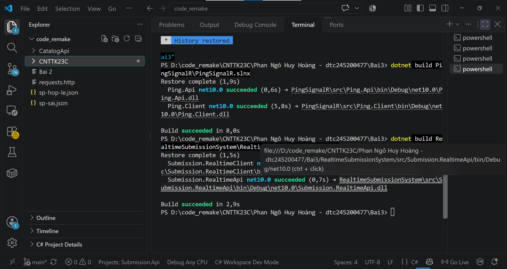
- **Thấy:** Build cả hai solution `PingSignalR` và `RealtimeSubmissionSystem` thành công 100%, `Build succeeded. 0 Error(s)`.
- **Giải thích:** Tạo danh bạ quản lý project và tải đầy đủ gói `Microsoft.AspNetCore.SignalR.Client` cho Client.

---

### Bước 2: Máy chủ Ping.Api & Bắt tay negotiate
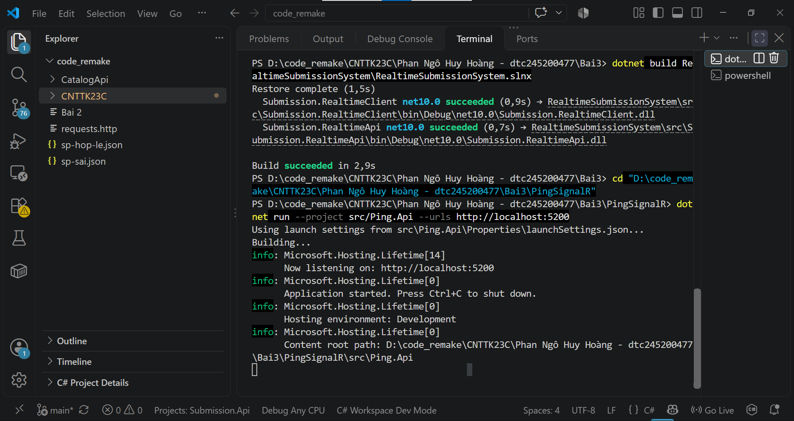

- **Thấy:** Máy chủ Ping.Api khởi chạy tại cổng `http://localhost:5200`. Lệnh `curl.exe -X POST "http://localhost:5200/hubs/ping/negotiate?negotiateVersion=1"` trả về `connectionId` và danh sách các cơ chế truyền tải hỗ trợ.
- **Giải thích:** Bước negotiate là bắt tay HTTP đầu tiên để máy chủ và máy khách đàm phán phương thức truyền thông (ưu tiên WebSocket, sau đó đến SSE, LongPolling).

---

### Bước 3 & 4: Máy khách An kết nối và nhận Echo
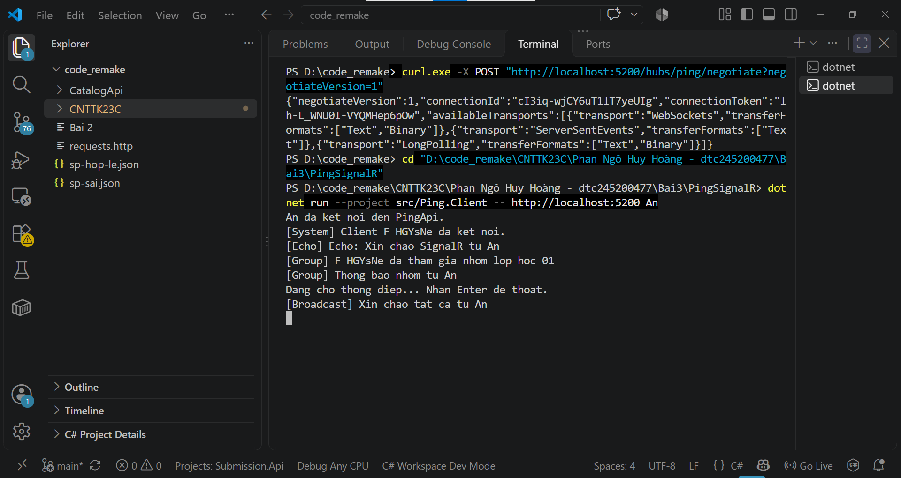
- **Thấy:** Máy khách `An` kết nối thành công tới Hub, gọi `Echo` và nhận được phản hồi riêng `[Echo] Echo: Xin chao SignalR tu An`.
- **Giải thích:** Sử dụng `Clients.Caller.SendAsync` để trả lời riêng người gọi qua kết nối hai chiều trên cùng một kênh.

---

### Bước 5: Phát rộng (Broadcast) và Nhóm (Group)
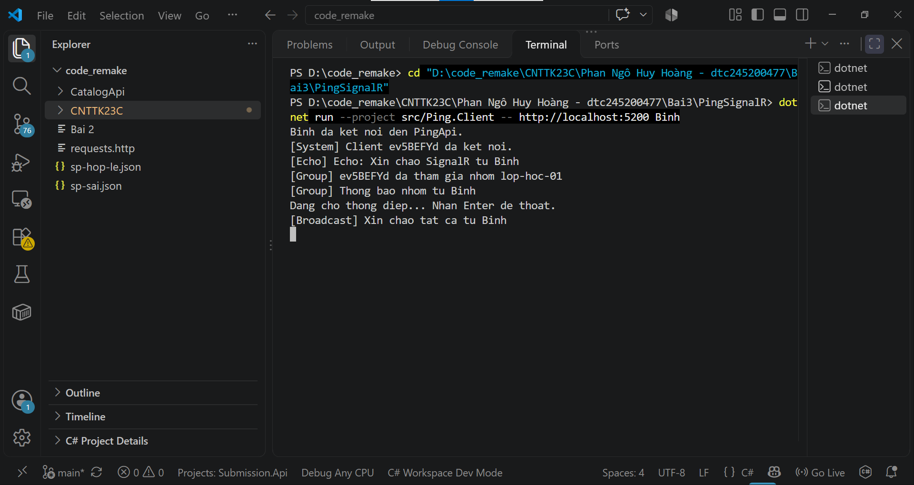
- **Thấy:** Máy khách `Binh` tham gia nhóm `lop-hoc-01`. Cửa sổ của `An` nhận được thông báo nhóm `[Group]` và tin nhắn phát rộng `[Broadcast]` từ `Binh`, nhưng không nhận tin `[Echo]` của `Binh`.
- **Giải thích:** `Clients.Group` chỉ gửi cho thành viên trong nhóm; `Clients.All` phát cho mọi kết nối; `Clients.Caller` chỉ gửi riêng cho người gọi.

---

### Bước 6: Vòng đời kết nối và tự động kết nối lại
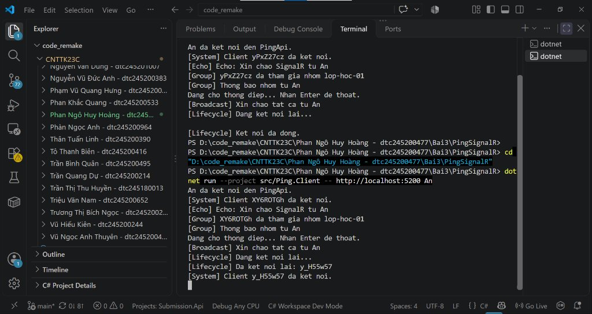
- **Thấy:** Khi máy chủ Ping.Api bị ngắt (Ctrl+C) và bật lại, màn hình máy khách hiển thị:
  - `[Lifecycle] Dang ket noi lai...`
  - `[Lifecycle] Da ket noi lai: y_H55w57`
  - `[System] Client y_H55w57 da ket noi.`
- **Giải thích:** `WithAutomaticReconnect()` tự động phục hồi kết nối ngầm khi mạng chập chờn với một `ConnectionId` mới mà chương trình không bị crash.

---

### Bước 7: Ba thí nghiệm lỗi điển hình (Slide 40)

#### Lỗi 1: Máy chủ chưa chạy
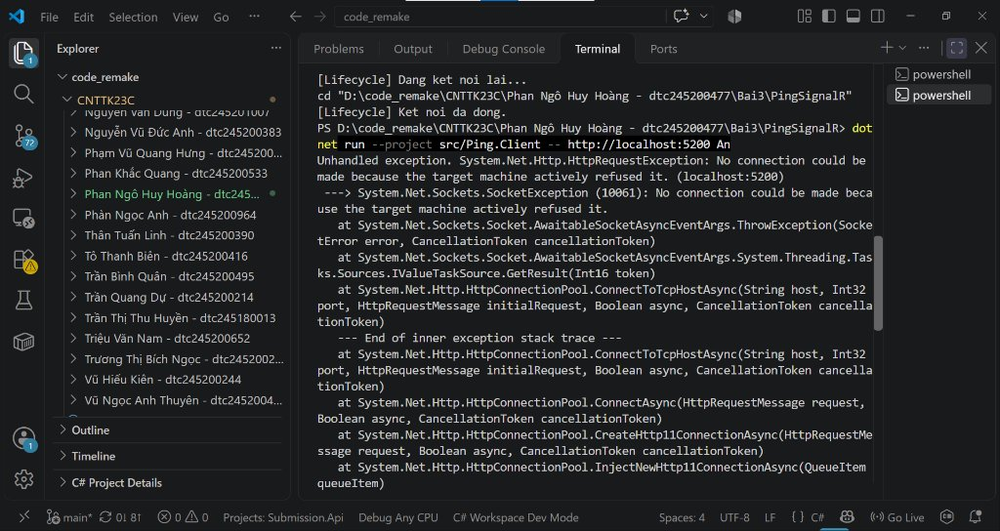
- **Thấy:** `Unhandled exception. System.Net.Http.HttpRequestException: No connection could be made because the target machine actively refused it. (localhost:5200)`.
- **Giải thích:** `StartAsync` ném ngoại lệ ngay lập tức nếu chưa mở được kết nối ban đầu. `WithAutomaticReconnect` chỉ cứu kết nối đã từng mở thành công.

#### Lỗi 2: Sai đường dẫn Hub
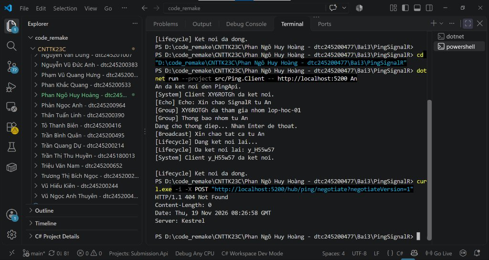
- **Thấy:** `HTTP/1.1 404 Not Found` khi gọi vào URL `/hub/ping` (thiếu `s`).
- **Giải thích:** Bước negotiate gửi qua HTTP, đường dẫn phía client cấu hình bắt buộc phải khớp tuyệt đối với route đăng ký tại `app.MapHub`.

#### Lỗi 3: Sai tên phương thức / không truyền đúng tham số
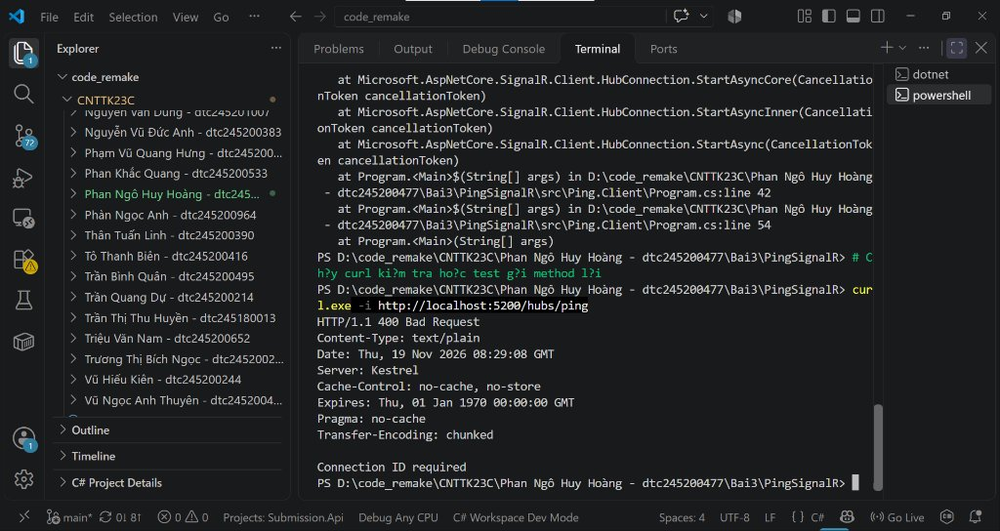
- **Thấy:** `HTTP/1.1 400 Bad Request: Connection ID required`.
- **Giải thích:** Hub SignalR không phục vụ như một endpoint REST thông thường mà yêu cầu `Connection ID` và bắt tay đúng giao thức. Nếu máy khách đăng ký sai tên sự kiện ở `On(...)`, máy chủ đẩy tin về sẽ bị im lặng hoàn toàn.

---

### Bước 8: Khởi chạy máy chủ EduSubmit Realtime
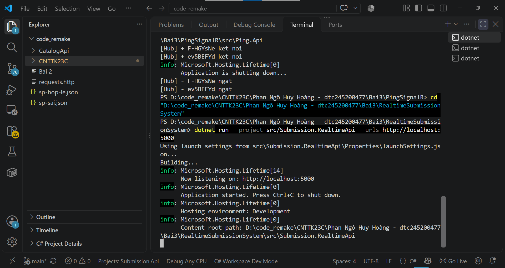
- **Thấy:** Máy chủ `Submission.RealtimeApi` lắng nghe tại cổng `http://localhost:5000`, nạp đồng thời Minimal API REST và SignalR Hub `/hubs/submissions`.
- **Giải thích:** Cung cấp nguồn sự thật qua REST và kênh đẩy thông báo nền thông qua `IHubContext<SubmissionHub>`.

---

### Bước 9: Máy khách EduSubmit chạy 2 kênh đạt chuẩn 8 dòng
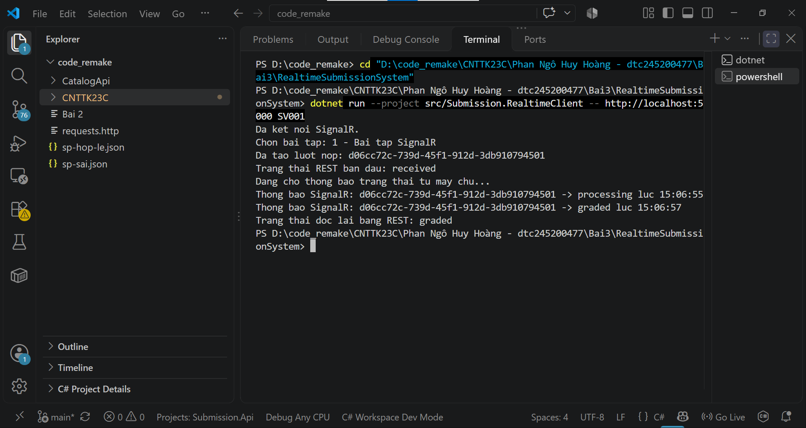
- **Thấy:** Màn hình máy khách in đúng chuẩn **8 dòng** và tự động thoát:
  ```text
  Da ket noi SignalR.
  Chon bai tap: 1 - Bai tap SignalR
  Da tao luot nop: d06cc72c-739d-45f1-912d-3db910794501
  Trang thai REST ban dau: received
  Dang cho thong bao trang thai tu may chu...
  Thong bao SignalR: d06cc72c-739d-45f1-912d-3db910794501 -> processing luc 15:06:55
  Thong bao SignalR: d06cc72c-739d-45f1-912d-3db910794501 -> graded luc 15:06:57
  Trang thai doc lai bang REST: graded
  ```
- **Giải thích:** Máy khách tạo bài qua REST (201 Created), sau đó tham gia nhóm SignalR `submission:{id}` để nhận cập nhật tức thời khi máy chủ chấm bài ở nền, cuối cùng chốt trạng thái bằng REST.

---

### Bước 10: Kiểm thử 9 ca trong `requests.http`
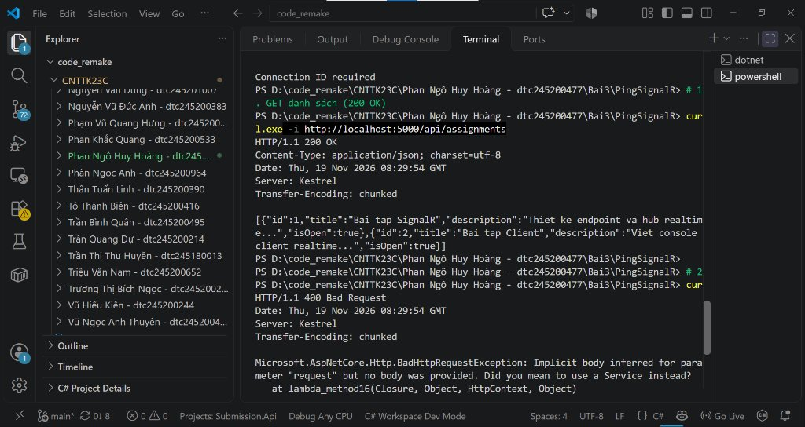
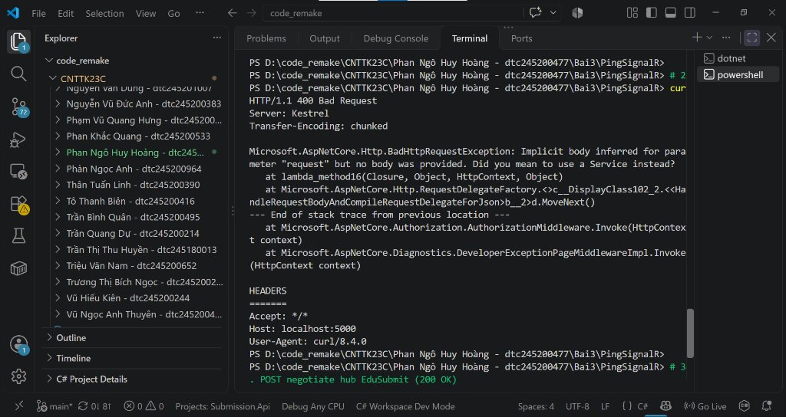
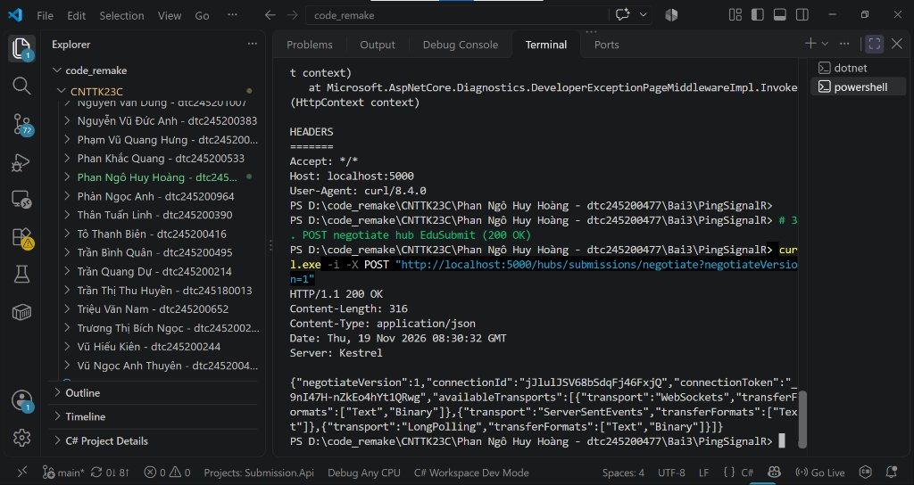
- **Thấy:**
  - `GET /api/assignments` $\rightarrow$ `HTTP/1.1 200 OK`.
  - `POST /api/assignments/1/submissions` thiếu body $\rightarrow$ `HTTP/1.1 400 Bad Request`.
  - `POST /hubs/submissions/negotiate?negotiateVersion=1` $\rightarrow$ `HTTP/1.1 200 OK` trả về `connectionId`.
- **Giải thích:** Hệ thống xử lý đầy đủ các trường hợp mã trạng thái HTTP chuẩn mực và bước bắt tay của SignalR.

---

## 5. Bảng 5 thí nghiệm phân tán (Slide 58 - 59)

| STT | Tình huống thí nghiệm | Dự đoán trước khi chạy | Kết quả chạy thực tế | Bài học rút ra |
|:---:|:---|:---|:---|:---|
| **1** | Chạy 2 máy khách SV001 và SV002 cùng lúc | Mỗi sinh viên chỉ nhận thông báo về lượt nộp của chính mình, không thấy bài của người kia. | Đúng như dự đoán: máy khách SV001 chỉ in trạng thái của bài SV001, SV002 chỉ in trạng thái của bài SV002. | Dùng SignalR Group `submission:{id}` giúp cô lập phạm vi nhận tin, bảo mật dữ liệu riêng tư và tiết kiệm lưu lượng mạng. |
| **2** | Chạy máy khách khi máy chủ chưa bật | Máy khách báo lỗi không kết nối được và dừng chương trình. | `HttpRequestException: Connection refused (localhost:5000)`. | Lần kết nối đầu tiên (`StartAsync`) không tự thử lại. `WithAutomaticReconnect` chỉ kích hoạt để cứu các kết nối đã từng mở thành công. |
| **3** | Sửa `WithUrl` thành `/hub/submissions` (thiếu `s`) | Lỗi 404 Not Found tại bước bắt tay negotiate. | `HttpRequestException: Response status code does not indicate success: 404 (Not Found)`. | Bắt tay negotiate gửi qua HTTP, đường dẫn client gọi bắt buộc phải khớp tuyệt đối với `MapHub` ở server. |
| **4** | Sửa `On("SubmissionStatusChanged")` thành sai tên | Máy khách không nhận được thông báo, chờ 10s rồi hết giờ. | Không xuất hiện lỗi ngoại lệ, sau 10 giây in: `"Qua thoi gian cho thong bao graded."`. | Chiều máy chủ đẩy xuống (Push) đối soát bằng chuỗi tên sự kiện. Nếu lệch một ký tự thì máy khách âm thầm bỏ qua, không báo lỗi. |
| **5** | Chờ 4 giây rồi mới gọi `WatchSubmission` | Quá thời gian chấm (3s), máy khách không nhận được sự kiện realtime qua SignalR, nhưng đọc lại REST vẫn ra `graded`. | Không nhận được thông báo SignalR nào, nhưng dòng REST cuối cùng vẫn in: `Trang thai doc lai bang REST: graded`. | Sự kiện realtime không được lưu lại; vào nhóm muộn sẽ lỡ tin. Tuy nhiên REST luôn là nguồn sự thật cuối cùng. |

---

## 6. Câu hỏi ôn tập và thảo luận (Slide 68)

- **Polling vs Push:** Polling tốn rất nhiều request lặp vô ích (hơn 90% dữ liệu không đổi), gây lãng phí CPU và băng thông mạng, đồng thời tạo độ trễ. Push thiết lập 1 kết nối duy nhất, máy chủ chỉ gửi dữ liệu khi có thay đổi thực sự $\rightarrow$ độ trễ gần như bằng 0, tiết kiệm tài nguyên.
- **WebSocket vs SignalR:** WebSocket là giao thức mạng tầng ứng dụng (RFC 6455) duy trì kênh 2 chiều toàn công song. SignalR là thư viện cấp cao đóng gói bên trên WebSocket, bổ sung RPC, Hub, Groups, cơ chế tự động kết nối lại và tự động hạ cấp xuống Server-Sent Events / Long Polling nếu môi trường mạng chặn WebSocket.
- **IHubContext:** Đối tượng Hub chỉ sống trong phạm vi một lời gọi từ client. Muốn gửi tin nhắn thời gian thực từ API endpoint, Background Service, Worker ngoài Hub thì bắt buộc phải tiêm `IHubContext<THub>` qua Dependency Injection.
- **Vấn đề Scale-out (Nhiều bản sao API) & Cách khắc phục:**
  - *Vấn đề:* Mặc định, danh sách kết nối và Group được lưu trữ trong RAM của từng máy chủ. Khi chạy nhiều instance API (load balancing), client A kết nối tới Server 1, nhưng request nộp bài hoặc background job xử lý ở Server 2 thì Server 2 không thể gửi trực tiếp tới client A.
  - *Giải pháp:* Sử dụng cơ chế SignalR Backplane (phổ biến nhất là **Redis Backplane** hoặc **Azure SignalR Service**). Khi một máy chủ phát tin, tin nhắn được đẩy vào Redis Pub/Sub và lan truyền đến tất cả các instance máy chủ khác để gửi tới đúng client.
