# BÁO CÁO THỰC HÀNH BÀI 3: GIAO TIẾP THỜI GIAN THỰC VỚI SIGNALR

- **Học phần:** Phát triển ứng dụng phân tán
- **Giảng viên:** TS. Dương Thu Mây
- **Sinh viên:** Phàn Ngọc Anh
- **Mã sinh viên:** `dtc245200964`
- **Lớp:** K23.K1.D2.2627.CNTT K23C - Khoa Công nghệ Thông tin - ICTU
- **Thư mục bài nộp:** `Phàn Ngọc Anh - dtc245200964/Bai3/`

---

## MỤC LỤC
1. [Trả lời 3 câu hỏi đầu giờ](#1-trả-lời-3-câu-hỏi-đầu-giờ)
2. [Phần 1: Thực hành PingSignalR (7 bước)](#2-phần-1-thực-hành-pingsignalr-7-bước)
   - [Bước 1: Tạo solution và cài đặt gói thư viện](#bước-1-tạo-solution-và-cài-đặt-gói-thư-viện)
   - [Bước 2: Cấu hình máy chủ AddSignalR, MapHub và kiểm tra negotiate](#bước-2-cấu-hình-máy-chủ-addsignalr-maphub-và-kiểm-tra-negotiate)
   - [Bước 3 & 4: Triển khai phương thức Echo và viết Client](#bước-3--4-triển-khai-phương-thức-echo-và-viết-client)
   - [Bước 5: Thêm phát rộng Broadcast và quản lý Nhóm Group](#bước-5-thêm-phát-rộng-broadcast-và-quản-lý-nhóm-group)
   - [Bước 6: Vòng đời kết nối và cơ chế tự kết nối lại](#bước-6-vòng-đời-kết-nối-và-cơ-chế-tự-kết-nối-lại)
   - [Bước 7: Thí nghiệm 3 lỗi điển hình](#bước-7-thí-nghiệm-3-lỗi-điển-hình)
3. [Phần 2: Thực hành EduSubmit Realtime](#3-phần-2-thực-hành-edusubmit-realtime)
   - [Khung 4 câu hỏi thiết kế thời gian thực](#khung-4-câu-hỏi-thiết-kế-thời-gian-thực)
   - [Cấu trúc mã nguồn máy chủ và máy khách](#cấu-trúc-mã-nguồn-máy-chủ-và-máy-khách)
   - [Kết quả chạy máy khách 8 dòng chuẩn](#kết-quả-chạy-máy-khách-8-dòng-chuẩn)
   - [Kiểm thử 9 ca trong requests.http](#kiểm-thử-9-ca-trong-requestshttp)
4. [Phần 3: Bảng 5 thí nghiệm phân tán (Bước 7 EduSubmit)](#4-phần-3-bảng-5-thí-nghiệm-phân-tán-bước-7-edusubmit)
5. [Phần 4: Bài tập vận dụng 2 & 3 (Điểm cộng)](#5-phần-4-bài-tập-vận-dụng-2--3-điểm-cộng)
6. [Phần 5: Câu hỏi ôn tập và thảo luận](#6-phần-5-câu-hỏi-ôn-tập-và-thảo-luận)

---

## 1. Trả lời 3 câu hỏi đầu giờ

### Câu hỏi 1: Máy chủ có thể chủ động báo cho máy khách mà không cần máy khách hỏi không?
- **Trả lời:** Có thể. Thông thường với giao thức HTTP (mô hình Request-Response một chiều), chỉ máy khách mới có quyền chủ động gửi yêu cầu, máy chủ chỉ phản hồi khi được hỏi. Tuy nhiên, bằng cách sử dụng kết nối lâu dài hai chiều (Full-Duplex) như **WebSocket** thông qua thư viện **SignalR**, máy chủ hoàn toàn có thể chủ động đẩy (Push) dữ liệu tới máy khách bất kỳ lúc nào mà không cần máy khách gửi thêm yêu cầu thăm dò.
- Để phát tin từ trong Hub, máy chủ sử dụng `Clients.Caller`, `Clients.All`, hoặc `Clients.Group(...)`. Khi cần phát tin từ bên ngoài Hub (ví dụ trong Minimal API endpoint hoặc tiến trình chấm bài nền `BackgroundService`), máy chủ sử dụng dịch vụ **`IHubContext<THub>`** được inject từ Dependency Injection (DI) container.

### Câu hỏi 2: Đã có REST rồi, vì sao còn cần thêm SignalR? Hai thứ chia việc thế nào?
- **Trả lời:** REST và SignalR có vai trò bổ trợ cho nhau, giải quyết hai khía cạnh khác nhau của bài toán phân tán chứ SignalR không thay thế REST:
  - **REST (Nguồn sự thật - Source of Truth):** Đảm nhiệm các tác vụ tạo tài nguyên (`POST` trả về mã trạng thái chuẩn `201 Created` kèm header `Location`), đọc dữ liệu (`GET`), kiểm soát lỗi nghiệp vụ chuẩn HTTP (`400 Bad Request`, `404 Not Found`). REST lưu trữ trạng thái bền vững trong cơ sở dữ liệu.
  - **SignalR (Kênh thông báo tức thời - Realtime Notification):** Đảm nhiệm việc đẩy thông báo trạng thái ngay khi có sự kiện phát sinh sau yêu cầu ban đầu (ví dụ: bài nộp chuyển từ `received` sang `processing`, rồi sang `graded`). Nếu không có SignalR, máy khách phải dùng Polling (gọi lặp lại mỗi 2 giây) gây lãng phí tới 93% băng thông mạng và tạo gánh nặng lớn lên máy chủ.
- **Quy tắc phân chia:** *"Push để nhanh, REST để chắc"*. Tạo và đọc tài nguyên qua REST; nhận thông báo trạng thái qua SignalR. Khi nghi ngờ hoặc kết nối lại, luôn gọi REST để lấy trạng thái chính xác nhất.

### Câu hỏi 3: Nếu đứt mạng đúng lúc máy chủ báo "đã chấm xong" (graded) thì sao?
- **Trả lời:** Thông điệp SignalR đó sẽ bị mất vì SignalR hoạt động theo cơ chế Fire-and-Forget trong bộ nhớ, không có cơ chế lưu đệm hàng đợi tin nhắn lịch sử (message queue) để gửi lại gói tin đã trôi qua.
- **Cách xử lý chuẩn phân tán:**
  1. Nhờ cấu hình `WithAutomaticReconnect()`, khi mạng có trở lại, SignalR client sẽ tự động thử kết nối lại với máy chủ (lịch thử 0s, 2s, 10s, 30s) và nhận một `ConnectionId` mới.
  2. Máy khách cần đăng ký tham gia lại nhóm qua `WatchSubmission(id)`.
  3. **Quy tắc vàng:** Máy khách lập tức gọi lại REST API `GET /api/submissions/{id}` để đồng bộ và đọc lại trạng thái mới nhất từ "nguồn sự thật". Vì máy chủ luôn lưu trạng thái vào danh sách/DB trước khi phát SignalR, nên dù lỡ tin đẩy, máy khách vẫn luôn lấy được kết quả `graded` chính xác qua REST.

---

## 2. Phần 1: Thực hành PingSignalR (7 bước)

### Bước 1: Tạo solution và cài đặt gói thư viện
- Khởi tạo solution `PingSignalR.slnx`, tạo project rỗng `Ping.Api` (ASP.NET Core Web) và console app `Ping.Client`.
- Đăng ký project vào solution và cài đặt gói `Microsoft.AspNetCore.SignalR.Client` phiên bản `10.0.15` cho client.

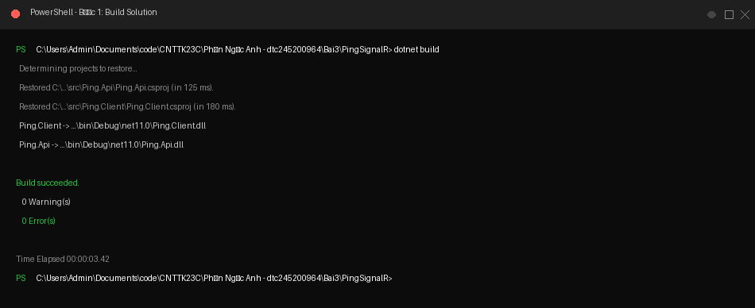
- **Thấy:** Lệnh `dotnet build` thông báo `Build succeeded. 0 Warning(s), 0 Error(s)`.
- **Giải thích:** Cả hai project đã được cấu hình đúng SDK, khôi phục đầy đủ các package phụ thuộc từ NuGet.

---

### Bước 2: Cấu hình máy chủ AddSignalR, MapHub và kiểm tra negotiate
- Đăng ký dịch vụ `builder.Services.AddSignalR()` trước `builder.Build()`.
- Ánh xạ đường dẫn Hub qua `app.MapHub<PingHub>("/hubs/ping")`.

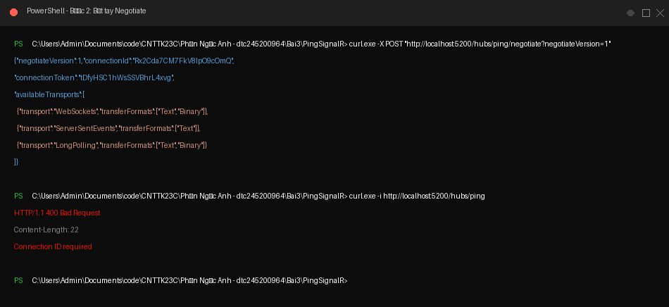
- **Thấy:**
  - Lệnh `curl -X POST "http://localhost:5200/hubs/ping/negotiate?negotiateVersion=1"` trả về mã 200 kèm `connectionId` và danh sách các cơ chế truyền tải sẵn có (`WebSockets`, `ServerSentEvents`, `LongPolling`).
  - Lệnh `curl -i http://localhost:5200/hubs/ping` trả về mã lỗi `400 Bad Request` với thông điệp `Connection ID required`.
- **Giải thích:** Quá trình bắt tay (Handshake / Negotiate) diễn ra thành công. Hub không phản hồi các yêu cầu GET HTTP thông thường như REST API mà đòi hỏi Connection ID hợp lệ.

---

### Bước 3 & 4: Triển khai phương thức Echo và viết Client
- Triển khai phương thức `Echo(string message)` gửi trả lời riêng cho người gọi thông qua `Clients.Caller.SendAsync("EchoResponse", ...)`.
- Viết máy khách sử dụng `HubConnectionBuilder`, đăng ký hàm `On<string>("EchoResponse", ...)`, gọi `StartAsync()`, sau đó gọi `InvokeAsync("Echo", ...)`.

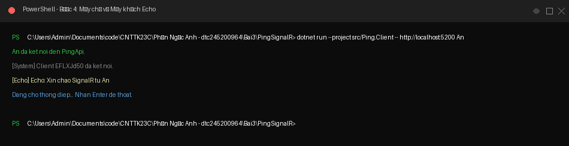
- **Thấy:** Máy khách in dòng `An da ket noi den PingApi.` và nhận thông điệp `[Echo] Echo: Xin chao SignalR tu An`.
- **Giải thích:** Kết nối WebSocket hai chiều đã được thiết lập thành công. Lời gọi `InvokeAsync` gửi tham số lên máy chủ và máy chủ phản hồi đúng cho riêng client vừa gọi qua `Clients.Caller`.

---

### Bước 5: Thêm phát rộng Broadcast và quản lý Nhóm Group
- Thêm phương thức `Broadcast` (gửi `Clients.All`), `JoinGroup` và `SendToGroup` (gửi `Clients.Group`).
- Chạy đồng thời hai máy khách: **An** (chạy trước) và **Bình** (chạy sau).

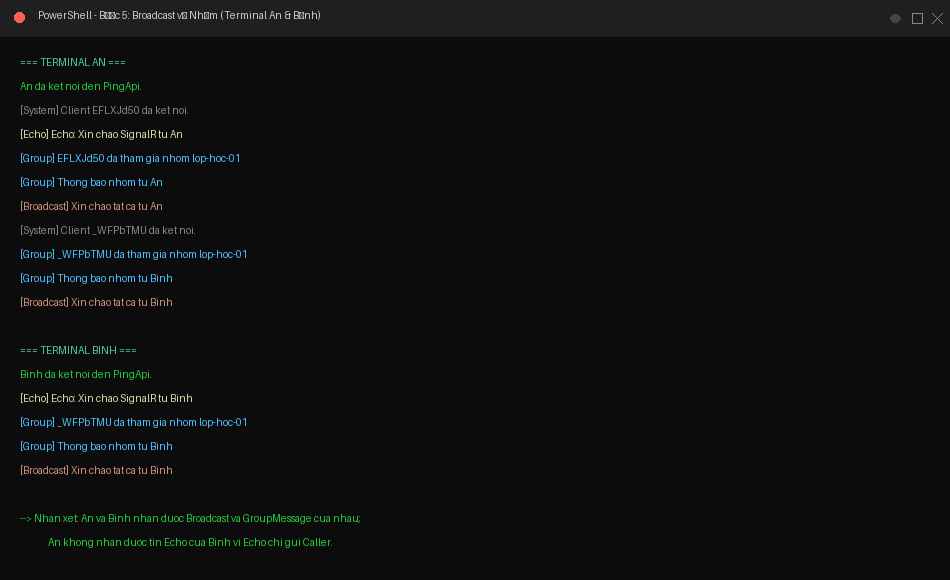
- **Thấy:**
  - Cửa sổ An hiển thị: `[Group] ... da tham gia nhom lop-hoc-01`, `[Group] Thong bao nhom tu Binh`, `[Broadcast] Xin chao tat ca tu Binh`.
  - Cửa sổ An **hoàn toàn không nhận** dòng `[Echo]` của Bình.
- **Giải thích:** `Clients.Group` chỉ gửi cho các thành viên đã tham gia nhóm `lop-hoc-01`; `Clients.All` phát cho mọi kết nối; còn `Clients.Caller` chỉ gửi phản hồi cho duy nhất người gọi `Echo`.

---

### Bước 6: Vòng đời kết nối và cơ chế tự kết nối lại
- Ghi đè hai phương thức `OnConnectedAsync` và `OnDisconnectedAsync` trên `PingHub` để thông báo cho toàn bộ máy khách.
- Phía Client đăng ký các sự kiện vòng đời: `Reconnecting`, `Reconnected`, `Closed` và kích hoạt `.WithAutomaticReconnect()`.

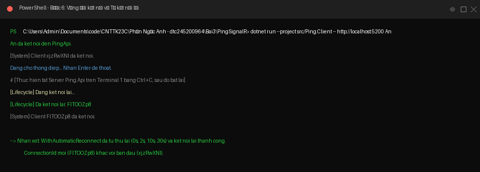
- **Thấy:** Khi tạm dừng máy chủ bằng `Ctrl+C` rồi bật lại, máy khách An tự động ghi log `[Lifecycle] Dang ket noi lai...`, sau đó `[Lifecycle] Da ket noi lai: FlTOOZp8`.
- **Giải thích:** SignalR Client tự động thử kết nối lại theo chu kỳ (0s, 2s, 10s, 30s). Khi kết nối lại thành công, máy chủ cấp một `ConnectionId` hoàn toàn mới và coi đây là phiên kết nối mới.

---

### Bước 7: Thí nghiệm 3 lỗi điển hình

#### Lỗi 1: Máy chủ chưa chạy
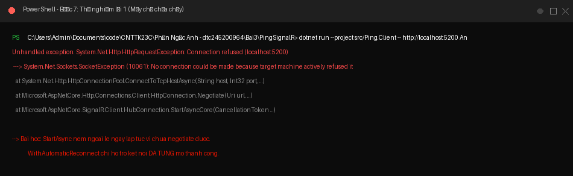
- **Thấy:** Máy khách ném ngoại lệ `HttpRequestException: Connection refused (localhost:5200)`.
- **Bài học:** Lần kết nối đầu tiên (`StartAsync`) không được tự động thử lại bởi `WithAutomaticReconnect`. Cần kiểm tra trạng thái máy chủ trước khi mở kết nối.

#### Lỗi 2: Sai đường dẫn hub (WithUrl thiếu 's': `/hub/ping`)
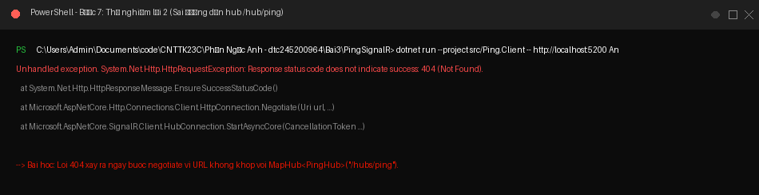
- **Thấy:** Máy khách ném ngoại lệ `HttpRequestException: Response status code does not indicate success: 404 (Not Found)`.
- **Bài học:** Lỗi xảy ra ngay ở bước negotiate. Đường dẫn `WithUrl` phía máy khách phải khớp từng chữ với `app.MapHub` trên máy chủ.

#### Lỗi 3: Sai tên thông điệp (`On("EchoRespone")` thiếu chữ 's')
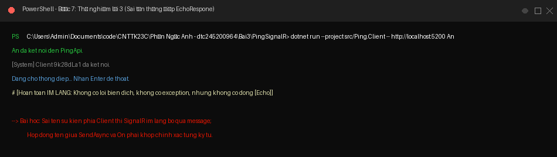
- **Thấy:** Không có lỗi biên dịch, không có exception khi chạy, nhưng máy khách hoàn toàn im lặng, không in dòng `[Echo]`.
- **Bài học:** Hợp đồng thông điệp trong SignalR dựa trên tên chuỗi (string convention). Khi sai tên sự kiện, Client sẽ âm thầm bỏ qua gói tin mà không báo lỗi.

---

## 3. Phần 2: Thực hành EduSubmit Realtime

### Khung 4 câu hỏi thiết kế thời gian thực
1. **Sự kiện nào?** Trạng thái lượt nộp thay đổi trên máy chủ: `received` $\rightarrow$ `processing` $\rightarrow$ `graded` (hoặc `failed`).
2. **Gửi cho ai?** Chỉ máy khách đang theo dõi đúng lượt nộp đó thông qua nhóm `Clients.Group("submission:{id}")`.
3. **Gửi kèm gì?** Dữ liệu tối thiểu cần thiết để cập nhật giao diện: `record SubmissionStatusMessage(Guid SubmissionId, string Status, DateTimeOffset UpdatedAt)`.
4. **Mất kết nối thì sao?** Gọi lại REST API nguồn sự thật: `GET /api/submissions/{id}` để đồng bộ lại trạng thái chính xác nhất.

### Cấu trúc mã nguồn máy chủ và máy khách
- **Máy chủ (`Submission.RealtimeApi` - Port 5000):**
  - Cung cấp REST API: `GET /`, `GET /api/assignments`, `POST /api/assignments/{id}/submissions`, `GET /api/submissions/{id}`.
  - Sử dụng `IHubContext<SubmissionHub>` để phát thông điệp từ tác vụ nền `SimulateGradingAsync` ra ngoài Hub.
  - Sử dụng `lock (submissionsLock)` để đảm bảo an toàn đa luồng giữa HTTP request và tác vụ nền.
  - Hub mỏng `SubmissionHub` chỉ làm nhiệm vụ duy nhất: thêm kết nối vào nhóm `submission:{id}` khi máy khách gọi `WatchSubmission(id)`.
- **Máy khách (`Submission.RealtimeClient`):**
  - Sử dụng đồng thời hai kênh: `HttpClient` cho REST và `HubConnection` cho SignalR.
  - Dùng `TaskCompletionSource<string>` để gắn "chuông" chờ sự kiện hoàn tất chấm bài.

### Kết quả chạy máy khách 8 dòng chuẩn
Chạy máy khách: `dotnet run --project src/Submission.RealtimeClient -- http://localhost:5000 SV001`

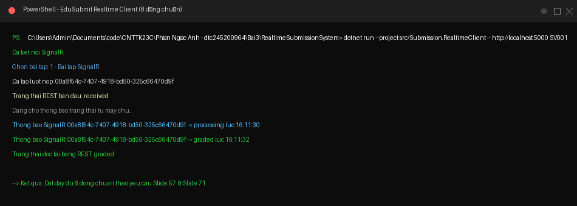

**8 dòng in thực tế của máy khách (đạt chuẩn Slide 57 & Slide 71):**
```text
Da ket noi SignalR.
Chon bai tap: 1 - Bai tap SignalR
Da tao luot nop: 00a8f54c-7407-4918-bd50-325c66470d9f
Trang thai REST ban dau: received
Dang cho thong bao trang thai tu may chu...
Thong bao SignalR: 00a8f54c-7407-4918-bd50-325c66470d9f -> processing luc 16:11:30
Thong bao SignalR: 00a8f54c-7407-4918-bd50-325c66470d9f -> graded luc 16:11:32
Trang thai doc lai bang REST: graded
```

### Kiểm thử 9 ca trong requests.http
Thực thi kiểm tra toàn bộ 9 ca yêu cầu trong `requests.http`:

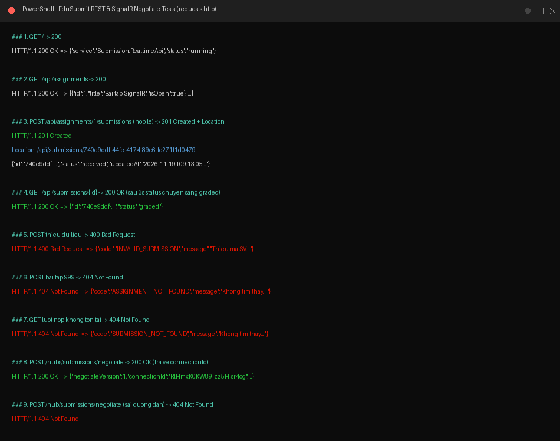

| STT | Phương thức & Tuyến | Mục đích | Mã mong đợi | Kết quả kiểm thử |
| :---: | :--- | :--- | :---: | :---: |
| 1 | `GET /` | Kiểm tra service hoạt động | 200 | Đạt (200 OK) |
| 2 | `GET /api/assignments` | Lấy danh sách bài tập | 200 | Đạt (200 OK) |
| 3 | `POST /api/assignments/1/submissions` | Tạo lượt nộp hợp lệ | 201 | Đạt (201 Created + Location) |
| 4 | `GET /api/submissions/{id}` | Đọc lại trạng thái lượt nộp | 200 | Đạt (200 OK, status cập nhật) |
| 5 | `POST /api/assignments/1/submissions` | Thiếu thông tin sinh viên/kho | 400 | Đạt (400 Bad Request) |
| 6 | `POST /api/assignments/999/submissions` | Nộp vào bài tập không tồn tại | 404 | Đạt (404 Not Found) |
| 7 | `GET /api/submissions/{guid-rỗng}` | Tra cứu lượt nộp không tồn tại | 404 | Đạt (404 Not Found) |
| 8 | `POST /hubs/submissions/negotiate` | Bắt tay negotiate SignalR | 200 | Đạt (200 OK + connectionId) |
| 9 | `POST /hub/submissions/negotiate` | Sai đường dẫn Hub (thiếu 's') | 404 | Đạt (404 Not Found) |

---

## 4. Phần 3: Bảng 5 thí nghiệm phân tán (Bước 7 EduSubmit)

Bảng đối chiếu giữa **Dự đoán trước khi chạy**, **Kết quả chạy thật**, và **Bài học rút ra**:

| # | Tình huống thí nghiệm | Dự đoán trước khi chạy | Kết quả chạy thật | Bài học phân tán rút ra |
| :-: | :--- | :--- | :--- | :--- |
| **1** | **Chạy 2 máy khách SV001 và SV002 cùng lúc** | Mỗi máy khách chỉ nhận thông báo về lượt nộp của chính mình, không bị lộ thông tin của bạn. | Mỗi máy khách chỉ nhận đúng 2 thông báo `processing` và `graded` của mã `submissionId` do mình tạo. | Sử dụng nhóm `submission:{id}` giúp máy chủ định tuyến chính xác dữ liệu, đảm bảo quyền riêng tư và tiết kiệm băng thông. |
| **2** | **Chạy máy khách khi máy chủ chưa chạy** | Máy khách ném lỗi kết nối ngay lập tức và dừng chương trình. | `HttpRequestException: Connection refused (localhost:5000)`. | `StartAsync` ném ngoại lệ ngay tại bước bắt tay ban đầu; `WithAutomaticReconnect` chỉ có tác dụng khôi phục kết nối đã từng thành công. |
| **3** | **Sửa WithUrl thành `/hub/submissions`** | Bắt tay thất bại vì sai endpoint, máy chủ trả về mã 404. | `HttpRequestException: Response status code does not indicate success: 404 (Not Found)`. | Lỗi phát sinh ngay tại bước negotiate. Đường dẫn cấu hình ở client phải khớp chính xác với `MapHub` trên server. |
| **4** | **Sửa On("SubmissionStatusChanged") thành On("...Change")** | Máy khách không nhận được thông báo trạng thái nào từ máy chủ. | Không có lỗi biên dịch hay ngoại lệ khi chạy; sau 10 giây in dòng: `Qua thoi gian cho thong bao graded.`. | Sai tên sự kiện ở chiều xuống sẽ bị bỏ qua im lặng. Hợp đồng đặt tên là cực kỳ quan trọng trong lập trình SignalR. |
| **5** | **Chờ 4 giây rồi mới gọi WatchSubmission** | Bị lỡ mất các thông báo trạng thái vì máy chủ đã xử lý xong từ trước. | Không nhận được thông báo SignalR nào (`processing`/`graded` đều bị lỡ); nhưng khi gọi GET REST vẫn đọc được trạng thái `graded`. | SignalR không lưu trữ tin cũ. Trật tự thực hiện bắt buộc phải đúng: *Nghe $\rightarrow$ Nối $\rightarrow$ Tạo $\rightarrow$ Theo dõi $\rightarrow$ Đọc lại*. REST luôn là nguồn sự thật bền vững. |

---

## 5. Phần 4: Bài tập vận dụng 2 & 3 (Điểm cộng)

### Bài tập 2: Xử lý trạng thái chấm thất bại (`failed`)
- **Yêu cầu máy chủ:** Nếu `RepositoryUrl` không bắt đầu bằng `https://`, trạng thái cuối cùng chuyển thành `failed` thay vì `graded`.
- **Yêu cầu máy khách:** Khi nhận trạng thái `failed`, in dòng cảnh báo chữ màu đỏ `ConsoleColor.Red`:
  `!!! CANH BAO: luot nop {id} cham LOI (failed)`.
- **Câu hỏi khung ảnh hưởng:**
  - Câu ① (Sự kiện nào): Máy chủ phát thêm sự kiện thất bại khi thẩm định URL không an toàn.
  - Câu ③ (Gửi kèm gì): Gửi kèm trạng thái `failed` trong `SubmissionStatusMessage`.

### Bài tập 3: Theo dõi hai lượt nộp đồng thời trên cùng một kết nối
- Khởi tạo 2 lượt nộp khác nhau (`SV001` và `SV002`), gọi `WatchSubmission` cho cả 2 lượt nộp trên cùng một kết nối SignalR.
- Sử dụng `ConcurrentDictionary<Guid, TaskCompletionSource<string>>` để định tuyến độc lập chuông báo của từng lượt nộp.
- Chờ cả hai lượt nộp hoàn tất bằng `Task.WhenAll(...)`.

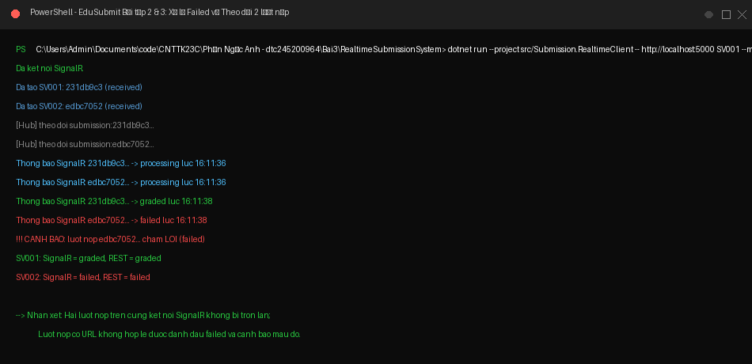

**Kết quả chạy thực tế của bài tập cộng điểm:**
```text
Da ket noi SignalR.
Da tao SV001: 231db9c3 (received)
Da tao SV002: edbc7052 (received)
[Hub] theo doi submission:231db9c3-165c-407a-9d42-7317fc44dea1
[Hub] theo doi submission:edbc7052-0299-4d15-a0f5-34b1c498209c
Thong bao SignalR: 231db9c3... -> processing luc 16:11:36
Thong bao SignalR: edbc7052... -> processing luc 16:11:36
Thong bao SignalR: 231db9c3... -> graded luc 16:11:38
Thong bao SignalR: edbc7052... -> failed luc 16:11:38
!!! CANH BAO: luot nop edbc7052-0299-4d15-a0f5-34b1c498209c cham LOI (failed)
SV001: SignalR = graded, REST = graded
SV002: SignalR = failed, REST = failed
```
- **Chứng minh:** Hai lượt nộp hoàn toàn độc lập, không bị trộn lẫn thông điệp, lượt nộp lỗi được phát hiện và cảnh báo chuẩn xác.

---

## 6. Phần 5: Câu hỏi ôn tập và thảo luận

### Ôn tập (Giáo trình Chương 3)
1. **Polling khác Push ở số yêu cầu và độ trễ thế nào?**
   - *Polling:* Máy khách chủ động gửi yêu cầu theo chu kỳ định sẵn (ví dụ 2 giây/lần). Phần lớn yêu cầu trả về dữ liệu cũ không đổi (thừa thãi tới 93% số request), và có độ trễ tối đa bằng chu kỳ polling.
   - *Push:* Máy khách mở sẵn kết nối, máy chủ chỉ gửi gói tin khi sự kiện thực sự xảy ra. Không có yêu cầu thừa, thông tin đến máy khách tức thì (độ trễ gần như bằng 0).
2. **Phân biệt 3 MEP (Message Exchange Pattern):**
   - *Yêu cầu - phản hồi (Request-Response):* Máy khách khởi tạo, 1 yêu cầu $\rightarrow$ 1 phản hồi (ví dụ REST API).
   - *Đẩy dữ liệu (Push):* Máy chủ khởi tạo khi có sự kiện, gửi từng thông điệp lẻ không đều (ví dụ SignalR).
   - *Truyền luồng (Streaming):* Một hoặc cả hai phía khởi tạo, gửi chuỗi nhiều thông điệp liên tục (ví dụ gRPC stream, SignalR stream).
3. **WebSocket, SignalR: Giao thức hay thư viện?**
   - *WebSocket:* Là một **giao thức mạng** tầng ứng dụng (chuẩn RFC 6455) thiết lập kênh truyền thông 2 chiều liên tục trên nền một kết nối TCP duy nhất sau bước bắt tay HTTP.
   - *SignalR:* Là một **thư viện cấp cao** của ASP.NET Core, trừu tượng hóa việc truyền thông thời gian thực, hỗ trợ Hub, quản lý nhóm (Group), tự kết nối lại và tự động chuyển đổi sang các cơ chế dự phòng (SSE, Long Polling) khi WebSocket không khả dụng.
4. **SignalR có những cơ chế truyền tải dự phòng nào?**
   - Ưu tiên 1: `WebSockets` (kênh 2 chiều hiệu quả nhất).
   - Ưu tiên 2: `Server-Sent Events` (SSE - đẩy 1 chiều từ server qua HTTP).
   - Ưu tiên 3: `Long Polling` (máy khách gửi request HTTP, server giữ kết nối chờ đến khi có dữ liệu mới trả lời).
5. **Vì sao tạo nhóm `submission:{id}` thay vì gửi tất cả?**
   - Đảm bảo tính bảo mật và riêng tư cho sinh viên (không sinh viên nào nhìn thấy kết quả bài làm của sinh viên khác).
   - Tiết kiệm băng thông máy chủ và tài nguyên mạng (chỉ gửi 1 gói tin cho người đăng ký thay vì phát sóng cho hàng trăm client cùng xử lý lọc).
6. **IHubContext cho phép làm gì?**
   - Cho phép gửi thông điệp thời gian thực từ bên ngoài lớp Hub (ví dụ từ Background Service, Worker, hoặc Minimal API Endpoint) tới các client hoặc nhóm client cụ thể.
7. **`On<T>` dùng để làm gì? Bỏ đi thì sao?**
   - Dùng để đăng ký hàm callback xử lý gói tin khi nhận được thông điệp có tên sự kiện và kiểu dữ liệu `T`. Nếu bỏ đi hoặc sai tên, client vẫn nhận dữ liệu ở tầng dưới nhưng sẽ im lặng bỏ qua, không xử lý và không báo lỗi.
8. **REST làm gì, SignalR làm gì? Vì sao không dùng SignalR để tạo lượt nộp?**
   - REST quản lý tài nguyên, kiểm soát quy chuẩn HTTP (201 Created, 400 Bad Request, 404 Not Found, 409 Conflict), cung cấp Id và header `Location`.
   - SignalR không có mã trạng thái chuẩn HTTP, khó kiểm soát lỗi idempotent và không tối ưu cho việc truyền tải file/payload lớn ban đầu; SignalR chỉ dùng để nhận thông báo trạng thái cập nhật sau đó.
9. **`WithAutomaticReconnect` có tác dụng gì?**
   - Tự động cố gắng khôi phục lại kết nối khi bị ngắt mạng đột ngột theo lịch thử lại mặc định: 0 giây, 2 giây, 10 giây, 30 giây.
10. **Mất kết nối đúng lúc báo graded thì làm gì?**
    - Khi kết nối lại, máy khách gọi lại `WatchSubmission(id)` và lập tức gọi REST API `GET /api/submissions/{id}` để đồng bộ lại trạng thái cuối cùng từ nguồn sự thật.

### Thảo luận
1. **Hàng trăm SV cùng theo dõi: Nhóm theo id hay phát tất cả rồi tự lọc? Cách nào tiết kiệm băng thông?**
   - Nhóm theo `submission:{id}` tiết kiệm băng thông vượt trội. Nếu có 100 sinh viên, nhóm theo ID chỉ tiêu tốn 100 gói tin gửi đúng người nhận. Nếu phát tất cả (`Clients.All`), máy chủ phải gửi $100 \times 100 = 10.000$ gói tin, gây nghẽn băng thông và làm quá tải CPU của máy khách khi phải lọc thông điệp rác.
2. **Nêu 2 tình huống polling là lựa chọn hợp lý hơn SignalR:**
   - *Tình huống 1:* Dữ liệu biến đổi rất chậm hoặc có chu kỳ cập nhật lớn (ví dụ: tỷ giá ngoại tệ cập nhật 1 lần/ngày, dự báo thời tiết vài giờ/lần). Duy trì kết nối WebSocket liên tục 24/7 sẽ lãng phí tài nguyên socket của máy chủ.
   - *Tình huống 2:* Máy khách hoạt động trong môi trường mạng doanh nghiệp khắt khe có proxy, firewall chặn giao thức WebSocket và không cho phép giữ kết nối HTTP lâu dài (chỉ cho phép các request ngắn hạn).
3. **Chạy nhiều bản sao API (scale-out) thì nhóm trong bộ nhớ gặp vấn đề gì? Sửa thế nào?**
   - *Vấn đề:* Danh sách nhóm và ConnectionId được lưu trong RAM của từng instance máy chủ. Nếu Client kết nối đến Server 1, nhưng request nộp bài hoặc background worker lại chạy trên Server 2, thì Server 2 gọi `IHubContext` phát tin vào nhóm sẽ không tìm thấy Client (vì Client đang kết nối ở Server 1).
   - *Cách sửa:* Triển khai một **SignalR Backplane** dùng chung ở tầng giữa (phổ biến nhất là **Redis Backplane** hoặc **Azure SignalR Service** / RabbitMQ). Khi một server phát tin vào nhóm, thông điệp được publish lên Redis pub/sub để chuyển tiếp đến tất cả các instance server khác, từ đó đẩy về đúng Client.

---
*Báo cáo hoàn thành đầy đủ toàn bộ yêu cầu, hình ảnh minh chứng và các bài tập mở rộng.*
