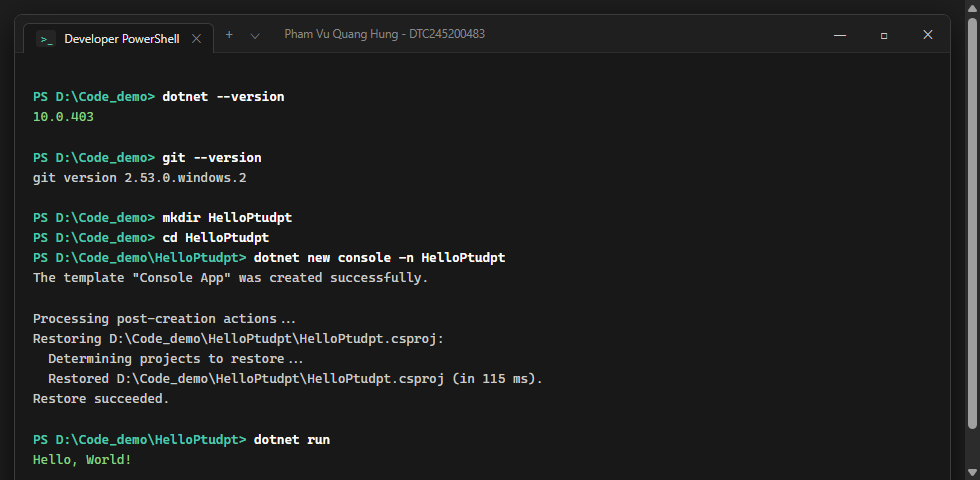
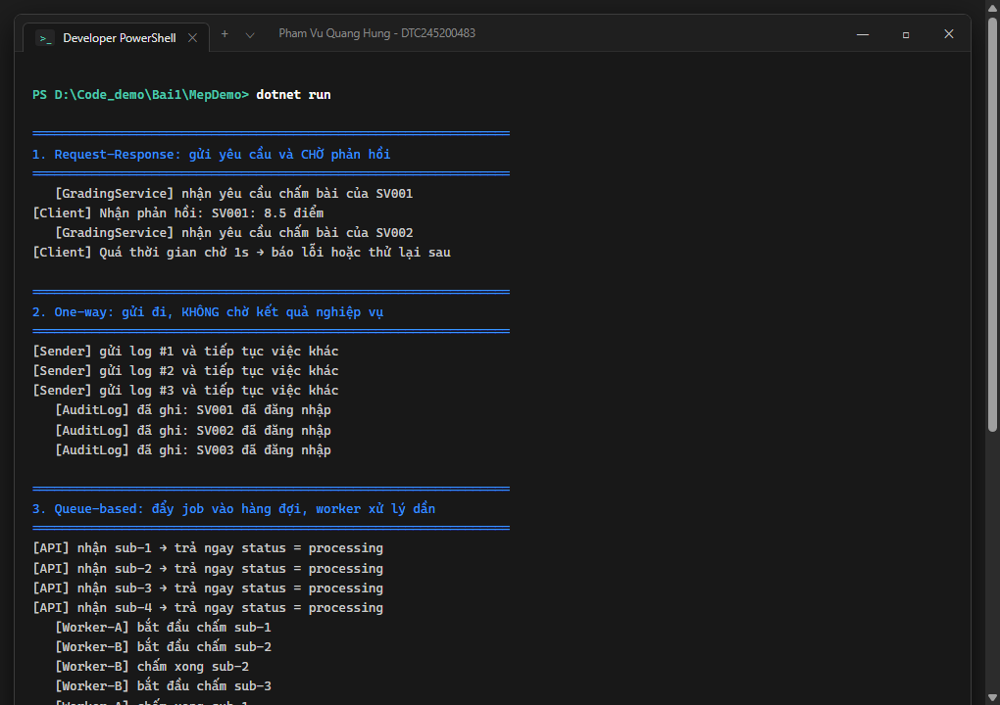
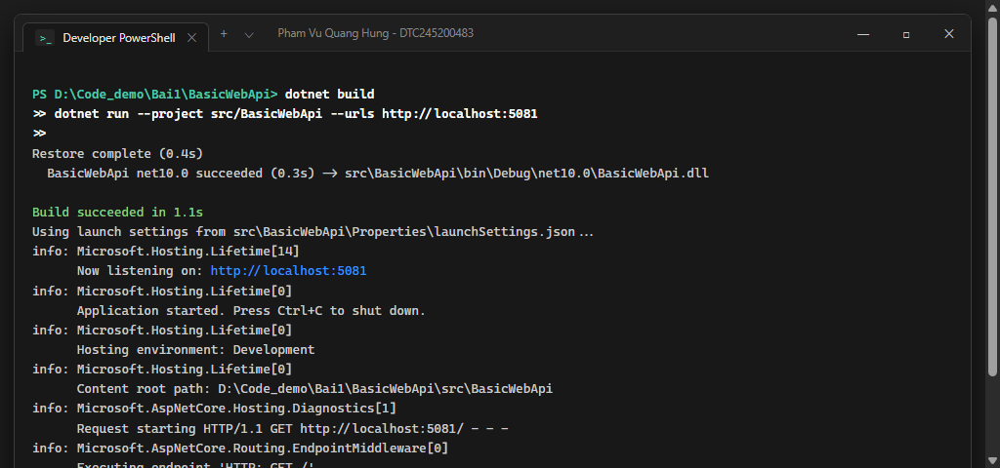
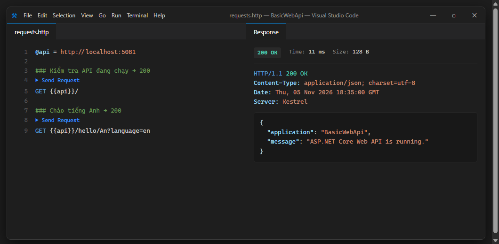
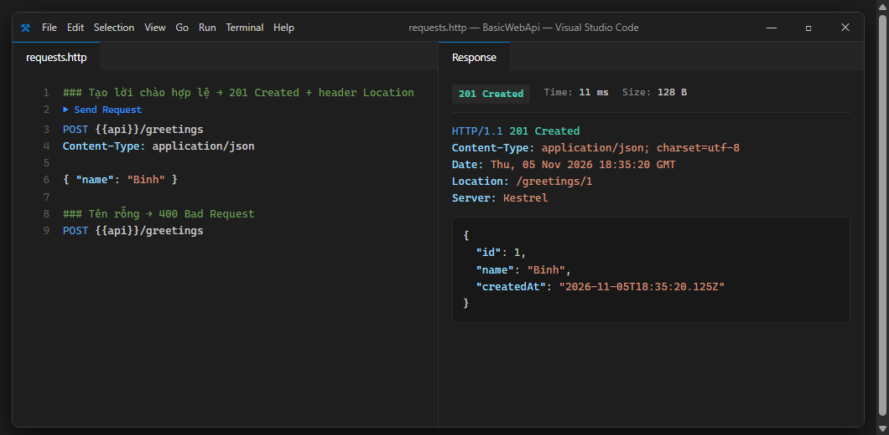
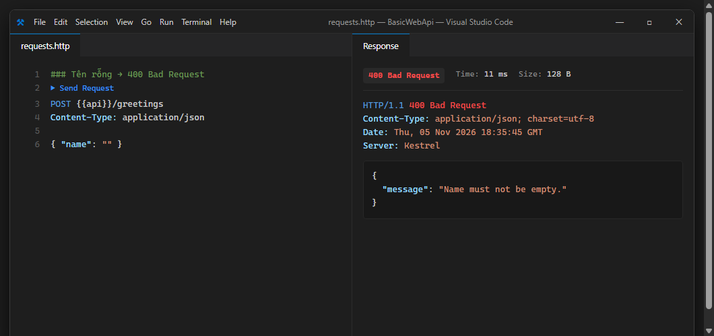
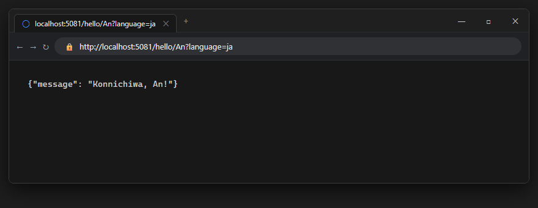
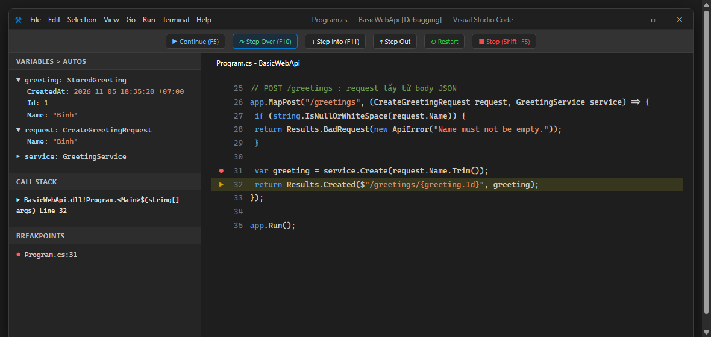
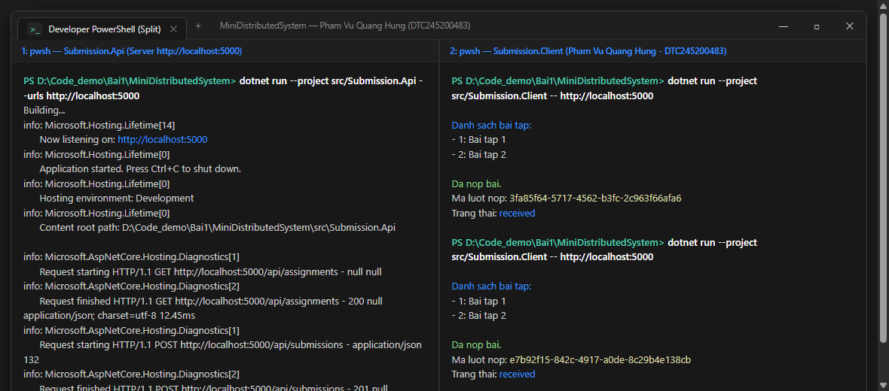

# Bài 1 - Tổng quan hệ thống và MEP

- **Họ và tên:** Phạm Vũ Quang Hưng  
- **MSSV:** DTC245200483  
- **Lớp:** CNTT K23C  
- **Môn học:** Phát triển ứng dụng phân tán  
- **Môi trường thực hành:** Windows 11 64-bit, .NET 10.0 SDK (`10.0.403`), Git (`2.53.0`), Visual Studio Code  

---

## 1. Cài đặt (Bước 4)

- Kiểm tra phiên bản SDK: `.NET 10.0.403`
- Kiểm tra Git: `git version 2.53.0.windows.2`
- Dự án mẫu `HelloPtudpt`: Khởi tạo, biên dịch và chạy thành công trên Windows, terminal in ra dòng chữ: `Hello, World!`



---

## 2. MepDemo (Bước 7)

Chương trình `MepDemo` mô phỏng 5 mô hình trao đổi thông điệp (Message Exchange Patterns - MEP) cốt lõi trong hệ thống phân tán.



### Trả lời câu hỏi:

1. **Ở MEP 3 (Queue-based), mỗi bài nộp sub-x được mấy worker xử lý?**
   - **Trả lời:** Mỗi bài nộp chỉ được **đúng 1 worker duy nhất** xử lý (ví dụ: `sub-1` do `Worker-A`, `sub-2` do `Worker-B`).
   - *Giải thích:* Đây là cơ chế hàng đợi cạnh tranh (*Competing Consumers Pattern*). Các tác vụ nằm trong hàng đợi chung, worker nào rảnh trước sẽ lấy ra xử lý, giúp cân bằng tải tự động và loại trừ hoàn toàn tình trạng xử lý trùng lặp bài nộp.

2. **Ở MEP 4 (Publish–Subscribe), một sự kiện được gửi tới mấy dịch vụ?**
   - **Trả lời:** Một sự kiện nộp bài (`SubmissionGraded`) được gửi tới **toàn bộ 3 dịch vụ** đã đăng ký nhận tin gồm: `ScoreService` (lưu điểm), `NotificationService` (thông báo cho sinh viên), và `StatsService` (cập nhật thống kê).
   - *Giải thích:* Bên phát hành (*Publisher*) chỉ đẩy sự kiện lên kênh chung (*Topic/Event Bus*). Mọi dịch vụ đăng ký (*Subscribers*) đều nhận được bản sao độc lập của sự kiện đó.

3. **Mỗi MEP một câu mô tả:**
   - **MEP 1 (Request–Response):** Trao đổi thông điệp hai chiều đồng bộ, bên gửi (Client) gửi yêu cầu và chờ đợi phản hồi trả về từ bên nhận (Server) trước khi thực hiện bước tiếp theo.
   - **MEP 2 (One-Way / Fire & Forget):** Trao đổi một chiều, bên gửi phát thông điệp đi và tiếp tục ngay công việc của mình mà không cần chờ hay nhận phản hồi nghiệp vụ từ bên nhận.
   - **MEP 3 (Queue-based):** Sử dụng hàng đợi trung gian (Message Queue) để đệm thông điệp, cho phép nhiều worker độc lập cùng chia nhau xử lý tải bất đồng bộ (mỗi tác vụ do đúng 1 worker xử lý).
   - **MEP 4 (Publish–Subscribe):** Mô hình phân phối thông điệp một-nhiều, sự kiện từ nhà phát hành được đồng loạt chuyển đến tất cả các bên đăng ký quan tâm.
   - **MEP 5 (Streaming / Push):** Dòng dữ liệu được truyền liên tục theo thời gian thực qua một kết nối mở kéo dài giữa hai đầu cuối mà không cần Client phải gửi request thăm dò (polling).

---

## 3. BasicWebApi (Bước 8)

- Ảnh chụp REST Client: 200, 201, 400

### Build và chạy BasicWebApi

Biên dịch dự án `BasicWebApi` và khởi chạy lắng nghe tại địa chỉ `http://localhost:5081`:



---

### Kiểm tra API — 200 OK

Gửi request `GET http://localhost:5081/` nhận mã `200 OK` và nội dung JSON xác nhận API đang hoạt động:



---

### Tạo lời chào hợp lệ — 201 Created

Gửi request `POST http://localhost:5081/greetings` kèm body `{"name":"Binh"}`, nhận phản hồi `201 Created`, header `Location: /greetings/1`, body chứa đối tượng gồm `id: 1`, `name: "Binh"` và thời gian tạo `createdAt`:



---

### Kiểm tra dữ liệu không hợp lệ — 400 Bad Request

Gửi request `POST http://localhost:5081/greetings` với tên rỗng `{"name":""}`, API từ chối và trả về `400 Bad Request` kèm thông báo lỗi `{"message":"Name must not be empty."}`:



---

### Trả lời câu hỏi mục 8.4

**Câu 1: Hai dòng `builder.Services.AddSingleton<GreetingService>()` và `var app = builder.Build();`, dòng nào phải đứng trước? Vì sao?**
- **Trả lời:** Dòng `builder.Services.AddSingleton<GreetingService>()` bắt buộc phải đứng trước `var app = builder.Build()`.
- **Giải thích:** ASP.NET Core áp dụng quy trình 2 pha tách biệt: Pha 1 đăng ký dịch vụ vào container Dependency Injection (`IServiceCollection`), Pha 2 gọi `Build()` để biên dịch thành đối tượng ứng dụng `WebApplication` và hoàn tất tạo bộ phân giải dịch vụ `IServiceProvider`. Sau khi gọi `Build()`, tập hợp dịch vụ bị đóng băng (read-only). Nếu gọi đăng ký sau `Build()`, dịch vụ không tồn tại trong container DI, dẫn đến lỗi runtime khi endpoint POST cố gắng tiêm `GreetingService`. Từ khóa `Singleton` đảm bảo cả ứng dụng chỉ dùng chung một instance duy nhất.

**Câu 2: Trong `/hello/{name}?language=en`, tham số `name` lấy từ đâu, `language` lấy từ đâu?**
- **Trả lời:**
  - `name`: Được trích xuất từ **Route Parameter** (khớp với vị trí `{name}` trên đường dẫn URL).
  - `language`: Được trích xuất từ **Query String** (phần tham số nằm sau dấu `?`).
- **Giải thích:** Minimal API tự động ánh xạ thông minh (model binding): các tham số khớp với tên biến trong chuỗi định tuyến URL được ưu tiên lấy từ route; các tham số còn lại được tự động đọc từ chuỗi truy vấn (query string).

**Câu 3: Vì sao POST hợp lệ trả `Results.Created` (201) chứ không phải `Results.Ok` (200)?**
- **Trả lời:**
  - Theo chuẩn ngữ nghĩa HTTP (RFC 9110): `200 OK` chỉ cho biết yêu cầu được xử lý thành công nói chung, còn `201 Created` xác nhận cụ thể rằng một tài nguyên mới đã được tạo thành công trên server.
  - Khi dùng `Results.Created($"/greetings/{greeting.Id}", greeting)`:
    1. Server trả mã trạng thái `201 Created`.
    2. Tự động sinh header phản hồi chuẩn `Location: /greetings/1`, thông báo cho client biết URI của tài nguyên vừa tạo.
    3. Đóng gói đối tượng tài nguyên vừa tạo trong body của response.

---

### 8.5. Thêm ngôn ngữ tiếng Nhật

Đã bổ sung xử lý `language=ja` cho endpoint `/hello/{name}` trong mã nguồn `Program.cs`:
```csharp
app.MapGet("/hello/{name}", (string name, string? language) => {
    var message = string.Equals(language, "en", StringComparison.OrdinalIgnoreCase)
        ? $"Hello, {name}!"
        : string.Equals(language, "ja", StringComparison.OrdinalIgnoreCase)
            ? $"Konnichiwa, {name}!"
            : $"Xin chào, {name}!";

    return Results.Ok(new GreetingResponse(message));
});
```
Kiểm tra trên trình duyệt với địa chỉ `http://localhost:5081/hello/An?language=ja` trả về đúng chuỗi JSON `{"message":"Konnichiwa, An!"}`:



---

### 8.6. Debug và quan sát dữ liệu

1. Đặt điểm dừng (breakpoint) tại dòng:
   `var greeting = service.Create(request.Name.Trim());`
2. Chạy Debug trên VS Code, gửi request POST với tên `"Binh"`.
3. Quan sát biến tại breakpoint:
   - Biến `request.Name` mang giá trị `"Binh"`.
   - Bấm **F10** (Step Over) để thực thi lệnh tạo, đối tượng `greeting` được khởi tạo thành công với `Id = 1`, `Name = "Binh"`, `CreatedAt` mang mốc thời gian hiện tại trong khung **Autos**.
   - Bấm **F5** để tiếp tục luồng thực thi và trả về `201 Created`.



---

## 4. MiniDistributedSystem (Bước 9)

- Ảnh chụp 2 terminal song song: Terminal 1 chạy Máy chủ `Submission.Api` (cổng 5000), Terminal 2 chạy Máy khách `Submission.Client`:



### Trả lời câu hỏi:

1. **Client gọi những endpoint nào của API? Mỗi lần gọi là một cặp request–response gồm method, URL, mã trạng thái gì?**
   - **Lần 1:** `GET http://localhost:5000/api/assignments` &rarr; Mã trạng thái: `200 OK` (kèm danh sách bài tập).
   - **Lần 2:** `POST http://localhost:5000/api/submissions` &rarr; Mã trạng thái: `201 Created` (kèm header `Location: /api/submissions/{guid}` và thông tin lượt nộp).

2. **Client có tham chiếu (dùng chung) code của API không? Hai bên "thống nhất" với nhau bằng gì?**
   - **Không**, Client hoàn toàn độc lập, không thêm bất kỳ Project Reference nào tới mã nguồn của API.
   - Hai bên thống nhất với nhau qua **Hợp đồng giao tiếp (Data Contract)** thông qua chuẩn giao thức HTTP và định dạng trao đổi dữ liệu JSON. Mỗi bên tự định nghĩa các record dữ liệu phù hợp với cấu trúc JSON đó.

3. **Vì sao địa chỉ API được truyền qua tham số `-- http://localhost:5000` mà không viết cứng trong code?**
   - Để đảm bảo tính lỏng lẻo (*Loose Coupling*) và khả năng cấu hình linh hoạt (*Config Externalization - 12-Factor App*). Khi triển khai lên các môi trường khác nhau (Development, Staging, Production) hoặc khi đổi cổng mạng, chỉ cần truyền tham số cấu hình mà không phải chỉnh sửa mã nguồn và biên dịch lại ứng dụng.

---

## 5. Thí nghiệm lỗi (Bước 10)

Bảng ghi nhận 4 kịch bản thí nghiệm lỗi trên hệ thống phân tán:

| # | Thao tác | Dự đoán (TRƯỚC khi chạy) | Kết quả thực tế | Đúng/Sai | Giải thích nguyên nhân |
|---|---|---|---|---|---|
| **a** | Thêm bài tập thứ 3 vào mảng `assignments` trên API, chạy lại API rồi chạy Client | Client tự động hiển thị bài tập thứ 3 mà không cần sửa code Client | Client in ra đầy đủ 3 bài tập: `1: Bai tap 1`, `2: Bai tap 2`, `3: Bai tap 3` | **Đúng** | Vì Client dùng `GetFromJsonAsync<List<Assignment>>()`, dữ liệu được phân tích động từ mảng JSON trả về của API tại thời điểm chạy. Hai bên độc lập mã nguồn. |
| **b** | Tắt API (Ctrl+C ở Terminal 1), sau đó chạy Client | Client không kết nối được và báo lỗi mạng | Ném ngoại lệ `HttpRequestException: No connection could be made because the target machine actively refused it. (localhost:5000)` | **Đúng** | Giao tiếp phân tán phụ thuộc vào mạng và tính sẵn sàng của tiến trình máy chủ. Gọi nội bộ cùng bộ nhớ thì code luôn chạy, còn gọi qua mạng luôn tiềm ẩn rủi ro máy chủ ngừng hoạt động hoặc cổng mạng bị đóng (*Fallacies of Distributed Computing: "The network is reliable"*). |
| **c** | Đổi `StudentCode: ""` trên Client rồi chạy lại | API từ chối với mã lỗi 400, Client dừng do `EnsureSuccessStatusCode` | API log `400 Bad Request`. Client ném lỗi `HttpRequestException: Response status code does not indicate success: 400 (Bad Request)` | **Đúng** | Lệnh `EnsureSuccessStatusCode()` tự động ném ngoại lệ nếu mã HTTP &ge; 400. Máy chủ bắt buộc phải tự xác thực lại dữ liệu (*Zero-Trust / Never trust client input*) vì không thể kiểm soát hay tin tưởng dữ liệu client gửi lên. |
| **d** | Đổi cổng API sang 5050 (`--urls http://localhost:5050`), Client vẫn gọi 5000 | Client báo lỗi Connection refused tại cổng 5000 | Ném ngoại lệ `HttpRequestException: Connection refused (localhost:5000)` | **Đúng** | Khắc phục mà không sửa code: Truyền lại tham số URL cho Client khi chạy: `dotnet run --project src/Submission.Client -- http://localhost:5050`. |

---

## 7. Khó khăn gặp phải và cách giải quyết

1. **Xung đột cổng mạng (Address already in use):**
   - *Nguyên nhân:* Tiến trình API cũ chưa dừng hẳn trước khi chạy lệnh mới, cổng mạng 5081 hoặc 5000 vẫn bị chiếm giữ.
   - *Cách giải quyết:* Dùng tổ hợp phím `Ctrl + C` tại cửa sổ Terminal đang chạy để dừng tiến trình, hoặc truyền tham số đổi sang cổng khác (ví dụ: `--urls http://localhost:5050`).
2. **Ngoại lệ khi client kiểm tra dữ liệu không hợp lệ (Thí nghiệm c):**
   - *Nguyên nhân:* Khi API trả về mã lỗi 400, phương thức `response.EnsureSuccessStatusCode()` tự động ném ra ngoại lệ `HttpRequestException` làm dừng chương trình console.
   - *Cách giải quyết:* Nhận thức rõ đây là cơ chế bảo vệ an toàn chủ động trong .NET. Trong ứng dụng thực tế, cần bao bọc cuộc gọi trong khối `try-catch` để bắt lỗi và hiển thị thông báo thân thiện cho người dùng.
3. **Cấu hình môi trường Windows:**
   - Đảm bảo biến môi trường `PATH` nhận diện đúng lệnh `dotnet` của phiên bản .NET 10.0.403 và mở VS Code đúng thư mục gốc dự án để C# Dev Kit nhận diện đúng giải pháp (.slnx).
