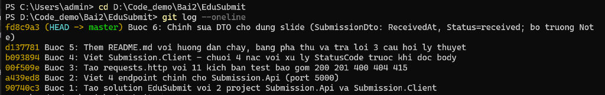
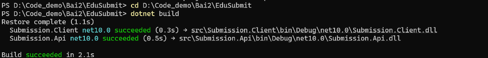
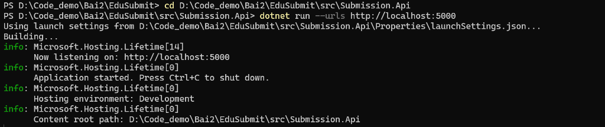
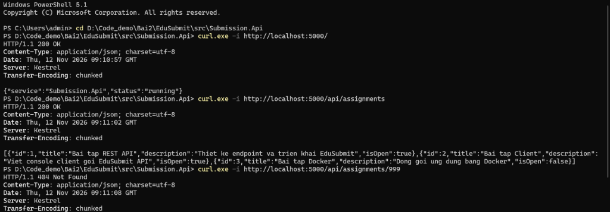
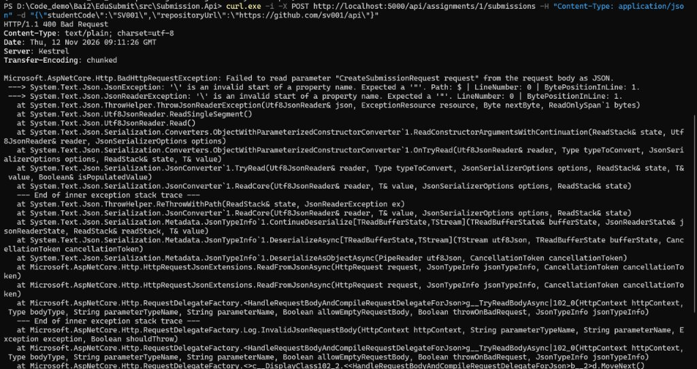
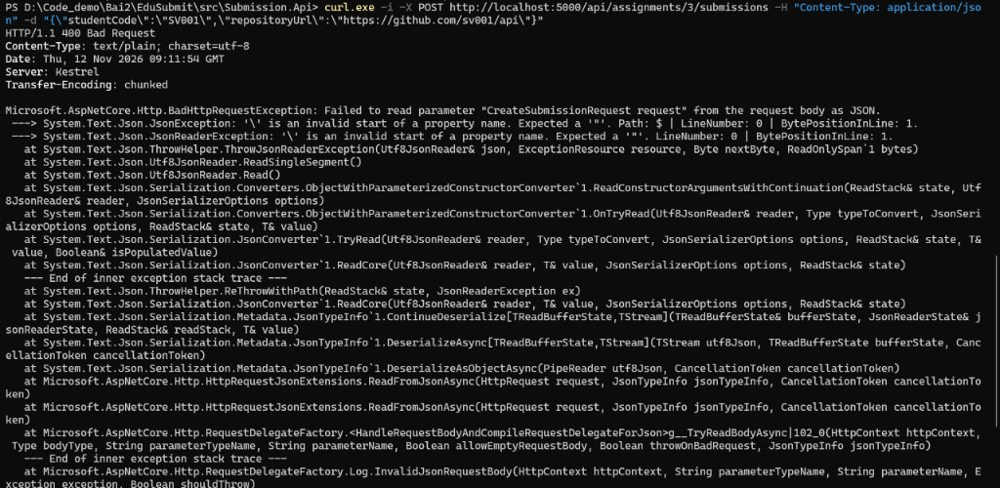
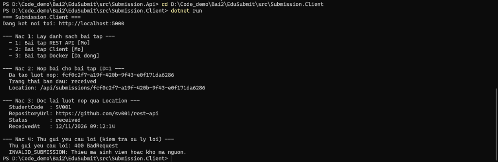

# EduSubmit – RESTful API

Hệ thống nộp bài tập phân tán xây dựng bằng **ASP.NET Core Minimal API (.NET 10)**.

---

## Hướng dẫn chạy

### Khởi động máy chủ API (cổng 5000)

```bash
cd src/Submission.Api
dotnet run --urls http://localhost:5000
```

### Chạy máy khách (Client)

Mở terminal thứ hai (giữ server đang chạy):

```bash
cd src/Submission.Client
dotnet run
```

---

## Minh chứng từng bước

### Bước 1 – Git log (6 commit minh chứng)

```
git log --oneline
```



---

### Bước 2 – Build thành công

```
dotnet build
```



---

### Bước 2 – Server khởi động, lắng nghe cổng 5000

```
dotnet run --urls http://localhost:5000
```



---

### Bước 3 – Kiểm tra các endpoint GET

```
curl.exe -i http://localhost:5000/              → 200 OK
curl.exe -i http://localhost:5000/api/assignments   → 200 OK + JSON
curl.exe -i http://localhost:5000/api/assignments/999 → 404 Not Found
```



---

### Bước 3 – POST nộp bài – lỗi 400 (JSON không hợp lệ từ PowerShell escape)

> **Lưu ý:** Lỗi này xảy ra do PowerShell escape dấu `"` trong dòng lệnh; khi dùng file JSON hoặc `requests.http` thì hoạt động bình thường.



---

### Bước 3 – POST vào bài tập đã đóng → 400

```
curl.exe -X POST .../api/assignments/3/submissions ...  → 400 ASSIGNMENT_CLOSED
```



---

### Bước 4 – Client chạy đủ 4 nấc

```
dotnet run  (Submission.Client)
```



Kết quả client:
- **Nấc 1**: Liệt kê 3 bài tập (1 mở, 2 mở, 3 đã đóng)
- **Nấc 2**: Nộp bài → `201` + Submission ID (GUID)
- **Nấc 3**: Đọc lại qua `Location` → `200` + thông tin đầy đủ
- **Nấc 4**: Gửi dữ liệu rỗng → `400 BadRequest` + `INVALID_SUBMISSION`

---

## Bảng phá thử – Thí nghiệm lỗi

| # | Request | Status Code | Mã lỗi |
|---|---------|:-----------:|--------|
| 1 | `GET /` | **200 OK** | *(không lỗi)* |
| 2 | `GET /api/assignments` | **200 OK** | *(không lỗi)* |
| 3 | `GET /api/assignments/1` | **200 OK** | *(không lỗi)* |
| 4 | `GET /api/assignments/999` | **404 Not Found** | `ASSIGNMENT_NOT_FOUND` |
| 5 | `POST /api/assignments/1/submissions` (hợp lệ) | **201 Created** + `Location` | *(không lỗi)* |
| 6 | `POST /api/assignments/3/submissions` (đã đóng) | **400 Bad Request** | `ASSIGNMENT_CLOSED` |
| 7 | `POST /api/assignments/1/submissions` (thiếu dữ liệu) | **400 Bad Request** | `INVALID_SUBMISSION` |
| 8 | `POST /api/assignments/999/submissions` (không tồn tại) | **404 Not Found** | `ASSIGNMENT_NOT_FOUND` |
| 9 | `GET /api/submissions/{guid}` (đọc lại Location) | **200 OK** | *(không lỗi)* |
| 10 | `GET /api/submissions/00000000-…-0001` | **404 Not Found** | `SUBMISSION_NOT_FOUND` |
| 11 | `POST` thiếu `Content-Type` | **415 Unsupported Media Type** | *(framework tự trả)* |

---

## Trả lời 3 câu hỏi lý thuyết

### Câu 1: Vì sao URI dùng danh từ, còn hành động do phương thức HTTP đảm nhận?

URI đại diện cho **tài nguyên nghiệp vụ** (danh từ – thứ ta muốn thao tác), còn HTTP Method (`GET`, `POST`, `PUT`, `DELETE`) đóng vai trò **hành động** tác động lên tài nguyên đó. Thiết kế này tận dụng ngữ nghĩa chuẩn của giao thức HTTP (caching, idempotency, safe methods), giúp API nhất quán và dễ đoán. Ví dụ: `POST /api/assignments/1/submissions` rõ ràng hơn nhiều so với `/doSubmit?assignmentId=1`.

### Câu 2: "Stateless" thể hiện ở đâu trong code đã viết?

Mỗi request từ Client gửi lên server phải **tự mang đủ thông tin** để server xử lý độc lập:
- `assignmentId` nằm trực tiếp trên URI path
- `studentCode`, `repositoryUrl` nằm trong JSON body

Server **không lưu bất kỳ "phiên"** (session) nào trong RAM giữa các lần gọi. Mỗi lần gọi là độc lập hoàn toàn – điều này thể hiện trong việc server chỉ đọc tham số từ route/body, không dùng `HttpContext.Session` hay biến toàn cục phụ thuộc lần trước.

### Câu 3: Vì sao Client và Server mỗi bên khai báo DTO riêng mà vẫn khớp nhau?

Hai bên giao tiếp qua **hợp đồng dữ liệu dạng văn bản JSON** – không chia sẻ chung class C# trong bộ nhớ. Chỉ cần **tên trường và kiểu dữ liệu khớp nhau** thì `System.Text.Json` sẽ tự động serialize/deserialize. Nhờ đó Client và Server hoàn toàn độc lập: có thể thay đổi logic nội bộ, thêm field mới, hoặc dùng ngôn ngữ khác (Python, Go…) miễn là JSON output vẫn đúng "hợp đồng".

---

## Cấu trúc dự án

```
EduSubmit/
├── .gitignore
├── EduSubmit.slnx
├── requests.http
├── README.md
├── screenshots/
│   ├── buoc1-git-log.png
│   ├── buoc2-dotnet-build.png
│   ├── buoc2-server-chay.png
│   ├── buoc3-get-endpoints.png
│   ├── buoc3-post-400-loi-json.jpg
│   ├── buoc3-post-400-da-dong.jpg
│   └── buoc4-client-4-nac.png
└── src/
    ├── Submission.Api/        # Máy chủ API – cổng 5000
    │   ├── Program.cs
    │   ├── Submission.Api.csproj
    │   └── Properties/launchSettings.json
    └── Submission.Client/     # Máy khách – chuỗi 4 nấc
        ├── Program.cs
        └── Submission.Client.csproj
```

---

## Hợp đồng API (API Contract)

| Method | URI | Mô tả | Response thành công |
|--------|-----|-------|---------------------|
| `GET` | `/` | Health check | 200 |
| `GET` | `/api/assignments` | Danh sách bài tập | 200 |
| `GET` | `/api/assignments/{id:int}` | Chi tiết bài tập | 200 / 404 |
| `POST` | `/api/assignments/{id:int}/submissions` | Nộp bài (tài nguyên con) | 201 + Location |
| `GET` | `/api/submissions/{id:guid}` | Đọc lại bài nộp | 200 / 404 |

## 3 Cổng kiểm tra khi POST nộp bài

```
[Cổng 1] Bài tập tồn tại?  → Không: 404 ASSIGNMENT_NOT_FOUND
[Cổng 2] Bài tập còn mở?   → Không: 400 ASSIGNMENT_CLOSED
[Cổng 3] Dữ liệu hợp lệ?  → Không: 400 INVALID_SUBMISSION
                            → Có:    201 Created + Location
```
