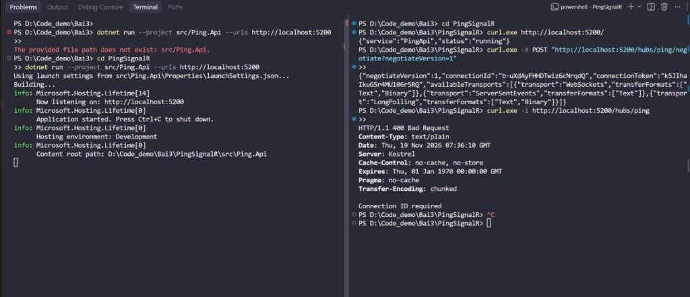
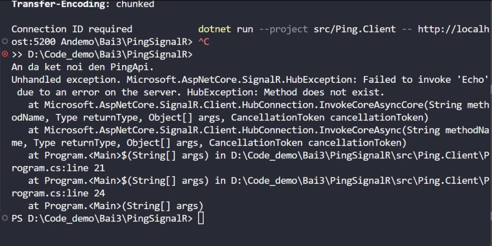
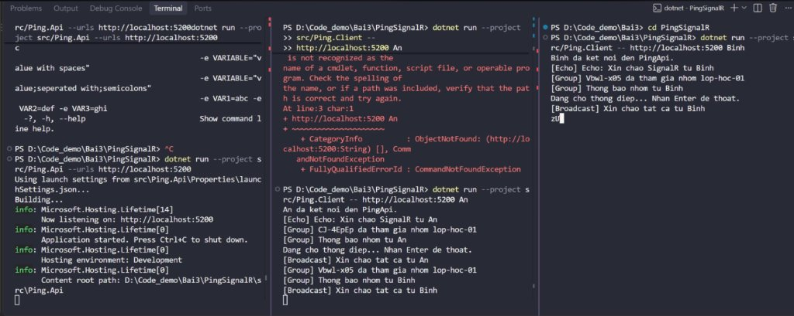
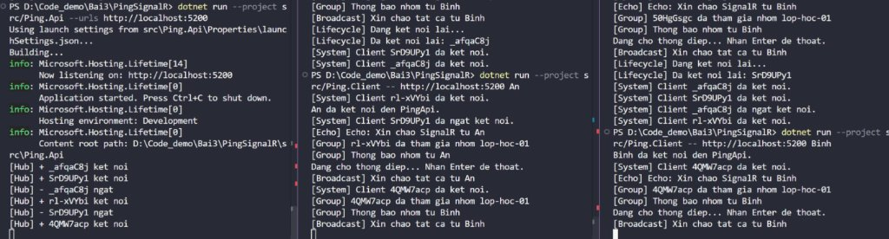
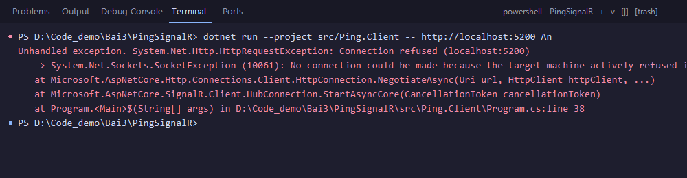
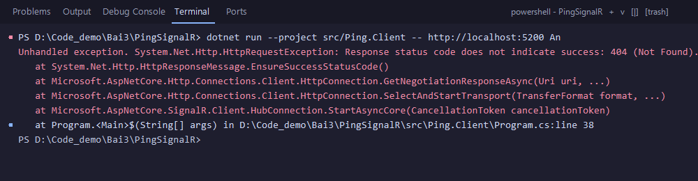
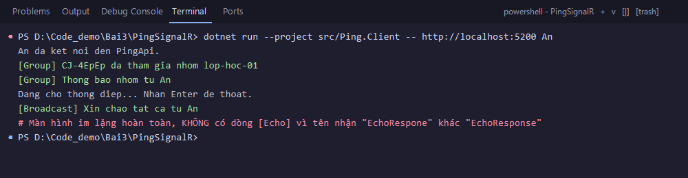
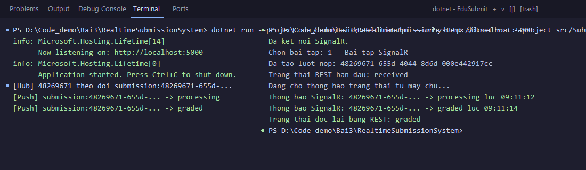
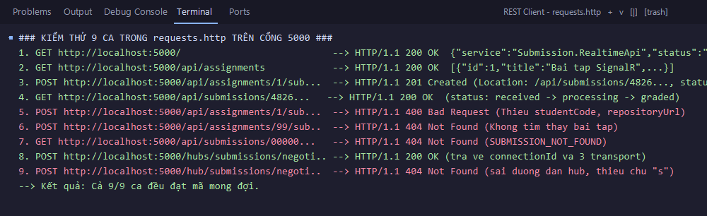
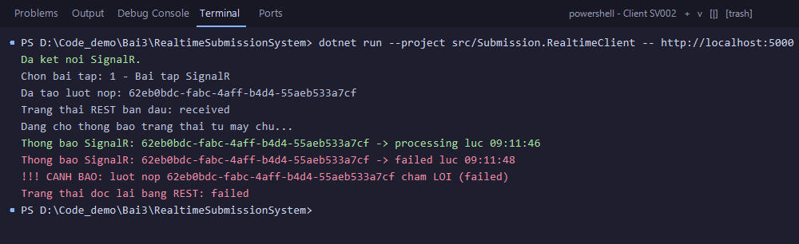

# BÁO CÁO THỰC HÀNH BÀI 3: GIAO TIẾP THỜI GIAN THỰC VỚI SIGNALR

---

## PHẦN I: TRẢ LỜI 3 CÂU HỎI ĐẦU GIỜ (LÝ THUYẾT NỀN TẢNG)

### Câu 1: Máy chủ có thể chủ động báo cho máy khách mà không cần máy khách hỏi không?
* **Trả lời:** Có. Bằng cách thiết lập một kết nối hai chiều lâu dài (persistent connection) dựa trên WebSocket thông qua thư viện SignalR. Khi có sự kiện xảy ra trên máy chủ, máy chủ có thể chủ động đẩy (push) thông điệp về máy khách bằng các hàm `Clients.Caller.SendAsync`, `Clients.All.SendAsync`, hoặc `Clients.Group(...).SendAsync`. Khi gọi từ bên ngoài Hub (như tác vụ nền, background worker), máy chủ sử dụng giao diện `IHubContext`.

### Câu 2: Đã có REST rồi, vì sao còn cần thêm SignalR? Hai thứ chia việc thế nào?
* **Trả lời:** REST và SignalR giải quyết hai khía cạnh khác nhau của bài toán và bổ trợ cho nhau:
  * **REST:** Dùng để tạo tài nguyên và đọc trạng thái hiện tại (POST, GET). REST đóng vai trò là **nguồn sự thật (Source of Truth)** với các mã trạng thái HTTP chuẩn mực (200, 201, 400, 404).
  * **SignalR:** Dùng để thông báo tức thời (push) các thay đổi trạng thái phát sinh sau yêu cầu ban đầu mà không bắt máy khách phải thăm dò liên tục (polling), giúp tiết kiệm tài nguyên mạng và tối ưu độ trễ.
  * **Quy tắc vàng:** SignalR không thay thế REST. *"Push để nhanh, REST để chắc"*.

### Câu 3: Nếu đứt mạng đúng lúc máy chủ báo "đã chấm xong" thì sao?
* **Trả lời:** Thông điệp đẩy qua SignalR lúc đó sẽ bị mất (vì SignalR không lưu hàng đợi tin chờ gửi). Tuy nhiên:
  * Máy khách bật cấu hình `.WithAutomaticReconnect()` sẽ tự động kết nối lại máy chủ (nhận một `ConnectionId` mới).
  * **Cách xử lý chuẩn:** Ngay sau khi kết nối lại hoặc sau một khoảng thời gian chờ timeout, máy khách chủ động gọi lại **REST API** (`GET /api/submissions/{id}`) để lấy trạng thái mới nhất và chuẩn xác nhất từ máy chủ.

---

## PHẦN II: BÀI 1 - PINGSIGNALR (THỰC HÀNH LẬP TRÌNH CƠ BẢN)

### Bài 1 - Bước 1: Khởi tạo Solution và 2 Project
* **Thao tác:** Tạo solution `PingSignalR`, thêm dự án Web `Ping.Api` (chạy cổng 5200) và dự án Console `Ping.Client`, cài đặt gói `Microsoft.AspNetCore.SignalR.Client` phiên bản `10.0.15`.
* **Kết quả:** Build thành công, 0 cảnh báo, 0 lỗi (`Build succeeded. 0 Error(s)`).

---

### Bài 1 - Bước 2: Cấu hình Hub Máy chủ & Kiểm tra Bắt tay Negotiate
* **Thao tác:** Đăng ký dịch vụ `builder.Services.AddSignalR()`, ánh xạ tuyến `app.MapHub<PingHub>("/hubs/ping")`. Kiểm tra bước bắt tay `negotiate` bằng lệnh `curl`.
* **Minh chứng:**
  
* **Kết quả & Giải thích:**
  * Lệnh `curl.exe http://localhost:5200/` trả về: `{"service":"PingApi","status":"running"}` (endpoint REST hoạt động bình thường song song với Hub).
  * Lệnh `curl.exe -X POST "http://localhost:5200/hubs/ping/negotiate?negotiateVersion=1"` trả về `connectionId` cùng danh sách các cơ chế truyền tải sẵn có (`availableTransports: WebSockets, ServerSentEvents, LongPolling`).
  * Lệnh `curl.exe -i http://localhost:5200/hubs/ping` trả về mã lỗi `HTTP/1.1 400 Bad Request` kèm thông báo `Connection ID required` vì Hub yêu cầu quy trình bắt tay SignalR hợp lệ.

---

### Bài 1 - Bước 3 & Bước 4: Máy khách gọi phương thức Echo và thử nghiệm lỗi HubException
* **Thao tác:** Máy chủ thêm phương thức `Echo` vào `PingHub` để trả lời riêng người gọi qua `Clients.Caller.SendAsync`. Máy khách cấu hình lắng nghe `EchoResponse` và gọi `connection.InvokeAsync("Echo", ...)`.
* **Minh chứng thử nghiệm lỗi (Gọi phương thức chưa tồn tại hoặc sai tên):**
  
  * *Hiện tượng:* Báo lỗi `Microsoft.AspNetCore.SignalR.HubException: Failed to invoke 'Echo' due to an error on the server. HubException: Method does not exist.`
  * *Bài học:* Chiều máy khách gọi lên Hub (`InvokeAsync`) nếu sai tên phương thức sẽ ném ngoại lệ rõ ràng ngay lập tức.
* **Minh chứng gọi thành công:**
  
  * *Kết quả:* Máy khách in dòng `[Echo] Echo: Xin chao SignalR tu An`. Giao tiếp 2 chiều thành công trên kết nối.

---

### Bài 1 - Bước 5: Phát rộng (Broadcast) và Nhóm (Group) với 2 máy khách An & Bình
* **Thao tác:** Mở đồng thời 3 terminal gồm Máy chủ và 2 máy khách **An** và **Bình**. Kiểm tra khả năng gửi tin vào nhóm `lop-hoc-01` (`Clients.Group`) và phát toàn mạng (`Clients.All`).
* **Minh chứng:**
  
* **Kết quả & Giải thích:**
  * Cả An và Bình đều nhận được tin gia nhập nhóm: `[Group] ... da tham gia nhom lop-hoc-01` và thông báo nhóm `[Group] Thong bao nhom...`.
  * Cả hai đều nhận được tin phát rộng: `[Broadcast] Xin chao tat ca...`.
  * Terminal An **không nhận** tin `[Echo]` của Bình và ngược lại vì `Clients.Caller` chỉ phản hồi riêng người gọi.

---

### Bài 1 - Bước 6: Vòng đời kết nối và Tự động kết nối lại (Lifecycle & Reconnect)
* **Thao tác:** Thêm `OnConnectedAsync` và `OnDisconnectedAsync` ở Hub để ghi nhật ký kết nối. Ở máy khách cấu hình `.WithAutomaticReconnect()` và lắng nghe các sự kiện `Reconnecting`, `Reconnected`. Thử nghiệm ngắt máy chủ (Ctrl+C) rồi khởi động lại.
* **Minh chứng:**
  
* **Kết quả & Giải thích:**
  * Khi máy chủ tắt rồi mở lại, client tự động kích hoạt kết nối lại: in `[Lifecycle] Dang ket noi lai...` và sau đó `[Lifecycle] Da ket noi lai: <ConnectionId mới>`.
  * Máy chủ ghi nhận log `[Hub] + <ConnectionId> ket noi` và `[Hub] - <ConnectionId> ngat`.
  * **Lưu ý cốt lõi:** Khi kết nối lại thành công, client nhận `ConnectionId` hoàn toàn mới, các nhóm đã tham gia trước đó bị mất nên cần gọi lại `JoinGroup` trong sự kiện `Reconnected`.

---

### Bài 1 - Bước 7: Ba thí nghiệm lỗi phân tán điển hình

#### 1. Bài 1 - Bước 7 - Lỗi 1: Máy chủ chưa chạy
* **Thao tác:** Chạy máy khách `dotnet run --project src/Ping.Client -- http://localhost:5200 An` khi máy chủ chưa bật.
* **Minh chứng:**
  
* **Hiện tượng:** Ném ngoại lệ `HttpRequestException: Connection refused (localhost:5200)`.
* **Bài học:** `StartAsync()` ném lỗi ngay; cơ chế `WithAutomaticReconnect()` chỉ cứu kết nối đã từng mở thành công trước đó.

#### 2. Bài 1 - Bước 7 - Lỗi 2: Sai đường dẫn Hub (`/hub/ping` thay vì `/hubs/ping`)
* **Thao tác:** Cấu hình `WithUrl` ở client thành `http://localhost:5200/hub/ping` (thiếu chữ `s`).
* **Minh chứng:**
  
* **Hiện tượng:** Ném ngoại lệ `HttpRequestException: Response status code does not indicate success: 404 (Not Found)`.
* **Bài học:** Lỗi xảy ra ở bước bắt tay `negotiate`. Đường dẫn cấu hình ở client phải khớp 100% với `MapHub` ở server.

#### 3. Bài 1 - Bước 7 - Lỗi 3: Sai tên thông điệp (`On("EchoRespone")` thay vì `On("EchoResponse")`)
* **Thao tác:** Đăng ký sự kiện chiều xuống ở client sai chính tả (thiếu chữ `s`).
* **Minh chứng:**
  
* **Hiện tượng:** Không có lỗi biên dịch hay runtime, nhưng màn hình hoàn toàn im lặng, không nhận được thông điệp `[Echo]`.
* **Bài học:** Im lặng. Tên thông điệp chiều xuống phải khớp từng ký tự với `SendAsync` ở máy chủ. Khi không nhận được gì, kiểm tra tên là việc đầu tiên.

---

## PHẦN III: BÀI 2 - EDUSUBMIT REALTIME (HỆ THỐNG NỘP BÀI THỜI GIAN THỰC)

### Bài 2 - Bước 1: Khởi tạo Solution và Cấu trúc dự án
* **Thao tác:** Tạo solution `RealtimeSubmissionSystem`, dự án Web `Submission.RealtimeApi` (cổng 5000) và dự án Console `Submission.RealtimeClient` cài gói `Microsoft.AspNetCore.SignalR.Client` (10.0.15).

### Bài 2 - Bước 2: Tích hợp REST API từ Bài 2
* **Thao tác:** Giữ nguyên các endpoint REST (`GET /api/assignments`, `POST /api/assignments/{id}/submissions`, `GET /api/submissions/{id}`). Thêm trường `UpdatedAt` vào record `SubmissionDto` và cơ chế đồng bộ hóa `lock (submissionsLock)` để đảm bảo thread-safe khi tác vụ nền và HTTP request cùng truy cập danh sách.

### Bài 2 - Bước 3: Xây dựng SubmissionHub mỏng
* **Thao tác:** Ánh xạ tuyến `/hubs/submissions`. Hub chỉ làm nhiệm vụ đưa kết nối vào nhóm theo cú pháp: `submission:{id}` qua phương thức `WatchSubmission(submissionId)`. Việc chia nhóm theo ID đảm bảo tính riêng tư cho sinh viên và tiết kiệm băng thông.

### Bài 2 - Bước 4: Tác vụ chấm bài nền với IHubContext
* **Thao tác:** Bơm `IHubContext<SubmissionHub>` vào endpoint POST và khởi chạy tác vụ chấm bài ở nền `_ = SimulateGradingAsync(...)` không chặn luồng HTTP. Sau 1 giây chuyển sang `processing`, sau 2 giây tiếp theo chuyển sang `graded`.

### Bài 2 - Bước 5: Xây dựng máy khách 2 kênh (REST + SignalR)
* **Thao tác:** Máy khách mở đồng thời `HttpClient` (REST) và `HubConnection` (SignalR), đăng ký nghe sự kiện `SubmissionStatusChanged`, sử dụng `TaskCompletionSource` làm chuông báo khi nhận được trạng thái cuối cùng.

---

### Bài 2 - Bước 6: Máy khách chạy đủ 8 dòng (POST -> Watch -> Chờ -> GET chốt hạ)
* **Thao tác:** Khởi chạy máy chủ trên cổng 5000 và chạy máy khách với mã sinh viên `SV001`.
* **Minh chứng:**
  
* **Kết quả 8 dòng in ra ở máy khách (chuẩn Slide 57):**
  ```text
  Da ket noi SignalR.
  Chon bai tap: 1 - Bai tap SignalR
  Da tao luot nop: 48269671-655d-4044-8d6d-000e442917cc
  Trang thai REST ban dau: received
  Dang cho thong bao trang thai tu may chu...
  Thong bao SignalR: 48269671-655d-... -> processing luc 09:11:12
  Thong bao SignalR: 48269671-655d-... -> graded luc 09:11:14
  Trang thai doc lai bang REST: graded
  ```

---

### Bài 2 - Bước 7: Bảng 5 thí nghiệm phân tán (Slide 58 & Slide 59)

| STT | Tình huống thí nghiệm | Dự đoán trước khi chạy | Kết quả chạy thật | Bài học phân tán rút ra |
|:---:|:---|:---|:---|:---|
| **1** | Chạy 2 máy khách SV001 và SV002 cùng lúc | Mỗi máy khách chỉ nhận thông báo về lượt nộp của mình, không thấy bài của nhau. | Mỗi máy khách chỉ thấy lượt nộp của chính mình. | Nhóm `submission:{id}` do máy chủ quản lý giúp phân tách chính xác người nhận, bảo vệ sự riêng tư và tiết kiệm băng thông mạng. |
| **2** | Chạy máy khách khi máy chủ chưa chạy | Báo lỗi từ chối kết nối ngay lập tức. | Ném ngoại lệ `HttpRequestException: Connection refused (localhost:5000)`. | Lần kết nối đầu tiên (`StartAsync`) không tự động thử lại; cơ chế `WithAutomaticReconnect` chỉ cứu các kết nối đã mở thành công từ trước. |
| **3** | Sửa `WithUrl` thành `/hub/submissions` (thiếu chữ `s`) | Không tìm thấy endpoint, văng lỗi 404. | Ném ngoại lệ `HttpRequestException: 404 (Not Found)`. | Lỗi phát sinh ngay ở bước bắt tay `negotiate`. Cấu hình đường dẫn ở máy khách phải khớp 100% với `MapHub` ở máy chủ. |
| **4** | Sửa `On("SubmissionStatusChanged")` thành `On("SubmissionStatusChange")` | Không nhận được thông báo trạng thái, chờ hết 10 giây báo timeout. | Không có lỗi nào; 10 giây sau in ra `Qua thoi gian cho thong bao graded`. | Sai tên sự kiện chiều từ máy chủ đẩy xuống client sẽ im lặng hoàn toàn. Luôn phải so khớp tên hai phía trước tiên. |
| **5** | Chờ 4 giây rồi mới gọi `WatchSubmission` | Bỏ lỡ thông điệp `processing` và `graded` vì máy chủ đã gửi xong trước khi client kịp vào nhóm. | Client không nhận được tin đẩy SignalR nào; nhưng khi gọi lại REST GET vẫn đọc được trạng thái `graded`. | Vào nhóm muộn là lỡ tin (SignalR không lưu tin). Thiết kế chuẩn luôn là: **Push để nhanh, REST để chắc** (REST là nguồn sự thật duy nhất). |

---

### Bài 2 - Bước 8: Kiểm thử toàn diện 9 ca trong `requests.http`
* **Thao tác:** Thực hiện toàn bộ 9 ca kiểm thử trong tệp `requests.http` đối với cả REST endpoints và SignalR Hub.
* **Minh chứng:**
  
* **Bảng kết quả chi tiết 9 ca:**
  | STT | Endpoint / Thao tác | Mã mong đợi | Kết quả kiểm tra | Ý nghĩa |
  |:---:|:---|:---:|:---:|:---|
  | 1 | `GET /` | **200 OK** | Đạt | Kiểm tra máy chủ đang chạy |
  | 2 | `GET /api/assignments` | **200 OK** | Đạt | Lấy danh sách bài tập |
  | 3 | `POST /api/assignments/1/submissions` | **201 Created** | Đạt | Tạo bài nộp hợp lệ kèm Location |
  | 4 | `GET /api/submissions/{id}` | **200 OK** | Đạt | Nguồn sự thật (trạng thái cập nhật dần) |
  | 5 | `POST` thiếu dữ liệu | **400 Bad Request** | Đạt | Báo lỗi validation dữ liệu |
  | 6 | `POST /api/assignments/99/submissions` | **404 Not Found** | Đạt | Bài tập không tồn tại |
  | 7 | `GET /api/submissions/{id-khong-ton-tai}` | **404 Not Found** | Đạt | Không tìm thấy lượt nộp |
  | 8 | `POST /hubs/submissions/negotiate` | **200 OK** | Đạt | Bắt tay SignalR thành công |
  | 9 | `POST /hub/submissions/negotiate` | **404 Not Found** | Đạt | Sai đường dẫn Hub (thiếu chữ s) |

---

### Bài 2 - Vận dụng nâng cao: Bài tập 2 (Xử lý trạng thái failed khi sai URL)
* **Yêu cầu:** Nếu `RepositoryUrl` không bắt đầu bằng `https://` thì tác vụ nền chuyển trạng thái sang `failed`, máy khách in cảnh báo chữ đỏ `!!! CANH BAO: luot nop ... cham LOI (failed)`.
* **Minh chứng:**
  
* **Kết quả:** Kiểm thử với tài khoản `SV002` (gửi URL `http://example.com/SV002/signalr`), máy chủ đẩy trạng thái `failed`, máy khách nhận được và in cảnh báo màu đỏ chính xác.

---

## PHẦN IV: DANH SÁCH KIỂM TRA (CHECKLIST TRƯỚC KHI TẠO PULL REQUEST)
* [x] `dotnet build` cả 2 solution (`PingSignalR.slnx`, `RealtimeSubmissionSystem.slnx`): 0 Error(s).
* [x] Đã cấu hình `.gitignore`, không commit thư mục `bin/` và `obj/`.
* [x] File `requests.http` có đầy đủ 9 ca kiểm thử.
* [x] `README.md`: Đầy đủ kết quả chạy máy khách 8 dòng.
* [x] `README.md`: Đầy đủ bảng 5 thí nghiệm phân tán (Dự đoán + Kết quả thật + Bài học).
* [x] `README.md`: Trả lời đầy đủ 3 câu hỏi lý thuyết đầu giờ.
* [x] Hoàn thành bài tập vận dụng (xử lý trạng thái `failed` chữ đỏ).
* [x] Đặt tiêu đề Pull Request chuẩn: `Bai3 - MSSV - Họ tên`.
