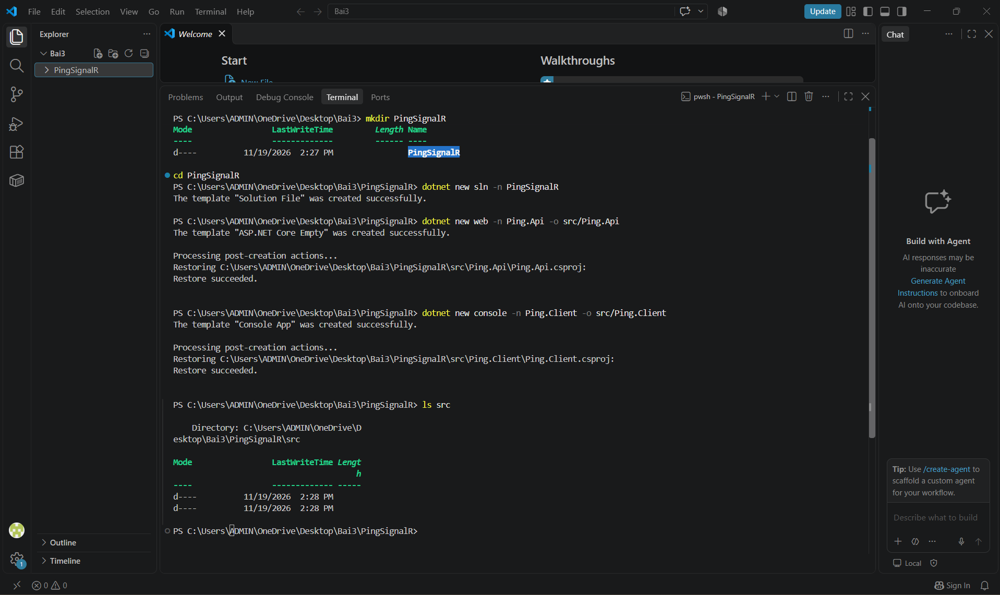
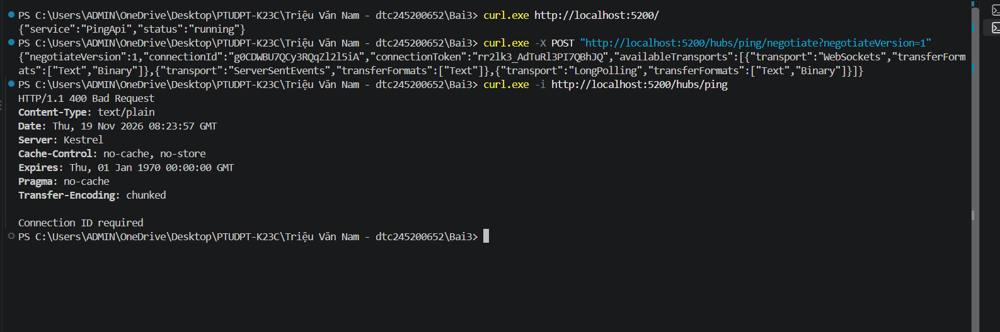

# Báo cáo thực hành Bài 3: Giao tiếp thời gian thực với SignalR

## Bước 1.1: Tạo solution và build PingSignalR

- **Thấy:** Lệnh `dotnet build` báo `Build succeeded` với 0 lỗi.
- **Giải thích:** Khởi tạo thành công solution `PingSignalR` gồm 2 project `Ping.Api` (máy chủ) và `Ping.Client` (máy khách đã cài gói `Microsoft.AspNetCore.SignalR.Client` phiên bản 10.0.15).
## Bước 1.2: ghi danh project, thêm gói SignalR

## Bước 2: negotiate

- **Thấy:** `curl` trả về `connectionId` cùng 3 cơ chế truyền tải (`WebSockets`, `ServerSentEvents`, `LongPolling`); truy cập trực tiếp `GET /hubs/ping` báo `400 Connection ID required`.
- **Giải thích:** Máy chủ báo các cách truyền tải hỗ trợ và hoàn tất bước bắt tay ban đầu để thương lượng giao thức kết nối SignalR.

