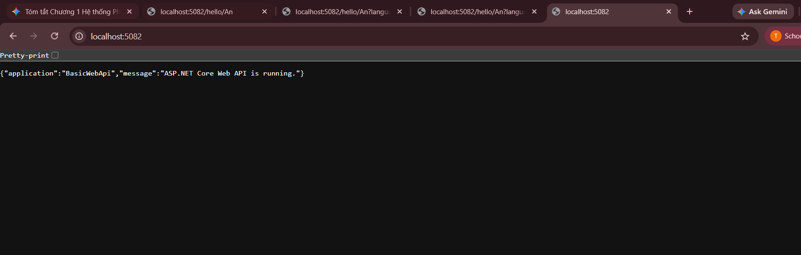
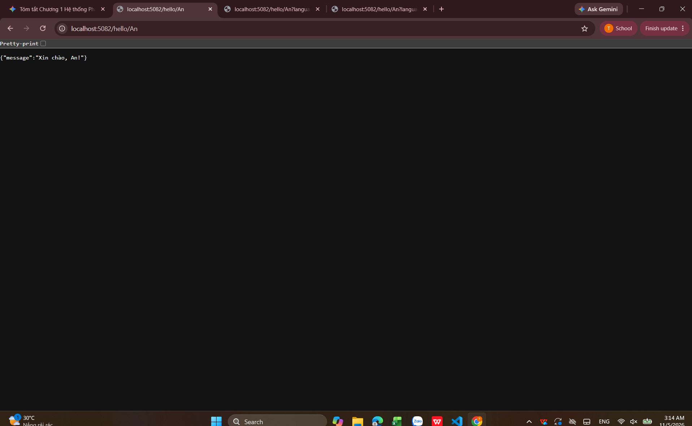
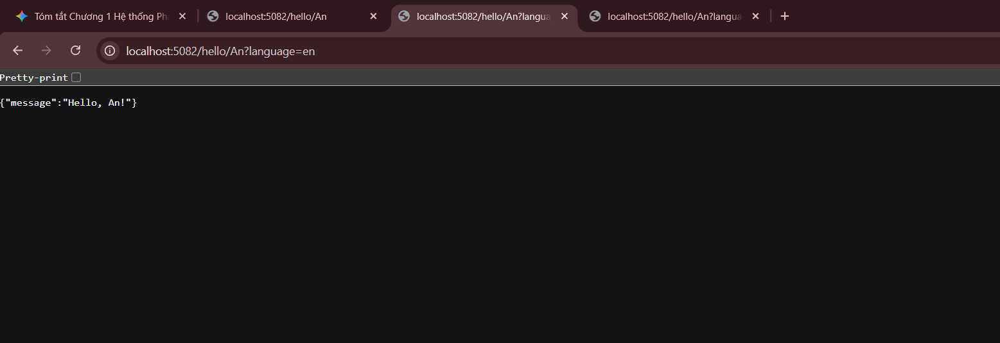
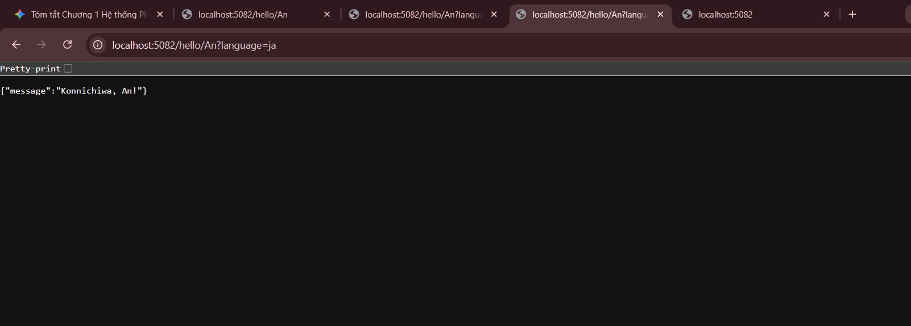
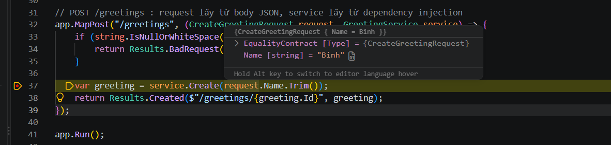

# Nhật ký Thực hành Bài 1
# 8.1 Khởi tạo và xây dựng dự án BasicWebApi
- **Thao tác thực hiện:**
  - Khởi tạo project ASP.NET Core Minimal API trong thư mục `src/BasicWebApi`.
  - Kiểm tra và biên dịch mã nguồn thành công bằng .NET CLI.
  PS C:\Users\ADMIN\OneDrive\Desktop\Bai1\BasicWebApi> dotnet build
  - **Minh chứng lệnh build:**
Restore complete (0.7s)
  BasicWebApi net10.0 succeeded (2.3s) → src\BasicWebApi\bin\Debug\net10.0\BasicWebApi.dll

Build succeeded in 3.4s

## 8.2 Thử bằng trình duyệt
http://localhost:5082/ 
http://localhost:5082/hello/An 
http://localhost:5082/hello/An?language=en 

## 8.4 Tìm hiểu mã nguồn BasicWebApi

### 1. Vị trí gọi AddSingleton và Build()
- **Câu hỏi:** Giữa `builder.Services.AddSingleton...` và `var app = builder.Build();`, dòng nào phải đứng trước? Vì sao?
- **Trả lời:** `builder.Services.AddSingleton...` bắt buộc phải đứng trước `builder.Build()`.
- **Giải thích:** `builder.Build()` có nhiệm vụ khởi tạo và đóng gói DI Container (Dependency Injection Container). Tất cả các dịch vụ (services) cần thiết phải được đăng ký vào `builder.Services` trước khi gọi `Build()`. Sau khi đã Build, container sẽ ở trạng thái Read-Only và không cho đăng ký thêm.

### 2. Phân biệt Route Parameter và Query String
- **Câu hỏi:** Trong route `/hello/{name}?language=en`, tham số `name` được lấy từ đâu và `language` được lấy từ đâu?
- **Trả lời:**
  - `name`: Được lấy từ **Route Parameter** (nằm trực tiếp trên đường dẫn URL).
  - `language`: Được lấy từ **Query String** (phía sau dấu `?` trên URL).

### 3. Phản hồi HTTP Status Code
- **Câu hỏi:** Vì sao khi gửi POST hợp lệ, API lại trả về `Results.Created` (HTTP 201) chứ không phải `Results.Ok` (HTTP 200)?
- **Trả lời:** Theo chuẩn thiết kế **RESTful API**, mã **`201 Created`** đại diện cho việc tạo mới thành công một tài nguyên trên máy chủ (Resource Creation). Phản hồi này thường kèm theo thông tin vị trí của tài nguyên mới (trong Header `Location`), giúp phân biệt rõ với các thao tác truy vấn thông thường (`200 OK`).
### 8.5 Tự làm (sửa code). Thêm ngôn ngữ thứ ba
http://localhost:5082/hello/An?language=ja 
## 8.6 Debug ứng dụng

- **Cấu hình:** Chạy Debug project `BasicWebApi` (cổng `https://localhost:5001`).
- **Thực thi:**
  - Đặt Breakpoint tại dòng 37 trong `Program.cs`.
  - Gửi request `POST /greetings` từ file `requests.http`.
- **Kết quả Debug:**
  - VS Code tạm dừng chính xác tại dòng 37 khi nhận request.
  - Hover chuột kiểm tra biến `request` nhận đúng dữ liệu `Name = "Binh"`.
  - Sử dụng phím `F10` để duyệt từng dòng lệnh và `Shift + F5` để kết thúc phiên Debug.

- **Minh chứng Debug thành công:**
  ![Debug Breakpoint Line 37] 