# Bài 3 – SignalR (Real-time với ASP.NET Core)

## Thông tin sinh viên

| Họ và tên | Mã sinh viên | Lớp |
|-----------|--------------|-----|
| Trương Thị Bích Ngọc | `dtc245200251` | CNTT K23C |

---

## Mô tả bài tập

Bài tập thực hành **SignalR** với ASP.NET Core — xây dựng hệ thống giao tiếp real-time giữa server và nhiều client thông qua WebSocket/SignalR Hub.

---

## Phần 1 – PingSignalR (Bước 1–7)

Tạo giải pháp **PingSignalR** gồm 2 project:

| Project | Loại | Mô tả |
|---------|------|-------|
| `Ping.Api` | ASP.NET Core Web | Server – định nghĩa `PingHub` với các method: `Echo`, `Broadcast`, `JoinGroup`, `SendToGroup`, `OnConnectedAsync`, `OnDisconnectedAsync` |
| `Ping.Client` | Console App | Client – kết nối tới hub, gọi các method và lắng nghe thông điệp |

### Bước 1: Tạo solution và 2 project

```bash
dotnet new web -n Ping.Api -o src/Ping.Api
dotnet new console -n Ping.Client -o src/Ping.Client
dotnet sln add src/Ping.Api/Ping.Api.csproj src/Ping.Client/Ping.Client.csproj
```

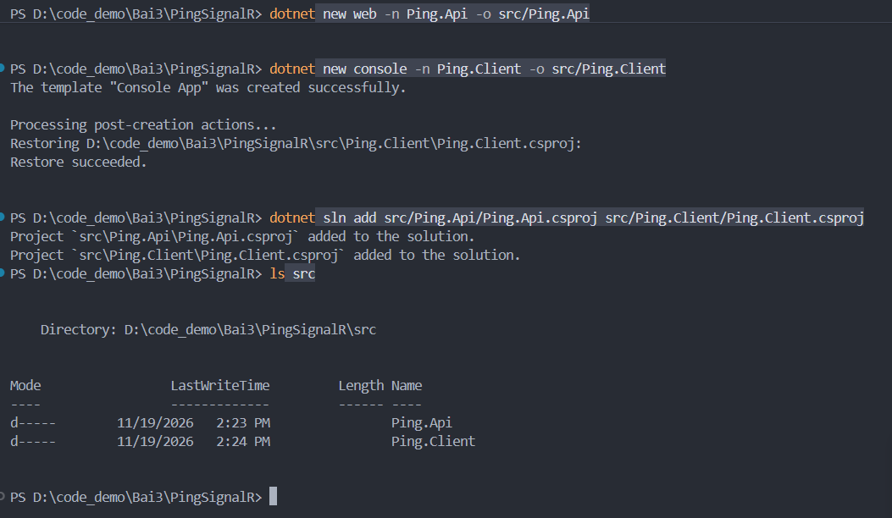

### Bước 2: Thêm package SignalR Client, dotnet build

```bash
dotnet add src/Ping.Client package Microsoft.AspNetCore.SignalR.Client --version 10.0.15
dotnet new gitignore
dotnet build
```

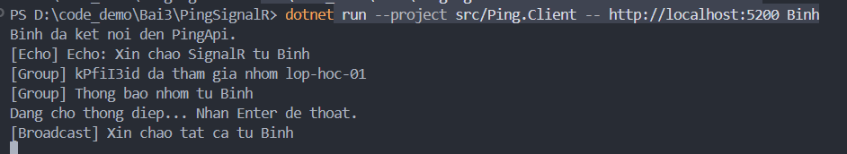

### Bước 3: Kiểm tra API endpoint và negotiate hub

```bash
curl.exe http://localhost:5200/
curl.exe -X POST "http://localhost:5200/hubs/ping/negotiate?negotiateVersion=1"
curl.exe -i http://localhost:5200/hubs/ping
```

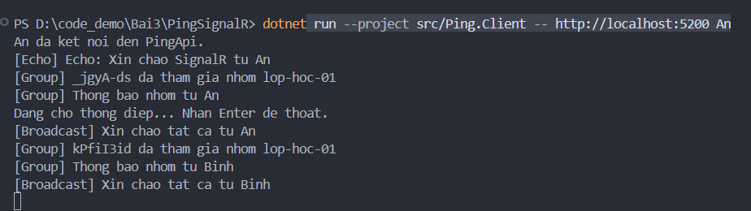

### Bước 4: Trình duyệt – GET /

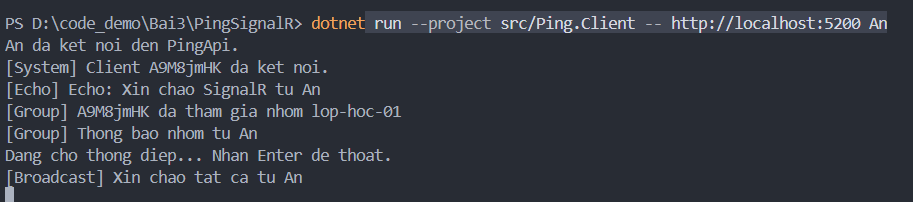

### Bước 5: Client kết nối hub – Echo, Group, Broadcast (lần 1)

```bash
dotnet run --project src/Ping.Client -- http://localhost:5200 An
```

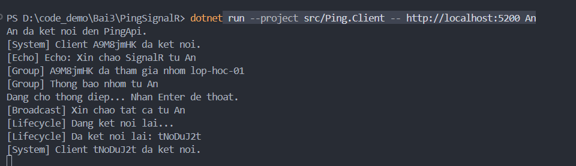

> Lỗi khi Hub chưa triển khai đúng method:

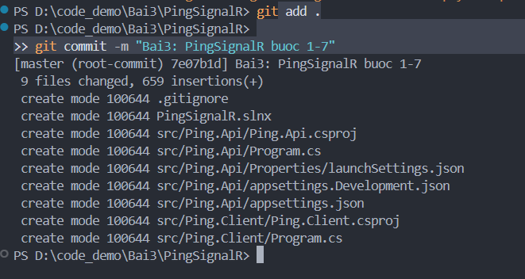

### Bước 6: Client kết nối thành công sau khi fix Hub

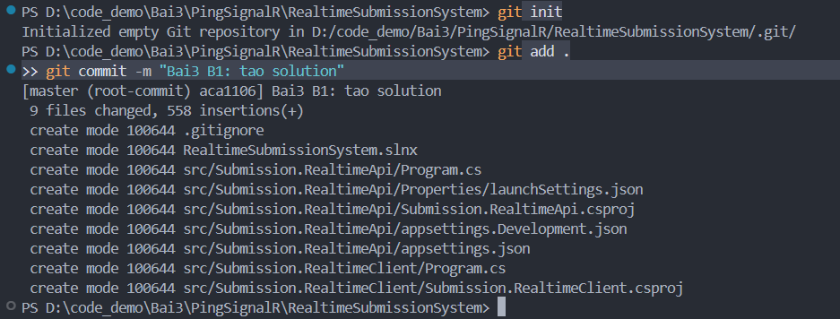

### Bước 7: Hai client kết nối đồng thời (An + Binh) – nhận Group & Broadcast

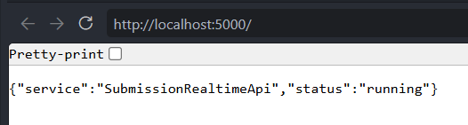

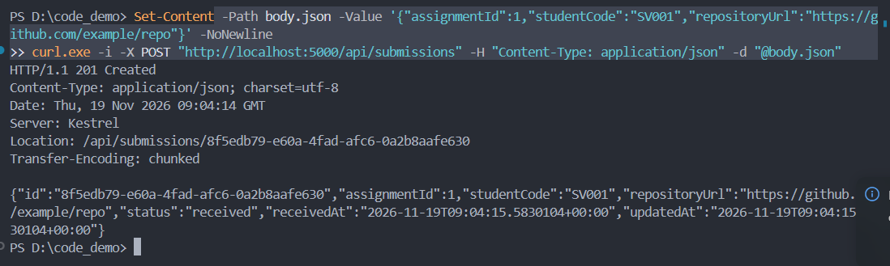

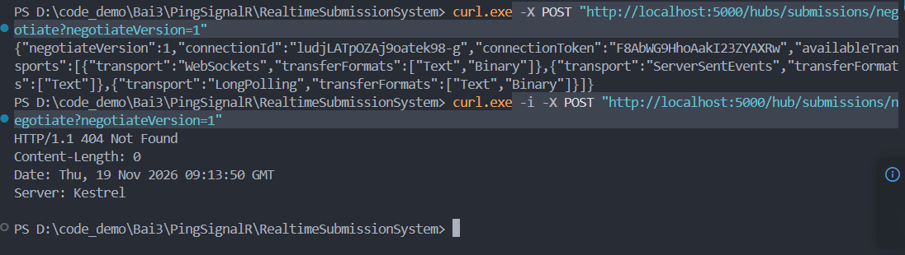

### Bước 7 (tiếp): Hai client cùng nhau – nhận chéo thông điệp

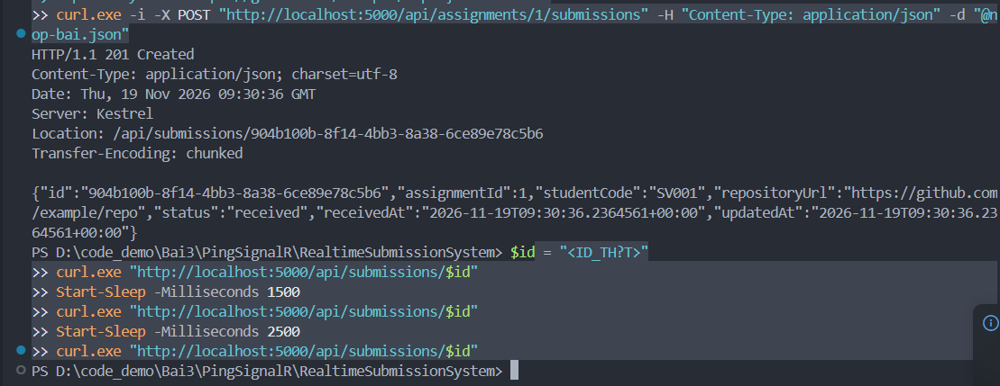

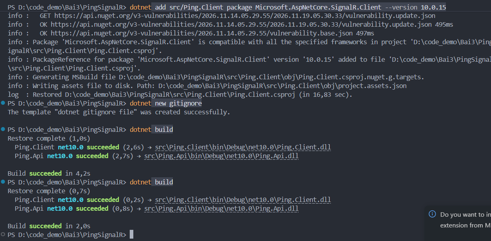

### Bước 7 (Reconnect): Lifecycle – Reconnecting / Reconnected

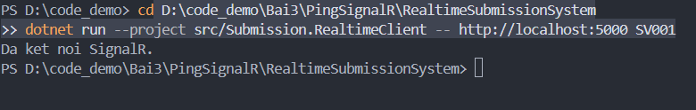

### Bước 8: Commit PingSignalR

```bash
git add .
git commit -m "Bai3: PingSignalR buoc 1-7"
```

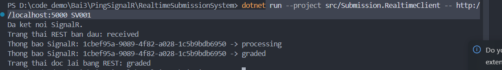

---

## Phần 2 – RealtimeSubmissionSystem (Bài tập B1)

Hệ thống nộp bài real-time, kết hợp **REST API + SignalR Hub**:

| Project | Loại | Mô tả |
|---------|------|-------|
| `Submission.RealtimeApi` | ASP.NET Core Web | Server – REST endpoints + `SubmissionHub` |
| `Submission.RealtimeClient` | Console App | Client – nộp bài qua REST, nhận thông báo qua SignalR |

**Luồng hoạt động:**
1. Client lấy danh sách bài tập: `GET /api/assignments`
2. Client nộp bài: `POST /api/assignments/{id}/submissions` → `201 Created`
3. Client subscribe SignalR group `submission:{id}` qua `WatchSubmission`
4. Server mô phỏng chấm: `received` → `processing` (sau 1s) → `graded` (sau 3s)
5. Client nhận thông báo real-time `SubmissionStatusChanged`, xác nhận lại bằng REST

### B1.1: Tạo solution và commit

```bash
git init
git add .
git commit -m "Bai3 B1: tao solution"
```

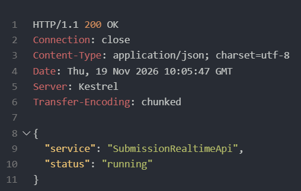

### B1.2: Trình duyệt – GET / (SubmissionRealtimeApi)

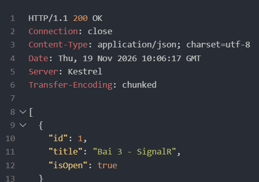

### B1.3: curl – GET / và negotiate hub

```bash
curl.exe http://localhost:5000/
curl.exe -X POST "http://localhost:5000/hubs/submissions/negotiate?negotiateVersion=1"
```

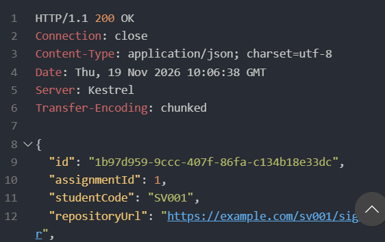

### B1.4: curl – POST tạo lượt nộp (status = received)

```bash
Set-Content -Path body.json -Value '{"assignmentId":1,"studentCode":"SV001","repositoryUrl":"https://github.com/example/repo"}' -NoNewline
curl.exe -i -X POST "http://localhost:5000/api/submissions" -H "Content-Type: application/json" -d "@body.json"
```

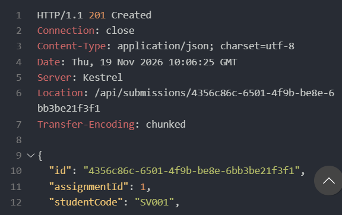

### B1.5: REST API – GET danh sách bài tập (HTTP Client)

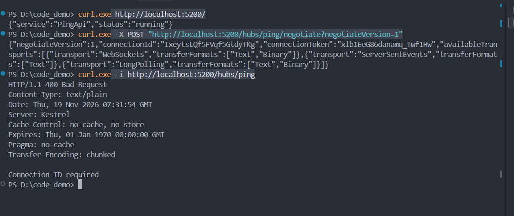

### B1.6: REST API – POST tạo submission qua HTTP Client

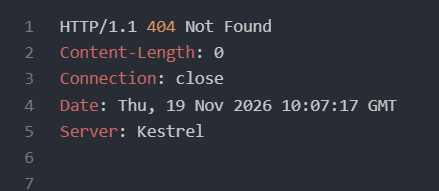

### B1.7: REST API – GET submission theo ID (polling trạng thái)

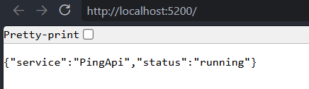

### B1.8: REST API – POST thiếu dữ liệu → 201 (studentCode rỗng)

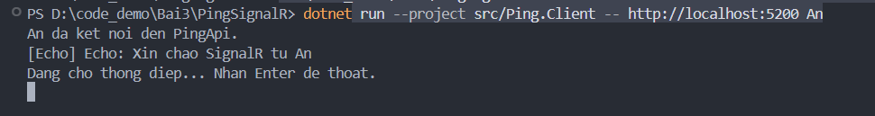

### B1.9: curl – nộp bài bằng nop-bai.json (status polling)

```bash
curl.exe -i -X POST "http://localhost:5000/api/assignments/1/submissions" -H "Content-Type: application/json" -d "@nop-bai.json"
$id = "<ID_TH?T>"
curl.exe "http://localhost:5000/api/submissions/$id"
Start-Sleep -Milliseconds 1500
curl.exe "http://localhost:5000/api/submissions/$id"
Start-Sleep -Milliseconds 2500
curl.exe "http://localhost:5000/api/submissions/$id"
```

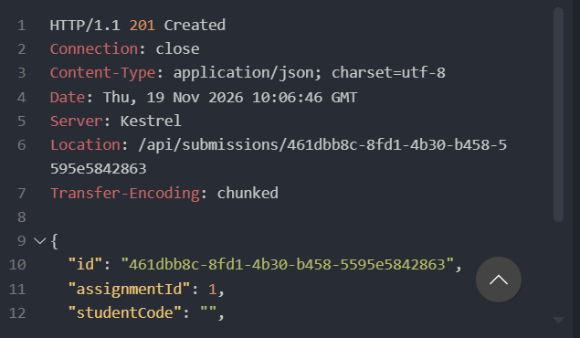

### B1.10: Client kết nối SignalR – Da ket noi

```bash
dotnet run --project src/Submission.RealtimeClient -- http://localhost:5000 SV001
```

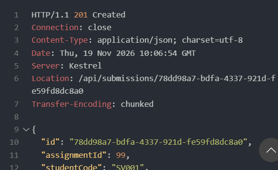

### B1.11: Client nhận thông báo real-time – received → processing → graded

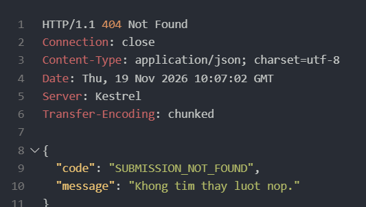

### B1.12: Trình duyệt – GET / RealtimeApi (xác nhận)

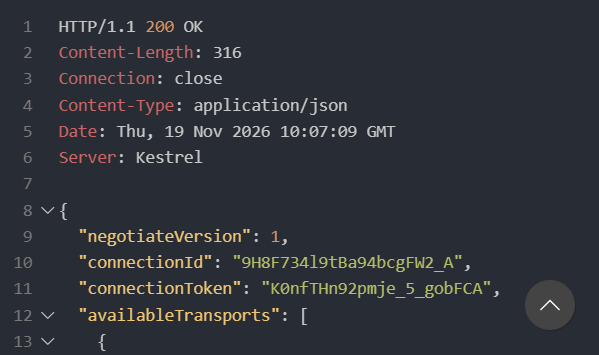

### B1.13: negotiate đúng hub → thành công; sai đường → 404

```bash
# Đúng
curl.exe -X POST "http://localhost:5000/hubs/submissions/negotiate?negotiateVersion=1"
# Sai
curl.exe -i -X POST "http://localhost:5000/hub/submissions/negotiate?negotiateVersion=1"
```


### B1.14: HTTP Client – 200 OK response headers

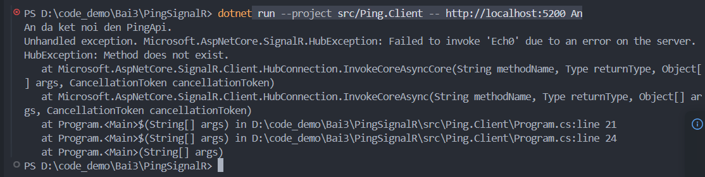

### B1.15: HTTP Client – GET danh sách bài tập

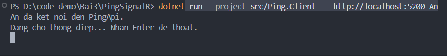

### B1.16: HTTP Client – POST tạo submission thành công

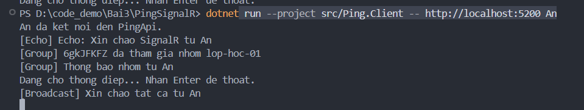

### B1.17: HTTP Client – GET submission theo ID (polling)

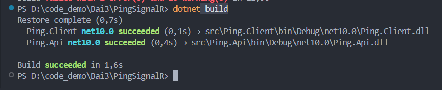

---

## Cấu trúc thư mục

```
Bai3/
├── images/                             # Ảnh minh chứng
│   ├── img01.png ~ img30.png
├── PingSignalR/                        # Giải pháp PingSignalR
│   ├── PingSignalR.slnx
│   ├── .gitignore
│   ├── src/
│   │   ├── Ping.Api/                   # Server SignalR Hub
│   │   │   └── Program.cs
│   │   └── Ping.Client/                # Client kết nối Hub
│   │       └── Program.cs
│   └── RealtimeSubmissionSystem/       # Hệ thống nộp bài real-time
│       ├── RealtimeSubmissionSystem.slnx
│       ├── requests.http
│       ├── nop-bai.json
│       └── src/
│           ├── Submission.RealtimeApi/
│           │   └── Program.cs
│           └── Submission.RealtimeClient/
│               └── Program.cs
└── README.md                           # File này
```

---

## Hướng dẫn chạy

### Phần 1 – PingSignalR

```bash
# Terminal 1 – Server
cd PingSignalR
dotnet run --project src/Ping.Api

# Terminal 2 – Client
dotnet run --project src/Ping.Client -- http://localhost:5200 TenClient
```

### Phần 2 – RealtimeSubmissionSystem

```bash
# Terminal 1 – Server
cd PingSignalR/RealtimeSubmissionSystem
dotnet run --project src/Submission.RealtimeApi

# Terminal 2 – Client
dotnet run --project src/Submission.RealtimeClient -- http://localhost:5000 SV001
```

---

## Kết quả đạt được

- ✅ Server PingApi khởi động, negotiate WebSocket thành công
- ✅ Client kết nối hub, nhận `EchoResponse`, `GroupMessage`, `BroadcastMessage`, `SystemMessage`
- ✅ Nhiều client kết nối đồng thời — nhận broadcast/group message chéo nhau
- ✅ Reconnect tự động hoạt động (`WithAutomaticReconnect`)
- ✅ SubmissionRealtimeApi chạy, negotiate hub thành công
- ✅ Nộp bài qua REST → nhận thông báo real-time `received → processing → graded`
- ✅ Xác nhận trạng thái cuối bằng GET REST → `graded`
- ✅ Sai đường dẫn hub → 404 Not Found
