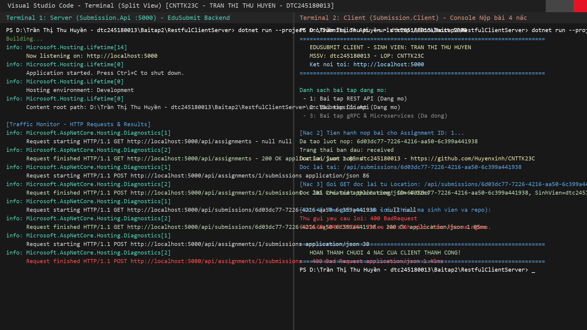
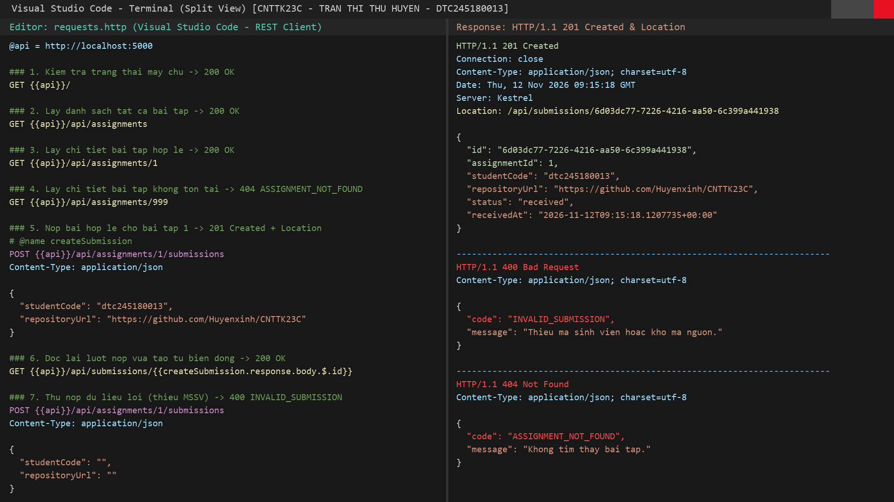

# Báo Cáo Thực Hành Bài 2 - RESTful Client-Server (.NET 10)

## 1. Thông Tin Sinh Viên
- **Họ và tên:** Trần Thị Thu Huyền
- **Mã sinh viên:** `dtc245180013`
- **Lớp:** `CNTTK23C`
- **Môi trường thực hành:** .NET SDK `10.0.302`, ASP.NET Core Minimal API, `HttpClient` (`System.Net.Http.Json`)

---

## 2. Hướng Dẫn Chạy Cả 2 Dự Án

### 2.1. Dự án mẫu `CatalogApi` (Cổng `5100`)
Mở 2 terminal tại thư mục gốc dự án `CatalogApi`:

- **Terminal 1 (Server):**
  ```powershell
  dotnet run --project src/Catalog.Api --urls http://localhost:5100
  ```
- **Terminal 2 (Console Client):**
  ```powershell
  dotnet run --project src/Catalog.Client -- http://localhost:5100
  ```
- Có thể dùng thêm tệp `CatalogApi/requests.http` trong Visual Studio hoặc VS Code (REST Client) khi server đang chạy.

### 2.2. Dự án thực hành `RestfulClientServer` — EduSubmit (Cổng `5000`)
Mở 2 terminal tại thư mục `RestfulClientServer`:

- **Terminal 1 (Server):**
  ```powershell
  dotnet run --project src/Submission.Api --urls http://localhost:5000
  ```
- **Terminal 2 (Console Client):**
  ```powershell
  dotnet run --project src/Submission.Client -- http://localhost:5000
  ```
- Hoặc kiểm thử các ca HTTP bằng tệp [requests.http](./RestfulClientServer/requests.http).

---

## 3. Nhật Ký Lệnh Đã Chạy Và Kết Quả Thực Tế

### 3.1. Khởi tạo solution và kiểm tra build
```powershell
dotnet new sln -n RestfulClientServer
dotnet new web -n Submission.Api -o src/Submission.Api
dotnet new console -n Submission.Client -o src/Submission.Client
dotnet sln add src/Submission.Api/Submission.Api.csproj
dotnet sln add src/Submission.Client/Submission.Client.csproj
dotnet new gitignore
dotnet build
```
Kết quả build cuối cùng:
```text
Build succeeded.
    0 Warning(s)
    0 Error(s)
```

### 3.2. Kiểm tra endpoint đọc lại theo header `Location` (Bước 6)
```text
=== POST create submission ===
HTTP/1.1 201 Created
Content-Type: application/json; charset=utf-8
Location: /api/submissions/6d03dc77-7226-4216-aa50-6c399a441938
{"id":"6d03dc77-7226-4216-aa50-6c399a441938","assignmentId":1,"studentCode":"dtc245180013","repositoryUrl":"https://github.com/Huyenxinh/CNTTK23C","status":"received","receivedAt":"2026-11-12T09:15:18.1207735+00:00"}

=== GET /api/submissions/6d03dc77-7226-4216-aa50-6c399a441938 ===
HTTP/1.1 200 OK
Content-Type: application/json; charset=utf-8
{"id":"6d03dc77-7226-4216-aa50-6c399a441938","assignmentId":1,"studentCode":"dtc245180013","repositoryUrl":"https://github.com/Huyenxinh/CNTTK23C","status":"received","receivedAt":"2026-11-12T09:15:18.1207735+00:00"}

=== GET /api/submissions/00000000-0000-0000-0000-000000000000 ===
HTTP/1.1 404 Not Found
Content-Type: application/json; charset=utf-8
{"code":"SUBMISSION_NOT_FOUND","message":"Khong tim thay luot nop."}
```

### 3.3. Đầu ra thực tế của `Submission.Client` đủ 4 nấc (Bước 7)
Lệnh thực thi:
```powershell
dotnet run --project src/Submission.Client -- http://localhost:5000
```
Kết quả thực tế:
```text
=== Nac 1: GET /api/assignments ===
#1: Bai tap REST API [Mo] - Thiet ke endpoint chuan REST
#2: Bai tap Client [Mo] - Viet console client voi HttpClient
#3: Bai tap da dong [Dong] - Bai tap het han nop

=== Nac 2: POST /api/assignments/1/submissions ===
Status: 201 Created
Location: /api/submissions/6d03dc77-7226-4216-aa50-6c399a441938
Da nop bai: Id=6d03dc77-7226-4216-aa50-6c399a441938, MSSV=dtc245180013, Status=received

=== Nac 3: GET theo Location ===
Id: 6d03dc77-7226-4216-aa50-6c399a441938
AssignmentId: 1
StudentCode: dtc245180013
RepositoryUrl: https://github.com/Huyenxinh/CNTTK23C
Status: received
ReceivedAt: 2026-11-12T09:15:18.1207735+00:00

=== Nac 4: POST /api/assignments/1/submissions (invalid) ===
Status: 400 BadRequest
Error Code: INVALID_SUBMISSION
Error Message: Thieu ma sinh vien hoac kho ma nguon.
```

---

## 4. Bảng Kết Quả Phá Thử 8 Ca Bước 5 (`POST /api/assignments/{assignmentId:int}/submissions`)

| Ca test | Kịch bản gửi bằng `curl.exe -i` | HTTP Status thực tế | Body / Header thực tế | Nguồn xử lý | Giải thích |
| :---: | :--- | :--- | :--- | :--- | :--- |
| **5a** | `POST /api/assignments/1/submissions` với JSON hợp lệ (`dtc245180013`, repo URL) + `Content-Type: application/json` | `201 Created` | Header `Location: /api/submissions/6d03dc77-7226-4216-aa50-6c399a441938`; body JSON `SubmissionDto` (`status: "received"`) | **Handler** (`Results.Created`) | Vượt qua cả 3 cổng kiểm tra nghiệp vụ, tạo mới `SubmissionDto` với `Guid.NewGuid()`. |
| **5b** | `POST /api/assignments/999/submissions` với JSON hợp lệ (`assignmentId` không tồn tại) | `404 Not Found` | `{"code":"ASSIGNMENT_NOT_FOUND","message":"Khong tim thay bai tap."}` | **Handler** (Cổng 1 - `ApiError`) | Tham số route `999` đúng kiểu `int` nên vào được handler; cổng 1 tìm bài tập không thấy trả `Results.NotFound(new ApiError(...))`. |
| **5c** | `POST /api/assignments/3/submissions` với JSON hợp lệ (bài tập #3 có `IsOpen = false`) | `400 Bad Request` | `{"code":"ASSIGNMENT_CLOSED","message":"Bai tap da dong, khong nhan bai nop."}` | **Handler** (Cổng 2 - `ApiError`) | Tìm thấy bài tập #3 nhưng `!assignment.IsOpen` nên cổng 2 chặn lại và trả `Results.BadRequest(new ApiError(...))`. |
| **5d** | `POST /api/assignments/1/submissions` với `studentCode: "   "` (rỗng / khoảng trắng) | `400 Bad Request` | `{"code":"INVALID_SUBMISSION","message":"Thieu ma sinh vien hoac kho ma nguon."}` | **Handler** (Cổng 3 - `ApiError`) | Bài tập #1 đang mở nhưng `string.IsNullOrWhiteSpace(request.StudentCode)` đúng nên cổng 3 trả `ApiError`. |
| **5e** | `POST /api/assignments/1/submissions` với `repositoryUrl: ""` (chuỗi rỗng) | `400 Bad Request` | `{"code":"INVALID_SUBMISSION","message":"Thieu ma sinh vien hoac kho ma nguon."}` | **Handler** (Cổng 3 - `ApiError`) | `string.IsNullOrWhiteSpace(request.RepositoryUrl)` đúng nên cổng 3 trả `ApiError`. |
| **5f** | `POST /api/assignments/abc/submissions` (`assignmentId` không phải số nguyên) | `404 Not Found` | `Content-Length: 0` (body rỗng, không có `ApiError`) | **Framework** (ASP.NET Core Routing) | Route khai báo ràng buộc `{assignmentId:int}` nên framework không khớp route cho `"abc"` và trả `404` rỗng trước khi vào handler. |
| **5g** | `POST /api/assignments/1/submissions` có body JSON nhưng **thiếu** `Content-Type: application/json` | `415 Unsupported Media Type` | `Content-Length: 0` (body rỗng, không có `ApiError`) | **Framework** (Model/Body Binding) | Parameter `CreateSubmissionRequest` mặc định đọc từ JSON body; thiếu `Content-Type: application/json` nên framework từ chối ngay ở tầng middleware/binding. |
| **5h** | `POST /api/assignments/1/submissions` có `Content-Type: application/json` nhưng body lỗi cú pháp `{bad json` | `400 Bad Request` | `Content-Length: 0` (body rỗng, không có `ApiError`) | **Framework** (JSON Deserializer) | `System.Text.Json` không parse được JSON nên framework tự trả `400 Bad Request` rỗng trước khi gọi hàm handler. |

---

## 5. Ảnh Minh Chứng Thực Tế

- **Dự án thực hành `RestfulClientServer` / EduSubmit (cổng `5000`) chạy 2 tiến trình (`Submission.Api` + `Submission.Client` đủ 4 nấc):**
  

- **Kiểm thử các ca HTTP (`200`, `201`, `400`, `404`) trên `Submission.Api` cổng `5000`:**
  

---

## 6. Trả Lời Câu Hỏi Lý Thuyết

### Câu 1: Vì sao URI dùng danh từ, còn hành động do phương thức HTTP đảm nhận?
- **Bản chất của kiến trúc REST:** REST coi mọi thứ là **tài nguyên (Resource)** và mỗi tài nguyên phải có một định danh ổn định qua URI. Danh từ số nhiều như `/api/assignments` hay `/api/submissions/{submissionId}` biểu diễn tập tài nguyên hoặc một thực thể cụ thể, giúp địa chỉ ngắn gọn, nhất quán và không bị trùng lặp kiểu `/api/getAssignments`, `/api/createSubmission`.
- **Vai trò của HTTP Method:** Động từ nằm ở phương thức HTTP chuẩn (`GET`, `POST`, `PUT`, `DELETE`...) mang ngữ nghĩa kỹ thuật rõ ràng (an toàn, idempotent, khả năng cache).
- **Ví dụ từ code thực tế trong `src/Submission.Api/Program.cs`:**
  - Cùng một đường dẫn phân cấp `/api/assignments/{assignmentId:int}/submissions` chỉ toàn danh từ, dùng `app.MapPost(...)` để **tạo lượt nộp mới** (`201 Created`).
  - Đường dẫn `/api/assignments/{assignmentId:int}` và `/api/submissions/{submissionId:guid}` kết hợp với `app.MapGet(...)` để **đọc tài nguyên** (`200 OK` hoặc `404 Not Found`).

### Câu 2: "Stateless" thể hiện ở đâu trong code đã viết?
- **Khái niệm Stateless trong REST:** Server không lưu trạng thái phiên làm việc (session) của từng client giữa các request. Mỗi HTTP request gửi lên phải chứa đầy đủ thông tin (URL đích, header `Content-Type`, body JSON) để server xử lý độc lập.
- **Thể hiện trong code `Submission.Api/Program.cs` và `Submission.Client/Program.cs`:**
  1. Server không dùng `HttpContext.Session`, cookie phiên hay biến lưu "sinh viên hiện tại đang đăng nhập là ai" hay "client đang ở bài tập nào".
  2. Khi client nộp bài ở Nấc 2 (`POST /api/assignments/1/submissions`), client phải gửi kèm toàn bộ `assignmentId` trên URI và `StudentCode`, `RepositoryUrl` trong `CreateSubmissionRequest` body.
  3. Khi client đọc lại bài nộp ở Nấc 3 (`http.GetAsync(createdLocation)`), client không dựa vào "lượt nộp gần nhất trong session của tôi" mà phải truyền định danh cụ thể `/api/submissions/{id}` nhận từ header `Location`. Mỗi request gửi lại bất kỳ lúc nào (bởi `Submission.Client`, `curl.exe` hay `requests.http`) đều cho kết quả nhất quán chỉ phụ thuộc vào tham số của chính request đó và trạng thái tài nguyên hiện tại (`assignments`, `submissions`).

### Câu 3: Vì sao client và server mỗi bên khai báo DTO riêng mà vẫn khớp nhau?
- **Giao tiếp qua hợp đồng dữ liệu JSON (Wire Contract) chứ không qua DLL .NET:** Client (`Submission.Client`) và Server (`Submission.Api`) trao đổi qua HTTP với payload JSON (`application/json`). Hai bên **không cần tham chiếu project nhau** (trong `Submission.Client.csproj` không có `<ProjectReference>` tới `Submission.Api.csproj`).
- **Cơ chế khớp tên thuộc tính và kiểu dữ liệu:**
  - Server khai báo:
    ```csharp
    record CreateSubmissionRequest(string StudentCode, string RepositoryUrl);
    record SubmissionDto(Guid Id, int AssignmentId, string StudentCode, string RepositoryUrl, string Status, DateTimeOffset ReceivedAt);
    record ApiError(string Code, string Message);
    ```
  - Client khai báo bản sao riêng các `record` cùng tên thuộc tính và kiểu tương thích.
  - ASP.NET Core Minimal API mặc định dùng `System.Text.Json` với cấu hình web (`JsonSerializerDefaults.Web`): serialize tên thuộc tính sang `camelCase` (`"studentCode"`, `"assignmentId"`, `"receivedAt"`...) và khi deserialize ở cả server lẫn `ReadFromJsonAsync<T>` ở client đều mặc định **không phân biệt hoa/thường (`PropertyNameCaseInsensitive = true`)**.
  - Nhờ giữ nguyên hợp đồng tên trường, kiểu dữ liệu (`int`, `Guid`, `string`, `bool`, `DateTimeOffset`) và cấu trúc JSON, client có thể thay đổi ngôn ngữ hoặc triển khai độc lập hoàn toàn với server mà vẫn giao tiếp chính xác.
