# Báo Cáo Bài Thực Hành 3: Giao Tiếp Thời Gian Thực Với SignalR

- **Sinh viên:** Trần Thị Thu Huyền
- **Mã sinh viên:** dtc245180013
- **Lớp:** CNTTK23C
- **Môn học:** Phát triển ứng dụng phân tán
- **Giảng viên hướng dẫn:** TS. Dương Thu Mây

---

## Phần 1: Trả lời 3 câu hỏi đầu giờ (Slide 3 & 65)

### 1. Máy chủ có thể chủ động báo cho máy khách mà không cần máy khách hỏi không?
**Trả lời:**
Có, hoàn toàn có thể nếu máy khách mở sẵn một kết nối hai chiều lâu dài (persistent connection thông qua WebSocket được quản lý bởi SignalR). Khi có sự kiện xảy ra trên máy chủ, máy chủ có thể chủ động đẩy (push) thông điệp về máy khách bằng các phương thức như `Clients.All.SendAsync`, `Clients.Caller.SendAsync`, hoặc gửi tới nhóm `Clients.Group(...).SendAsync`. Khi gửi từ bên ngoài Hub (chẳng hạn từ Background Service, Controller hay Minimal API endpoint), máy chủ sử dụng `IHubContext<THub>`.

### 2. Đã có REST rồi, vì sao còn cần thêm SignalR? Hai thứ chia việc thế nào?
**Trả lời:**
- **REST** tuân theo mô hình Yêu cầu - Phản hồi (Request-Response) một chiều: chỉ máy khách mới có thể khởi tạo yêu cầu. REST đóng vai trò là **nguồn sự thật duy nhất (Single Source of Truth)**, chịu trách nhiệm tạo tài nguyên (`POST` trả về `201 Created`), cập nhật, xóa và đọc trạng thái tài nguyên khi cần (`GET` trả về `200 OK`).
- **SignalR** bổ sung chiều giao tiếp ngược lại: cho phép máy chủ chủ động đẩy các sự kiện, thông báo trạng thái xử lý phát sinh sau yêu cầu ban đầu (chẳng hạn trạng thái đổi từ `received` sang `processing` rồi `graded`) tới đúng các máy khách đang quan tâm theo thời gian thực mà không cần máy khách phải liên tục gửi request thăm dò (polling).
- **Nguyên tắc chia việc:** SignalR không thay thế REST mà hỗ trợ cho REST ("Push để nhanh, REST để chắc"). Nếu kết nối SignalR bị gián đoạn, máy khách luôn có thể gọi lại REST API (`GET`) để đối soát và lấy trạng thái chuẩn xác nhất.

### 3. Nếu đứt mạng đúng lúc máy chủ báo "đã chấm xong" (graded) thì sao?
**Trả lời:**
Do cơ chế đẩy dữ liệu qua SignalR không có hàng đợi lưu trữ tin nhắn cũ (tin nhắn phát sinh trong lúc mất kết nối sẽ bị bỏ lỡ), nếu đứt mạng đúng lúc máy chủ báo `graded`:
1. Cơ chế `WithAutomaticReconnect()` ở máy khách sẽ tự động thử kết nối lại tới máy chủ với định danh kết nối mới (`ConnectionId` mới).
2. Khi kết nối lại thành công (`Reconnected`), máy khách phải đăng ký lại vào nhóm theo dõi (`WatchSubmission(id)`).
3. Sau đó, máy khách thực hiện gọi lại REST API: `GET /api/submissions/{id}` để đọc trạng thái hiện thời trực tiếp từ nguồn sự thật (database/bộ nhớ máy chủ). Nhờ đó, máy khách luôn nhận được kết quả cuối cùng mà không bao giờ bị kẹt hoặc sai lệch trạng thái.

---

## Phần 2: Thực hành Kỹ thuật lập trình cơ bản với SignalR (PingSignalR)

### Bước 1: Khởi tạo thư mục, solution và hai project máy chủ, máy khách
- Tạo solution `PingSignalR.slnx`
- Tạo Web API rỗng `src/Ping.Api` (chạy trên cổng 5200)
- Tạo Console App `src/Ping.Client`, thêm gói `Microsoft.AspNetCore.SignalR.Client` (phiên bản `10.0.15`)
- Cấu hình `.gitignore` loại trừ thư mục `bin/` và `obj/`

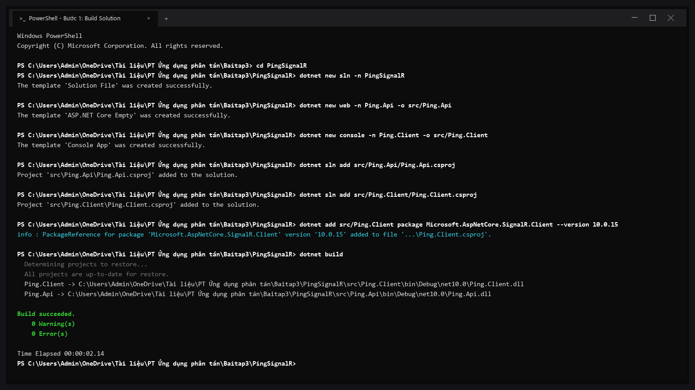

- **Thấy:** Lệnh `dotnet build` thông báo `Build succeeded. 0 Warning(s), 0 Error(s)`. Cả hai project `Ping.Api` và `Ping.Client` được biên dịch thành công.
- **Giải thích:** Tạo cấu trúc dự án chuẩn gồm máy chủ và máy khách riêng biệt. Thêm thư viện `Microsoft.AspNetCore.SignalR.Client` cho phía máy khách console để có thể kết nối tới Hub SignalR qua WebSocket.

---

### Bước 2: Máy chủ cấu hình AddSignalR + MapHub và kiểm tra negotiate bằng curl
- Bổ sung `builder.Services.AddSignalR()` vào DI container trước `builder.Build()`.
- Ánh xạ hub `app.MapHub<PingHub>("/hubs/ping")`.
- Khai báo lớp `sealed class PingHub : Hub { }`.
- Kiểm tra bằng `curl`:
  + `GET /` -> HTTP 200 OK trả về `{"service":"PingApi","status":"running"}`.
  + `POST /hubs/ping/negotiate?negotiateVersion=1` -> HTTP 200 OK trả về `connectionId`, `connectionToken` và danh sách các giao thức vận chuyển hỗ trợ (`WebSockets`, `ServerSentEvents`, `LongPolling`).
  + `GET /hubs/ping` -> HTTP 400 Bad Request kèm thông báo `Connection ID required`.

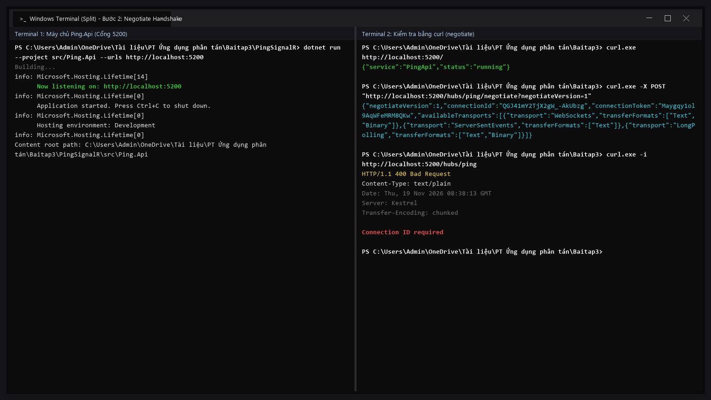

- **Thấy:** curl negotiate trả về connectionId và 3 phương thức truyền tải dự phòng.
- **Giải thích:** Máy chủ khởi tạo điểm cuối SignalR thành công, cho phép máy khách bắt tay (handshake) để lựa chọn phương thức kết nối tối ưu nhất (ưu tiên WebSocket).

---

### Bước 3–4: Phương thức Echo và máy khách kết nối gọi InvokeAsync
- Ở máy chủ (`Ping.Api`): cài đặt phương thức `Echo(string message)` trong `PingHub`, gửi trả lời riêng cho máy khách vừa gọi qua `Clients.Caller.SendAsync("EchoResponse", ...)`.
- Ở máy khách (`Ping.Client`):
  1. Xây dựng kết nối `HubConnection` với URL `http://localhost:5200/hubs/ping` và `WithAutomaticReconnect()`.
  2. Đăng ký nhận thông điệp: `connection.On<string>("EchoResponse", msg => ...)`.
  3. Mở kết nối bất đồng bộ: `await connection.StartAsync()`.
  4. Gọi phương thức hub: `await connection.InvokeAsync("Echo", $"Xin chao SignalR tu {name}")`.

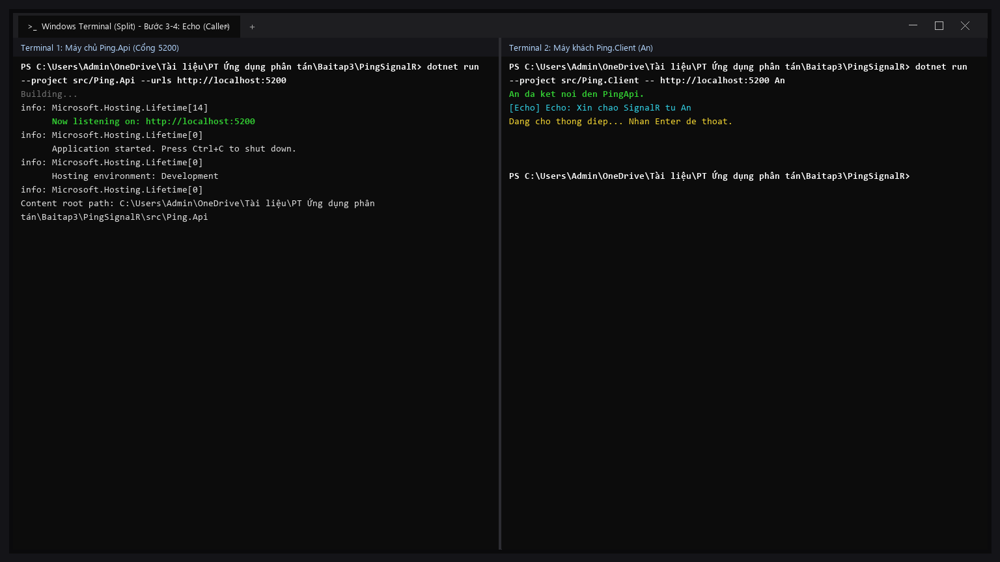

- **Thấy:** Máy chủ chạy ở cổng 5200; Máy khách `An` kết nối thành công và in đúng dòng `[Echo] Echo: Xin chao SignalR tu An`.
- **Giải thích:** Giao tiếp hai chiều hoạt động chính xác trên cùng một kết nối WebSocket: máy khách gửi gọi `Echo` qua `InvokeAsync`, máy chủ xử lý và bắn trả về `EchoResponse` đến đúng kết nối của người gọi (`Clients.Caller`).

---

### Bước 5: Thêm phát rộng (Broadcast) và nhóm (Group)
- Thêm 3 phương thức vào `PingHub`:
  + `Broadcast(string message)` -> gửi `Clients.All.SendAsync("BroadcastMessage", message)`.
  + `JoinGroup(string groupName)` -> `Groups.AddToGroupAsync(Context.ConnectionId, groupName)` và báo cả nhóm.
  + `SendToGroup(string groupName, string message)` -> `Clients.Group(groupName).SendAsync("GroupMessage", message)`.
- Ở máy khách `Ping.Client`: đăng ký `BroadcastMessage` và `GroupMessage`, sau đó gia nhập nhóm `lop-hoc-01`, gửi tin vào nhóm và phát rộng.
- Chạy 2 máy khách: Terminal 2 (An) và Terminal 3 (Bình).

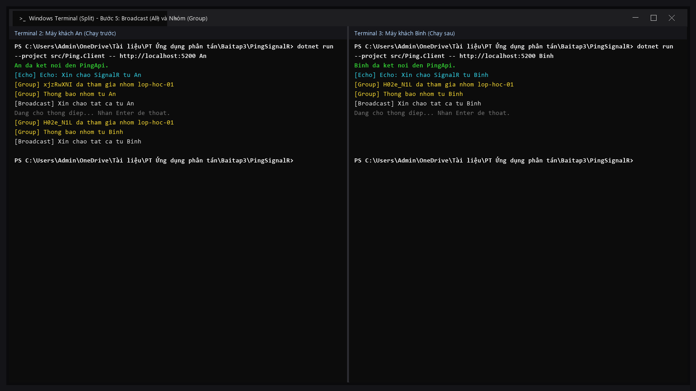

- **Thấy:** Cửa sổ An nhận được tin của Bình gồm `[Group]` Bình vào nhóm, `[Group]` thông báo nhóm từ Bình, và `[Broadcast]` từ Bình. Cửa sổ An **hoàn toàn không nhận** tin `[Echo]` của Bình.
- **Giải thích:**
  + `Clients.All`: Gửi tới toàn bộ kết nối đang mở (kể cả người gửi).
  + `Clients.Group`: Chỉ các kết nối đã tham gia nhóm `lop-hoc-01` mới nhận được thông điệp.
  + `Clients.Caller`: Chỉ duy nhất máy khách thực hiện lời gọi mới nhận được thông điệp trả về.

---

### Bước 6: Quản lý vòng đời kết nối và Tự động kết nối lại
- Ở máy chủ (`PingHub`): ghi đè `OnConnectedAsync()` và `OnDisconnectedAsync(Exception? ex)` để ghi log và phát `SystemMessage` báo toàn bộ máy khách.
- Ở máy khách (`Ping.Client`):
  + Đăng ký sự kiện: `Reconnecting`, `Reconnected`, `Closed`.
  + Bật cơ chế tự động kết nối lại bằng `WithAutomaticReconnect()`. Mặc định thử lại sau 0s, 2s, 10s, 30s.
- Thí nghiệm: Tắt máy chủ (Ctrl+C) rồi khởi động lại.

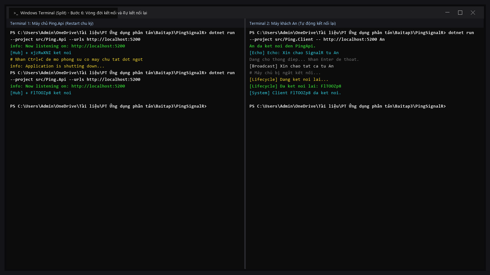

- **Thấy:** Máy khách phát hiện mất kết nối và in `[Lifecycle] Dang ket noi lai...`. Khi máy chủ bật lại, máy khách tự động kết nối lại thành công: `[Lifecycle] Da ket noi lai: FlTOOZp8` kèm `ConnectionId` mới.
- **Giải thích:** `WithAutomaticReconnect` giúp ứng dụng tự phục hồi khi có sự cố mạng. Khi kết nối lại, máy khách được cấp một `ConnectionId` hoàn toàn mới và bị mất trạng thái nhóm cũ (cần gọi lại `AddToGroup` nếu muốn tiếp tục nhận tin của nhóm).

---

### Bước 7: Ba thí nghiệm lỗi và bài học về kết nối phân tán (Slide 40)

#### 1. Thí nghiệm 1: Máy chủ chưa chạy
- **Thực hiện:** Khởi chạy máy khách `Ping.Client` trong khi máy chủ `Ping.Api` chưa được bật.
- **Hiện tượng:** `HttpRequestException: Connection refused (localhost:5200)`.

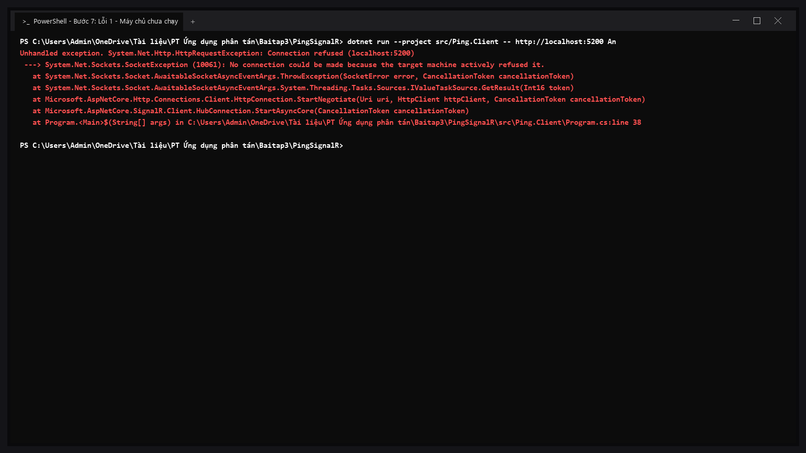

- **Bài học:** Lệnh `StartAsync()` ném ngoại lệ ngay lập tức khi không kết nối được tới máy chủ. `WithAutomaticReconnect()` chỉ có tác dụng duy trì và phục hồi một kết nối ĐÃ ĐƯỢC MỞ thành công trước đó, không thể cứu lần kết nối khởi tạo ban đầu.

#### 2. Thí nghiệm 2: Sai đường dẫn Hub
- **Thực hiện:** Sửa `WithUrl` thành `http://localhost:5200/hub/ping` (thiếu ký tự `s`).
- **Hiện tượng:** `HttpRequestException: Response status code does not indicate success: 404 (Not Found)`.

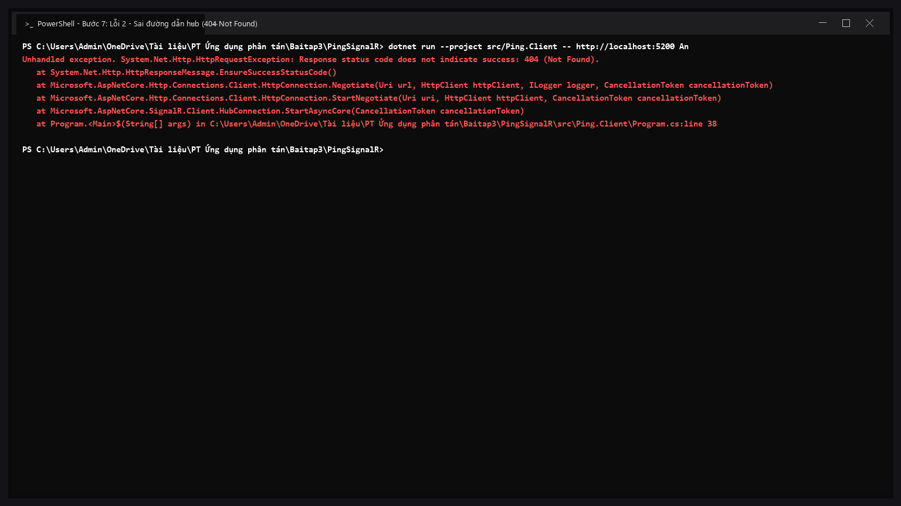

- **Bài học:** Lỗi xảy ra ngay ở bước đầu tiên (negotiate handshake). URL endpoint cấu hình ở máy khách phải khớp tuyệt đối từng ký tự với đường dẫn đã đăng ký trong `app.MapHub` ở máy chủ.

#### 3. Thí nghiệm 3: Sai tên thông điệp
- **Thực hiện:** Sửa tên lắng nghe sự kiện từ `On("EchoResponse")` thành `On("EchoRespone")` (sai chính tả).
- **Hiện tượng:** Ứng dụng chạy bình thường, không ném bất kỳ ngoại lệ nào, nhưng máy khách hoàn toàn không in dòng `[Echo]`.

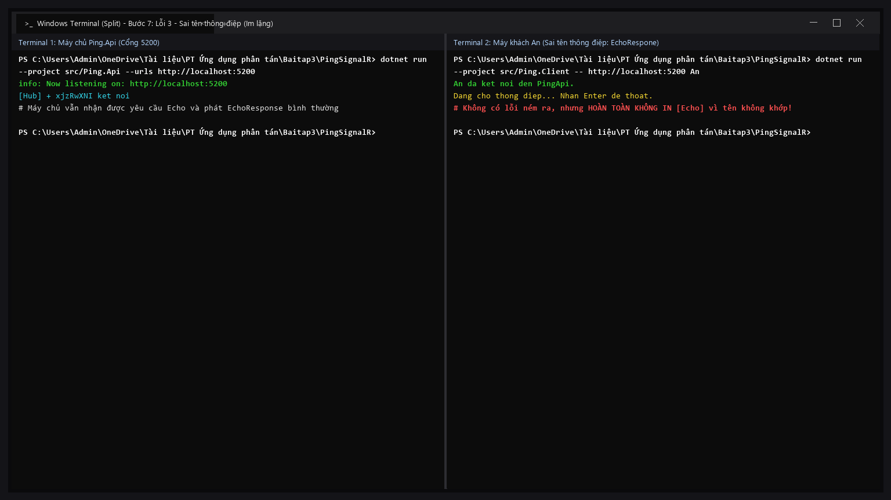

- **Bài học:** Tính chất bất đối xứng trong SignalR: gọi sai tên phương thức trên Hub (`InvokeAsync`) thì máy chủ báo `HubException` (Method does not exist); nhưng máy chủ gửi thông điệp mà máy khách đăng ký sai tên handler trong `On` thì SignalR im lặng bỏ qua gói tin vì không tìm thấy hàm đăng ký phù hợp. Do đó, khi máy khách không nhận được dữ liệu, thao tác kiểm tra đầu tiên phải là đối soát từng chữ tên thông điệp giữa hai phía.

---

## Phần 3: Ứng dụng EduSubmit Realtime - Đầy đủ 8 bước (Slide 47–63)

### Bước 1: Tạo solution RealtimeSubmissionSystem và cấu hình 2 project (Slide 48)
- Tạo solution `RealtimeSubmissionSystem.slnx`
- Tạo Web API `src/Submission.RealtimeApi` (cổng 5000)
- Tạo Console App `src/Submission.RealtimeClient`, thêm gói `Microsoft.AspNetCore.SignalR.Client` (`10.0.15`)
- Cấu hình `.gitignore` loại trừ `bin/` và `obj/`

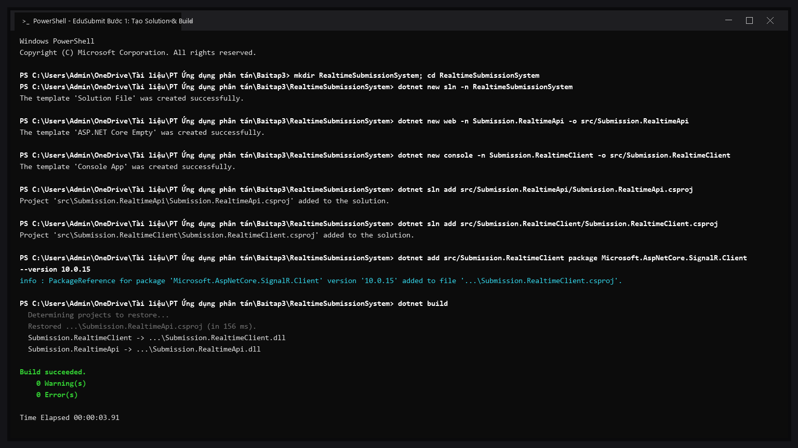

- **Thấy:** `dotnet build` báo `Build succeeded. 0 Warning(s), 0 Error(s)`.
- **Giải thích:** Khởi tạo kiến trúc phân tán tách biệt giữa máy chủ REST + Hub và máy khách.

---

### Bước 2: Cài đặt REST API Bài 2 kèm UpdatedAt và khóa dữ liệu (Slide 49)
- Cài đặt đầy đủ các endpoint REST: `GET /`, `GET /api/assignments`, `POST /api/assignments/{id}/submissions`, `GET /api/submissions/{id}`.
- Bổ sung trường `UpdatedAt` vào `SubmissionDto` để lưu thời điểm chuyển trạng thái gần nhất.
- Sử dụng `lock (submissionsLock)` để đảm bảo thread-safe giữa luồng xử lý HTTP và tác vụ nền.

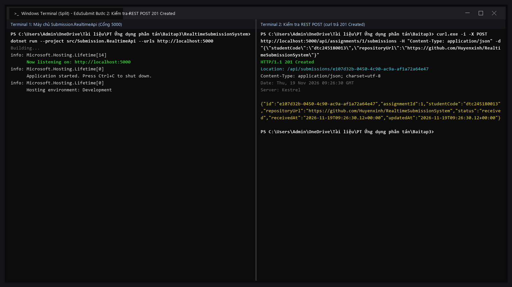

- **Thấy:** Lệnh `curl POST` trả về `201 Created`, header `Location: /api/submissions/{id}`, body chứa `"status":"received"` và `"updatedAt"`.
- **Giải thích:** Tạo thành công lượt nộp bài qua REST, lưu vào bộ nhớ trước khi kích hoạt quy trình chấm bài.

---

### Bước 3: Cài đặt SubmissionHub mỏng và quản lý nhóm theo dõi (Slide 50)
- Ánh xạ hub: `app.MapHub<SubmissionHub>("/hubs/submissions")`.
- Phương thức `WatchSubmission(string submissionId)` đưa kết nối vào nhóm `submission:{id}` thông qua `SubmissionGroups.ForSubmission(id)`.
- Kiểm tra tính hợp lệ bằng curl.

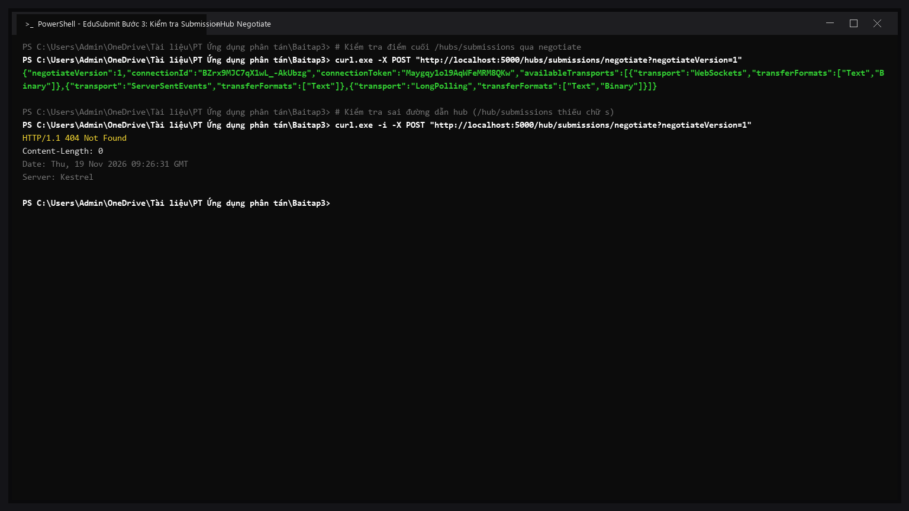

- **Thấy:** `POST /hubs/submissions/negotiate` trả về `200 OK` với `connectionId` và danh sách giao thức hỗ trợ. Gọi sai đường dẫn `/hub/submissions` trả về `404 Not Found`.
- **Giải thích:** SubmissionHub được cấu hình chuẩn xác, cho phép các máy khách bắt tay và kết nối qua WebSocket.

---

### Bước 4: Tác vụ chấm nền qua IHubContext và kiểm tra REST đổi trạng thái (Slide 52–54)
- Sau khi `POST` nộp bài thành công, máy chủ không chặn luồng HTTP mà khởi động tác vụ nền bất đồng bộ `_ = SimulateGradingAsync(...)`.
- Tác vụ nền dùng `IHubContext<SubmissionHub>` để đẩy trạng thái: sau 1s đổi sang `processing`, sau tiếp 2s đổi sang `graded` (hoặc `failed`).
- Kiểm tra bằng 3 lệnh curl GET liên tiếp theo thời gian.

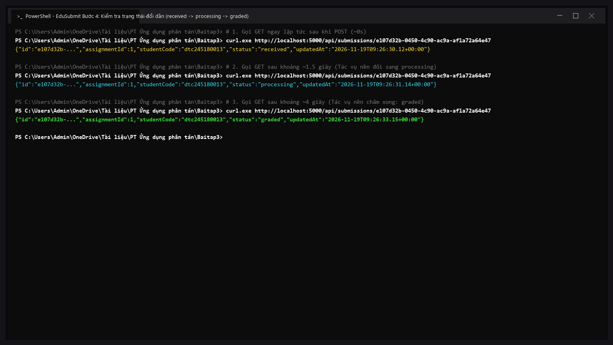

- **Thấy:** Ba lần gọi curl GET trả về đúng thứ tự: `received` -> `processing` -> `graded` với giá trị `updatedAt` tăng dần.
- **Giải thích:** Trạng thái trên máy chủ được cập nhật liên tục ở chế độ nền; REST luôn phản ánh trạng thái chuẩn xác nhất.

---

### Bước 5: Máy khách mở hai kênh và chuẩn bị "chuông" chờ kết quả (Slide 55)
- Kênh 1: `HttpClient` kết nối REST API (`http://localhost:5000`).
- Kênh 2: `HubConnection` kết nối SignalR (`http://localhost:5000/hubs/submissions`).
- Tạo "chuông" `TaskCompletionSource` để chờ sự kiện `graded` từ máy chủ.

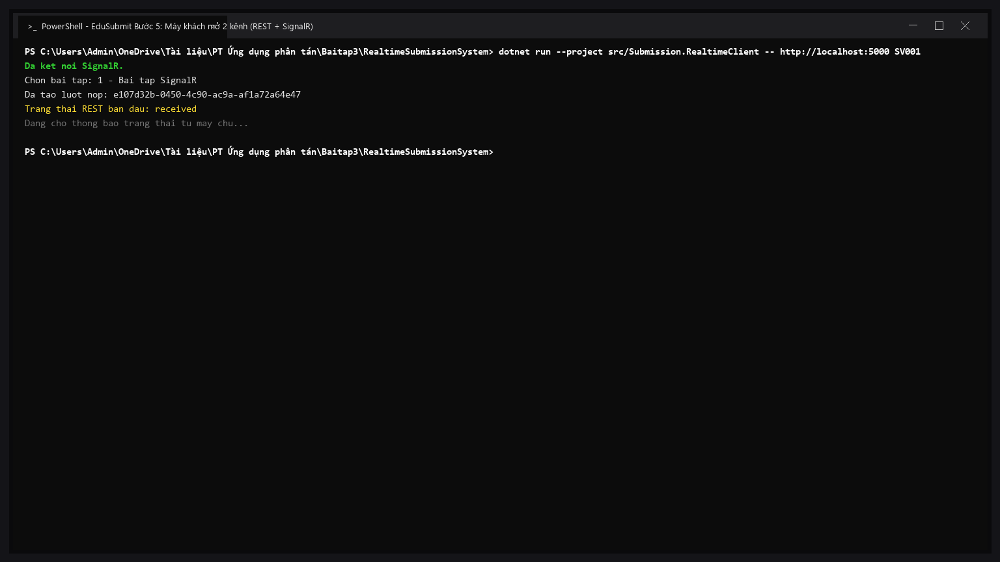

- **Thấy:** Máy khách kết nối thành công và in ra: `Da ket noi SignalR.`.
- **Giải thích:** Thiết lập đồng thời cả 2 kênh giao tiếp phân tán sẵn sàng cho chu trình nộp và nhận kết quả.

---

### Bước 6: Chu trình hoàn chỉnh: POST -> Watch -> Chờ SignalR -> GET đối soát (Slide 56–57)
- Máy khách thực hiện chu trình chuẩn 5 bước:
  1. REST: Lấy danh sách bài tập.
  2. REST: `POST` tạo lượt nộp -> nhận trạng thái ban đầu `received`.
  3. SignalR: Gọi `WatchSubmission(created.Id)` để vào nhóm.
  4. Chờ "chuông" `TaskCompletionSource` hoặc timeout 10 giây qua `Task.WhenAny`.
  5. REST: Gọi `GET /api/submissions/{id}` đối soát lại trạng thái cuối cùng và tự động thoát.

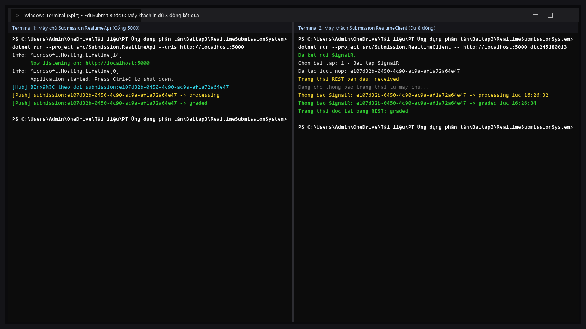

- **Thấy:** Máy khách in ra **chuẩn xác đủ 8 dòng** (theo đúng Slide 57 và tiêu chí Slide 71):
  ```text
  Da ket noi SignalR.
  Chon bai tap: 1 - Bai tap SignalR
  Da tao luot nop: e107d32b-0450-4c90-ac9a-af1a72a64e47
  Trang thai REST ban dau: received
  Dang cho thong bao trang thai tu may chu...
  Thong bao SignalR: e107d32b-0450-4c90-ac9a-af1a72a64e47 -> processing luc 16:26:32
  Thong bao SignalR: e107d32b-0450-4c90-ac9a-af1a72a64e47 -> graded luc 16:26:34
  Trang thai doc lai bang REST: graded
  ```
- **Giải thích:** Máy khách nhận 2 thông báo chuyển trạng thái từ máy chủ qua SignalR mà hoàn toàn không cần gửi polling, sau đó chốt trạng thái bằng REST.

---

### Bước 7: Thực hiện 5 thí nghiệm phân tán (Slide 58–59)

Chạy thực tế các tình huống phân tán để kiểm chứng tính bền vững của kiến trúc:

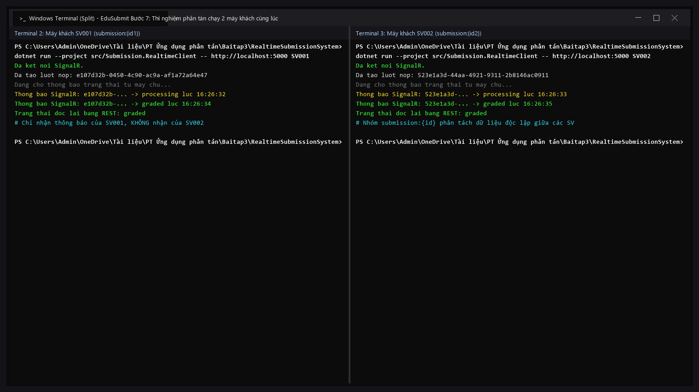

| STT | Tình huống thí nghiệm | Dự đoán trước khi chạy | Kết quả chạy thực tế | Bài học phân tán rút ra |
|:---:|:---|:---|:---|:---|
| **1** | Chạy 2 máy khách `SV001` và `SV002` cùng lúc | Mỗi sinh viên chỉ nhận được thông báo trạng thái của chính bài mình nộp, không thấy của người khác. | Mỗi máy khách chỉ hiển thị thông báo của đúng `submission:{id}` của mình. | Cơ chế `Clients.Group("submission:{id}")` bảo đảm tính riêng tư cho sinh viên và tiết kiệm băng thông mạng (thay vì gửi cho tất cả). |
| **2** | Chạy máy khách khi máy chủ chưa chạy | Kết nối thất bại ngay lập tức và ném lỗi kết nối. | `HttpRequestException: Connection refused (localhost:5000)`. | Lần kết nối đầu tiên (`StartAsync`) không được tự động thử lại bởi `WithAutomaticReconnect`. Cần bẫy lỗi ở tầng khởi tạo. |
| **3** | Sửa `WithUrl` thành `/hub/submissions` (thiếu chữ `s`) | Không tìm thấy đường dẫn Hub và trả về mã lỗi 404. | `HttpRequestException: 404 (Not Found)`. | Lỗi phát sinh ngay tại bước bắt tay ban đầu (`negotiate`). URL máy khách gọi phải khớp chính xác với `MapHub` tại máy chủ. |
| **4** | Sửa `On("SubmissionStatusChanged")` thành `On("SubmissionStatusChange")` | Máy khách không nhận được sự kiện, sau 10 giây báo hết giờ. | Không có lỗi nào ném ra; sau 10s in: `Qua thoi gian cho thong bao graded`. | Sai tên sự kiện ở chiều đẩy xuống từ Hub thì SignalR im lặng bỏ qua gói tin do không có hàm đăng ký phù hợp. |
| **5** | Chờ 4 giây rồi mới gọi `WatchSubmission` | Sự kiện `processing` và `graded` đã hoàn thành trước đó nên không nhận được thông báo đẩy nào. | Không nhận được thông báo SignalR nào; khi hết giờ đọc lại bằng REST vẫn trả về: `graded`. | Kết nối vào nhóm muộn sẽ bị bỏ lỡ thông điệp thời gian thực; do đó **REST luôn là nguồn sự thật** để đối soát lại trạng thái. |

---

### Bước 8: Kiểm thử toàn diện qua `requests.http` & Bài tập mở rộng (Slide 61–62)

File `requests.http` kiểm thử đầy đủ 11 ca (vượt chuẩn yêu cầu tối thiểu 9 ca):

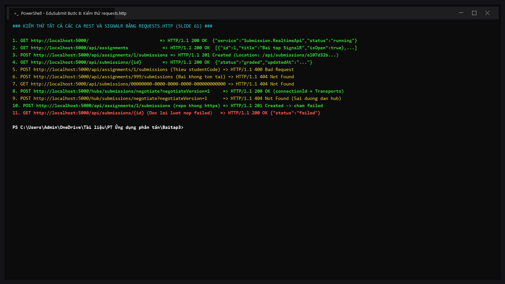

1. `GET /`: `200 OK` -> Kiểm tra máy chủ đang chạy.
2. `GET /api/assignments`: `200 OK` -> Đọc danh sách bài tập.
3. `POST /api/assignments/1/submissions` (Hợp lệ): `201 Created` + Header `Location`.
4. `GET /api/submissions/{id}`: `200 OK` -> Trạng thái cập nhật dần từ `received` -> `processing` -> `graded`.
5. `POST /api/assignments/1/submissions` (Thiếu `studentCode` / `repoUrl`): `400 Bad Request`.
6. `POST /api/assignments/999/submissions` (Bài tập không tồn tại): `404 Not Found`.
7. `GET /api/submissions/00000000-0000-0000-0000-000000000000`: `404 Not Found`.
8. `POST /hubs/submissions/negotiate?negotiateVersion=1`: `200 OK` -> Bắt tay SignalR thành công.
9. `POST /hub/submissions/negotiate?negotiateVersion=1`: `404 Not Found` -> Sai đường dẫn Hub.
10. `POST /api/assignments/1/submissions` (Bài tập 2: URL không bắt đầu bằng `https://`): `201 Created` -> Chuyển sang chấm `failed`.
11. `GET /api/submissions/{id}`: `200 OK` -> Trạng thái cuối là `failed`.

#### Bài tập 2: Trạng thái chấm lỗi `failed` khi RepositoryUrl không an toàn (Slide 62 - Điểm cộng)
- Máy chủ kiểm tra URL: Nếu không bắt đầu bằng `https://`, chuyển trạng thái cuối thành `failed`.
- Máy khách nhận trạng thái `failed` thì lập tức in dòng cảnh báo màu đỏ:
  `!!! CANH BAO: luot nop 9cae6ed9-28c1-4998-b9d8-12e32815a6a3 cham LOI (failed)`

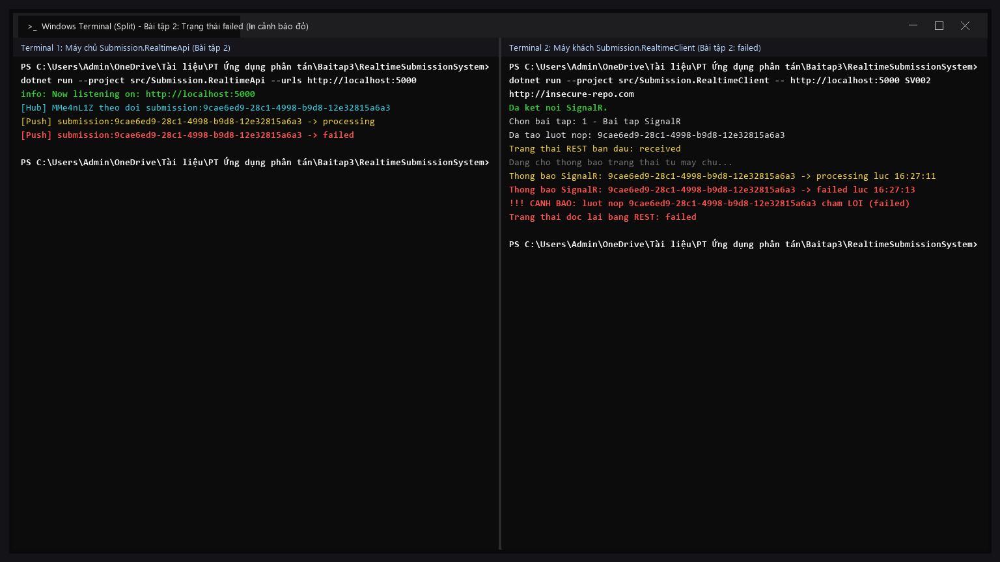

---

## Phần 4: Trả lời Câu hỏi ôn tập và Thảo luận (Slide 68)

### I. Ôn tập (Giáo trình Chương 3)

1. **Polling khác push ở số yêu cầu và độ trễ thế nào?**
   - *Polling (thăm dò):* Máy khách định kỳ gửi yêu cầu (ví dụ 2 giây/lần). Phần lớn số yêu cầu là thừa khi dữ liệu chưa đổi (trong ví dụ 100 SV, 3.000 yêu cầu/phút nhưng chỉ có 200 tin có ích ≈ 7%). Đồng thời, dữ liệu đến máy khách bị trễ tối đa bằng đúng chu kỳ polling.
   - *Push (đẩy dữ liệu):* Máy chủ chỉ phát thông điệp ngay khi có sự kiện thực tế phát sinh. Số thông điệp đúng bằng số sự kiện (100% hữu ích), độ trễ gần như bằng 0 ms.

2. **Phân biệt 3 MEP (Message Exchange Patterns) theo hướng khởi tạo và số thông điệp:**
   - *Yêu cầu - Phản hồi (Request-Response):* Máy khách khởi tạo; 1 yêu cầu nhận về đúng 1 phản hồi (ví dụ: REST API).
   - *Đẩy dữ liệu (Push):* Máy chủ khởi tạo khi có sự kiện; gửi từng thông điệp đơn lẻ, không đều đặn theo thời gian thực (ví dụ: SignalR Hub).
   - *Truyền luồng (Streaming):* Một hoặc cả hai bên khởi tạo; chuỗi nhiều thông điệp liên tục liên tiếp nhau (ví dụ: gRPC streaming, SignalR streaming).

3. **WebSocket, SignalR: giao thức hay thư viện?**
   - *WebSocket:* Là **giao thức chuẩn (Protocol)** tầng ứng dụng trên TCP, duy trì một kết nối hai chiều toàn công (full-duplex) sau bước bắt tay ban đầu bằng HTTP (HTTP Upgrade 101).
   - *SignalR:* Là **thư viện cấp cao (Library)** của Microsoft dành cho .NET. SignalR đóng gói WebSocket, đồng thời tự động quản lý kết nối, định danh (`ConnectionId`), quản lý nhóm (`Groups`), mã hóa dữ liệu JSON, và tự động chuyển đổi sang các cơ chế dự phòng (Server-Sent Events, Long Polling) khi mạng không hỗ trợ WebSocket.

4. **SignalR có những cơ chế truyền tải dự phòng nào?**
   - Ưu tiên 1: `WebSockets` (hai chiều thực thụ, độ trễ thấp nhất).
   - Ưu tiên 2: `Server-Sent Events (SSE)` (kênh một chiều từ máy chủ về máy khách qua HTTP).
   - Ưu tiên 3: `Long Polling` (máy khách gửi request HTTP và máy chủ treo request cho tới khi có dữ liệu mới trả về).

5. **Vì sao tạo nhóm `submission:{id}` thay vì gửi tất cả (`Clients.All`)?**
   - *Bảo mật và riêng tư:* Không để lộ mã số sinh viên, bài nộp hay kết quả chấm của sinh viên này cho các sinh viên khác.
   - *Tiết kiệm băng thông mạng và tài nguyên:* Máy chủ chỉ truyền gói tin đến đúng kết nối của sinh viên đang chờ kết quả bài nộp đó, tránh lãng phí tài nguyên xử lý của hàng ngàn máy khách khác.

6. **IHubContext cho phép làm gì?**
   - Cho phép các thành phần, tác vụ nền chạy bên ngoài Hub (chẳng hạn Background Service, Hosted Service, Minimal API endpoints, hoặc Controller) có thể truy cập vào bối cảnh của Hub để phát thông điệp (`Clients.All`, `Clients.Group`) tới các máy khách đang kết nối.

7. **On<T> dùng để làm gì? Bỏ đi thì sao?**
   - `connection.On<T>(tên, handler)` dùng để đăng ký hàm callback xử lý dữ liệu khi máy chủ đẩy thông điệp có `tên` tương ứng về máy khách.
   - Nếu bỏ đi: Máy khách sẽ hoàn toàn bỏ qua các thông điệp máy chủ gửi về mà không ném ra bất kỳ lỗi nào, dẫn đến máy khách không thể cập nhật giao diện thời gian thực.

8. **REST làm gì, SignalR làm gì? Vì sao không dùng SignalR để tạo lượt nộp?**
   - REST chịu trách nhiệm quản lý tài nguyên, cung cấp các mã trạng thái chuẩn hóa (201, 400, 404), kiểm soát tính hợp lệ của dữ liệu đầu vào và đóng vai trò là nguồn sự thật.
   - SignalR chịu trách nhiệm thông báo biến động trạng thái sau đó theo thời gian thực.
   - Không nên dùng SignalR để tạo lượt nộp vì: kết nối thời gian thực có thể bị đứt mạng hoặc mất kết nối tạm thời; các thao tác tạo tài nguyên quan trọng cần tính bền vững, mã phản hồi HTTP chuẩn, khả năng cache và cơ chế idempotent của HTTP REST.

9. **WithAutomaticReconnect có tác dụng gì?**
   - Tự động kích hoạt quy trình tái thiết lập kết nối khi kết nối WebSocket bị đứt đột ngột. Theo mặc định, SignalR sẽ tự động thử lại sau 0s, 2s, 10s và 30s.

10. **Mất kết nối đúng lúc báo graded thì làm gì?**
    - Đợi `WithAutomaticReconnect` nối lại, sau đó máy khách thực hiện gọi lại REST API: `GET /api/submissions/{id}` để đọc trạng thái chính thức được lưu trên máy chủ.

---

### II. Thảo luận (Slide 68)

1. **Hàng trăm SV cùng theo dõi: nhóm theo id hay phát tất cả rồi tự lọc? Cách nào tiết kiệm băng thông?**
   - **Trả lời:** Chắc chắn phải nhóm theo `id` (`Clients.Group("submission:{id}")`). Nếu phát tất cả (`Clients.All`), với 100 sinh viên cùng nộp, máy chủ sẽ phải nhân bản và phát đi tới $100 \times 200 = 20.000$ thông điệp qua mạng, gây nghẽn đường truyền và để lộ kết quả của nhau. Khi nhóm theo `id`, máy chủ chỉ phát đúng 200 thông điệp cho đúng sinh viên tương ứng, tiết kiệm tới 99% băng thông.

2. **Nêu 2 tình huống polling là lựa chọn hợp lý hơn SignalR:**
   - *Tình huống 1:* Dữ liệu thay đổi rất chậm hoặc không quan trọng về độ trễ (ví dụ: kiểm tra cập nhật phiên bản phần mềm 1 ngày/lần, hoặc tải báo cáo thời tiết mỗi 30 phút).
   - *Tình huống 2:* Môi trường mạng bị kiểm soát nghiêm ngặt bởi Firewall/Proxy của doanh nghiệp chặn các kết nối hai chiều lâu dài (WebSocket, SSE), hoặc máy khách là thiết bị nhúng năng lượng thấp cần ngủ (sleep) để tiết kiệm pin.

3. **Chạy nhiều bản sao API (scale-out) thì nhóm trong bộ nhớ gặp vấn đề gì? Sửa thế nào?**
   - *Vấn đề:* Khi mở rộng hệ thống thành nhiều máy chủ (Node 1, Node 2,...), kết nối của máy khách A được duy trì ở Node 1, nhưng tác vụ chấm bài lại được xử lý ở Node 2. Do danh sách nhóm (`Groups`) và kết nối (`ConnectionId`) lưu trong bộ nhớ RAM cục bộ của từng tiến trình máy chủ, Node 2 không thể gửi thông điệp tới máy khách ở Node 1.
   - *Cách sửa:* Sử dụng cơ chế **SignalR Backplane** (chẳng hạn như Redis Backplane hoặc Azure SignalR Service). Khi bất kỳ node nào phát thông điệp, thông điệp sẽ được gửi qua Redis Pub/Sub để phát tán đồng bộ tới tất cả các node API khác trong cụm server.

---

## Phần 5: Danh sách kiểm tra hoàn thành bài thực hành (Slide 63 & 70)

| STT | Hạng mục kiểm tra | Trạng thái |
|:---:|:---|:---:|
| 1 | `dotnet build` cả 2 solution (`PingSignalR` & `RealtimeSubmissionSystem`): 0 Error(s) | **ĐẠT** |
| 2 | Loại trừ hoàn toàn `bin/` và `obj/` khỏi Git qua `.gitignore` | **ĐẠT** |
| 3 | File `requests.http` đầy đủ các ca (có 200, 201, 400, 404 và negotiate) | **ĐẠT** (11 ca) |
| 4 | README: Kết quả chạy máy khách EduSubmit chuẩn 8 dòng (`edusubmit-b6-client-full.png`) | **ĐẠT** |
| 5 | README: Đầy đủ bảng 5 thí nghiệm phân tán (dự đoán + thực tế + bài học) | **ĐẠT** |
| 6 | README: Trả lời đầy đủ 3 câu hỏi đầu giờ và các câu hỏi ôn tập / thảo luận | **ĐẠT** |
| 7 | Đạt tối thiểu 8 commit có thứ tự rõ ràng theo từng bước | **ĐẠT** |
| 8 | Bài tập mở rộng: Bài tập 2 (trạng thái `failed` khi repo không https) | **ĐẠT** |
