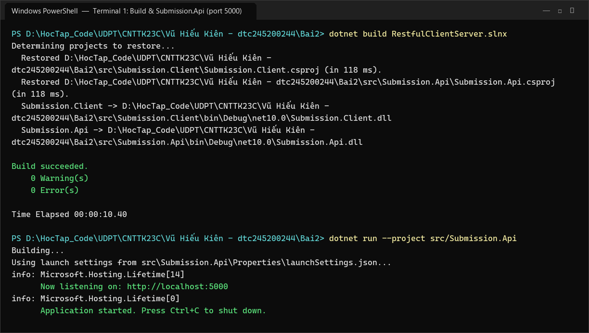
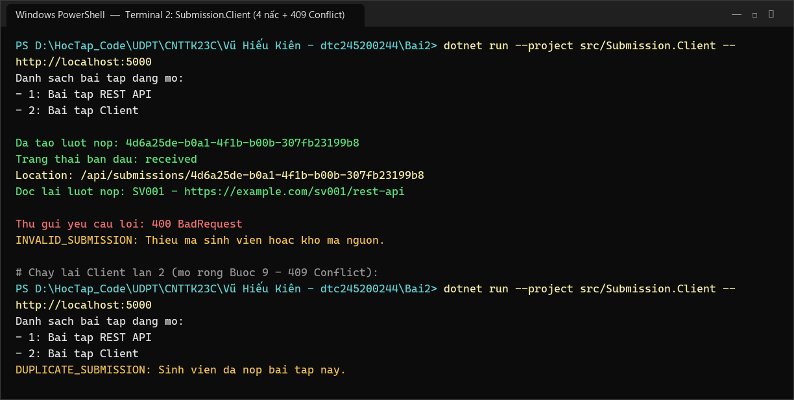
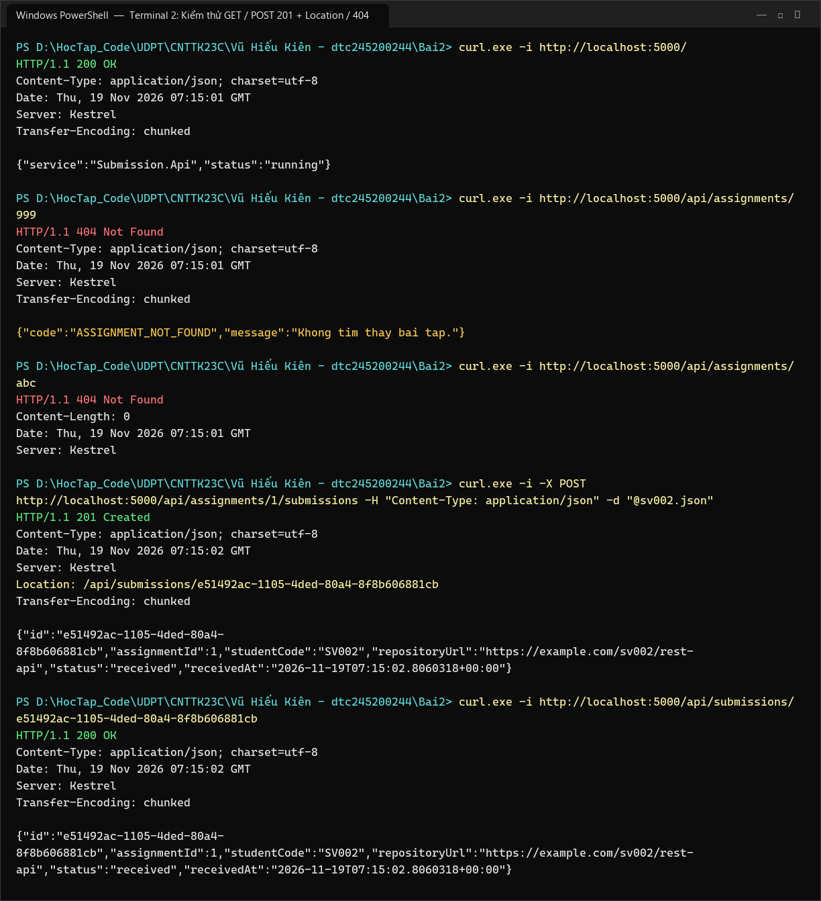
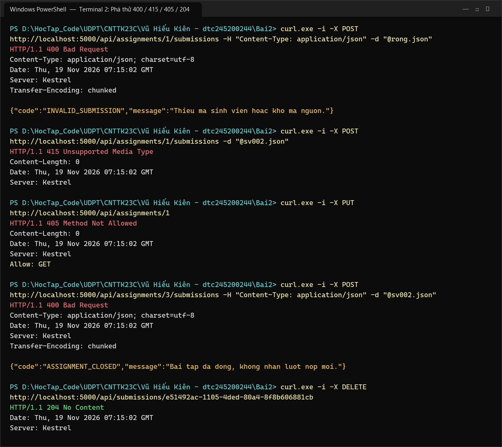
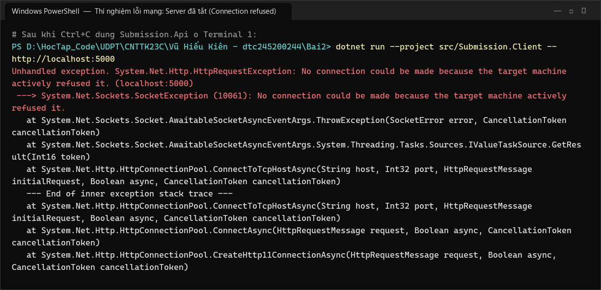

# Bài 2 – EduSubmit: RESTful API cho tương tác Client–Server

- **Họ và tên:** Vũ Hiếu Kiên
- **Mã sinh viên:** `dtc245200244`
- **Lớp:** CNTT K23C
- **Học phần:** Phát triển ứng dụng phân tán
- **Môi trường:** Windows 11 | .NET SDK `10.0.201` | ASP.NET Core Minimal API (Kestrel)

---

## 1. Cấu trúc thư mục `Bai2/`

```text
Bai2/
├── .gitignore                        # Bỏ qua bin/, obj/
├── RestfulClientServer.slnx          # Solution gồm Submission.Api và Submission.Client
├── README.md                         # Nhật ký thực hành, ảnh kết quả, bảng phá thử & trả lời 3 câu hỏi
├── requests.http                     # Bộ 14 kịch bản REST Client (200, 201, 204, 400, 404, 409, 415)
├── sv001.json                        # Body JSON mẫu hợp lệ
├── rong.json                         # Body JSON mẫu rỗng để kiểm thử 400 INVALID_SUBMISSION
├── images/                           # Ảnh kết quả chạy thực tế
│   ├── 01-build-and-api-server.png
│   ├── 02-client-4-steps.png
│   ├── 03-curl-200-201-404.png
│   ├── 04-curl-negative-tests.png
│   └── 05-chaos-connection-refused.png
└── src/
    ├── Submission.Api/               # Máy chủ RESTful API (cổng 5000)
    │   ├── Program.cs
    │   ├── Submission.Api.csproj
    │   └── Properties/launchSettings.json
    └── Submission.Client/            # Máy khách Console HttpClient (chuỗi 4 nấc)
        ├── Program.cs
        └── Submission.Client.csproj
```

---

## 2. Hợp đồng API (API Contract) & 3 cổng kiểm tra

| Phương thức | URI | Thành công | Lỗi có thể gặp (`ApiError { code, message }`) |
| :--- | :--- | :--- | :--- |
| `GET` | `/` | `200 OK` + `{service, status}` | – |
| `GET` | `/api/assignments` | `200 OK` + mảng JSON bài tập | – |
| `GET` | `/api/assignments/{assignmentId:int}` | `200 OK` + chi tiết bài tập | `404 ASSIGNMENT_NOT_FOUND` (hoặc `404` rỗng nếu sai kiểu `:int`) |
| `POST` | `/api/assignments/{assignmentId:int}/submissions` | `201 Created` + `Location` + `SubmissionDto` | `404 ASSIGNMENT_NOT_FOUND` · `400 ASSIGNMENT_CLOSED` · `400 INVALID_SUBMISSION` · `409 DUPLICATE_SUBMISSION` · `415` |
| `GET` | `/api/submissions/{submissionId:guid}` | `200 OK` + chi tiết lượt nộp | `404 SUBMISSION_NOT_FOUND` |
| `DELETE` *(mở rộng Bước 9)* | `/api/submissions/{submissionId:guid}` | `204 No Content` (không body) | `404 SUBMISSION_NOT_FOUND` |

Thứ tự **3 cổng kiểm tra** trong handler `POST /api/assignments/{assignmentId:int}/submissions`:
1. **Cổng 1 (Tài nguyên cha tồn tại?):** Không tìm thấy bài tập $\rightarrow$ `404 Not Found` (`ASSIGNMENT_NOT_FOUND`).
2. **Cổng 2 (Quy tắc nghiệp vụ — bài tập còn mở?):** `IsOpen == false` $\rightarrow$ `400 Bad Request` (`ASSIGNMENT_CLOSED`).
3. **Cổng 3 (Dữ liệu đầu vào hợp lệ?):** Thiếu `StudentCode` hoặc `RepositoryUrl` $\rightarrow$ `400 Bad Request` (`INVALID_SUBMISSION`).
4. **Mở rộng Bước 9 (Xung đột dữ liệu?):** Sinh viên đã nộp bài tập này $\rightarrow$ `409 Conflict` (`DUPLICATE_SUBMISSION`). Nếu hợp lệ hết $\rightarrow$ Server tự sinh `Id` (`Guid.NewGuid()`), `Status = "received"`, `ReceivedAt = DateTimeOffset.UtcNow` và trả `201 Created` kèm header `Location`.

---

## 3. Lệnh đã chạy và Ảnh kết quả thực tế

### 3.1. Biên dịch solution và Khởi động máy chủ API (Terminal 1 — cổng 5000)

```powershell
dotnet build RestfulClientServer.slnx
# Build succeeded. 0 Warning(s), 0 Error(s)

dotnet run --project src/Submission.Api --urls http://localhost:5000
# Now listening on: http://localhost:5000
```



### 3.2. Chạy máy khách `Submission.Client` đủ 4 nấc (Terminal 2)

```powershell
# Lần 1: Liệt kê -> Nộp bài (201) -> Đọc lại theo Location (200) -> Gửi sai (400 + ApiError, không sập)
dotnet run --project src/Submission.Client -- http://localhost:5000

# Lần 2 (khi server vẫn giữ SV001 ở RAM): Kiểm tra mở rộng 409 Conflict (DUPLICATE_SUBMISSION)
dotnet run --project src/Submission.Client -- http://localhost:5000
```

Kết quả thực tế quan sát được:
```text
Danh sach bai tap dang mo:
- 1: Bai tap REST API
- 2: Bai tap Client

Da tao luot nop: 4d6a25de-b0a1-4f1b-b00b-307fb23199b8
Trang thai ban dau: received
Location: /api/submissions/4d6a25de-b0a1-4f1b-b00b-307fb23199b8
Doc lai luot nop: SV001 - https://example.com/sv001/rest-api

Thu gui yeu cau loi: 400 BadRequest
INVALID_SUBMISSION: Thieu ma sinh vien hoac kho ma nguon.
```



### 3.3. Kiểm thử từng endpoint bằng `curl.exe -i` (GET / POST 201 + Location / 404)

```powershell
curl.exe -i http://localhost:5000/
curl.exe -i http://localhost:5000/api/assignments
curl.exe -i http://localhost:5000/api/assignments/1
curl.exe -i http://localhost:5000/api/assignments/999
curl.exe -i http://localhost:5000/api/assignments/abc
curl.exe -i -X POST http://localhost:5000/api/assignments/1/submissions -H "Content-Type: application/json" -d "@sv001.json"
curl.exe -i http://localhost:5000/api/submissions/<guid>
```



### 3.4. Kiểm thử các ca lỗi & mở rộng (`400`, `415`, `405`, `204`)

```powershell
curl.exe -i -X POST http://localhost:5000/api/assignments/1/submissions -H "Content-Type: application/json" -d "@rong.json"
curl.exe -i -X POST http://localhost:5000/api/assignments/1/submissions -d "@sv001.json"
curl.exe -i -X PUT http://localhost:5000/api/assignments/1
curl.exe -i -X POST http://localhost:5000/api/assignments/3/submissions -H "Content-Type: application/json" -d "@sv001.json"
curl.exe -i -X DELETE http://localhost:5000/api/submissions/<guid>
```



### 3.5. Thí nghiệm tắt máy chủ API rồi chạy máy khách (`Connection refused`)



---

## 4. Bảng phá thử (Ca thử, Mong đợi, Thực tế)

### 4.1. Tám ca kiểm thử Bước 5 (`5a` – `5h`) và Mở rộng Bước 9 (`9c` – `9g`)

| Ca | Yêu cầu thử nghiệm | Mã mong đợi | Kết quả thực tế | Ai trả lời? | Giải thích nguyên nhân |
| :-: | :--- | :-: | :--- | :-: | :--- |
| **5a** | `POST /api/assignments/1/submissions` với `sv001.json` | `201` | `201 Created` + Header `Location: /api/submissions/{guid}` + `SubmissionDto` | **Handler** | Dữ liệu qua đủ 3 cổng kiểm tra; Server tự sinh `Guid`, gán `Status = "received"`, `ReceivedAt` và trả kèm đường dẫn đọc lại. |
| **5b** | `POST /api/assignments/1/submissions` với `rong.json` (`studentCode=""`, `repositoryUrl=""`) | `400` | `400 Bad Request` + `{"code":"INVALID_SUBMISSION","message":"Thieu ma sinh vien hoac kho ma nguon."}` | **Handler** | Cổng kiểm tra 3 phát hiện dữ liệu đầu vào rỗng nên trả về lỗi `ApiError` thống nhất. |
| **5c** | `POST /api/assignments/999/submissions` với payload hợp lệ | `404` | `404 Not Found` + `{"code":"ASSIGNMENT_NOT_FOUND","message":"Khong tim thay bai tap."}` | **Handler** | Cổng kiểm tra 1 phát hiện tài nguyên cha (bài tập `999`) không tồn tại. |
| **5d** | Bỏ header `Content-Type: application/json` khi `POST` | `415` | `415 Unsupported Media Type` (`Content-Length: 0`, không có `ApiError`) | **Framework** | ASP.NET Core từ chối trước khi vào handler vì không xác định được kiểu nội dung request body. |
| **5e** | Gửi JSON sai cú pháp (`{"studentCode":"SV002",`) | `400` | `400 Bad Request` (`BadHttpRequestException` văn bản, không có `ApiError`) | **Framework** | Bộ phân tích JSON (`System.Text.Json`) báo lỗi cú pháp trước khi gọi hàm handler. |
| **5f** | Gửi JSON thiếu trường `repositoryUrl` (`{"studentCode":"SV002"}`) | `400` | `400 Bad Request` + `{"code":"INVALID_SUBMISSION","message":"Thieu ma sinh vien hoac kho ma nguon."}` | **Handler** | Thiếu trường khiến `RepositoryUrl` không hợp lệ và bị cổng kiểm tra 3 trong handler chặn lại. |
| **5g** | `PUT /api/assignments/1` | `405` | `405 Method Not Allowed` (`Content-Length: 0`, Header `Allow: GET`) | **Framework** | URI `/api/assignments/1` chỉ đăng ký `MapGet`, không đăng ký `MapPut`. |
| **5h** | `POST /api/assignments/3/submissions` (bài tập 3 có `IsOpen = false`) | `400` | `400 Bad Request` + `{"code":"ASSIGNMENT_CLOSED","message":"Bai tap da dong, khong nhan luot nop moi."}` | **Handler** | Cổng kiểm tra 2 phát hiện bài tập đã đóng dù mã bài tập có tồn tại và body hợp lệ. |
| **9c** | `POST /api/assignments/1/submissions` trùng `(assignmentId, studentCode)` đã nộp | `409` | `409 Conflict` + `{"code":"DUPLICATE_SUBMISSION","message":"Sinh vien da nop bai tap nay."}` | **Handler** | Hợp đồng đúng định dạng nhưng xung đột với lượt nộp đã tồn tại trong danh sách `submissions`. |
| **9d–9e** | `DELETE /api/submissions/{id}` lần 1 và gọi lại `DELETE` lần 2 | `204` $\rightarrow$ `404` | Lần 1: `204 No Content`; Lần 2: `404 Not Found` (`SUBMISSION_NOT_FOUND`) | **Handler** | Xóa thành công trả `204` không body; xóa lại lần nữa không còn phần tử nên trả `404`. |

### 4.2. Bốn thí nghiệm về tính chất hệ phân tán (`4c`, `7a`, `7b`, `6c`)

| # | Thí nghiệm | Kết quả mong đợi | Kết quả thực tế quan sát | Bài học về hệ phân tán |
| :-: | :--- | :--- | :--- | :--- |
| **1 (`4c` vs `4b`)** | Gọi `GET /api/assignments/abc` so với `/api/assignments/999` | `/abc`: `404` rỗng; `/999`: `404 + ApiError` | `/abc` trả `404 Content-Length: 0` (Framework do ràng buộc `{assignmentId:int}`); `/999` trả `404 + ASSIGNMENT_NOT_FOUND` (Handler). | Client không được giả định mọi `404` đều có JSON `ApiError`; luôn kiểm tra `StatusCode` trước. |
| **2 (`7a`)** | Tắt `Submission.Api` (`Ctrl+C`) rồi chạy `Submission.Client` | Ngoại lệ mất kết nối | `HttpRequestException: No connection could be made because the target machine actively refused it. (localhost:5000)` | Trong hệ phân tán, tiến trình phía bên kia mạng có thể vắng mặt bất kỳ lúc nào (khác gọi hàm nội bộ). |
| **3 (`7b`)** | Chạy `Submission.Client -- http://localhost:5999` (sai cổng) | Ngoại lệ mất kết nối | `HttpRequestException: Connection refused (localhost:5999)` | Hai tiến trình độc lập chỉ giao tiếp được khi thống nhất địa chỉ kết nối (host + port cấu hình). |
| **4 (`6c`)** | Khởi động lại API rồi `GET /api/submissions/{id_cũ}` | `404 SUBMISSION_NOT_FOUND` | Trả `404 Not Found` kèm `{"code":"SUBMISSION_NOT_FOUND",...}` | Dữ liệu trong `List<SubmissionDto>` nằm trên RAM của tiến trình API nên mất khi API dừng. |

---

## 5. Trả lời 3 câu hỏi giải thích (Slide 90 & 116)

### Câu 1: Vì sao URI dùng danh từ, còn hành động do phương thức HTTP đảm nhận?

- **Trả lời chính:** Trong kiến trúc REST, **URI dùng để định danh tài nguyên (danh từ)** mà hệ thống quản lý, còn **phương thức HTTP (động từ)** quy định thao tác chuẩn tác động lên tài nguyên đó (`GET` để đọc, `POST` để tạo mới, `DELETE` để xóa).
- **Ví dụ cụ thể từ code đã viết (`src/Submission.Api/Program.cs`):**
  - Tài nguyên bài tập và tài nguyên con lượt nộp dùng URI danh từ: `/api/assignments`, `/api/assignments/{assignmentId:int}`, `/api/assignments/{assignmentId:int}/submissions`, `/api/submissions/{submissionId:guid}`.
  - Thay vì viết URI chứa động từ như `/submitAssignment` hay `/getSubmissionById`, ta gắn `app.MapGet("/api/assignments", ...)` để đọc danh sách, `app.MapPost("/api/assignments/{assignmentId:int}/submissions", ...)` để tạo lượt nộp mới, và `app.MapDelete("/api/submissions/{submissionId:guid}", ...)` để xóa.
  - Cùng một URI `/api/assignments/1`, gửi `GET` thì được `200 OK`, còn gửi `PUT` (ca `5g`) bị framework từ chối bằng `405 Method Not Allowed` kèm `Allow: GET` — chứng tỏ **phương thức HTTP mới là động từ điều khiển hành vi**, giúp giao diện API nhất quán, tự giải thích được và tận dụng được ngữ nghĩa chuẩn (safe / idempotent) của HTTP.

### Câu 2: "Stateless" thể hiện ở đâu trong code đã viết?

- **Trả lời chính:** **Stateless (phi trạng thái)** nghĩa là máy chủ **không lưu trữ trạng thái phiên hội thoại (session)** của từng máy khách giữa hai lần gọi liên tiếp; mỗi yêu cầu HTTP gửi lên phải **tự mang theo đầy đủ mọi thông tin cần thiết** để máy chủ hiểu và xử lý độc lập.
- **Ví dụ cụ thể từ code đã viết:**
  - Trong `POST /api/assignments/{assignmentId:int}/submissions`: máy khách (`src/Submission.Client/Program.cs`) không gọi bước "chọn bài tập lưu vào phiên", mà gửi đầy đủ `assignmentId` ngay trên URI (`/api/assignments/1/submissions`) cùng `studentCode` và `repositoryUrl` ngay trong body JSON (`CreateSubmissionRequest`).
  - Trong `GET /api/submissions/{submissionId:guid}`: máy khách dùng chính địa chỉ đầy đủ trong header `Location` (`/api/submissions/{guid}`) để tra cứu, chứ không hỏi server "cho xem lượt nộp vừa nãy của tôi".
  - Trên máy chủ (`src/Submission.Api/Program.cs`), các handler là các lambda độc lập không đọc `HttpContext.Session` hay ghi nhớ "máy khách nào vừa gọi API trước đó". Dữ liệu `submissions` lưu trong bộ nhớ là **trạng thái của tài nguyên nghiệp vụ**, không phải trạng thái phiên của client.

### Câu 3: Vì sao Client và Server mỗi bên khai báo DTO riêng mà vẫn khớp nhau?

- **Trả lời chính:** Vì **DTO là hợp đồng dữ liệu JSON (Data Contract)** truyền qua mạng HTTP ở biên hệ thống, **không phải kiểu/lớp C# chia sẻ chung trong bộ nhớ**; hai tiến trình khớp nhau nhờ **tên trường và kiểu dữ liệu tương thích trong JSON**, không cần tham chiếu project của nhau.
- **Ví dụ cụ thể từ code đã viết:**
  - `Submission.Client.csproj` không hề có `<ProjectReference>` tới `Submission.Api.csproj`. Cả `src/Submission.Api/Program.cs` và `src/Submission.Client/Program.cs` đều tự định nghĩa bản sao riêng của `record AssignmentDto(...)`, `record CreateSubmissionRequest(...)`, `record SubmissionDto(...)`, `record ApiError(string Code, string Message)`.
  - Khi giao tiếp qua HTTP, Server tuần tự hóa (serialize) `SubmissionDto` thành chuỗi JSON camelCase (`{"id":"...","assignmentId":1,"studentCode":"SV001","repositoryUrl":"...","status":"received","receivedAt":"..."}`) và Client dùng `ReadFromJsonAsync<SubmissionDto>()` (mặc định không phân biệt hoa thường tên thuộc tính theo `JsonSerializerDefaults.Web`) để giải tuần tự hóa (deserialize) vào `record SubmissionDto` của riêng mình.
  - Nhờ đó hai bên có thể biên dịch độc lập, nâng cấp logic nội bộ hoặc thậm chí viết bằng hai ngôn ngữ lập trình khác nhau mà vẫn làm việc chung chỉ cần giữ đúng **hợp đồng JSON** (tên trường + kiểu dữ liệu).
